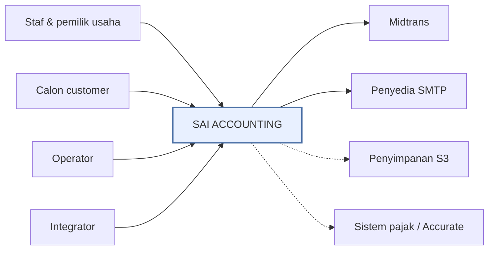
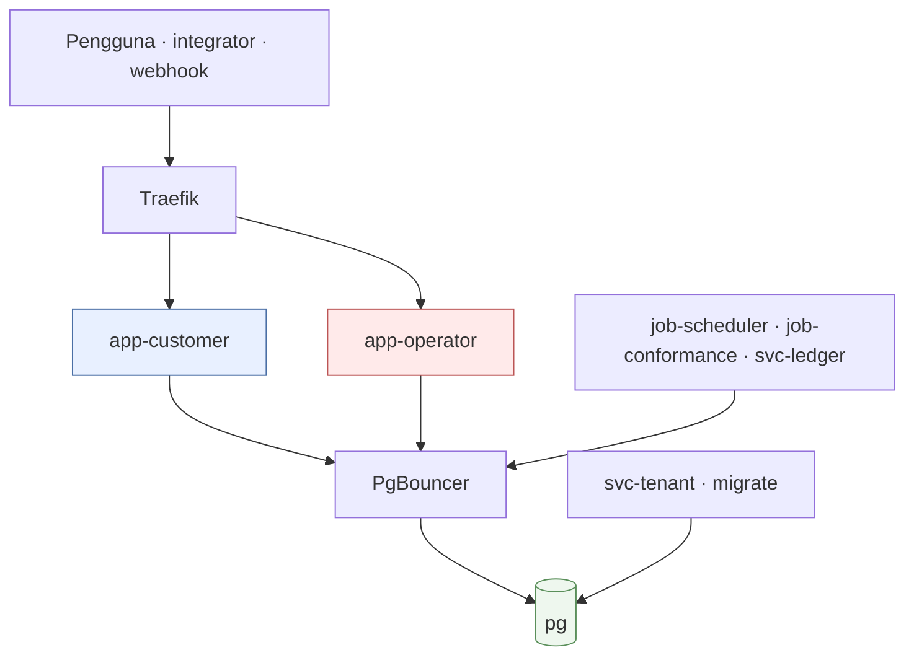
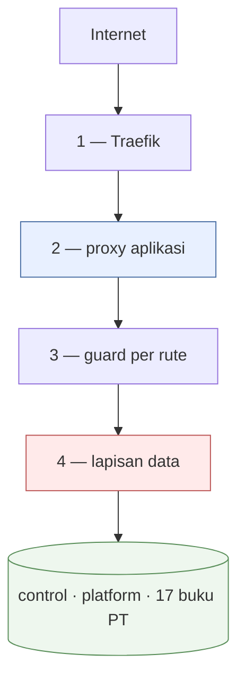
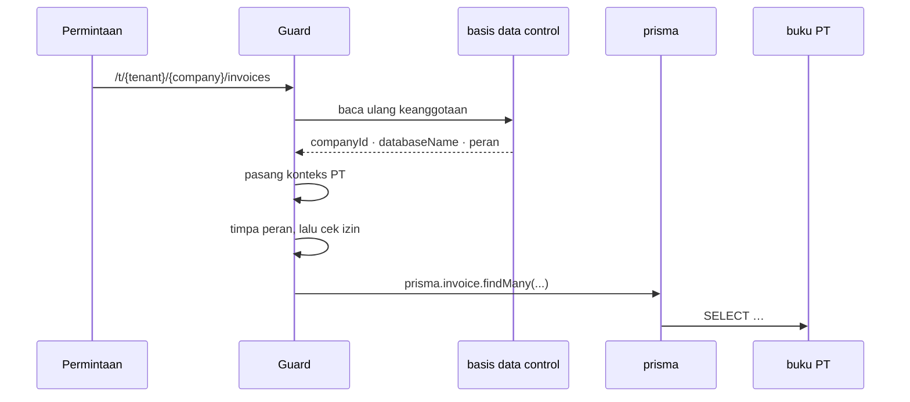

# 01 — Arsitektur

> 20 Okt 2026 · produksi `main@ca0cd038` · [indeks](./README.md)

## 1. Produk

Aplikasi akuntansi berbahasa Indonesia, dijual sebagai langganan SaaS ke usaha
kecil–menengah. Prinsipnya *simple surface, standard engine*: staf mengisi
formulir yang tidak menyebut "debit" dan "kredit", mesin posting
(`src/lib/posting/`) menerjemahkannya jadi jurnal berpasangan ganda yang
seimbang.

| Permukaan | Host | Kode | Untuk siapa |
|---|---|---|---|
| Pemasaran | `APP_DOMAIN` (`/`, `/pricing`, `/status`) | `src/app/(marketing)` | Calon customer, crawler |
| Aplikasi customer | `APP_DOMAIN` (`/t/{tenant}/{company}/…`) | `src/app/(app)` | Staf & pemilik usaha |
| Konsol operator | `OPERATOR_DOMAIN` (rute di akar) | `apps/operator` | Penyedia layanan |

Dua aplikasi Next.js, dua image, satu monorepo. Plane ditentukan **host saja**
(`packages/core/src/operator-plane.ts`); tanpa `OPERATOR_HOST`, konsol 404 di
host mana pun. Cookie berlingkup host, jadi sesi customer yang bocor tidak
menjangkau konsol.

## 2. Tenant ≠ Perusahaan

Menentukan ke basis data mana sebuah baris ditulis.

| | Tenant | Perusahaan (PT) |
|---|---|---|
| Artinya | Satu customer yang berlangganan | Satu buku besar |
| Punya | Paket, tagihan, kuota | Jurnal, faktur, stok, aset |
| Datanya di | `sai_control` + `sai_platform` | Basis data sendiri, `sai_<slug>` |
| Jumlah | 1 tenant → banyak PT | — |

Rinciannya: [`MULTI-TENANT.md`](../MULTI-TENANT.md) ·
[`MULTI-COMPANY.md`](../MULTI-COMPANY.md).

## 3. Bentuk sistem

### 3.1 Konteks



| Pihak | Hubungannya |
|---|---|
| Staf & pemilik usaha | Membukukan di `APP_DOMAIN` |
| Calon customer | Pemasaran & pendaftaran; termasuk crawler |
| Operator | Konsol di `OPERATOR_DOMAIN` |
| Integrator | `/api/v1` hanya-baca, token Bearer |
| Midtrans | Dua arah: permintaan bayar keluar, webhook masuk |
| Penyedia SMTP | Faktur, undangan, atur-ulang sandi, peringatan |
| Penyimpanan S3 | Tujuan backup — garis putus-putus: **belum disetel** |
| Sistem pajak / Accurate | **Tanpa panggilan jaringan**; berkas diunggah manusia |

Sengaja tidak ada: antrean pesan, cache bersama, identitas luar, CDN,
pemantauan luar.

### 3.2 Container



| Simpul | Isinya |
|---|---|
| Traefik | Terminasi TLS; memilih aplikasi dari header `Host` |
| `app-*` | Dua aplikasi Next, dua image. **Tidak saling memanggil lewat HTTP** |
| `job-*` | Loop shell yang tidur; dua langkahnya kini hanya MENERBITKAN ke antrean |
| `svc-*` | Pelari jalur yang menguras tabel `jobs` — `ledger` (Node), `tenant` (Go) |
| `svc-tenant` · `migrate` | Langsung ke `pg`, melewati pooler: keduanya mencacah/menyentuh SETIAP basis data, dan pooler hanya mengekspos yang terdaftar di konfigurasinya |
| `pg` | PostgreSQL 17: `control` + `platform` + 17 buku PT |

## 4. Pola

| Dipakai | Di mana | Kenapa |
|---|---|---|
| Monolit modular | 2 aplikasi + 5 paket | Satu VM dibagi 6 aplikasi; mikrolayanan menambah overhead tanpa manfaat |
| Database-per-tenant | 17 basis data PT | Isolasi **fisik** buku besar |
| Shared-database | `control`, `platform` | Identitas & penagihan memang lintas-tenant |
| Ambient context | `AsyncLocalStorage` + penyimpan per-permintaan | 120 berkas `import { prisma }` tak perlu ubah tanda tangan |
| Proxy klien DB | `lib/prisma.ts`, `control-db`, `platform-db` | Klien diselesaikan saat kueri, bukan saat modul dimuat |
| Pool klien LRU | `lib/company-clients.ts` | `max_connections` terbatas; 17 klien permanen = kehabisan koneksi |
| Izin terpusat | `@sai/core/authz` + `authz-effective.ts` | Halaman & API pasangannya tidak menyimpang diam-diam |
| Mesin posting terpusat | `lib/posting/` | Satu pintu; guard tak bisa dilewati route baru |
| Snapshot lintas-DB | platform → control | Hot path tidak menyentuh basis data penagihan |
| Pekerja loop-tidur | 3 job | Tanpa antrean, tanpa daemon cron |

| Sengaja TIDAK ada | Konsekuensi yang diterima |
|---|---|
| Antrean pesan | Pekerjaan latar berurutan tiap jam; tanpa *retry* per-pekerjaan |
| Cache bersama | Cache hanya di memori proses; hilang saat restart |
| HTTP antar-layanan | Kedua aplikasi hanya berbagi basis data |
| Tailwind / `className` | Dicabut #203 — gaya sebaris + token |
| Tipe diperiksa di `next build` | `bun run typecheck` satu-satunya gate tipe |
| Penskalaan horizontal | Satu container `app-customer`; cache per-proses |

## 5. Empat batas keamanan



| Batas | Penegak | Sifat gagal |
|---|---|---|
| 1 — TLS | Traefik, label compose | HTTP → 301; `www.` → apex |
| 2 — plane & sesi | `src/proxy.ts` · `apps/operator/src/proxy.ts` · `operator-plane` | `OPERATOR_HOST` kosong = konsol 404 di mana pun |
| 3 — izin | `page-auth.ts` · `auth-guard.ts` · `api-token-guard.ts` | Halaman → pantul; API → 403. Dijaga `tests/authz-coverage` |
| 4 — perusahaan | `company-context.ts` · `current-company.ts` | `MissingCompanyContextError` — melempar, tidak menebak |
| 4 — buku besar | `lib/posting/index.ts` · `lib/ledger.ts` | Periode tertutup / belum disetujui = ditolak |

Batas 2 bukan otorisasi: proxy hanya memutuskan plane dan perlu-sesi. Untuk
`/api/v1/*` proxy **melepaskan** jalurnya — tanpa itu proxy menjawab 401
sebelum `requireApiToken` berjalan, dan itu terjadi di produksi sampai 16 Agu
2026.

## 6. Tiga lapis basis data

| Lapis | Basis data | Isi utama | Klien |
|---|---|---|---|
| Platform | `sai_platform` (1) | Paket, langganan, tagihan platform, pembayaran, jejak job, isi situs | `@sai/db/client/platform` |
| Control | `sai_control` (1) | Pengguna, tenant, perusahaan, keanggotaan, undangan, token API | `@sai/db/client/control` |
| Buku PT | `sai_<slug>` (17) | Seluruh buku besar | `@sai/db/client/company` |

Control menunjuk ke buku PT lewat `companies.database_name` — menunjuk, bukan
FK — dan menyalin status & kuota tenant dari platform sebagai snapshot.

**Enam aturan yang menjaga pemisahannya:**

1. **Tidak ada FK menyeberangi basis data.** Buku PT tidak ber-FK ke `users`; pakai id global + `lib/users-directory.ts`.
2. **Kredensial tidak pernah dari basis data.** `database_name` hanya nama, disaring `/^[A-Za-z0-9_]{1,64}$/`; host/user/sandi selalu dari environment.
3. **Urutan tulis: platform dulu, control belakangan.** Dibalik berarti control menjanjikan kuota yang belum ada.
4. **Tidak ada angka akuntansi di control/platform.**
5. **Cache tingkat modul berkunci** `companyId`/`tenantId` (`@sai/core/tenant-cache`).
6. **`platform-db.ts` dilarang dari hot path** — guard, sesi, proxy, `operator-plane`.

**Dua aturan yang tidak boleh dilanggar:**

- **Konteks perusahaan hilang → melempar**, tidak pernah jatuh ke basis data bawaan. Jatuh ke bawaan berarti transaksi PT A tertulis ke buku PT B tanpa error dan tanpa jejak. Penegaknya `requireCompanyContext()`, dijaga `tests/company-context.test.ts`.
- **Penagihan mati ≠ aplikasi mati (#137).** `sai_platform` tak terjangkau tidak boleh mematikan login atau buku besar.

## 7. "Perusahaan mana ini?"



| Langkah | Yang perlu diketahui |
|---|---|
| Baca ulang keanggotaan | Dari control **pada permintaan ini**, bukan dari JWT |
| Jawaban control | Slug tak ada, PT nonaktif, bukan anggota, tenant lain → **404 yang sama persis** |
| Pasang konteks | `setRouteCompany`, dikunci pada hasil `await headers()` lewat `WeakMap` |
| Timpa peran | JWT membawa peran di PT terakhir yang dibuka |
| Kueri | Klien dari pool LRU, maksimum 4 |

Dua sumber konteks (`lib/current-company.ts`): `AsyncLocalStorage` lewat
`runWithCompany()` untuk skrip/cron/tes, dan penyimpan per-permintaan untuk
HTTP. Keduanya kosong → melempar. Tidak ada sumber ketiga.

**Tiga jebakan yang sudah ditutup:**

| Jebakan | Keadaan sekarang |
|---|---|
| `cache()` React tidak per-permintaan di route handler (#333) — `holder() === holder()` bernilai `false`, hanya route handler yang 500 | Penyimpan dikunci pada hasil `await headers()` + `WeakMap` |
| `enterWith` tidak merambat setelah `await`; konteks ALS terukur `null` di badan route | Permintaan HTTP bertumpu pada penyimpan per-permintaan |
| `companyId` di JWT (#158) membuat route lupa-lingkup tetap bekerja dengan PT terakhir | Lupa membawa perusahaan kini menghasilkan error |

`prisma.$transaction([a, b])` bentuk array tidak bisa lewat Proxy; seluruh 84
pemanggilan di repo memakai bentuk callback.

## 8. Otorisasi

```
Matriks BAWAAN       → Override PERAN             → Override PENGGUNA        → Modul USAHA     → Entitlement     → Matriks EFEKTIF
@sai/core/authz         role_permission_overrides    user_permission_overrides   11 modul          lisensi/paket     canEffective()
66 izin × 4 peran       dikelola di /permissions                                 company_settings  @sai/core/entitlement
```

**Entitlement: satu pintu, dua sumber.** Tiga lapis menjawab tiga pertanyaan
yang berbeda, dan menyatukannya akan membuat jawaban yang salah terbaca benar:

| Lapis | Pertanyaannya | Sumber |
|---|---|---|
| Lisensi / paket | "dibeli?" | `plan_key` (SaaS) **atau** berkas lisensi (on-premise) |
| Modul usaha | "dipakai perusahaan ini?" | pengaturan per perusahaan |
| Izin peran | "boleh oleh orang ini?" | matriks efektif |

Diiris di **satu titik** — sumber himpunan modul aktif di
`src/lib/authz-effective.ts` — sehingga setiap penjaga yang sudah ada (halaman,
route, menu, Aksi Cepat) ikut menegakkannya tanpa satu baris diubah. Lapis yang
dipasang di 50 tempat adalah lapis yang bocor di tempat ke-51. Jalur SaaS keluar
lebih awal dan meneruskan nilai mentah apa adanya, jadi perilakunya **terbukti
tidak berubah**.

⚠ **Lisensi hanya MENYEMPITKAN.** Ia berarti "boleh dipakai", bukan "menyala":
modul opt-in tetap harus dipilih perusahaan, dan lisensi yang menyalakan modul
yang tidak dipilih siapa pun akan menghidupkan manufaktur di buku yang tidak
memakainya.

Penegaknya `requirePagePermission` (halaman), `requireApiPermission` (API
sesi), `requireApiToken` (API v1); tampilan memakai `can(...)`. Ketiganya
menanyai matriks **efektif**.

Dilarang: membandingkan string peran atau menulis daftar peran di luar matriks.
`tests/authz-coverage.test.ts` menolak halaman/route tanpa deklarasi izin.

Matriks kedua untuk lapis tenant (`lib/tenant-authz.ts`): 6 izin × 3 peran
(`owner`, `admin`, `member`); `member` hanya memegang `tenant.home`.

| Kalimat ke pengguna | Sebabnya | Sumbernya |
|---|---|---|
| "Anda tidak punya akses" | Peran | matriks izin |
| "Fitur belum aktif untuk perusahaan Anda" | Modul usaha | `company_settings` |
| "Buku ini terkunci" | Kunci buku | otentikasi ulang |

**Modul tidak pernah menggerbangi buku besar.** PT yang mematikan modul
`trading` tetap memiliki jurnalnya, dan laporan tetap rekonsiliasi.
`lib/reports.ts`, `lib/ledger.ts`, `lib/posting/*` dilarang mengimpor
`business-modules.ts`; dijaga `tests/business-modules-ledger.test.ts`.

## 9. Mesin posting — satu pintu

Setiap dokumen sumber masuk lewat `postForSource()` di `lib/posting/index.ts`
dan melewati empat gate:

| Gate | Isi |
|---|---|
| Idempoten | Sumber yang sudah punya jurnal hidup tidak diposting dua kali |
| Persetujuan (#25) | Belum disetujui = tidak masuk jurnal |
| Kunci periode (#13) | Periode tertutup = ditolak |
| Berimbang | Σ debit = Σ kredit, kalau tidak → rollback |

Penyusun barisnya murni dan terpisah: `rules.ts` (baris per jenis dokumen),
`mapping.ts` (`MAPPING_KEYS` → `account_mappings`), `rates.ts`, `cogs.ts`.

Jurnal **imutabel**: koreksi lewat `reverseJournal()`. Posting **atomik**: `tx`
dioper, commit/rollback bersama tulisan sumbernya.

Dua aturan valas yang mudah salah:

- Penyelesaian meringankan piutang/utang pada **kurs dokumennya sendiri**; selisihnya ke `fx_gain_loss` (#23).
- Akun yang diringankan mengikuti **mata uang dokumen**: faktur USD yang dilunasi transfer IDR tetap membersihkan piutang USD (#43).

Gate persetujuan dan periode ada di sini, bukan di route, karena setiap jalur
yang mengubah dokumen jadi jurnal melewati `postForSource`/`repostForSource`.

**Pintunya tetap tunggal sesudah antrean masuk**, dan itu yang menentukan bentuk
pekerjaan latar: jalur `ledger` (`svc-ledger`) adalah **satu-satunya** layanan
latar yang menulis buku besar, dan handler-nya **mendelegasikan** ke mesin yang
sama (`src/lib/recurring-run.ts` → `postForSource`). Enam jalur lain membaca
buku, menulis tabel `jobs`, dan menghasilkan berkas — tidak pernah `INSERT`/
`UPDATE` ke tabel buku. Kontraknya menolaknya sebelum kode lahir: `kind`
ber-`writes_ledger` di luar jalur `ledger` gagal dibangkitkan
(`scripts/contract-generate.ts`).

Sebabnya bukan kerapian: `app-customer` memposting **secara sinkron** saat
pengguna menekan tombol — 44 pemanggil `postForSource` — dan pintu kedua di
proses lain berarti dua mesin menulis buku besar. Ketika keduanya menyimpang,
yang menyimpang adalah **buku**, tanpa satu galat pun.

## 10. Struktur kode

```
packages/                         # diimpor sebagai @sai/<paket>/<subpath>
├── db/        (4 berkas)         # mesin dari URL, pabrik adapter, operasi server
│   ├── prisma/{company,control,platform}/schema.prisma
│   └── generated/…               # gitignored — lahir saat build
├── core/      (34 berkas)        # MURNI: authz, constants, utils, i18n inti, tax, control-db
├── ui/        (54 berkas)        # primitif AntD v6, provider & shell, tema & token
├── billing/   (7 berkas)         # aturan penagihan MURNI
└── platform/  (20 berkas)        # SISI-SERVER: platform-db, surel, jejak, isi situs
apps/operator/ (61 berkas)        # KONSOL — image `…-operator`
├── src/app/(operator)/           # 19 halaman, TANPA prefix /operator
├── src/lib/operator/             # sesi, guard, TOTP, store, tulisan, jejak
├── src/proxy.ts                  # host ≠ OPERATOR_HOST → 404
└── tsconfig.json                 # alias `@op/*` (TANPA `@/`)
src/                              # APLIKASI CUSTOMER
├── app/
│   ├── (marketing)/              # /, /pricing, /status, sitemap, OG
│   ├── (app)/(auth)/             # login, daftar, lupa sandi, undangan, unlock
│   ├── (app)/(dashboard)/t/[tenantSlug]/[companySlug]/   # ← 102 halaman buku
│   ├── (app)/(setup)/ (tenant)/(panel)/ (docs)/
│   └── api/                      # 128 rute
├── lib/                          # 231 berkas — logika domain PEMBUKUAN
│   └── posting/                  # mesin jurnal (5 berkas)
├── components/ui/                # 5 wrapper yang bergantung pada aplikasi
├── proxy.ts                      # ⚠ BUKAN middleware.ts
prisma/
├── postgresql/{company,control,platform}/NNNN_*/   # migration yang DITERAPKAN
└── migrations/ control/ platform/                  # arsip MariaDB — hanya-baca
workers/                             # pelari jalur NODE
├── runner.ts                        # pelari jalur bersama (klaim · lease · upkeep)
├── jalur-perusahaan.ts              # masuk konteks PT — satu tempat, satu aturan
├── ledger.ts                        # jalur `ledger` — satu-satunya penulis buku
└── interactive.ts                   # jalur `interactive` — ekspor besar
services/integrator/                 # pelari jalur GO — nol aturan akuntansi
├── go.mod · .golangci.yml           # DI LUAR workspace bun
├── cmd/tenant/                      # jalur `tenant` — cadangan per basis data
└── internal/
    ├── contract/  (DIBANGKITKAN)    # kosakata & angka antrean
    ├── jobs/                        # klaim · lease · reclaim — SQL antrean
    ├── db/                          # kolam koneksi kendali, pembersih DSN
    ├── backup/                      # dump · sandi · manifest · tujuan
    └── trail/                       # `backup_runs` — satu-satunya tulisan di luar `jobs`
contract/                            # SATU sumber untuk kontrak lintas bahasa
└── kinds.yaml                       # kind · status · angka antrean
```

### Poliglot: satu monorepo, dua bahasa, tiga workspace yang berbeda

| Pohon | Bahasa | Di workspace bun? | Siapa menjaganya |
|---|---|---|---|
| `src/` · `apps/*` · `packages/*` | TypeScript | **ya** (`packages/*` + `apps/*`) | 25+ pemindai `tests/`, akar dari `tests/akar-sumber.ts` |
| `workers/` · `scripts/` | TypeScript | tidak, tapi **ikut `tsconfig`** (`**/*.ts`) | `tsc` + lint |
| `services/*` | Go | **tidak** | `tests/services-go.test.ts` + gerbang Go |

**`services/` sengaja di luar workspace bun.** Satu `package.json` di dalam
pohon Go akan menariknya ke graf paket yang penjaganya tidak memahaminya —
dijaga `tests/services-go.test.ts`.

**Dua aturan yang memutuskan poliglot ini bertahan atau menyimpang diam-diam:**

> **1. Hanya jalur `ledger` (Node) menulis buku besar.** Kode Go membaca buku,
> menulis tabel `jobs` (+ `backup_runs`, daftar-izin yang disebut), dan
> menghasilkan berkas. Pintu posting wajib TUNGGAL (invarian I-2, §9), dan
> pintu itu TypeScript: `app-customer` memposting secara sinkron saat pengguna
> menekan tombol — 44 pemanggil `postForSource` — dan ia tidak akan pindah.
> I-3 menutup jalan keluarnya: layanan tidak saling memanggil, jadi Go tidak
> bisa menitip posting ke Node.

> **2. Setiap konstanta yang dipakai DUA bahasa dibangkitkan dari `contract/`,
> tidak pernah ditulis dua kali.** Berlaku untuk `kind`/status pekerjaan DAN
> untuk angka antrean (backoff, lease, retensi, ambang umur). Dua daftar tulis
> tangan menyimpang **tanpa galat**: `kind` yang hanya dikenal satu sisi menjadi
> baris `queued` yang menumpuk selamanya tanpa pengklaim, dan `lease_renew_ms`
> yang berbeda di satu sisi membuat pekerja sisi itu kehilangan pekerjaannya di
> tengah jalan. Generatornya menolak kombinasi yang tidak konsisten, jadi
> kombinasi yang salah tidak bisa LAHIR ke bahasa mana pun.

**⚠ Batas Go: ia berhenti SEBELUM perhitungan akuntansi.** Jalur yang nol
aturan akuntansi pindah tanpa perdebatan (cadangan, migration, integrasi luar,
penerbitan). Jalur yang MENGHITUNG angka akuntansi tidak — sampai ada pemicu
**terukur**, bukan rencana. Sebabnya bukan ongkos melainkan kelas kerusakannya:
`contract/` membangkitkan **konstanta**, bukan **aturan**, dan dua implementasi
"laba ditahan periode ini" bisa sama-sama konsisten di dalam dirinya dan tetap
berbeda hasilnya. Batas ini sudah menahan dua pemindahan:

| Yang tertahan | Pemicu yang menunggu |
|---|---|
| Kesesuaian data (`tenant.conformance`) | 2 dari 11 pemeriksaannya memanggil pagar materialitas (#444/#445) — penilaian, bukan konstanta. Pemicunya sama dengan tahap 1d |
| Jalur `schema` lewat antrean | *expand/contract* harus berlaku lebih dulu: tanpa itu, migration di luar gerbang pemblokir berarti aplikasi melayani buku yang skemanya lebih tua daripada kodenya |

| Gerbang rilis | Isinya |
|---|---|
| 1 | `bun run verify` — typecheck + lint + vitest |
| 2 | `bun run go:test` + `bun run go:lint` (gofmt + 8 linter) |
| 3 | `bun run build` + `bun run build:operator` + build image |

```
src/ ──────────┐
               ├──▶  @sai/platform  ──▶  @sai/billing  ──▶  @sai/core  ──▶  @sai/db
apps/operator ─┘          │
                          └──▶  @sai/ui  ──▶  @sai/core
   (kedua aplikasi boleh memakai paket mana pun; TIDAK pernah satu sama lain)
```

| Aturan | Guard |
|---|---|
| Kedua aplikasi tidak saling mengimpor | `tests/operator-dependency-direction.test.ts` |
| Paket tidak mengimpor `@/…`; graf tanpa siklus; manifes jujur | `tests/packages-mandiri.test.ts` |
| Klien Prisma hanya lewat `@sai/db/client/*` | `tests/klien-prisma-dari-paket.test.ts` |
| Modul yang pindah tidak hidup lagi di jalur lama | `tests/paket-pindahan.test.ts` |
| Scanner wajib memakai akar `src/` + `apps/operator/src` + `packages/*/src` | `tests/akar-sumber.ts` |
| Pohon Go tidak menulis tabel buku; kosakata & angka antrean tidak ditulis tangan di sana | `tests/services-go.test.ts` |
| `kind` yang DITERBITKAN punya tepat satu pengklaim, di jalurnya sendiri | `tests/kind-punya-pengklaim.test.ts` |
| Versi Go di image = versi di `go.mod` | `tests/go-image-version.test.ts` |
| Hasil pekerjaan: izin per `kind` + gerbang kedua, nol redirect, jalur divalidasi dua kali | `tests/job-result-authorization.test.ts` · `job-result-store.test.ts` |
| Durasi diukur dari `started_at`, bukan dari `claimed_at` yang diperpanjang | `tests/metrik-antrean.test.ts` |
| Migration expand-only: nol DROP/RENAME/penyempitan tipe/backfill | `tests/expand-contract.test.ts` |
| Dokumen satuan dirender dari BUKU, bukan dari muatan peramban | `tests/dokumen-satuan-server.test.ts` |

- `@sai/platform → @sai/ui` ada untuk satu hal: rute ikon menggambar lambang bawaan. Arah sebaliknya tidak boleh ada.
- **Scanner yang hanya menyapu `src/` lulus dengan nol pelanggar** begitu kodenya pindah ke paket — kegagalan diam yang terjadi di Fase 2.
- **Paket baru** butuh baris `COPY packages/<x>/package.json` di tahap `deps` Dockerfile + entri `transpilePackages`. Subpath baru butuh entri `exports`.
- **`src/proxy.ts`, bukan `middleware.ts`.** Next versi ini menamainya `proxy`.
- **`packages/db/generated/` tidak ada di git.** Tanpa `db:generate`, `next build` gagal dengan "module not found" yang tidak menyebut perintah yang kurang.

## 11. Lapis penyajian

| Aspek | Keadaan |
|---|---|
| Rendering | Server Component bawaan; `"use client"` hanya di komponen client terdalam |
| Komponen | Ant Design v6 lewat `@sai/ui`; `@ant-design/nextjs-registry` untuk SSR |
| Gaya | Sebaris (`style={{…}}`) — tanpa Tailwind, tanpa `className` sejak #203 |
| Warna | `var(--ant-…)` atau `theme.useToken()`; hex mentah hanya di `packages/ui/src/theme/antd-tokens.ts`, dijaga ESLint `sai/warna-token-antd` |
| Pseudo/media | Satu `<style href precedence>` per komponen, menyasar `data-*` |
| Ikon | `@ant-design/icons` — impor bernama saja; ukuran lewat `style={{ fontSize }}` |
| Tabel | `StaticTable` (server) atau `DataTable` (client, +80 KB gzip/rute) |
| Tombol tautan | `<ButtonLink href>` internal · `<Button href>` eksternal; `<Link><Button/></Link>` ditolak tes |
| Angka & uang | `tabular-nums`, rata-kanan, `id-ID`; hijau masuk / merah keluar, tidak boleh warna-saja |
| i18n | id/en/zh lewat cookie locale; terjemahan hilang = error tsc |

Barrel `@ant-design/icons` memanggil `createContext` di tingkat modul tanpa
`"use client"`, dan build React untuk server component tidak mengekspornya —
`modularizeImports` menulis ulang tiap impor bernama ke jalur per-ikon.
`optimizePackageImports` tidak menyelesaikannya. Guard:
`tests/icon-rsc-boundary.test.ts`.

Sumber kebenaran desain:
[`design-system/sai-accounting/MASTER.md`](../../design-system/sai-accounting/MASTER.md).

## 12. Enam keputusan yang mengikat sisanya

| # | Keputusan | Alasan | Harganya |
|---|---|---|---|
| 1 | Satu basis data per PT (#104) | Isolasi fisik buku besar | Migration berjalan N kali |
| 2 | Konteks hilang = melempar | Tulisan silang-PT tidak berbunyi | Setiap jalur baru wajib membawa lingkupnya |
| 3 | Platform terpisah dari control (#137) | Penagihan mati ≠ aplikasi mati | Tanpa FK lintas-basis; butuh rekonsiliasi |
| 4 | Operator di host sendiri (#154) | Cookie berlingkup host | Dua domain + daftar IP + hitungan hop proxy |
| 5 | Posting lewat satu pintu | Guard tak bisa dilewati route baru | `posting/index.ts` jadi 1.867 baris |
| 6 | Tipe diperiksa di luar `next build` | Satu VM yang dibagi 6 aplikasi tidak sanggup | `bun run verify` jadi gate wajib |

## 13. Ukuran & keadaan produksi

Dihitung 18 Okt 2026.

| | |
|---|---|
| Halaman | 131 customer + 19 konsol |
| Rute API | 128 customer + 2 konsol |
| Model Prisma | 62 perusahaan + 19 control + 17 platform = 98 — **tiga di antaranya kembar sementara**: jejak putaran ada di kedua skema selama langkah expand (migration kendali 0005), dan hilang dari platform pada langkah contract |
| Migration aktif | company 1 · control 4 · platform 4; arsip MariaDB hanya-baca: 99 |
| Modul `src/lib` | 231 berkas |
| Berkas tes | 306 berkas · 4.429 tes |
| Izin RBAC | 66 (perusahaan) + 6 (tenant) |

Keadaan produksi, dibaca 16–18 Okt 2026:

| | |
|---|---|
| Container naik | `app-customer`, `app-operator`, 3 job, `pgbouncer`, `pg`, plus `sai-db` (MariaDB fallback, dicabut di #636) |
| Basis data | 19 di PostgreSQL 17.11, total 227 MB |
| Tenant / PT / pengguna / keanggotaan | 11 / 17 / 13 / 17 |
| Langganan | 11: 10 `active`, 1 `trialing`; `billing_mode` 11/11 `none`; 0 pembayaran |
| Kesehatan | `control` `platform` `company` `scheduler` `mail` = `ok` · **`backup` = `local_only`** · `conformance` = `findings` (1.439 temuan, 0 PT gagal) |

Dua di antaranya temuan: **backup belum punya salinan di luar mesin** (P0-1 di
[05 Penilaian](./05-PENILAIAN.md)), dan **penagihan otomatis sengaja dimatikan**
sesuai Fase A di [`KOMERSIALISASI.md`](../KOMERSIALISASI.md).

## 14. Kemampuan yang sudah ada

| Bidang | Kemampuan |
|---|---|
| Akuntansi inti | COA + impor · jurnal umum + pembalikan · buku besar · neraca saldo · periode · tutup tahun · revaluasi valas · pusat biaya · pemetaan akun otomatis |
| Penjualan | Kontrak · faktur + kirim surel + pembayaran · surat jalan · retur · piutang + penuaan · pelanggan & penerima kiriman · target penjualan |
| Pembelian & persediaan | Wisaya pembelian · pemasok · retur · utang · uang muka · biaya pendaratan · persediaan · HPP rata-rata bergerak |
| Manufaktur | BOM · pusat kerja · operasi BOM · perintah produksi · akumulasi biaya |
| Aset tetap | Kategori · aset · penyusutan · pelepasan · pemindahan + riwayat lokasi |
| Kas & bank | Transaksi kas/bank · konversi mata uang · kurs · rekonsiliasi bank |
| Laporan | Neraca · laba-rugi · arus kas · perubahan ekuitas · beban menurut sifat · laba per proyek · penjualan per pelanggan · pembelian per pemasok · nilai persediaan · anggaran — semuanya dengan ekspor Excel & PDF |
| Tata kelola | RBAC 66 izin × 4 peran + override · persetujuan berambang · jejak audit · kunci buku · dokumen berulang · anggaran · pajak + e-Faktur · 11 modul usaha · i18n · token API + `/api/v1` + OpenAPI |
| Platform | Pendaftaran mandiri · wisaya penyiapan · undangan staf · paket & langganan · tagihan · gate Midtrans · scheduler · konsol operator · halaman status · ekspor data tenant · permintaan hapus akun · backup otomatis |

## 15. Stack

| Lapis | Pilihan | Catatan |
|---|---|---|
| Kerangka | Next.js 16.2.1 (App Router, `output: standalone`) | `typescript.ignoreBuildErrors = true` |
| Runtime | Node 22 | Bun 1.3 hanya pemasang paket & peluncur skrip |
| UI | React 19.2.4 + Ant Design v6 | Tanpa Tailwind & `className` sejak #203 |
| ORM | Prisma 7.5 + `@prisma/adapter-pg` | Tiga klien dari tiga skema |
| Basis data | PostgreSQL 17 + PgBouncer (`transaction`) | Uang `Decimal(15,2)` · kuantitas `(15,3)` · kurs `(18,6)` |
| Autentikasi | NextAuth v5 beta (Credentials, JWT 24 jam) | Plus token Bearer dan sesi operator |
| Validasi | Zod 4 + `react-hook-form` | Satu modul validasi per domain |
| Grafik · Surel | Recharts 3 · Nodemailer 7 | |
| Uji | Vitest 3 — 306 berkas | Gate-nya `bun run verify` |
| Proxy · Registry | Traefik · GHCR | 4 image dibangun CI; jangan build di server |
