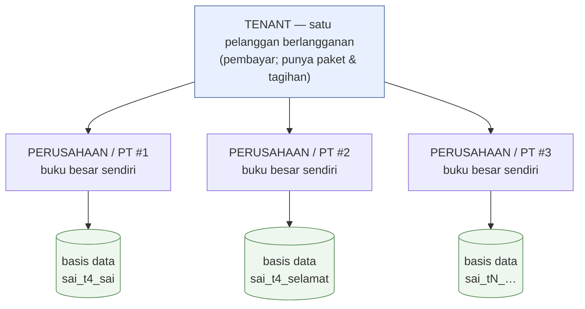
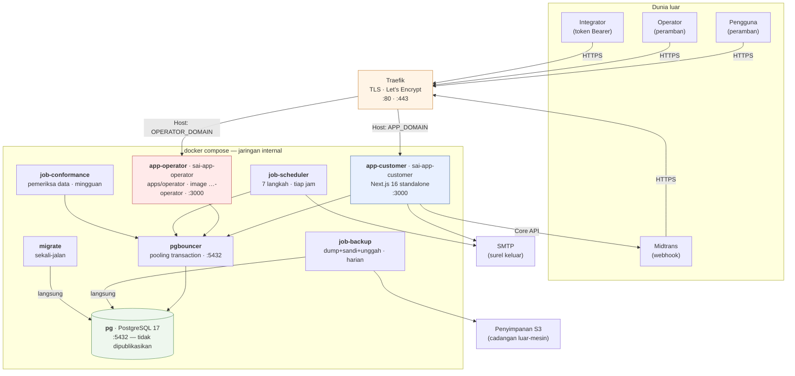

# 01 — Ringkasan Platform

> Dimutakhirkan 18 Okt 2026 · produksi `main@ca0cd038` · [indeks](./README.md)

> Sejak 15 Okt 2026 produksi berjalan di PostgreSQL 17 (`sai-pg`, lewat
> `sai-pgbouncer`). MariaDB (`sai-db`) hanya jalan mundur, tidak ditulisi, dan
> akan dicabut (#636). Lihat
> [11 §10.2](./11-RENCANA-POSTGRESQL.md#102-validasi-pasca-penukaran-16-okt-2026).

## 1. Apa yang dijual

**SAI Accounting** adalah aplikasi akuntansi berbahasa Indonesia yang dijual
sebagai langganan SaaS kepada usaha kecil–menengah Indonesia. Doktrin
produknya ditulis di `AGENTS.md` sebagai syarat setiap pekerjaan UI:

> **simple surface, standard engine** — ramah pengguna awam, tapi proses
> akuntansi tetap baku.

Staf mengisi formulir yang tidak menyebut "debit" dan "kredit". Mesin posting
(`src/lib/posting/`) menerjemahkan setiap dokumen menjadi jurnal berpasangan
ganda yang seimbang. Pembanding saat membangunnya adalah Accurate Online; petanya
ada di [`docs/accurate-reference.md`](../accurate-reference.md).

## 2. Tiga permukaan, dua aplikasi

Tiga audiens dilayani dua aplikasi Next.js dalam satu monorepo: pemasaran dan
aplikasi pelanggan di `src/` (container `app-customer`), konsol operator di
`apps/operator` (container `app-operator`, image `…-operator`).

| Bidang | Host | Kode | Untuk siapa |
|---|---|---|---|
| **Pemasaran** | `APP_DOMAIN` (`/`, `/pricing`, `/status`) | `src/app/(marketing)` | Calon pelanggan, perayap mesin pencari |
| **Aplikasi pelanggan** | `APP_DOMAIN` (`/t/{tenant}/{company}/…`) | `src/app/(app)` | Staf & pemilik usaha yang membukukan |
| **Konsol operator** | `OPERATOR_DOMAIN` (rute di akar, tanpa awalan; `/operator/*` lama → 308 ke jalur tanpa awalan) | `apps/operator` | Kami, penyedia layanan |

Pemisahan operator ditegakkan kode. Bidangnya ditentukan host saja
(`packages/core/src/operator-plane.ts`, murni dan aman-edge). Image pelanggan
tidak memuat rute konsol, dan `apps/operator/src/proxy.ts` menjawab 404 untuk
setiap host selain `OPERATOR_HOST`. Tanpa `OPERATOR_HOST` di `.env`, konsol
menjawab 404 di host mana pun (gagal-tertutup). Alasannya: cookie berlingkup
host, sehingga sesi pelanggan yang bocor tidak bisa menjangkau konsol operator.

## 3. Dua sumbu penyewaan, dan keduanya wajib dibedakan

Dua istilah ini paling sering tertukar, dan perbedaannya menentukan ke basis
data mana sebuah baris ditulis:

- **Tenant** = pelanggan yang berlangganan, pemilik paket, tagihan, dan kuota.
  Datanya di basis data kendali dan platform.
- **Perusahaan (PT)** = satu buku besar, dengan basis data PostgreSQL sendiri
  per PT (issue #104; MariaDB sampai 15 Okt 2026). Satu tenant boleh punya
  banyak PT.

Rinciannya di [`docs/MULTI-TENANT.md §2`](../MULTI-TENANT.md) dan
[`docs/MULTI-COMPANY.md`](../MULTI-COMPANY.md).

## 4. Arsitektur sekilas

Satu mesin, dua aplikasi Next yang tidak saling memanggil lewat HTTP (keduanya
hanya berbagi basis data), dan satu PostgreSQL di belakang PgBouncer. Tidak ada
antrean pesan, *cache* bersama, atau *service mesh*. Pekerjaan latar berjalan
sebagai loop shell yang tidur, tanpa antrean. Alasannya ditulis di
`docker-compose.yml`; konsekuensinya dinilai di [dok 08](./08-PENILAIAN-ARSITEKTUR.md).

## 5. Tiga basis data, dan satu aturan yang tidak boleh dilanggar

| Basis data | Jumlah | Isi | Klien Prisma |
|---|---|---|---|
| **kendali** `sai_control` | 1 | Pengguna, tenant, perusahaan, keanggotaan, undangan, token API, notifikasi | `packages/db/generated/control` |
| **platform** `sai_platform` | 1 | Paket, langganan, tagihan platform, pembayaran, jejak penjadwal & cadangan, isi situs | `packages/db/generated/platform` |
| **perusahaan** `sai_<slug>` | **banyak** (17 per 16 Okt 2026) | Seluruh buku besar: jurnal, faktur, kontrak, stok, aset tetap, jejak audit | `packages/db/generated/company` |

Aturan ini diulang di empat berkas sumber:

> **Konteks perusahaan yang hilang harus melempar galat, tidak pernah jatuh ke
> basis data bawaan.**

Jatuh ke bawaan berarti transaksi PT A tertulis ke buku PT B tanpa galat dan
tanpa jejak, lalu baru ketahuan berbulan-bulan kemudian sebagai neraca yang
tidak cocok. Halaman yang gagal terbuka jauh lebih murah. Penegakannya dibedah di [dok 02 §3](./02-ARSITEKTUR.md) dan
[dok 06 §1](./06-ALIRAN-DATA.md).

Doktrin kembarannya, dari issue #137:

> **Penagihan mati ≠ aplikasi mati.** `sai_platform` yang tak terjangkau tidak
> boleh membuat login atau buku besar ikut mati.

Karena itu `packages/platform/src/platform-db.ts` dilarang diimpor dari jalur
panas (penjaga, sesi, proxy), dan `/api/health` melaporkan status platform tanpa
membiarkannya ikut memutuskan 503.

## 6. Kemampuan yang sudah ada

Diukur dari rute yang ada di `src/app`.

### Akuntansi inti
Daftar akun (COA) + impor · jurnal umum + pembalikan · buku besar · neraca
saldo · periode (tutup/buka ulang) · **tutup tahun** · revaluasi valas ·
pusat biaya (*cost center*) · pemetaan akun otomatis.

### Penjualan
Kontrak pelanggan · faktur + kirim surel + pembayaran · surat jalan ·
retur penjualan · piutang + penuaan · pelanggan & penerima kiriman (*consignee*)
· target penjualan.

### Pembelian & persediaan
Wizard pembelian · pemasok + transaksi · retur pembelian · utang ·
uang muka + kompensasi · **biaya pendaratan** (*landed cost*) · persediaan
(pergerakan, opname, penilaian) · harga pokok rata-rata bergerak.

### Manufaktur
Bill of Material (BOM) · pusat kerja (*work center*) · operasi BOM ·
perintah produksi (rilis → selesai) · akumulasi biaya produksi.

### Aset tetap
Kategori · aset · penyusutan · pelepasan · pemindahan + riwayat lokasi ·
laporan per lokasi.

### Kas & bank
Transaksi kas/bank · konversi mata uang · kurs · **rekonsiliasi bank**
(impor rekening, pencocokan, kunci).

### Laporan
Neraca · laba-rugi · arus kas · perubahan ekuitas · neraca saldo ·
beban menurut sifat · laba per proyek · penjualan per pelanggan · pembelian
per pemasok · nilai persediaan · kas & bank · laporan anggaran — semuanya
dengan ekspor (Excel via `exceljs`, PDF via `jspdf`).

### Tata kelola
RBAC berbasis izin (66 izin perusahaan × 4 peran, dengan *override* per peran
& per pengguna) · alur **persetujuan** berambang nilai · jejak audit per PT ·
kunci buku (otentikasi ulang) · dokumen berulang (*recurring*) · anggaran ·
pajak + e-Faktur · modul per jenis usaha (11 modul) · i18n tiga bahasa
(id/en/zh) · token API + `/api/v1` + OpenAPI.

### Platform (sisi penyedia)
Pendaftaran mandiri · wisaya penyiapan · undangan staf · paket & langganan ·
tagihan platform · gerbang pembayaran Midtrans · penjadwal langganan ·
konsol operator (tenant, audit, surel, penjadwal, isi situs, rekonsiliasi) ·
halaman status publik · ekspor data tenant · permintaan penghapusan akun ·
cadangan otomatis.

## 7. Tumpukan teknologi

| Lapis | Pilihan | Catatan |
|---|---|---|
| Kerangka | **Next.js 16.2.1** (App Router, `output: standalone`) | Pemeriksaan tipe **dimatikan** di `next build` — sengaja, lihat dok 07 |
| Runtime | **Node 22** (bookworm-slim) | Node yang menjalankan; **Bun 1.3** hanya pemasang paket & peluncur skrip |
| UI | **React 19.2.4** + **Ant Design v6** | Tanpa Tailwind & tanpa `className` sejak #203; gaya sebaris + token |
| ORM | **Prisma 7.5** + `@prisma/adapter-pg` *(MariaDB sampai 15 Okt 2026)* | **Tiga** klien dibangkitkan dari tiga skema |
| Basis data | **PostgreSQL 17** + PgBouncer (`transaction`) *(MariaDB 11 sampai 15 Okt 2026)* | Uang `Decimal(15,2)`, kuantitas `(15,3)`, kurs `(18,6)` |
| Autentikasi | **NextAuth v5 beta** (Credentials, JWT 24 jam) | Plus dua rezim lain — lihat dok 05 |
| Validasi | **Zod 4** + `react-hook-form` | Satu modul validasi per domain (31 berkas) |
| Grafik | **Recharts 3** | |
| Surel | **Nodemailer 7** | Konfigurasi tiga lapis — lihat dok 04 |
| Uji | **Vitest 3** — **303 berkas tes** (18 Okt 2026) | Gerbangnya `bun run verify` |
| Proxy | **Traefik** (bersama 5 aplikasi lain di mesin yang sama) | TLS Let's Encrypt, resolver `le` |
| Registry | **GHCR** (`ghcr.io/tri-evendi/sai-accounting`) | 4 image dibangun CI (pelanggan, operator, migrator, backup — sejak 18 Okt 2026); **jangan pernah build di server** |

## 8. Ukuran

Dihitung 18 Okt 2026:

| | |
|---|---|
| Halaman (`page.tsx`) | 131 (pelanggan, `src/app`) + 18 (konsol, `apps/operator` — 17 + `/login`) |
| Rute API (`route.ts`) | 127 (pelanggan) + 2 (konsol) |
| Model Prisma | 61 (perusahaan) + 15 (kendali) + 12 (platform) = **88** *(11 Okt 2026)* |
| Migration aktif (`prisma/postgresql/`) | 1 (perusahaan) + 4 (kendali) + 4 (platform) = **9** — arsip MariaDB hanya-baca: 99 |
| Modul `src/lib` | 231 berkas — sisanya pindah ke `packages/*` (`@sai/db`, `@sai/core`, `@sai/ui`, `@sai/billing`, `@sai/platform`) |
| Berkas tes | 303 |
| Izin RBAC | 66 (perusahaan) + 6 (tenant) *(11 Okt 2026)* |

## 9. Keadaan produksi

Dibaca dari `docker ps`, `/api/health` (dari dalam container), dan kueri
langsung ke `sai-pg` pada 16 Okt 2026; baris bertanda 18 Okt diperbarui hari
itu:

| | |
|---|---|
| Container naik | `sai-app-customer` (healthy), `sai-app-operator` (healthy), `sai-job-scheduler`, `sai-job-conformance`, `sai-job-backup`, `sai-pgbouncer`, `sai-pg` (healthy), `sai-db` (jalan mundur, tidak ditulisi) |
| Basis data | **19** di PostgreSQL 17.11: kendali + platform + **17** buku PT, cocok dengan 17 terdaftar. Total 227 MB |
| Tenant / perusahaan / pengguna / keanggotaan | 11 / 17 / 13 / 17 |
| Langganan | 11: 10 `active`, 1 `trialing`; mode penagihan 11/11 `none`; 0 pembayaran |
| Kesehatan (18 Okt) | `control`, `platform`, `company`, `scheduler`, `mail` = `ok` · **`backup` = `local_only`** (`lastSuccessAt: null` — belum ada salinan luar mesin) · `conformance` = `findings` (1.439 temuan, 0 PT gagal) |
| Migration diterapkan (18 Okt) | kendali 4/4 · platform 4/4 · perusahaan 1/1 (`prisma/postgresql/`) |

Dua hal dari tabel itu adalah temuan, dan keduanya dinilai di
[dok 08](./08-PENILAIAN-ARSITEKTUR.md):

1. **Belum ada salinan cadangan di luar mesin.** `AWS_ACCESS_KEY_ID`,
   `AWS_SECRET_ACCESS_KEY`, dan `BACKUP_S3_BUCKET` di `.env` kosong, jadi
   cadangan harian terenkripsi hanya tersimpan di volume `cadangan` di mesin
   yang sama. `/api/health` melaporkan `backup: local_only` dengan
   `lastSuccessAt: null`. Risikonya juga hukum: pembukuan wajib disimpan
   sepuluh tahun (UU KUP), dan kehilangan mesin berarti kehilangan buku beserta
   cadangannya.
2. **Penagihan otomatis sengaja dimatikan** di seluruh 11 langganan
   (`billing_mode=none`). Ini keputusan Fase A yang didokumentasikan di
   [`docs/KOMERSIALISASI.md`](../KOMERSIALISASI.md), bukan kerusakan.

## 10. Ke mana selanjutnya

- Bentuk & batasnya → [02 Arsitektur](./02-ARSITEKTUR.md)
- Daftar setiap layanan → [03 Inventaris](./03-INVENTARIS-LAYANAN.md)
- Risiko & utang → [08 Penilaian](./08-PENILAIAN-ARSITEKTUR.md)
