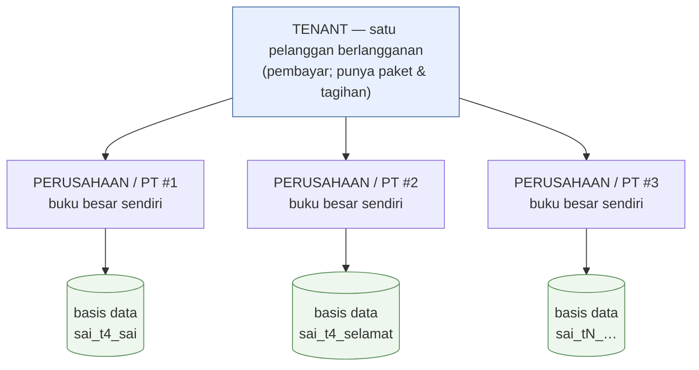
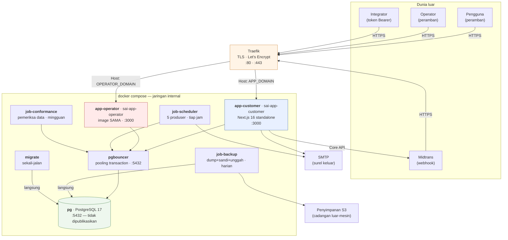

# 01 — Ringkasan Platform

> Potret 11 Oktober 2026 · v0.9.0 (`origin/main@a2eecf7c`) · [indeks](./README.md)

> **⚑ Diperbarui 17 Okt 2026: mesin basis data.** Sejak 15 Okt 2026 produksi
> berjalan di **PostgreSQL 17** (`sai-pg`, lewat `sai-pgbouncer`). Diagram,
> tumpukan teknologi, dan §9.1 di bawah sudah mencerminkannya; angka lain tetap
> potret 11 Okt. MariaDB (`sai-db`) hanya jalan mundur, tidak ditulisi, dan akan
> dicabut (#636). Lihat
> [11 §10.2](./11-RENCANA-POSTGRESQL.md#102-validasi-pasca-penukaran-16-okt-2026).

## 1. Apa yang dijual

**SAI Accounting** adalah aplikasi akuntansi berbahasa Indonesia yang dijual
sebagai langganan SaaS kepada usaha kecil–menengah Indonesia. Doktrin
produknya satu baris, dan ia ditulis di `AGENTS.md` sebagai syarat setiap
pekerjaan UI:

> **simple surface, standard engine** — ramah pengguna awam, tapi proses
> akuntansi tetap baku.

Artinya secara konkret: staf mengisi formulir yang tidak menyebut "debit" dan
"kredit", sementara mesin posting (`src/lib/posting/`) menerjemahkan setiap
dokumen menjadi jurnal berpasangan ganda yang seimbang di belakang layar.
Pembanding yang dipakai saat membangunnya adalah Accurate Online — petanya ada
di [`docs/accurate-reference.md`](../accurate-reference.md).

## 2. Tiga penyewa permukaan, satu proses

Yang membuat arsitektur ini tidak biasa: **tiga audiens berbeda dilayani satu
container Next.js**, dipisahkan oleh *hostname* dan grup rute — bukan oleh tiga
aplikasi.

| Bidang | Host | Grup rute | Untuk siapa |
|---|---|---|---|
| **Pemasaran** | `APP_DOMAIN` (`/`, `/pricing`, `/status`) | `(marketing)` | Calon pelanggan, perayap mesin pencari |
| **Aplikasi pelanggan** | `APP_DOMAIN` (`/t/{tenant}/{company}/…`) | `(app)` | Staf & pemilik usaha yang membukukan |
| **Konsol operator** | `OPERATOR_DOMAIN` (`/operator/…`) | `(operator)` | Kami, penyedia layanan |

Pemisahan operator **ditegakkan, bukan dikonvensikan**: di host pelanggan
setiap `/operator` menjawab 404, dan di host operator setiap rute pelanggan
menjawab 404. Tanpa `OPERATOR_HOST` di `.env`, `/operator` tidak terjangkau di
host mana pun — gagal-tertutup. Logikanya murni di `packages/core/src/operator-plane.ts`,
dipanggil dari `src/proxy.ts`. Alasannya: cookie berlingkup host, jadi sesi
pelanggan yang bocor tidak pernah bisa menjangkau konsol operator.

## 3. Dua sumbu penyewaan, dan keduanya wajib dibedakan

Istilah yang paling sering tertukar di repo ini, dan selisihnya menentukan ke
basis data mana sebuah baris ditulis:

- **Tenant** = pelanggan yang berlangganan. Ia yang punya paket, tagihan, dan
  kuota. Hidup di basis data **kendali** + **platform**.
- **Perusahaan (PT)** = satu buku besar. **Satu basis data PostgreSQL sendiri per
  PT** (issue #104; MariaDB sampai 15 Okt 2026). Satu tenant boleh punya banyak PT.

Rinciannya di [`docs/MULTI-TENANT.md §2`](../MULTI-TENANT.md) dan
[`docs/MULTI-COMPANY.md`](../MULTI-COMPANY.md).

## 4. Arsitektur sekilas

Satu mesin, enam container aplikasi, satu PostgreSQL di belakang PgBouncer — dan **tidak ada**
antrean pesan, *cache* bersama, *service mesh*, maupun layanan HTTP kedua.
Seluruh pekerjaan latar berjalan sebagai *loop shell yang tidur*, bukan sebagai
pekerja yang mengambil dari antrean. Itu pilihan sadar yang dibenarkan panjang
di `docker-compose.yml`; konsekuensinya dinilai di [dok 08](./08-PENILAIAN-ARSITEKTUR.md).

## 5. Tiga basis data, dan satu aturan yang tidak boleh dilanggar

| Basis data | Jumlah | Isi | Klien Prisma |
|---|---|---|---|
| **kendali** `sai_control` | 1 | Pengguna, tenant, perusahaan, keanggotaan, undangan, token API, notifikasi | `packages/db/generated/control` |
| **platform** `sai_platform` | 1 | Paket, langganan, tagihan platform, pembayaran, jejak penjadwal & cadangan, isi situs | `packages/db/generated/platform` |
| **perusahaan** `sai_<slug>` | **banyak** (17 per 11 Okt 2026) | Seluruh buku besar: jurnal, faktur, kontrak, stok, aset tetap, jejak audit | `packages/db/generated/company` |

Aturannya, dan ia diulang di empat berkas sumber karena memang sepenting itu:

> **Konteks perusahaan yang hilang harus MELEMPAR — tidak pernah jatuh ke basis
> data bawaan.**

Sebabnya bukan kerapian. Jatuh ke bawaan berarti transaksi PT A tertulis ke
buku PT B **tanpa galat dan tanpa jejak**, lalu ketahuan berbulan-bulan
kemudian sebagai neraca yang tidak cocok. Halaman yang gagal terbuka hari ini
jauh lebih murah. Penegakannya dibedah di [dok 02 §3](./02-ARSITEKTUR.md) dan
[dok 06 §1](./06-ALIRAN-DATA.md).

Doktrin kembarannya, dari issue #137:

> **Penagihan mati ≠ aplikasi mati.** `sai_platform` yang tak terjangkau tidak
> boleh membuat login atau buku besar ikut mati.

Karena itu `packages/platform/src/platform-db.ts` dilarang diimpor dari jalur panas (penjaga,
sesi, proxy), dan `/api/health` **melaporkan** status platform tanpa membiarkan
status itu ikut memutuskan 503.

## 6. Kemampuan yang sudah ada

Diukur dari rute yang benar-benar ada di `src/app`, bukan dari rencana.

### Akuntansi inti
Daftar akun (COA) + impor · jurnal umum + pembalikan · buku besar · neraca
saldo · periode (tutup/buka ulang) · **tutup tahun** · revaluasi valas ·
pusat biaya (*cost center*) · pemetaan akun otomatis.

### Penjualan
Kontrak pelanggan · faktur + kirim surel + pembayaran · surat jalan ·
retur penjualan · piutang + penuaan · pelanggan & penerima kiriman (*consignee*)
· target penjualan.

### Pembelian & persediaan
Wizard pembelian · pemasok + transaksi · retur pembelian · utang ·
uang muka + kompensasi · **biaya pendaratan** (*landed cost*) · persediaan
(pergerakan, opname, penilaian) · harga pokok rata-rata bergerak.

### Manufaktur
Bill of Material (BOM) · pusat kerja (*work center*) · operasi BOM ·
perintah produksi (rilis → selesai) · akumulasi biaya produksi.

### Aset tetap
Kategori · aset · penyusutan · pelepasan · pemindahan + riwayat lokasi ·
laporan per lokasi.

### Kas & bank
Transaksi kas/bank · konversi mata uang · kurs · **rekonsiliasi bank**
(impor rekening, pencocokan, kunci).

### Laporan
Neraca · laba-rugi · arus kas · perubahan ekuitas · neraca saldo ·
beban menurut sifat · laba per proyek · penjualan per pelanggan · pembelian
per pemasok · nilai persediaan · kas & bank · laporan anggaran — semuanya
dengan ekspor (Excel via `exceljs`, PDF via `jspdf`).

### Tata kelola
RBAC berbasis izin (66 izin perusahaan × 4 peran, dengan *override* per peran
& per pengguna) · alur **persetujuan** berambang nilai · jejak audit per PT ·
kunci buku (otentikasi ulang) · dokumen berulang (*recurring*) · anggaran ·
pajak + e-Faktur · modul per jenis usaha (11 modul) · i18n tiga bahasa
(id/en/zh) · token API + `/api/v1` + OpenAPI.

### Platform (sisi penyedia)
Pendaftaran mandiri · wisaya penyiapan · undangan staf · paket & langganan ·
tagihan platform · gerbang pembayaran Midtrans · penjadwal langganan ·
konsol operator (tenant, audit, surel, penjadwal, isi situs, rekonsiliasi) ·
halaman status publik · ekspor data tenant · permintaan penghapusan akun ·
cadangan otomatis.

## 7. Tumpukan teknologi

| Lapis | Pilihan | Catatan |
|---|---|---|
| Kerangka | **Next.js 16.2.1** (App Router, `output: standalone`) | Pemeriksaan tipe **dimatikan** di `next build` — sengaja, lihat dok 07 |
| Runtime | **Node 22** (bookworm-slim) | Node yang menjalankan; **Bun 1.3** hanya pemasang paket & peluncur skrip |
| UI | **React 19.2.4** + **Ant Design v6** | Tanpa Tailwind & tanpa `className` sejak #203; gaya sebaris + token |
| ORM | **Prisma 7.5** + `@prisma/adapter-pg` *(MariaDB sampai 15 Okt 2026)* | **Tiga** klien dibangkitkan dari tiga skema |
| Basis data | **PostgreSQL 17** + PgBouncer (`transaction`) *(MariaDB 11 sampai 15 Okt 2026)* | Uang `Decimal(15,2)`, kuantitas `(15,3)`, kurs `(18,6)` |
| Autentikasi | **NextAuth v5 beta** (Credentials, JWT 24 jam) | Plus dua rezim lain — lihat dok 05 |
| Validasi | **Zod 4** + `react-hook-form` | Satu modul validasi per domain (31 berkas) |
| Grafik | **Recharts 3** | |
| Surel | **Nodemailer 7** | Konfigurasi tiga lapis — lihat dok 04 |
| Uji | **Vitest 3** — **276 berkas tes · 4.654 tes** | Gerbangnya `bun run verify` |
| Proxy | **Traefik** (bersama 5 aplikasi lain di mesin yang sama) | TLS Let's Encrypt, resolver `le` |
| Registry | **GHCR** (`ghcr.io/tri-evendi/sai-accounting`) | 4 image dibangun CI (pelanggan, operator, migrator, backup — sejak 18 Okt 2026); **jangan pernah build di server** |

## 8. Ukuran

| | |
|---|---|
| Berkas TypeScript/TSX | 939 |
| Baris kode (`src/`) | ~342.800 |
| Halaman (`page.tsx`) | 142 |
| Rute API (`route.ts`) | 126 |
| Model Prisma | 61 (perusahaan) + 15 (kendali) + 12 (platform) = **88** |
| Migration | 64 (perusahaan) + 17 (kendali) + 18 (platform) = **99** |
| Modul `src/lib` | 299 berkas |
| Berkas tes | 276 (4.654 tes) |
| Skrip operasional | 51 |
| Izin RBAC | 66 (perusahaan) + 6 (tenant) |

## 9. Keadaan produksi saat potret

Dibaca dari `docker compose ps`, `/api/health`, dan kueri langsung ke MariaDB
pada 11 Oktober 2026:

| | |
|---|---|
| Image yang melayani | `ghcr.io/tri-evendi/sai-accounting:latest` — v0.9.0 |
| Container naik | `sai-web` (healthy), `sai-scheduler`, `sai-conformance`, `sai-backup`, `sai-db` (healthy) — **nama pra-pemisahan**; potret ini diambil sebelum bidang dipisah |
| Tenant | 11 |
| Perusahaan terdaftar | **17** — dan **17** basis data perusahaan di MariaDB (cocok, tidak ada yang tak terdaftar) |
| Pengguna | 13 |
| Keanggotaan | 17 |
| Langganan | 11 — 10 `active`, 1 `trialing` |
| **Mode penagihan** | **11 dari 11 = `none`** — penagihan otomatis dihentikan (Fase A) |
| Pembayaran tercatat | 0 |
| Token API aktif | 0 |
| Putaran penjadwal | 1.246 — terakhir 7 menit sebelum potret, **sehat** |
| Putaran cadangan | 54 — **`lastSuccessAt: null`** ⚠ |

### 9.1 Potret 16 Okt 2026 — sesudah penukaran ke PostgreSQL

Dibaca dari `docker ps`, `/api/health` (dari dalam container), dan kueri
langsung ke `sai-pg`:

| | |
|---|---|
| Container naik | `sai-app-customer` (healthy), `sai-app-operator` (healthy), `sai-job-scheduler`, `sai-job-conformance`, `sai-job-backup`, `sai-pgbouncer`, `sai-pg` (healthy), `sai-db` (jalan mundur, tidak ditulisi) |
| Basis data | **19** di PostgreSQL 17.11: kendali + platform + **17** buku PT, cocok dengan 17 terdaftar. Total 227 MB |
| Tenant / perusahaan / pengguna / keanggotaan | 11 / 17 / 13 / 17 (sama dengan potret 11 Okt) |
| Langganan | 11: 10 `active`, 1 `trialing`; mode penagihan 11/11 `none`; 0 pembayaran |
| Kesehatan | `control`, `platform`, `company`, `scheduler`, `mail` = `ok` · **`backup` = `failing`** (nol cadangan sejak penukaran) · **`conformance` = `late`** (17 PT gagal). Keduanya sudah diperbaiki di `develop`; lihat [11 §10.2](./11-RENCANA-POSTGRESQL.md#102-validasi-pasca-penukaran-16-okt-2026) |
| Migration diterapkan | kendali 17/17 · platform 17/17 · perusahaan 64/64 — **tidak ada drift** *(platform 0018 ditambahkan 11 Okt sore, BELUM diterapkan)* |

Dua hal dari tabel itu adalah temuan, bukan statistik, dan keduanya dinilai di
[dok 08](./08-PENILAIAN-ARSITEKTUR.md):

1. **Cadangan belum pernah berhasil sekali pun.** `/api/health` melaporkan
   `backup.status: "failing"` dengan `lastSuccessAt: null` setelah 54 percobaan.
   Akarnya terbukti di `.env`: `AWS_ACCESS_KEY_ID`,
   `AWS_SECRET_ACCESS_KEY`, dan `BACKUP_S3_BUCKET` **tidak ada**. Ini risiko
   hukum, bukan sekadar teknis — pembukuan wajib disimpan sepuluh tahun (UU KUP).
2. **Penagihan otomatis sengaja mati** di seluruh 11 langganan
   (`billing_mode=none`). Itu keputusan Fase A yang didokumentasikan di
   [`docs/KOMERSIALISASI.md`](../KOMERSIALISASI.md) — **bukan** kerusakan.

## 10. Ke mana selanjutnya

- Bentuk & batasnya → [02 Arsitektur](./02-ARSITEKTUR.md)
- Daftar setiap layanan → [03 Inventaris](./03-INVENTARIS-LAYANAN.md)
- Risiko & utang → [08 Penilaian](./08-PENILAIAN-ARSITEKTUR.md)
