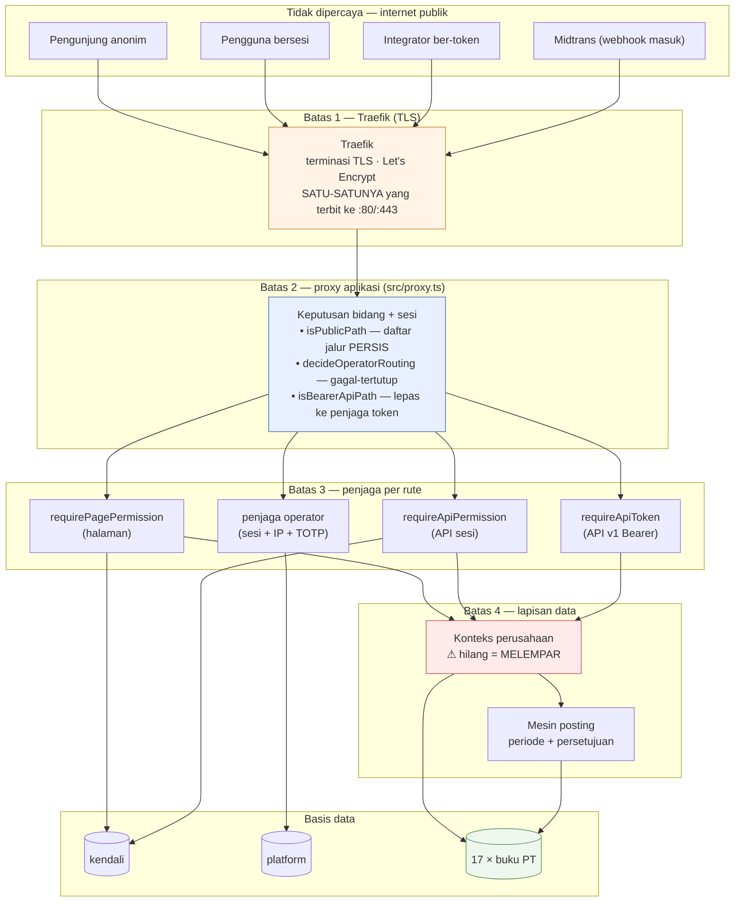
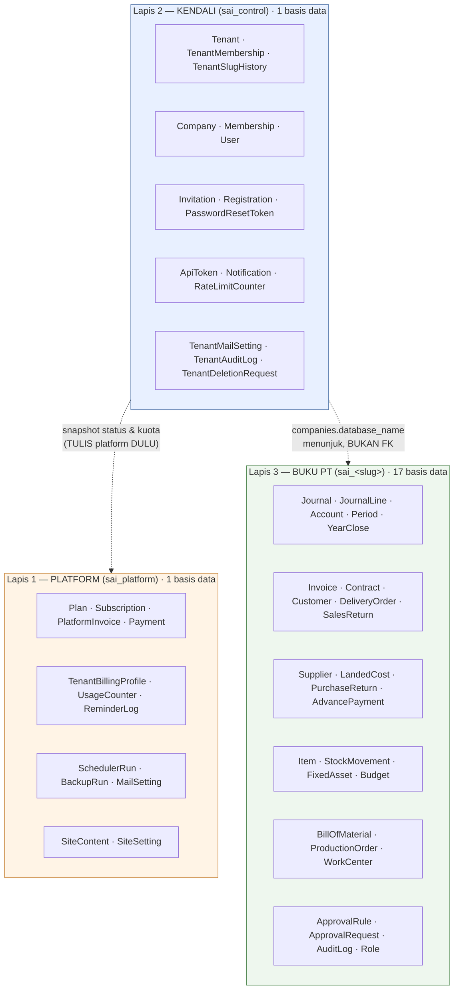
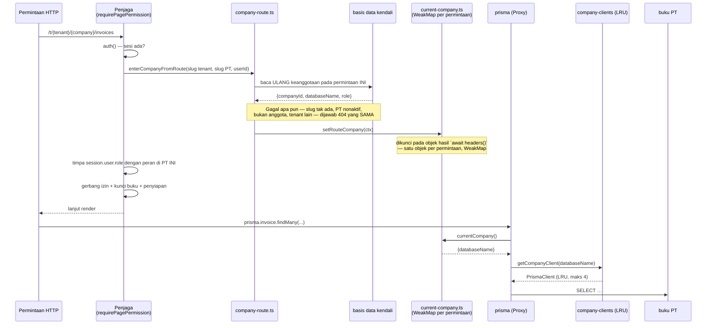
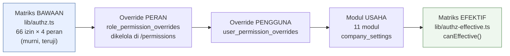
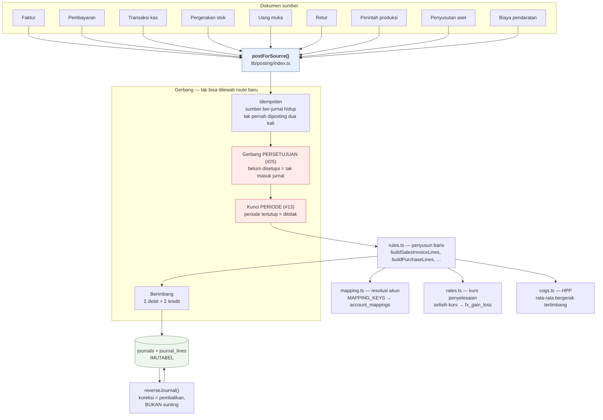

# 02 — Arsitektur Sistem

> Potret 11 Oktober 2026 · v0.9.0 · [indeks](./README.md)

## 1. Pola yang dipakai, dan yang sengaja tidak

### Yang dipakai

| Pola | Di mana | Kenapa |
|---|---|---|
| **Monolit modular** | Satu aplikasi Next.js, modul per domain di `src/lib` | Satu mesin ~3,6 GB berbagi dengan 5 aplikasi lain; mikrolayanan di sini berarti membayar overhead tanpa pembeli |
| **Database-per-tenant** (per PT) | 17 basis data perusahaan | Isolasi FISIK buku besar — satu kueri salah tidak bisa menyeberang |
| **Shared-database** (kendali & platform) | `sai_control`, `sai_platform` | Identitas & penagihan memang lintas-tenant |
| **Ambient context** | `AsyncLocalStorage` + penyimpan per-permintaan | Agar 120 berkas yang `import { prisma }` tidak perlu diubah tanda tangannya |
| **Proxy klien basis data** | `lib/prisma.ts`, `control-db.ts`, `platform-db.ts` | Klien diselesaikan **saat kueri dipanggil**, bukan saat modul dimuat |
| **Kolam klien LRU** | `lib/company-clients.ts` | `max_connections` MariaDB adalah anggaran terbatas; 17 klien permanen = kehabisan koneksi |
| **Izin terpusat sebagai matriks** | `lib/authz.ts` + `authz-effective.ts` | Halaman & API pasangannya tidak bisa menyimpang diam-diam |
| **Mesin posting terpusat** | `lib/posting/` | Setiap dokumen → jurnal lewat **satu** pintu; penjaga periode & persetujuan tak bisa dilewati dengan menambah route |
| **Snapshot lintas-basis-data** | Status tenant & kuota disalin dari platform ke kendali | Jalur panas tidak boleh menyentuh basis data penagihan |
| **Fungsi murni + penjaga tes** | 275 berkas tes | Aturan diuji sebagai fungsi, bukan lewat basis data |
| **Pekerja loop-tidur** | `job-scheduler`, `job-conformance`, `job-backup` | Tanpa antrean, tanpa daemon cron — satu proses shell yang tidur tidak memakan apa pun |

### Yang sengaja TIDAK dipakai

Penting dicatat, karena ketiadaannya sering disalahartikan sebagai kelalaian:

| Tidak ada | Konsekuensi yang diterima |
|---|---|
| Antrean pesan (Redis/RabbitMQ/SQS) | Pekerjaan latar berjalan berurutan tiap jam; tidak ada *retry* per-pekerjaan, tidak ada *dead-letter* |
| Cache bersama (Redis/Memcached) | Cache hanya di memori proses; satu container = satu cache, hilang saat *restart* |
| Layanan HTTP kedua | Konsol operator berbagi proses dengan aplikasi pelanggan; dipisahkan host, bukan proses |
| Tailwind / `className` | Dicabut di #203 — gaya **sebaris** + token `var(--ant-…)`, dijaga ESLint `sai/warna-token-antd` |
| Pemeriksaan tipe di `next build` | Dimatikan sengaja; `bun run typecheck` jadi satu-satunya gerbang tipe |
| Penskalaan horizontal | Satu container `app-customer`; `AsyncLocalStorage` & kolam LRU per-proses tetap benar, tapi cache tidak dibagikan |

## 2. Batas sistem



**Yang menegakkan setiap batas:**

| Batas | Penegak | Sifat gagal |
|---|---|---|
| 1 — TLS | Traefik, label di `docker-compose.yml` | HTTP → 301 ke HTTPS; `www.` → apex |
| 2 — bidang & sesi | `src/proxy.ts` + `lib/operator/plane.ts` | **Gagal-tertutup**: `OPERATOR_HOST` kosong = `/operator` 404 di mana pun |
| 3 — izin | `page-auth.ts` / `auth-guard.ts` / `api-token-guard.ts` | Halaman → pantul ke beranda; API → 403. Dijaga `tests/authz-coverage` |
| 4 — perusahaan | `company-context.ts` / `current-company.ts` | `MissingCompanyContextError` — **melempar, tidak pernah menebak** |
| 4 — buku besar | `lib/posting/index.ts` + `lib/ledger.ts` | Periode tertutup / belum disetujui = posting ditolak |

Catatan penting soal batas 2: **ia bukan penjaga otorisasi.** Proxy hanya
memutuskan "perlu sesi atau tidak" dan "bidang mana". Otorisasi sungguhan ada
di batas 3. Untuk `/api/v1/*` proxy justru **melepaskan** jalurnya — tanpa itu
proxy menjawab 401 sebelum `requireApiToken` sempat berjalan, dan itu memang
terjadi di produksi sampai 16 Agustus 2026 (lihat `lib/api-v1.ts`).

## 3. Tiga lapis basis data

### Bentuknya



### Aturan yang menjaga pemisahannya

Semuanya ditegakkan kode atau tes, bukan konvensi:

1. **Tidak ada FK yang menyeberangi basis data.** Buku PT tidak boleh punya FK
   ke `users`; yang dipakai adalah id global + `lib/users-directory.ts`.
2. **Kredensial tidak pernah diambil dari basis data.**
   `companies.database_name` hanya menyimpan **nama**; host/pengguna/sandi
   selalu dari *environment*. Menyimpan URL lengkap di tabel berarti satu
   `SELECT` bisa membawa pergi kredensial setiap pelanggan.
   Nama basis data pun disaring `/^[A-Za-z0-9_]{1,64}$/` sebelum ikut menyusun
   string koneksi.
3. **Urutan tulis lintas-lapis: PLATFORM dulu, KENDALI belakangan.** Kegagalan
   di tengah lalu meninggalkan *pembayaran tercatat tanpa tenant naik kelas*
   (bisa direkonsiliasi: `bun run reconcile:platform`) — bukan *tenant naik
   kelas tanpa pembayaran*, yang tidak akan pernah ketahuan.
4. **Tidak ada angka akuntansi di kendali maupun platform.** Kalau ada yang
   menaruh tabel transaksi di sana, seluruh janji isolasi #104 batal saat itu juga.
5. **Cache tingkat modul yang isinya milik satu penyewa WAJIB dikunci** per
   `companyId` / `tenantId` (`lib/tenant-cache.ts`).
6. **`platform-db.ts` dilarang dari jalur panas** — penjaga, sesi, proxy, dan
   `lib/operator/plane.ts` tidak boleh mengimpornya.

Rinciannya: [`docs/MULTI-COMPANY.md §2`](../MULTI-COMPANY.md),
[`docs/MULTI-TENANT.md §4A`](../MULTI-TENANT.md).

## 4. Bagaimana "perusahaan mana ini?" terjawab

Ini bagian paling halus di seluruh sistem, dan ia **sudah pernah salah dua
kali**. Keduanya didokumentasikan di sumbernya; ringkasnya:



**Dua sumber, berurutan** (`lib/current-company.ts`):

1. Konteks `AsyncLocalStorage` — dipasang `runWithCompany()`, dipakai
   **skrip, cron, seed, tes**. Memakai `als.run()`, jadi merambat ke seluruh
   callback. **Selalu bisa diandalkan.**
2. Penyimpan per-permintaan — dipasang penjaga, melayani **permintaan HTTP**.

Keduanya kosong → **melempar**. Tidak ada sumber ketiga.

### Dua jebakan yang sudah diukur dan ditutup

**(a) `cache()` React bukan per-permintaan di route handler (#333).**
Penyimpan per-permintaan dulu bersandar pada `cache()` React. Diukur di Next
16.2.1/Node 22.22: di dalam **route handler** `holder() === holder()` →
`false`, jadi `setRouteCompany()` menulis ke satu objek dan pembacaan
berikutnya menerima objek **lain**. Di dalam **render halaman** → `true`.
Akibatnya halaman selamat dan hanya route handler menjawab 500. Sekarang
penyimpannya dikunci pada hasil `await headers()` — objek yang **Next sendiri**
lingkupkan per permintaan — dengan `WeakMap` di atasnya, sehingga entrinya mati
bersama permintaannya tanpa perlu dibersihkan.

**(b) `enterWith` tidak merambat setelah `await`.**
`enterCompanyContext()` memakai `als.enterWith`, dan sifatnya lebih sempit
daripada yang dulu ditulis: ia merambat hanya bila dipanggil **sebelum** `await`
apa pun di fungsi itu. Penjaga selalu membaca basis data kendali **lebih
dulu**, jadi ia selalu di kasus "sesudah `await`" — konteksnya terukur `null`
di badan route dan di komponen halaman. Karena itu kebenaran permintaan HTTP
bertumpu pada penyimpan per-permintaan, **bukan** pada rambatan ALS.

**(c) Sesi dicabut sebagai sumber (#158).** Dulu `companyId` ada di JWT sebagai
jaring pengaman. Justru itu yang membuat kesalahan bisa bertahan: route yang
lupa membawa lingkupnya **tetap bekerja**, dengan perusahaan yang kebetulan
terakhir dibuka di tab mana pun — tanpa galat, tanpa jejak. Mencabutnya
mengubah "lupa membawa perusahaan" dari sunyi menjadi berisik.

Konsekuensi bagi pengembang: **satu bentuk tidak didukung** —
`prisma.$transaction([a, b])` (bentuk array) tidak bisa lewat Proxy. Bentuk
callback bekerja penuh, dan seluruh transaksi di repo (84 pemanggilan `$transaction`) memakainya.

## 5. Empat lapis otorisasi



Penegakannya di tiga tempat, dan ketiganya menanyai matriks **EFEKTIF**:
`requirePagePermission` (halaman), `requireApiPermission` (API sesi),
`requireApiToken` (API v1). Tampilan memakai `can(...)`.

**Yang dilarang:** membandingkan string peran, atau menulis daftar
`["managing_director","finance_manager"]` di luar matriks.
`tests/authz-coverage.test.ts` menolak halaman/route tanpa deklarasi izin.

**Matriks kedua, untuk lapis tenant** (`lib/tenant-authz.ts`): 6 izin × 3 peran
(`owner`, `admin`, `member`). `member` memegang **tepat satu** izin —
`tenant.home`.

**Tiga pembeda yang tidak boleh dicampur:**

| Kalimat | Sebabnya | Sumbernya |
|---|---|---|
| "Anda tidak punya akses" | Peran | matriks izin |
| "Fitur ini belum aktif untuk perusahaan Anda" | Modul usaha | `company_settings` |
| "Buku ini terkunci" | Kunci buku | otentikasi ulang |

**Modul TIDAK PERNAH menggerbangi buku besar.** Perusahaan yang pernah
memposting jurnal lalu mematikan modul `trading` tetap memiliki jurnal itu, dan
setiap laporan tetap rekonsiliasi. `lib/reports.ts`, `lib/ledger.ts`, dan
`lib/posting/*` **dilarang** mengimpor `business-modules.ts` — dijaga
`tests/business-modules-ledger.test.ts`.

Rinciannya: [`docs/RBAC.md`](../RBAC.md), [`docs/MODUL-USAHA.md`](../MODUL-USAHA.md).

## 6. Mesin posting — satu pintu menuju buku besar



Tiga jaminan yang dinyatakan di `lib/posting/index.ts`:

- **Idempoten** — sumber yang sudah punya jurnal hidup tidak pernah diposting dua kali.
- **Atomik** — `tx` dioper, jadi posting *commit*/*rollback* bersama tulisan sumbernya.
- **Imutabel** — koreksi lewat `reverseJournal()`; baris jurnal tidak pernah disunting.

Dan dua aturan valas yang mudah salah:

- Penyelesaian meringankan piutang/utang **pada kurs dokumennya sendiri**,
  bukan kurs pembayaran; selisihnya ke `fx_gain_loss` (#23).
- Akun yang diringankan mengikuti mata uang **DOKUMEN**, bukan pembayaran —
  faktur USD yang dilunasi transfer IDR tetap membersihkan piutang USD (#43).

Alasan gerbang persetujuan & periode hidup **di sini** dan bukan di route:
setiap jalur yang mengubah dokumen menjadi jurnal melewati
`postForSource`/`repostForSource`, jadi penjaga di sini **tidak bisa dilewati
dengan menambah route baru**.

## 7. Struktur kode

```
src/
├── app/
│   ├── (marketing)/              # publik: /, /pricing, /status, sitemap, OG
│   ├── (app)/
│   │   ├── (auth)/               # login, daftar, lupa sandi, undangan, unlock
│   │   ├── (dashboard)/
│   │   │   ├── dashboard/        # pengalih → beranda PT
│   │   │   └── t/[tenantSlug]/[companySlug]/   # ← 102 halaman buku
│   │   ├── (setup)/              # wisaya penyiapan PT
│   │   ├── (tenant)/(panel)/     # /platform/* — akun, tagihan, tim
│   │   ├── (docs)/docs/          # dokumentasi — publik, tanpa sesi
│   │   └── (operator)/operator/  # konsol penyedia — HOST SENDIRI
│   └── api/                      # 126 rute
│       ├── v1/                   # permukaan publik — token Bearer
│       ├── auth/                 # NextAuth + pendaftaran/atur-ulang
│       ├── billing/webhook       # Midtrans — tanda tangan SHA-512
│       ├── health                # probe tanpa sesi
│       └── t/[tenantSlug]/[companySlug]/   # rute berlingkup jalur
├── lib/                          # 299 berkas — logika domain
│   ├── posting/                  # mesin jurnal (5 berkas)
│   ├── validations/              # skema zod per domain (31 berkas)
│   ├── i18n/                     # id/en/zh — kunci dot-path BERTIPE
│   ├── operator/                 # bidang operator (10 berkas)
│   ├── manufacturing/ import/ pdf/ accurate/ brand/ theme/
├── components/
│   ├── ui/                       # primitif Ant Design v6
│   └── layout/ dashboard/ reports/ settings/ setup/ landing/ operator/ …
├── generated/{prisma,control,platform}/   # gitignored — lahir saat build
├── proxy.ts                      # ⚠ BUKAN middleware.ts
└── types/
```

Dua hal yang mengejutkan orang baru:

1. **`src/proxy.ts`, bukan `src/middleware.ts`.** Next versi ini menamainya
   `proxy`. Jangan pernah membuat `middleware.ts`.
2. **`src/generated/` tidak ada di git.** Ketiga klien Prisma lahir saat
   `bun run db:generate` / tahap build Docker. Tanpa ketiganya `next build`
   gagal dengan "module not found" yang **tidak menyebut** bahwa yang kurang
   adalah satu perintah generate.

## 8. Lapis penyajian & UI

| Aspek | Keadaan |
|---|---|
| Rendering | Server Component secara bawaan; `"use client"` hanya di daun interaktif |
| Komponen | **Ant Design v6** lewat `src/components/ui`; `@ant-design/nextjs-registry` untuk SSR |
| Gaya | **Sebaris** (`style={{…}}`) — **tanpa Tailwind, tanpa `className`** sejak #203 |
| Warna | `var(--ant-…)` atau `theme.useToken()`; hex mentah hanya boleh di `lib/theme/antd-tokens.ts`, dijaga ESLint `sai/warna-token-antd` |
| Pseudo/media | Satu `<style href precedence>` per komponen, menyasar atribut `data-*` |
| Ikon | `@ant-design/icons` — **impor bernama saja**, ditulis ulang `modularizeImports` ke jalur per-ikon |
| Tabel | `StaticTable` (server, tanpa JS) atau `DataTable` (AntD, client, **+80 KB gzip/rute**) |
| Tombol tautan | `<ButtonLink href>` internal · `<Button href>` eksternal. `<Link><Button/></Link>` **ditolak tes** |
| Angka | `tabular-nums`, rata-kanan, format `id-ID` |
| Semantik uang | Hijau masuk / merah keluar — **tidak boleh warna-saja** |
| i18n | id/en/zh lewat **cookie locale** (bukan rute `[lang]`); terjemahan yang hilang = **galat tsc** |

Satu jebakan RSC yang layak dicatat karena ia membuat `next build` gagal:
barrel `@ant-design/icons` memanggil `createContext` di tingkat modul tanpa
`"use client"`, dan build React untuk server component tidak mengekspor
`createContext`. `modularizeImports` di `next.config.ts` menulis ulang setiap
impor bernama ke jalur per-ikon sehingga barrel-nya tidak pernah dimuat.
`optimizePackageImports` **tidak** menyembuhkannya — alasannya diurai panjang
di `next.config.ts`. Penjaganya `tests/icon-rsc-boundary.test.ts`.

Sumber kebenaran desain: [`design-system/sai-accounting/MASTER.md`](../../design-system/sai-accounting/MASTER.md),
dengan `pages/<page>.md` yang **meng-override** MASTER.

## 9. Keputusan arsitektural yang mengikat

Enam keputusan yang membentuk sisanya. Masing-masing punya alasan tertulis di
sumbernya; mengubahnya berarti membatalkan alasan itu lebih dulu.

| # | Keputusan | Alasan | Harganya |
|---|---|---|---|
| 1 | Satu basis data per PT (#104) | Isolasi fisik buku besar | Migration harus berjalan N kali; `db:migrate:all` |
| 2 | Konteks hilang = melempar | Tulisan silang-PT tidak berbunyi | Setiap jalur baru wajib membawa lingkupnya |
| 3 | Platform terpisah dari kendali (#137) | Penagihan mati ≠ aplikasi mati | Tanpa FK/transaksi lintas-basis; butuh rekonsiliasi |
| 4 | Operator di host sendiri (#154) | Cookie berlingkup host | Dua domain + daftar IP + hitungan hop proxy |
| 5 | Posting lewat satu pintu | Penjaga tak bisa dilewati route baru | `lib/posting/index.ts` jadi berkas besar (1.867 baris) |
| 6 | Tipe diperiksa di luar `next build` | Mesin ~1,9 GB tidak sanggup | `bun run verify` jadi gerbang WAJIB — build hijau ≠ tipe benar |

Lanjut: [03 Inventaris Layanan](./03-INVENTARIS-LAYANAN.md)
