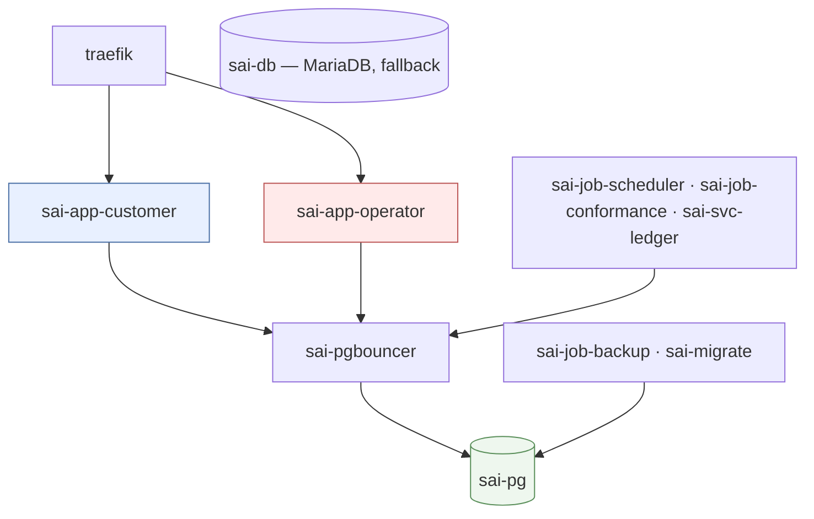
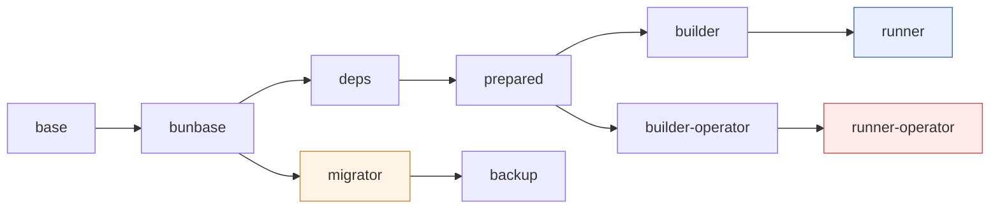
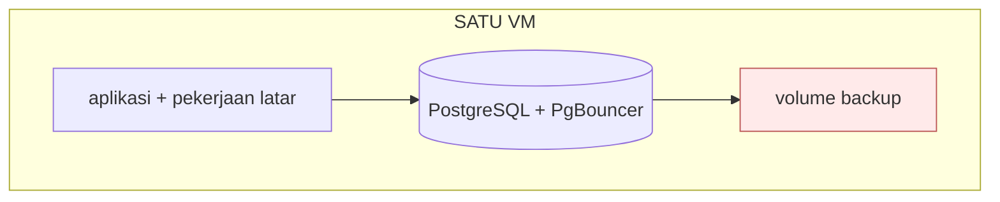
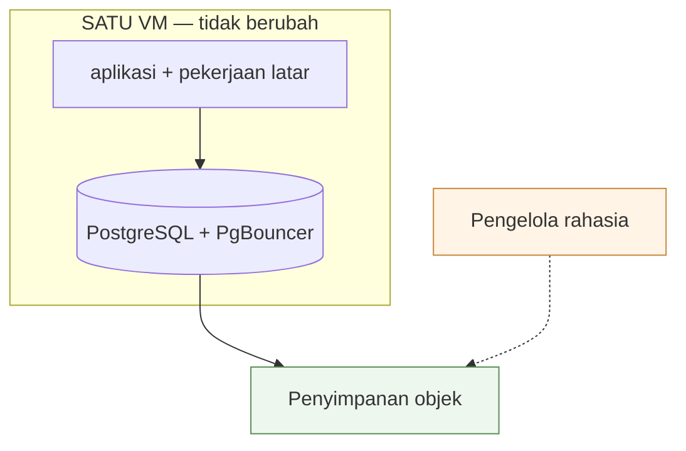
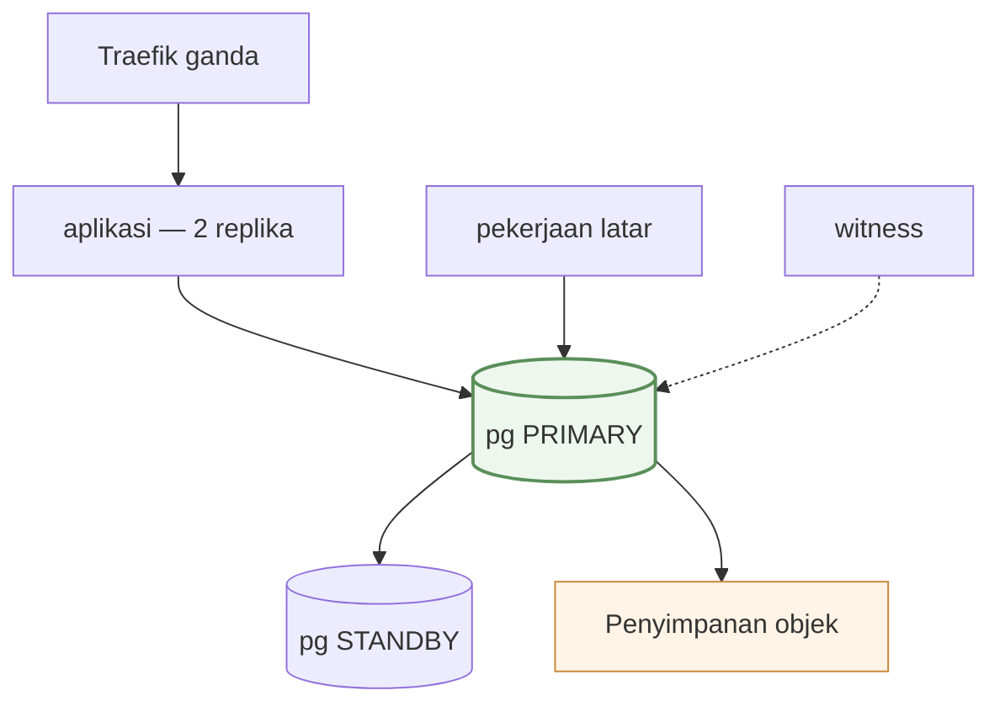

# 02 — Layanan & Infrastruktur

> 18 Okt 2026 · produksi `main@ca0cd038` · [indeks](./README.md)

Apa yang berjalan, di mesin apa, dan bagaimana rilis sampai ke sana. Dua bagian
terakhir berisi **target**, bukan keadaan.

- Repositori: `tri-evendi/sai-accounting` (bun workspaces)
- Direktori di server: `/opt/applications/sai-accounting`
- Registry: `ghcr.io/tri-evendi/sai-accounting`
- Pemilik: Tri Evendi. ❓ Tidak ada `CODEOWNERS`

## 1. Mesin

Satu VM, paket *Starter Type Instance*. Dibaca dari konsol penyedia 19 Okt 2026:

| | |
|---|---|
| vCPU | **2** |
| Memori | **8 GB** |
| Disk | **Cloud SSD 80 GB** |
| Kuota transfer | **2.560 GB/bulan**, 30 Mbps |
| Masa aktif | sampai **3 Juni 2027** · ⚠ perpanjangan otomatis **MATI** |
| Platform | Linux 6.8.0-117-generic · `Asia/Jakarta` |

Dibagi dengan lima aplikasi lain: `movin-pwa`, `movin-landing`,
`movin-budget-web`, `movin-wedding`, `movin-partner`, plus `traefik`.

> ⚠ **VM kedaluwarsa 3 Juni 2027 dan perpanjangan otomatis mati.** Itu
> pemadaman total, dan di sebagian penyedia disk ikut dilepas — satu-satunya
> risiko di dokumen ini yang punya tanggal pasti.

Ukuran mesin ini adalah alasan langsung empat keputusan: tipe diperiksa di luar
`next build`, image dibangun di CI, tahap `migrator` tidak mewarisi `builder`,
dan batas heap eksplisit di setiap perintah Node.

## 2. Sepuluh layanan

| Layanan | Container | Peran | Kadens |
|---|---|---|---|
| `app-customer` | `sai-app-customer` | Enam grup rute customer + 128 rute API | selalu hidup |
| `app-operator` | `sai-app-operator` | Konsol operator | selalu hidup |
| `pg` | `sai-pg` | PostgreSQL 17 — 17 buku PT + control + platform | selalu hidup |
| `pgbouncer` | `sai-pgbouncer` | Pool koneksi `transaction` | selalu hidup |
| `db` | `sai-db` | MariaDB 11, fallback, tidak ditulisi (#636) | sementara |
| `job-scheduler` | `sai-job-scheduler` | 7 langkah penagihan & pemeliharaan | tiap jam |
| `job-conformance` | `sai-job-conformance` | Sapuan kesesuaian data (hanya-baca) | mingguan |
| `job-backup` | `sai-job-backup` | dump → tar → sandi → S3 | harian |
| `svc-ledger` | `sai-svc-ledger` | Pelari jalur `ledger` — menguras tabel `jobs` | selalu hidup |
| `migrate` | `sai-migrate` | Migration, lalu keluar (`restart: "no"`) | sekali per deploy |

Ditambah `traefik`, dipakai bersama lima aplikasi lain dan tidak termasuk
`docker-compose.yml` repo ini.



Hanya kedua `app-*` yang berada di dua jaringan (`traefik_default` +
`internal`). Sisanya hanya di `internal`, jadi tidak terjangkau dari luar mesin
— itu sebabnya ketiga job memakai ulang image `migrator`.

**Empat image dari satu commit:** `app-customer` (`runner`), `app-operator`
(`runner-operator`), `migrator`, `backup`. `job-scheduler`, `job-conformance`,
dan `svc-ledger` memakai ulang `migrator`.

⚠ `svc-ledger` ber-awalan `svc-`, bukan `job-`, dan bedanya bukan selera:
ketiga `job-` adalah satu putaran yang BERAKHIR, sementara yang ini tidak
pernah berakhir — ia menguras antrean selama hidupnya. Nomenklaturnya di
`AGENTS.md`.

## 3. Dua aplikasi web

| | `app-customer` | `app-operator` |
|---|---|---|
| Image / tahap | `sai-accounting:latest` (`runner`) | `…-operator:latest` (`runner-operator`) |
| Perintah | `node server.js` sebagai `node` | `node apps/operator/server.js` |
| Domain | `APP_DOMAIN` + `www.` (301 ke apex) | hanya `OPERATOR_DOMAIN` |
| Volume | `documents` (RW) · `audit` (RW) | `audit` (RW); **tanpa** `documents` |
| Healthcheck | `/api/health` tiap 30s | `/api/health` konsol sendiri |
| Isi | Enam grup rute + PDF/Excel + surel | 19 halaman konsol; `/operator/*` lama → 308 |
| Standalone | 299 MB | 69 MB |

`app-customer` tidak memuat rute konsol, dan `OPERATOR_HOST` dikosongkan lewat
`environment:` (menimpa `env_file:`) sebagai lapis tambahan. Satu container,
tanpa replika: restart mengosongkan setiap cache dalam memori, dan cache
per-proses itulah yang menghalangi penskalaan horizontal (P2-3).

> ⚠ **Jangan beri `app-operator` router `APP_DOMAIN`.** Customer yang diarahkan
> ke sana menerima 404 untuk seluruh aplikasi.

## 4. Basis data

| | `pg` |
|---|---|
| Image | `postgres:17-alpine` (17.11); versi mayor sejajar `postgresql-client-17`, dijaga `tests/pg-client-version.test.ts` |
| Volume | `pg_data:/var/lib/postgresql/data` |
| Inisialisasi | `--data-checksums --encoding=UTF8 --lc-collate=C --lc-ctype=C` — checksum tidak bisa dinyalakan sesudahnya |
| Batas | `pg_isready` tiap 10s · `max_connections = 100` |
| Isi | 19 basis data, 227 MB (16 Okt 2026) |

`app-*` dan dua job lewat `pgbouncer`; `migrate` dan `job-backup` **langsung**
ke `pg` — Prisma Migrate memakai advisory lock yang terikat sesi, dan pooler
`transaction` memulangkan dump sebagian.

**`pgbouncer`** (`edoburu/pgbouncer:v1.26.0-p0` — **versi dipatok**, bukan
`latest`, sejak 19 Okt 2026) mendengarkan di **5432**, bukan 6432 —
salah port ini sebab pertama penukaran 15 Okt gagal. `POOL_MODE=transaction`,
`MAX_CLIENT_CONN=200`, `DEFAULT_POOL_SIZE=20`, `AUTH_TYPE=scram-sha-256`.
Wajib karena PostgreSQL memakai satu proses per koneksi dan puncak terukur 62
koneksi; mode `session` menghapus manfaatnya.

**Profil on-premise.** `docker-compose.onprem.yml` adalah override, bukan berkas
pengganti: `docker compose -f docker-compose.yml -f docker-compose.onprem.yml up
-d`. Hasilnya **tujuh service** — `pg`, `pgbouncer`, `migrate`, `app-customer`,
dan ketiga `job-*`.

| Yang berbeda di mesin customer | Sebabnya |
|---|---|
| Jaringan `traefik` **lokal** | di berkas utama ia `external: true`, dan tanpa Traefik di mesin itu `up` **gagal memvalidasi** sebelum satu container pun start |
| `app-operator` · `db` tidak dipasang | profil `tidak-dipasang` |
| Tag image **wajib**: `${SAI_TAG:?…}` | `latest` berpindah setiap kali CI mendorong, jadi `up -d` karena reboot atau ganti disk bisa memasang versi yang belum pernah diuji di sana |
| `pull_policy: always` | `build:` di berkas utama membuat `up` **membangun image di kotak customer** — sepuluh menit `next build` tanpa toolchain-nya, dilarang PRODUCTION.md |
| `APP_DEPLOY_PROFILE: onprem` | lewat `environment:` (menimpa `env_file:`) di kelima service SAI — override ini sendiri yang menyatakan profilnya, jadi tidak ada baris yang bisa lupa disalin |

Dijaga `tests/onprem-profile.test.ts`, yang menuntut **setiap** service
ber-`image: ${SAI_IMAGE…}` di berkas utama disebut di override — dipatok, atau
dinyatakan tidak dipasang. Tanpa itu, service baru ikut ke mesin customer dengan
setelan SaaS-nya tanpa satu permukaan pun berubah warna di sini.

**Profil penyebaran.** `APP_DEPLOY_PROFILE` = `saas` (bawaan bila tidak diset)
atau `onprem`, dibaca lewat `@sai/core/deploy-profile`; nilai asing **melempar**.
Pemasangan on-premise tidak memasang basis data platform sama sekali, dan
variabel ini yang membuat aplikasi bisa **menyatakan** keadaan itu alih-alih
melaporkannya sebagai kerusakan:

| Akibatnya | |
|---|---|
| `/api/health` | `platform: not-installed`, bukan `unknown` |
| Halaman status | tidak lagi memuat satu baris kuning permanen |
| `scheduler:subscriptions` | mencatat putaran kosong berstatus `ok`, supaya `watch:health` tidak mengirim surel tiap jam tentang langganan yang tidak ada di sana |

Profil `saas` yang kehilangan `PLATFORM_DATABASE_URL` justru **tidak** mencatat
apa pun: di sana ketiadaan alamat memang kerusakan, dan jejak yang kosong itulah
yang membuat penjaganya berbunyi. Profilnya **tidak pernah disimpulkan** dari env
basis data — alasannya di `packages/core/src/deploy-profile.ts`.

**Jejak putaran ada di basis data kendali**, bukan `sai_platform`:
`scheduler_runs`, `conformance_runs`, `backup_runs` (migration kendali
`0005_jejak_putaran`). Kenapa bukan platform: komentar model `SchedulerRun` di
`packages/db/prisma/control/schema.prisma`. Baris lama diangkut `bun run
trails:move` — idempoten, dan tidak menghapus apa pun di platform; `DROP`
menyusul sebagai langkah contract di rilis berikutnya.

**Bundel diagnostik.** `bun run support:bundle` merakit satu arsip yang bisa
dikirim dari mesin customer: versi & digest image, status dan jumlah restart
container, sisa sumber daya, **nama** migration terpasang per basis data, jumlah
baris per tabel dari `n_live_tup` (angka, tanpa memindai tabel), `/api/health`,
dan baris log. Log diambil dengan **allowlist** — hanya baris berbentuk
diagnostik yang masuk, sisanya dibuang tanpa dibaca — lalu yang lolos disunting.
Daftar sensor sengaja tidak dipakai: ia selalu ketinggalan satu bentuk, dan
bundel yang kurang satu baris log bisa diminta ulang sementara bundel yang
membocorkan satu faktur tidak bisa ditarik. Setiap arsip memuat `manifes.txt`
yang menyebut apa yang ikut dan apa yang ditinggalkan, supaya pengirimnya bisa
memeriksanya lebih dulu. Hanya **membaca**; `--dry-run` menyebutkan isi tanpa
menulis. Dijaga `tests/support-bundle-script.test.ts`, yang **menjalankan**
fungsi penyuntingan yang dikirim, bukan salinannya.

**`db`** (MariaDB 11) masih hidup sejak 15 Okt tetapi tidak ditulisi. Kembali
ke MariaDB berarti men-deploy image `sha-` lama **sekaligus** menukar URL,
karena image yang berjalan dibangun dari skema `provider = "postgresql"`.

Dua hal berbeda dari MariaDB dan masih terbuka sebagai risiko: collation `C`
(teks peka huruf besar-kecil) dan role aplikasi `sai` adalah **SUPERUSER**.

## 5. Pekerjaan latar

### `migrate`

`bun run db:migrate:all`, `restart: "no"`. Menerapkan migration ke control,
lalu platform, lalu setiap perusahaan; satu perusahaan yang gagal tidak
menghentikan yang lain. Image-nya dibangun dari `bunbase`, bukan `builder`.

> ⚠ **Jangan `db:migrate` (tunggal).** Ia hanya menyentuh basis data yang
> ditunjuk `DATABASE_URL`; control, platform, dan buku PT lain tertinggal
> **tanpa error**.

### `job-scheduler` — tujuh langkah, tiap jam

`sleep 3600`, `timeout -k 30 480` per langkah (7 × 480s = 56 menit < 1 jam).

| # | Perintah | Tugas | Idempotensi |
|---|---|---|---|
| 1 | `scheduler:subscriptions` | Trial habis, tagihan terbit, dunning, suspensi, pengingat H-7/H-3/H-1, sinkronisasi pemakaian | Idempoten |
| 2 | `notify:setup` | Kabar penyiapan mandek (H+1/+3/+7/+14) | `dedupe_key`, maks 4 seumur hidup |
| 3 | `notify:invoice-due` | Kabar jatuh tempo + ringkasan mingguan | `dedupe_key` |
| 4 | `remind:customers` | **Surel ke pelanggan** (H-3/H+1/H+7) | Kunci unik (invoice, kind, due_key) |
| 5 | `recurring:publish` | **Terbitkan PEKERJAAN** dokumen berulang — satu baris `jobs` per PT; yang memposting `svc-ledger` | `dedupe_key` berbutir jam UTC |
| 6 | `watch:health` | Baca 3 heartbeat, kirim surel peringatan | Satu surel per status per 24 jam |
| 7 | `prune:trails` | Pangkas jejak putaran > 90 hari | Putaran kosong = satu `SELECT` per tabel |

Tiga keputusan desain:

1. **`remind:customers` di belakang produser lain (#467)** — satu-satunya langkah yang mengirim surel ke luar organisasi customer, jadi putaran yang mati di tengah berhenti pada pekerjaan yang masih bisa diulang tanpa akibat bagi orang lain.
2. **`|| true` per langkah** — satu produser gagal tidak menghentikan langkah berikutnya.
3. **`timeout` wajib** — `|| true` menangani langkah yang *gagal*, bukan yang *menggantung*. Pada 30 Agu 2026 `scheduler:subscriptions` menggantung dua jam dengan CPU 0,09%; container tetap "Up", log terakhir "✓ selesai", nol error.

**Layanan, bukan crontab (#373):** baris crontab yang terlewat saat rilis tidak
menghasilkan error. Sebagai layanan, ia ikut naik bersama deploy dan terlihat
di `docker compose ps`.

⚠ **Langkah 5 berhenti melaksanakan.** Sampai Oktober 2026 ia `recurring:run`,
yang memposting dokumen berulang untuk SELURUH PT di dalam putaran ini. Tiga
cacatnya tidak kelihatan sampai salah satunya kejadian: satu PT yang gagal
menunggu **sejam** untuk dicoba lagi (yang diulang seluruh putaran, bukan yang
gagal); langkah itu memikul batas `timeout` yang harus **turun** setiap kali ada
langkah baru, padahal ongkosnya tumbuh seiring jumlah pelanggan; dan putaran
yang mati di tengah daftar meninggalkan separuh PT tak tergarap tanpa satu baris
pun yang mencatat sampai mana ia sempat. Sekarang langkah ini menulis satu baris
`jobs` per PT dan selesai dalam milidetik; `svc-ledger` melaksanakannya dengan
`attempts` dan *backoff* per PT.

### `svc-ledger` — pelari jalur `ledger`

Menguras `kind` `ledger.*` dari tabel `jobs` (basis data `control`). Satu-satunya
layanan latar yang **menulis buku besar**, dan karena itu ia memikul invarian
I-2: pintu posting wajib tunggal, dan pintu itu TypeScript. Handler-nya
**mendelegasikan** ke `src/lib/recurring-run.ts` — mesin yang sama yang dipakai
`recurring:run` tangan. Dua mesin untuk satu aturan akuntansi akan menyimpang
tanpa satu galat pun, dan yang menyimpang adalah buku.

| Hal | Bentuknya |
|---|---|
| Replika | **Satu, dan bukan pilihan penyebaran** — jalurnya tunggal-instans di `contract/kinds.yaml`; instans kedua keluar sendiri, dipagari `pg_try_advisory_lock` |
| Pekerjaan menggantung | Dijaga **lease**, bukan `timeout` compose: perpanjangan berhenti, ambang reclaim melewatinya, barisnya pulang ke `queued` dengan `attempts + 1` |
| Berhenti | SIGTERM menyelesaikan pekerjaan yang sedang jalan lalu berhenti mengklaim (`stop_grace_period: 60s`) |
| Pemeliharaan | Tiap 60 detik: memulangkan lease kedaluwarsa, membuang baris `done` > 14 hari. Baris **gagal tidak pernah** dipangkas |
| Terbaca di | `/operator/scheduler` (umur tertua per jalur) · `/api/health` → `queue` (satu kata) |

⚠ Antrean yang **kosong tidak membuktikan penerbitnya hidup**: bila
`recurring:publish` berhenti, tak ada baris yang pernah terbit — antrean kosong,
umur tertua nol, dan setiap ambang hijau sementara dokumen berulang berhenti
sama sekali. Yang membantahnya hanya denyut penjadwal, yang diukur dari stempel
waktu putaran. Itu sebabnya keduanya dibaca di **satu halaman**.

### `job-conformance` — mingguan

`bun run check-data-conformance`, `sleep 604800`, `timeout -k 30 1800`, **hanya
membaca** (dijaga `tests/check-data-conformance.test.ts`).

Memeriksa: status di luar enum · mata uang tak dikenal · valas tanpa kurs ·
mata uang pembayaran ≠ dokumennya · faktur kelebihan bayar · jurnal tidak
berimbang atau kosong · tipe akun asing · akun penampung beban berskala
material (#444, ambang 5%).

Ada karena guard zod hanya berlaku di jalur tulis; impor sekali jalan,
perbaikan SQL manual, dan seeder tidak melewatinya. Audit 20–21 Agu 2026
menemukan enam kelas cacat yang masuk lewat jalur itu — termasuk kuantitas
faktur termigrasi senilai **Rp 774 juta**. `|| true` di sini wajib: skrip
sengaja keluar bukan-nol saat menemukan sesuatu, dan tanpa `|| true` setiap
temuan jadi *crash-loop*.

### `job-backup` — harian

`sh scripts/backup.sh`, `sleep 86400` (RPO 1 hari, disengaja),
`timeout -k 60 7200`. Volume: `documents` (:ro) · `audit` (:ro) · `backup` (RW).

**Urutan:** `pg_dumpall` langsung ke `pg` → `tar -czf` → `openssl enc
-aes-256-cbc -pbkdf2 -iter 200000 -salt` → SHA-256 atas ciphertext →
`aws s3 cp` (arsip + `.sha256`) → pangkas yang kedaluwarsa **hanya** bila
unggahan sukses. Tanpa `BACKUP_S3_BUCKET`, hasilnya ke volume `backup` dan
`/api/health` melaporkan `local_only`.

| Keputusan | Alasan |
|---|---|
| `--all-databases`, bukan daftar yang diketik | Daftar tangan tertinggal saat customer baru mendaftar |
| Enkripsi sebelum berkas meninggalkan mesin | — |
| SHA-256 atas ciphertext ikut dikirim | AES-256-CBC tidak membawa pemeriksaan keutuhan sendiri |
| `awscli`, bukan SigV4 buatan sendiri | Penanda tangan sendiri gagal pada penyedia yang menormalkan header berbeda, dan gagalnya muncul saat restore |

> **⚠ Status 18 Okt 2026: `local_only`**, `lastSuccessAt: null`, tiga env S3
> kosong. Kehilangan mesin = kehilangan buku **beserta** backup-nya. P0-1.

`prove-backup-restore` memeriksa fingerprint, sandi, dan kelengkapan arsip. Ia
**tidak** memuat dump ke basis data mana pun — satu `psql <` yang salah sasaran
akan menimpa produksi. Pemuatan sungguhan ke server bayangan adalah latihan
kuartalan manusia (❓ belum ada bukti dijalankan).

## 6. Penyimpanan & volume

| Volume | Dipasang di | Isi | Dicadangkan? |
|---|---|---|---|
| `pg_data` | `pg` | 19 basis data | Ya, lewat `pg_dumpall` |
| `db_data` | `db` | MariaDB fallback, beku sejak 15 Okt | Tidak lagi; arsipkan dump terakhir sebelum dihapus (#636) |
| `documents` | `app-customer` (RW), `job-backup` (RO) | `data/documents/<companyId>/<uuid>.<ext>` | Ya — di `tar` |
| `audit` | kedua `app-*` (RW), `job-backup` (RO) | Berkas JSONL lama `.dipindahkan` | Ya — di `tar` |
| `backup` | `job-backup` (RW) | Arsip terenkripsi + `.sha256` | — (ia *adalah* backup-nya) |

Jejak audit ada di **tiga** tabel: `audit_logs` (tiap buku PT),
`tenant_audit_logs` (control), `operator_audit_logs` (platform).
`tenant_audit_logs` sengaja tanpa FK ke `tenants` — jejak ini mencatat
penghapusan tenant.

## 7. Modul & skrip

| Bidang | Modul yang memegang keputusan |
|---|---|
| Data & konteks | `prisma.ts` · `company-clients.ts` (LRU, `POOL_MAX`=4) · `company-context.ts` · `current-company.ts` · `@sai/core/control-db` · `@sai/platform/platform-db` · `company-{registry,route,request,provisioning}.ts` · `users-directory.ts` · `@sai/core/tenant-cache` |
| Otorisasi & sesi | `@sai/core/authz` · `authz-effective.ts` · `tenant-authz.ts` · `page-auth.ts` · `auth-guard.ts` · `api-token-guard.ts` · `auth.ts` · `business-modules.ts` · `company-unlock.ts` · `@sai/core/rate-limit{,-persistent}` · `@sai/core/operator-plane` · `apps/operator/src/lib/operator/*` |
| Mesin akuntansi | `posting/{index,rules,mapping,rates,cogs}.ts` · `ledger.ts` · `accounting.ts` · `period-close.ts` · `year-close*.ts` · `fx-revaluation-service.ts` · `approvals.ts` · `document-{chain,writes}.ts` · `opening-balance.ts` |
| Pelaporan | `statement-layout.ts` (79 KB) · `reports.ts` + `report-*.ts` · `receivables.ts` (39 KB) · `budget-report.ts` · `project-profit-report.ts` · `stock-value-report.ts` |
| Platform & penagihan | `@sai/billing/*` · `@sai/platform/payment-webhook` · `company-payment-settings.ts` · `@sai/core/registration` · `tenant-{export,directory}.ts` · `@sai/platform/{mailer-core,mail-settings}` · `health-report.ts` |
| Penyajian & isi | `nav.ts` · `docs-content.ts` (68 KB) · `wizard.ts` (44 KB) · `@sai/core/i18n/*` (~2.500 kunci) · `antd-tokens.ts` · `layout-scale.ts` · `changelog.ts` |

53 skrip operasional, semua lewat `bun run <nama>`:

| Kelompok | Isi |
|---|---|
| Migration & adopsi | `db:migrate:all` · `migrate-all-companies` · `migrate-platform` · `migrate-audit` & `migrate-tenant-audit` · `adopt-existing-company` · `adopt-tenant` |
| Pembuktian | `prove-scheduler-alive` · `prove-backup-restore` · `prove-tenant-adoption` · `prove-company-slug-immutable` · `prove-company-slug-scope` · `check-data-conformance` · `classify:books` · `verify-local-setup` · `rehearse-billing-webhook` |
| Dipanggil scheduler | `subscription-scheduler` · `notify-pending-setup` · `notify-invoice-due` · `remind-customers` · `run-recurring` · `watch-health` · `prune-run-trails` |
| Penyemaian | `seed-plans` · `seed-coa` · `seed-asset-categories` · `seed-demo` · `prisma/seed.ts` · `bootstrap` · `create-admin` · `create-company` |
| Operasi | `backup.sh` · `record-backup-run` · `reconcile:platform` · `pause-platform-billing` · `change-tenant-plan` · `operator-{code,credential}` · `execute-tenant-deletion` · `rename-tenant-slug` · `efaktur-platform` · `build-changelog` · `check:env` |

Dua jebakan: `seed-demo.ts` menghasilkan buku yang neracanya seimbang,
`prisma/seed.ts` tidak — hasilnya tidak bisa dipakai sebagai buku. Dan skrip
tidak bisa mengimpor `server-only` (`tsx` gagal memuatnya), jadi logika produser
harus tinggal di pustaka murni.

## 8. Jaringan & domain

Hanya Traefik yang mengikat `:80`/`:443`. Routing lewat label Docker, bukan
berkas konfigurasi.

| Router | Container | Entrypoint | Aturan | Middleware |
|---|---|---|---|---|
| `sai-app` / `-secure` | `app-customer` | `web` / `websecure` | `Host(APP_DOMAIN)` | `sai-https` / TLS `le` |
| `sai-www` / `-secure` | `app-customer` | `web` / `websecure` | `Host(www.APP_DOMAIN)` | `sai-www-apex` → 301 |
| `sai-ops` / `-secure` | `app-operator` | `web` / `websecure` | `Host(OPERATOR_DOMAIN)` | `sai-https` / TLS `le` |

> ⚠ **Nama service Traefik kedua container harus berbeda.** Dengan nama sama,
> Traefik menganggapnya satu service dengan dua backend dan membagi beban —
> permintaan operator bisa mendarat di container customer, **tanpa error**.

| Port | Terbit ke host |
|---|---|
| `80`, `443` | Ya — hanya Traefik |
| `3000` | Tidak (`expose`) — kedua `app-*` |
| `5432` · `3306` | Tidak — hanya di `internal` |

`APP_DOMAIN` = `saiaccounting.id` · `OPERATOR_DOMAIN` = `ops.saiaccounting.id`
(routing Traefik) · `OPERATOR_HOST` (pemeriksaan **di dalam** aplikasi, wajib).
Dua variabel berbeda yang nilainya harus cocok.

## 9. Image & build



| Tahap | Isinya | Heap |
|---|---|---|
| `base` · `bunbase` | `node:22-bookworm-slim` + openssl; lalu + bun 1.3 | — |
| `deps` | `bun install --frozen-lockfile` | — |
| `prepared` · `builder*` | 3× `prisma generate`; lalu `next build` | 768 MB |
| `runner*` | Standalone, `USER node` | — |
| `migrator` | 3× `prisma generate`; `CMD` `db:migrate:all` | 512 MB |
| `backup` | `migrator` + `postgresql-client-17` + `awscli` | — |

Tag per jalan CI: `latest` · `sha-<pendek>` · `<versi>`.

**Kedua image aplikasi wajib dari commit yang sama** — keduanya menulis basis
data yang sama. Membangun image aplikasi **tidak** ikut membangun `migrator`,
dan bila terlewat, dua job menjalankan kode lama tanpa tanda; karena itu
matriks CI membangun keempat image setiap kali.

**Bun = pemasang paket & peluncur skrip, Node = runtime.** `bun run`
menghormati shebang `#!/usr/bin/env node`, jadi `next`, `tsc`, `prisma`, `tsx`
tetap dijalankan Node dan `NODE_OPTIONS=--max-old-space-size=…` tetap berlaku.
Bun memakai JavaScriptCore yang **mengabaikan** batas itu; `bun --bun …`
mengubah error V8 yang terbaca menjadi OOM-killer (exit 137). `bun run
typecheck` memakai **2048 MB** karena kamus i18n bertipe terus tumbuh.

`trustedDependencies` bukan hiasan: bun memblokir skrip lifecycle kecuali
paketnya disebut di sana. Tanpa itu `bcrypt` tidak dibangun (error saat login),
`@prisma/engines` tidak diunduh, `esbuild` tidak terpasang (vitest mati).

## 10. Gate rilis

Gate-nya **dua**: `verify` **dan** build yang `EXIT=0`. Verify hijau tidak
membuktikan aplikasinya bisa dibangun.

| Gate | Siapa | Di mana |
|---|---|---|
| `bun run verify` | Semua, termasuk agent latar & sesi branch | Branch masing-masing |
| `bun run build` | **Hanya sesi utama**, sekali | Di atas `develop` hasil gabungan |
| `bun run build:operator` | Sama; wajib bila menyentuh `apps/operator` atau `packages/*` | Di atas hasil gabungan |

Agent latar tidak menjalankan build: `next build` ~10 menit di mesin ini, dan
dua build bersamaan pernah berakhir OOM (exit 137) yang terbaca seperti kode
rusak. Build yang tidak dijalankan ditulis apa adanya di badan PR. Sesi utama
tetap menjalankannya di atas hasil gabungan — satu-satunya build yang pernah
gagal di repo ini gagal di sana, padahal tiap branch-nya hijau.

| Jebakan | Akibat |
|---|---|
| `bun test` ≠ `bun run test` | Runner bawaan Bun: mengabaikan `vitest.config.ts`, lapor "no tests found" seolah suite rusak |
| `\| tail` pada perintah verify | Menutupi kode keluar; gate tampak hijau |
| `.next/types` basi | Typecheck gagal pada rute yang dipindahkan |
| `npm install` | Repo hanya punya `bun.lock` → lockfile kedua |

## 11. Alur rilis

```
develop  ──(verify + build hijau di atas hasil gabungan)──▶  PR ke main
main     ──push──▶  CI: build matriks 4 image  ──▶  GHCR
server   ──▶  git pull → compose pull → [migrate] → up -d        (TANPA membangun)
```

```bash
git pull
docker compose pull app-customer app-operator migrate job-scheduler job-conformance job-backup svc-ledger
# HANYA bila ada migration baru di prisma/postgresql/:
docker compose run --rm migrate bun run db:migrate:all
docker compose up -d --no-deps app-customer app-operator job-scheduler job-conformance job-backup svc-ledger
```

⚠ **`svc-ledger` wajib ikut `pull` dan `up`**, dan itu bukan kelengkapan
daftar: ia tidak melayani satu pun permintaan HTTP, jadi layanan yang
tertinggal di versi lama tidak membuat satu halaman pun rusak — ia hanya
menulis buku besar dengan image yang mendahului migration-nya, dan itu persis
bentuk kegagalan yang paling mahal di repo ini.

Tunggu **semua** job matriks hijau sebelum `pull`; bila satu target belum
terdorong, layanan berjalan di versi berbeda-beda. Bila rilis membawa
migration, urutannya **pull → migrate → swap** — `up --build -d` dalam satu
langkah menukar container sebelum migration berjalan.

Memeriksa apakah rilis membawa migration:
`git diff --name-only <sha-sebelumnya>..HEAD -- prisma/postgresql/`

### Rollback

```bash
SAI_TAG=sha-573d9cf docker compose up -d --no-deps app-customer app-operator
```

⚠ **Rollback ke sebelum 18 Okt 2026:** tag `sha-` yang lebih tua dari pemisahan
monorepo tidak punya image `…-operator`. Kembalikan juga `docker-compose.yml`
versi itu: `git checkout <sha-lama> -- docker-compose.yml`.

Dua hal yang mudah terlewat: migration baru → `db:migrate:all` (bukan
`db:migrate`); katalog paket berubah → `bun run db:seed:plans`. Paket GHCR
dibuat private secara bawaan, dan sampai dijadikan publik `docker compose pull`
menjawab `denied`.

Dua kebiasaan yang sudah dua kali terbukti perlu: buktikan migration lewat
angka pra/pasca yang dibaca sendiri, bukan laporan skrip; dan periksa
`.next/server` untuk memastikan fitur terjangkau — dengan cara itu #555
ketahuan tidak punya pemanggil.

## 12. Migration

```
db:migrate:all
├─ 1. db:migrate:control     prisma migrate deploy --config prisma.control.config.ts
├─ 2. db:migrate:platform    scripts/migrate-platform.ts  (dilewati dengan peringatan bila env kosong)
└─ 3. db:migrate:companies   scripts/migrate-all-companies.ts  (setiap PT terdaftar)
```

Diterapkan 18 Okt 2026: control **4/4** · platform **4/4** · perusahaan
**1/1** per buku. `prisma/migrations/` dan `prisma/{control,platform}/
migrations/` adalah arsip MariaDB hanya-baca (99 migration) — yang ditulis di
sana tidak akan diterapkan.

Migration ditulis **tangan** di
`prisma/postgresql/<db>/NNNN_<nama>/migration.sql` (lihat
[`DATABASE.md`](../DATABASE.md)), tidak dibangkitkan `migrate dev`. Klien
Prisma sudah ada di dalam image, jadi `db:generate` tidak perlu di server.

### Gerbang skema saat boot — pengganti `service_completed_successfully`

`app-customer` menunggu container `migrate` lewat
`depends_on: condition: service_completed_successfully`. Pengaman itu bekerja
selama yang ditunggu adalah pekerjaan yang **berakhir** — dan ia hilang begitu
pekerjaan latar menjadi layanan yang berjalan terus, sebab tidak ada lagi apa
pun yang "selesai" untuk ditunggu.

Gerbangnya **pindah, bukan dicabut**: aplikasi memeriksa sendiri saat boot
apakah skema yang ditemuinya sepadan dengan yang dibawa image-nya, dan
**menolak melayani** bila tidak (`packages/platform/src/schema-gate.ts`,
dibaca `/api/health`). Itu justru lebih kuat — berlaku di orkestrator mana pun
dan pada setiap restart, bukan hanya pada `up` yang pertama.

Yang menentukan seluruh nilainya adalah **ARAH** mana yang memblokir, dan salah
arah punya dua akibat yang dua-duanya mahal:

| Vonis | Artinya | Dilayani? |
|---|---|---|
| `mutakhir` | skema sepadan dengan image | ✅ |
| `tertinggal` | image lebih baru daripada skemanya | ❌ **503** |
| `menggantung` | ada migration yang gagal di tengah | ❌ **503** |
| `mendahului` | skema lebih baru daripada image | ✅ — ini keadaan **rollback yang disengaja** |
| `tak_terbaca` | tabel riwayat tak terbaca | ✅ — "saya tidak tahu" bukan alasan menolak lalu lintas |

Terlalu longgar → image yang lebih baru menulis kolom yang belum ada, dan
kegagalannya **tidak seragam**: halaman yang tidak menyentuh kolom baru tetap
sempurna, jadi yang terlihat adalah aplikasi "sebagian rusak" — dan sebagian
rusak pada pembukuan berarti ada angka yang masuk dan ada yang diam-diam tidak.
Terlalu ketat → rollback darurat ikut terblokir, tepat pada saat jalan keluar
dari insiden paling dibutuhkan.

## 13. Variabel lingkungan

Hanya nama; nilainya tidak dicantumkan. Pemeriksa: `bun run check:env`.

| Kelompok | Terisi di `.env` produksi |
|---|---|
| Domain & auth | `APP_DOMAIN`, `AUTH_SECRET`, `AUTH_URL`, `AUTH_TRUST_HOST` |
| Basis data | `DATABASE_URL`, `CONTROL_DATABASE_URL`, `PLATFORM_DATABASE_URL`, `PG_USER`, `PG_PASSWORD`, `DB_*` (MariaDB fallback) |
| Operator | `OPERATOR_DOMAIN`, `OPERATOR_HOST`, `OPERATOR_IP_ALLOWLIST`, `OPERATOR_MFA`, `OPERATOR_SESSION_SECRET`, `OPERATOR_USERS` |
| Enkripsi | `SETTINGS_ENCRYPTION_KEY`, `BACKUP_ENCRYPTION_KEY` |
| Backup · Kontak · Lain | `BACKUP_RETENTION_DAYS`, `BACKUP_S3_PREFIX` · `PLATFORM_CONTACT_EMAIL`, `PLATFORM_CONTACT_WHATSAPP` · `NODE_ENV`, `TZ`, `NEXT_PUBLIC_APP_NAME` |

| Dipakai kode, TIDAK ADA di `.env` | Akibat ketiadaannya |
|---|---|
| `AWS_ACCESS_KEY_ID`, `AWS_SECRET_ACCESS_KEY`, `BACKUP_S3_BUCKET`, `AWS_DEFAULT_REGION` | **Backup hanya lokal** |
| `MIDTRANS_SERVER_KEY`, `MIDTRANS_IS_PRODUCTION`, `PAYMENT_GATEWAY` | Gate bayar → MOCK / `manual` |
| `PLATFORM_ALERT_EMAIL` | Peringatan jatuh ke `PLATFORM_CONTACT_EMAIL` |
| `OPERATOR_TRUSTED_PROXY_HOPS` | Bawaan 1 — benar untuk susunan sekarang |
| `COMPANY_CLIENT_POOL_MAX` · `CONTROL_DB_CONNECTION_LIMIT` · `PLATFORM_DB_CONNECTION_LIMIT` · `POOL_DISCONNECT_GRACE_MS` | Bawaan 4 · 2 · 1 · 15.000 |
| `COMPANY_DATABASE_URL_TEMPLATE` · `SMTP_*` | Jatuh ke `DATABASE_URL` · SMTP dari `platform.mail_settings` |
| `ALLOW_SEED` | **Jangan pernah** `true` di produksi |

**Anggaran koneksi `app-customer`:** buku PT 2 × maks 4 klien = 8, control
2 × 1, platform 1 × 1 → **11**. Ditambah `app-operator` dan ketiga job saat
berjalan. Dua lapis batas: `max_client_conn = 200` di PgBouncer dan
`max_connections = 100` di `pg`.

Lingkungan: pengembangan `bun run dev` (transport surel `file` →
`data/mail-outbox/`) · produksi `docker compose` · staging ❓ tidak ada.

## 14. Pemantauan

| Yang ada | Isi |
|---|---|
| `GET /api/health` | `control`, `platform`, `company`, `scheduler`, **`queue`**, `backup`, `conformance`, `mail`. **503 hanya bila keadaan INTRINSIK container ini buruk** — control tak terjangkau, atau skema tak sepadan (§12). Bidang hilir dilaporkan, tidak pernah ikut memutuskan (doktrin #137) |
| `GET /status` | Versi untuk manusia: 4 keadaan per komponen, tanpa nama basis data atau kalimat error |
| Healthcheck Docker & Traefik | Kedua `app-*` tiap 30s · `pg` tiap 10s |
| `scheduler_runs` · `conformance_runs` · `backup_runs` | Jejak per putaran, dipangkas > 90 hari (baris `error`, baris terakhir, dan `ok` terakhir ditahan selamanya) |
| Halaman konsol `/scheduler`, `/conformance` | Denyut di layar — `/scheduler` memuat **umur antrean per jalur** |
| `prove-scheduler-alive` · `prove-backup-restore` | Memeriksa keadaan nyata |
| CI `Verify` | *Required status check* pada `main` sejak 11 Okt 2026 |

Dua jalur peringatan, penerimanya `PLATFORM_ALERT_EMAIL`: `watch:health`
(langkah 6, throttle satu surel per status per 24 jam) dan `src/lib/alert.ts`
(#374, throttle per fingerprint per jam).

### Antrean pekerjaan: yang diukur UMUR, bukan kedalaman

***Queue depth* bukan sinyal yang benar** — ia tidak mengatakan berapa lama
pekerjaannya menunggu maupun apakah tumpukannya tumbuh. Seribu pekerjaan yang
semuanya selesai dalam dua detik adalah sistem yang sehat; **satu** pekerjaan
yang menunggu empat jam adalah sistem yang rusak — dan metrik kedalaman membaca
keduanya terbalik.

| Status | Artinya | Ambang |
|---|---|---|
| `idle` | tidak ada yang menunggu | ambang **tidak berlaku** |
| `ok` | ada yang menunggu, masih segar | < 7 menit |
| `warn` | antrean tertahan | ≥ 7 menit |
| `late` | ini yang membangunkan orang | ≥ 10 menit |

Dipecah **per jalur**, dan ringkasannya mengambil yang **terburuk**: rata-rata
lintas jalur menyembunyikan justru hal yang paling ingin diketahui —
*starvation*, yaitu satu kelas pekerjaan tertahan di belakang kelas lain. Enam
jalur sehat dan satu yang macet adalah insiden, bukan "86% sehat".

Ambangnya **hanya berlaku bila ada yang menunggu**. Tanpa syarat itu, pekerja
yang menganggur karena memang tak ada kerja terbaca seperti kegagalan — dan
peringatan yang berbunyi untuk keadaan normal akhirnya diabaikan.

⚠ **Dan justru syarat itu membuka lubang yang paling berbahaya di sini.** Bila
penerbitnya mati, tak ada baris yang pernah terbit: antrean kosong, umur tertua
nol, setiap ambang di atas **hijau** — sementara dokumen berulang, pengingat,
dan cadangan semuanya berhenti. Kegagalan total yang terbaca sebagai kesehatan
sempurna. Yang membantahnya hanya **denyut penjadwal**, yang diukur dari stempel
waktu putaran dan karena itu tidak bergantung pada isi antrean sama sekali. Itu
sebabnya keduanya dibaca di **satu halaman** (`/operator/scheduler`), dan
sebabnya `/api/health` memuat `scheduler` dan `queue` berdampingan.

Aturan umumnya: **setiap komponen yang berjalan satu instans wajib punya denyut
yang diukur dari luar.** Dan stempel waktu **selesai** tidak bisa
memperlihatkan pekerjaan yang tidak pernah selesai, jadi "yang masih
tertunggak" wajib diukur sendiri.

Probe publik memuat **satu kata** saja. Umur dan kedalaman menyiratkan volume
pemakaian, dan #317 melarangnya bocor ke permukaan publik — sebab yang sama
yang membuat jumlah antrean surel tinggal di konsol operator. Angkanya dibaca
di konsol.

| Yang tidak ada | Akibat |
|---|---|
| Agregasi log | Log lama hanya lewat `docker logs` pada container yang masih hidup |
| Metrik / dasbor | Tidak ada tren; "apakah ini melambat?" tak terjawab — umur antrean terbaca **sekarang**, bukan sebagai riwayat |
| Pelacakan error | Error runtime hanya di log |
| Pemantauan luar | ❓ `/api/health` ada; pembacanya belum dipastikan |
| Peringatan saat scheduler mati total | `watch:health` berjalan **di dalam** `job-scheduler` dan ikut mati |

## 15. Pemulihan bencana

| Pertanyaan | Jawaban hari ini |
|---|---|
| **RPO** | 24 jam untuk kerusakan data · **tak terbatas** untuk kehilangan mesin |
| **RTO** | ❓ Belum pernah diukur |
| Backup luar-mesin | **Tidak ada** — `/api/health` → `local_only` |
| Dump manual | `backups/` di akar repo, di mesin yang sama dengan datanya |
| Latihan restore | Diwajibkan kuartalan; ❓ tanpa bukti |
| Kunci enkripsi di luar mesin | ❓ Belum dipastikan |
| Rollback kode · skema | Baik (tag `sha-`) · ❓ tidak ada migration `down` |

> ⚠ `.dockerignore` menjangkar polanya, `.gitignore` tidak. Karena itu pola
> `backups/` pernah membuat seluruh basis data produksi ikut masuk ke image
> yang di-deploy. **Periksa isi image, bukan pohon berkas.**

## 16. Tiga bentuk arsitektur infrastruktur

| Bentuk | VM | Satu kalimat |
|---|---|---|
| **Sekarang** | **1** | Satu VM memuat semuanya, termasuk backup-nya sendiri |
| **Minimal** | **1** | VM yang sama, tetapi datanya punya jalan pulang |
| **Ideal** | **5** (+1 staging opsional) | Basis data punya host sendiri, dan tidak ada satu mesin yang mematikan layanan |

### 16.1 Sekarang



Backup mendarat di volume pada mesin yang sama dengan datanya. Tidak ada
`cpus`/`mem_limit` per container, dan `pg` berbagi CPU serta disk dengan
aplikasi.

| ✅ | ❌ |
|---|---|
| Biaya terendah, operasional paling sederhana: satu compose, satu `.env`, satu tempat log | Kehilangan mesin = kehilangan buku **beserta** backup-nya |
| Tanpa jaringan antar-host: tidak ada latensi DB tambahan, tidak ada TLS DB | `pg` berebut 2 vCPU dan satu disk dengan lima aplikasi lain |
| Rollback cepat — tukar tag image | Restart atau patch `pg` = pemadaman total |
| Terbukti melayani 11 tenant | Satu job rakus bisa menjatuhkan aplikasi; RPO 24 jam / tak terbatas |

Tiga aturan kerja di repo lahir dari kegagalan nyata di mesin seukuran ini:

| Kejadian terukur | Akibatnya |
|---|---|
| `next build` di server ~19 menit, iowait 58–92%, separuh health probe 503 | Build dipindah ke CI |
| Dua build bersamaan → OOM-killer (137) | Agent latar tidak menjalankan build |
| `tsc` cold run OOM di 1536 MB | Heap `typecheck` naik ke 2048 MB |

### 16.2 Minimal



Tidak ada mesin baru. Yang berubah: dump harian dikirim ke penyimpanan objek di
region lain, kuncinya disimpan di luar mesin, dan batas sumber daya dipasang.

| Langkah | Usaha |
|---|---|
| Nyalakan perpanjangan otomatis VM | Satu sakelar (P0-3) |
| Isi 3 env S3, buktikan dengan `prove-backup-restore` atas artefak S3 | Rendah (P0-1) |
| `BACKUP_ENCRYPTION_KEY` ke pengelola rahasia, catat lokasinya | Rendah (P0-2) |
| Setel `cpus`/`mem_limit` per container | Rendah |

| ✅ | ❌ |
|---|---|
| Menutup satu-satunya risiko yang tidak bisa dipulihkan, dengan usaha hampir nol | Pemadaman tetap total bila VM atau `pg` jatuh |
| Tanpa mesin baru: topologi, env, dan TLS tidak berubah | RPO tetap 24 jam |
| Bisa dikerjakan hari ini, tanpa menunggu keputusan RPO/RTO | RTO masih restore manual dan belum pernah diukur |
| Batas container menghentikan "satu job menjatuhkan semuanya" | `pg` masih berebut CPU dan disk |

### 16.3 Ideal



| Simpul | Pilihannya | Kenapa |
|---|---|---|
| Traefik ganda | Dua instans di belakang VIP (keepalived) | Hari ini Traefik titik gagal tunggal untuk enam aplikasi |
| Aplikasi | 2 replika, PgBouncer lokal di tiap host | Pooler di host basis data ikut mati bersama primary. **Prasyarat P2-3**: cache dalam-memori harus dibagikan dulu |
| Pekerjaan latar | Tetap satu instans | Dua scheduler bersamaan menerbitkan tagihan dua kali; kalau perlu HA, pakai *leader election* |
| `pg PRIMARY` | Satu penulis, selalu | Buku besar memakai sequence dan nomor dokumen berurutan |
| `pg STANDBY` | Sinkron, `synchronous_commit = on` | RPO ≈ 0; harganya satu round-trip jaringan per commit |
| `witness` | Node ketiga pemegang quorum (etcd); Patroni atau repmgr | ⚠ **Dua node tidak cukup** — standby tidak bisa membedakan primary mati dari jaringan putus, dan dua primary yang sama-sama menerima jurnal tidak bisa digabungkan kembali |
| Penyimpanan objek | Arsip WAL (PITR) + dump harian, region lain | Replika menyalin perintah yang salah; hanya PITR yang bisa memulangkan keadaan sebelumnya |

**Perubahan paling menentukan: basis data pindah ke host sendiri.** Ketiga
kejadian di bentuk Sekarang adalah kasus yang sama — aplikasi dan `pg` berebut
CPU dan disk, dan yang kalah adalah basis data yang sedang menulis jurnal.

| Peran | Target | Alasan angkanya |
|---|---|---|
| Host aplikasi | 4 vCPU · 8 GB · 80 GB SSD (hari ini 2 vCPU) | vCPU yang naik dua kali adalah perubahan yang paling terasa |
| Host basis data | 4 vCPU · 8–16 GB · NVMe | Satu proses per koneksi, puncak 62 koneksi; `shared_buffers` ~25% RAM; beban dominan tulis kecil ber-`fsync` |
| Penyimpanan objek | S3-compatible, region berbeda | Dump + arsip WAL |
| Pengelola rahasia | Mana pun di luar mesin | `BACKUP_ENCRYPTION_KEY`, `SETTINGS_ENCRYPTION_KEY`, `AUTH_SECRET` |
| Staging | 2 vCPU · 4 GB, boleh mati di luar jam kerja | ❓ keputusan pemilik |

Yang ikut berubah pada perubahan yang sama: URL basis data menunjuk host lain ·
PgBouncer tetap di sisi aplikasi · `migrate` & `job-backup` tetap langsung ke
`pg` · TLS basis data wajib · `cpus`/`mem_limit` disetel · backup ditambah
arsip WAL. Yang **tidak** berubah: satu basis data per PT, satu image per
aplikasi dari satu commit, build tetap di CI.

| ✅ | ❌ |
|---|---|
| RPO ≈ 0 untuk kehilangan mesin, PITR untuk kesalahan manusia | Lima VM: biaya dan permukaan operasional berlipat, untuk 11 tenant |
| Failover otomatis: RTO dari jam ke menit | Patroni/etcd komponen baru yang bisa gagal sendiri; **failover yang salah menilai memutus layanan yang tadinya sehat** |
| Deploy dan patch tanpa pemadaman | `synchronous_commit` menambah satu round-trip tiap commit; standby lambat bisa menahan tulisan |
| `pg` berhenti berebut sumber daya; vCPU aplikasi naik dua kali | Pemantauan luar jadi prasyarat, bukan pelengkap |
| Staging membuat migration bisa dilatih | Dua `.env`, rahasia tersebar, TLS antar-host dan anggaran koneksi perlu ditinjau |

Tidak menyelesaikan: kesalahan manusia, migration yang merusak, atau kunci
enkripsi yang hilang — itu tetap pekerjaan bentuk Minimal.

### 16.4 Berapa VM

Sekarang dan Minimal: **satu VM, yang sudah ada.** Minimal menambah penyimpanan
objek dan pengelola rahasia, dan keduanya layanan, bukan VM.

Ideal: **lima VM.**

| # | Peran | Spesifikasi | Kenapa tidak bisa digabung |
|---|---|---|---|
| 1–2 | Aplikasi A & B | 4 vCPU · 8 GB · 80 GB SSD | Dua host adalah syarat deploy dan patch tanpa pemadaman; keduanya juga menjalankan Traefik + VIP dan PgBouncer lokal |
| 3 | Basis data primary | 4 vCPU · 8–16 GB · NVMe | Digabung dengan aplikasi berarti kembali ke kasus yang sudah terbukti patah |
| 4 | Basis data standby | 4 vCPU · 8–16 GB · NVMe | Standby di mesin yang sama tidak melindungi dari apa pun |
| 5 | Witness / etcd | 1 vCPU · 1–2 GB | Tidak boleh di salah satu host basis data — justru node inilah yang memecah seri |
| — | Penyimpanan objek | S3-compatible, region lain | Layanan, bukan VM |
| (6) | Staging | 2 vCPU · 4 GB | Opsional, ❓ keputusan pemilik |

Pekerjaan latar tidak mendapat VM sendiri: tetap satu instans, menumpang salah
satu host aplikasi. Bila dua replika aplikasi belum dibutuhkan, bentuk ideal
bisa jalan dengan **empat VM** — yang hilang hanya deploy tanpa pemadaman.

### 16.5 Perbandingan

| | Sekarang | Minimal | Ideal |
|---|---|---|---|
| Jumlah VM | 1 (dibagi 6 aplikasi) | 1 — VM yang sama, + S3 & pengelola rahasia | 5 (+1 staging) + S3 |
| Kehilangan data saat mesin hilang | Total | ≤ 24 jam | ~0 (standby sinkron) |
| Waktu pulih | ❓ belum diukur | Jam (restore manual) | Menit (failover) |
| Pemadaman saat deploy | Detik | Detik | ~0 (rolling) |
| Pemadaman saat `pg` restart | Total | Total | ~0 (switchover) |
| Tahan kesalahan manusia | ≤ 24 jam ke belakang, lokal | Ya, sampai batas dump harian | Ya — PITR ke detik mana pun |
| Biaya tambahan | — | Hampir nol | Sedang–tinggi |

**Minimal membeli pemulihan, Ideal membeli ketersediaan.** Pada 11 tenant, yang
hilang kalau aplikasi mati satu jam adalah waktu; yang hilang kalau mesin hilang
tanpa backup di luar adalah pembukuan sepuluh tahun.

## 17. Keputusan di balik bentuk ideal

> 🔶 Rancangan, belum prosedur terbukti.

**Dua angka yang harus diputuskan lebih dulu**, dan keduanya ❓ belum:

| | Pertanyaan | Keadaan sekarang |
|---|---|---|
| RPO | Berapa menit pembukuan yang boleh hilang? | 24 jam / tak terbatas |
| RTO | Berapa lama buku boleh tidak bisa dibuka? | ❓ belum pernah diukur |

Untuk pembukuan yang wajib disimpan sepuluh tahun (UU KUP), jawaban yang wajar
adalah **RPO mendekati nol** — satu jurnal yang hilang berarti neraca tidak
cocok, dan tidak ada cara merekonstruksinya. RTO biasanya lebih longgar. Jadi
urutannya **RPO dulu (PITR + commit sinkron), baru RTO (failover otomatis)**.

**PITR lebih penting daripada standby**, karena replika menyalin setiap
perintah termasuk yang salah:

| | Melindungi dari | Tidak melindungi dari |
|---|---|---|
| Standby sinkron | Mesin/disk primary mati | Perintah salah, migration merusak, korupsi logis |
| Arsip WAL (PITR) | Perintah salah, migration merusak, kehilangan mesin | Pemadaman (pemulihan butuh waktu) |
| Dump harian terenkripsi | Keduanya, sebagai lapis terakhir | Kehilangan > RPO harian |

**Lima hal yang HA tidak selesaikan:** kesalahan manusia (itu pekerjaan PITR) ·
migration yang merusak (staging + migration tulis tangan + angka pra/pasca) ·
kunci enkripsi hilang (dua node = dua `.env`, P0-2 makin penting) · buta
pemantauan (failover tanpa metrik gagal tanpa ada yang tahu) · jam tidak sinkron
(penutupan periode berbasis tanggal; NTP dan `TZ` wajib sama).

**Urutan pengerjaan.** Setiap langkah berguna walaupun langkah berikutnya tidak
pernah dikerjakan.

| # | Langkah | VM sesudahnya | Membeli apa |
|---|---|---|---|
| 0 | Nyalakan perpanjangan otomatis VM | 1 | Menghindari pemadaman bertanggal pasti |
| 1 | Backup luar-mesin terverifikasi + kunci di luar | 1 | Jalan pulang dari kehilangan mesin |
| 2 | Setel `cpus`/`mem_limit` | 1 | Satu job tidak bisa menjatuhkan aplikasi |
| 3 | Pisahkan host basis data | 2 | `pg` berhenti berebut disk |
| 4 | Arsip WAL → PITR | 2 | RPO dari 24 jam jadi menit |
| 5 | Pemantauan luar + metrik | 2 | Failover bisa dipercaya |
| 6 | VM ketiga sebagai target restore dingin | 3 | RTO terukur untuk pertama kalinya |
| 7 | Standby asinkron + latihan switchover | 3 | Pemulihan dari jam ke menit |
| 8 | Witness + failover otomatis, lalu commit sinkron | 4 | RPO ≈ 0 |
| 9 | Replika aplikasi kedua + Traefik ganda | **5 — ideal lengkap** | Deploy & patch tanpa pemadaman |
| 10 | DRC: standby asinkron di region lain | 6 | Tahan kehilangan satu DC |

Langkah 0–2 tidak menambah mesin dan tidak menunggu keputusan apa pun.

## 18. Yang belum dipastikan

| Hal | Kenapa penting |
|---|---|
| ❓ `CODEOWNERS` | Tidak ada; semuanya tampak dimiliki satu orang |
| ❓ Staging | Tidak ada definisi compose/CI. 🔶 Lokal → produksi langsung |
| ❓ Pemantauan luar | `/api/health` ada; pembacanya tidak diketahui |
| ❓ Agregasi log | Hanya `docker compose logs` |
| ❓ Latihan restore kuartalan | Diwajibkan `package.json`; tanpa bukti dijalankan |
| ❓ Basis data uji di produksi | Empat buku berpola uji hidup di instans produksi; dua putusan menunggu pemilik |
