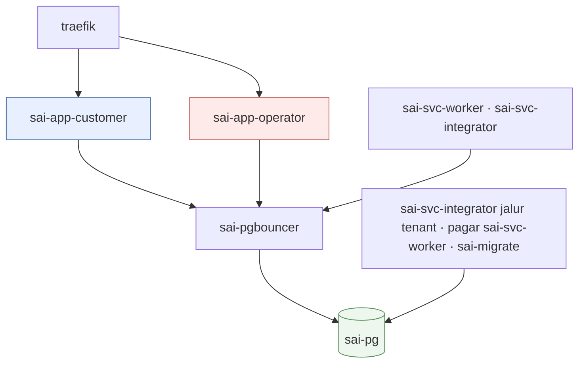
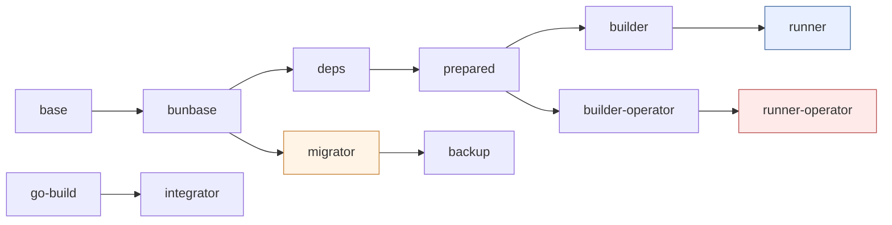
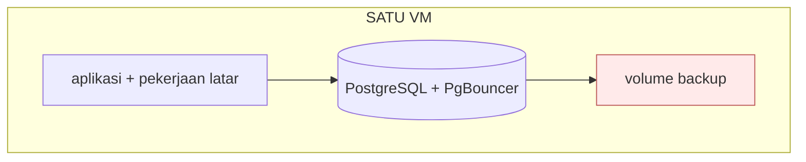
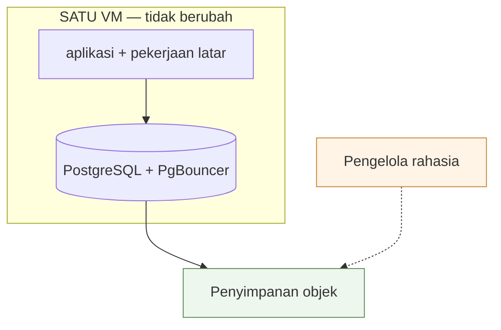
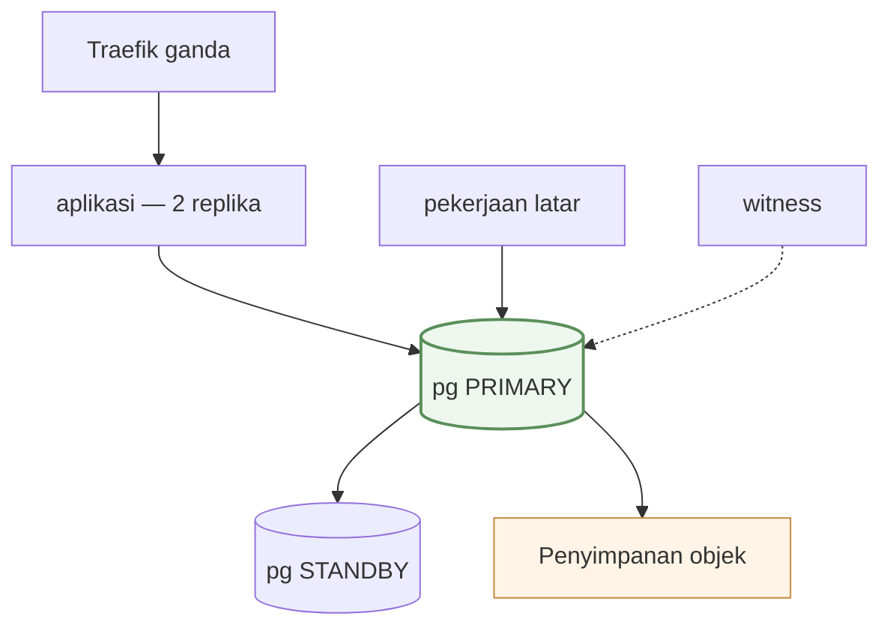

# 02 — Layanan & Infrastruktur

> 22 Okt 2026 (kode `develop`) · terakhir diukur terhadap produksi `main@ca0cd038` · [indeks](./README.md)

Apa yang berjalan, di mesin apa, dan bagaimana rilis sampai ke sana. Dua bagian
terakhir berisi **target**, bukan keadaan.

- Repositori: `tri-evendi/sai-accounting` (bun workspaces)
- Direktori di server: `/opt/applications/sai-accounting`
- Registry: `ghcr.io/tri-evendi/sai-accounting`
- Pemilik: Tri Evendi. ❓ Tidak ada `CODEOWNERS`

## 1. Mesin

Satu VM, paket *Starter Type Instance*. Dibaca dari konsol penyedia 19 Okt 2026:

| | |
|---|---|
| vCPU | **2** |
| Memori | **8 GB** |
| Disk | **Cloud SSD 80 GB** |
| Kuota transfer | **2.560 GB/bulan**, 30 Mbps |
| Masa aktif | sampai **3 Juni 2027** · ⚠ perpanjangan otomatis **MATI** |
| Platform | Linux 6.8.0-117-generic · `Asia/Jakarta` |

Dibagi dengan lima aplikasi lain: `movin-pwa`, `movin-landing`,
`movin-budget-web`, `movin-wedding`, `movin-partner`, plus `traefik`.

> ⚠ **VM kedaluwarsa 3 Juni 2027 dan perpanjangan otomatis mati.** Itu
> pemadaman total, dan di sebagian penyedia disk ikut dilepas — satu-satunya
> risiko di dokumen ini yang punya tanggal pasti.

Ukuran mesin ini adalah alasan langsung empat keputusan: tipe diperiksa di luar
`next build`, image dibangun di CI, tahap `migrator` tidak mewarisi `builder`,
dan batas heap eksplisit di setiap perintah Node.

## 2. Sembilan layanan

| Layanan | Container | Peran | Kadens |
|---|---|---|---|
| `app-customer` | `sai-app-customer` | Enam grup rute customer + 128 rute API | selalu hidup |
| `app-operator` | `sai-app-operator` | Konsol operator | selalu hidup |
| `pg` | `sai-pg` | PostgreSQL 17 — 17 buku PT + control + platform | selalu hidup |
| `pgbouncer` | `sai-pgbouncer` | Pool koneksi `transaction` | selalu hidup |
| `svc-worker` | `sai-svc-worker` | **Empat peran Node** di bawah penyelia `scripts/run-workers.ts`: `scheduler` (8 langkah penagihan & pemeliharaan, tiap jam), `conformance` (sapuan kesesuaian, mingguan), `ledger` (pelari jalur `ledger`), `interactive` (ekspor besar, `report.export`) | selalu hidup |
| `svc-integrator` | `sai-svc-integrator` | **Dua jalur Go** dalam satu proses: `tenant` (cadangan **per basis data**) dan `interactive` sisi Go (lembar sebar ber-`engine: go`, `report.export_go`; hari ini Neraca Saldo) | selalu hidup |
| `job-backup` | `sai-job-backup` | **Perkakas saja** sejak tahap 1b (profil `perkakas`) — pembukti pemulihan & jalur lama bertangan | tidak dijadwalkan |
| `migrate` | `sai-migrate` | Migration, lalu keluar (`restart: "no"`) | sekali per deploy |

**1 image = 1 container** sejak 22 Okt 2026 (keputusan pemilik, 09 §3.2):
sampai hari itu enam layanan latar — `job-scheduler`, `job-conformance`,
`svc-ledger`, `svc-interactive` (image `-migrator`) serta `svc-tenant` dan
`svc-interactive-go` (image `-integrator`) — berjalan sebagai enam container.

Ditambah `traefik`, dipakai bersama lima aplikasi lain dan tidak termasuk
`docker-compose.yml` repo ini. Dua layanan tahap 2 juga tidak dihitung, sebab
tidak berjalan: `cache-redis` (profile `replika`) dan `db-postgres-standby`
(hanya di `docker-compose.replika.yml`) — §19.



Hanya kedua `app-*` yang berada di dua jaringan (`traefik_default` +
`internal`). Sisanya hanya di `internal`, jadi tidak terjangkau dari luar mesin
— itu sebabnya `svc-worker` memakai ulang image `migrator`.

**Lima image dari satu commit:** `app-customer` (`runner`), `app-operator`
(`runner-operator`), `migrator`, `backup`, `integrator`. `svc-worker` memakai
ulang `migrator`; `svc-integrator` memakai `integrator`. Sejak 22 Okt 2026 CI
membangun `backup` di atas `-migrator` yang baru didorong (konteks bernama,
dirujuk digest), jadi host hanya membayar lapisan apt-nya — bukan
`node_modules` kedua.

**Memori & ukuran image — terukur 22 Okt 2026, SEBELUM penyatuan** (produksi
v0.11.0, masih enam layanan latar). Angka untuk `svc-worker` dan
`svc-integrator` sendiri belum diukur; jumlah lama di bawah adalah perkiraan
kasarnya, bukan pengukuran.

| Container (lama → baru) | RAM |
|---|---|
| `app-customer` | 324 MiB |
| `app-operator` | 151 MiB |
| `svc-ledger` + `svc-interactive` + `job-scheduler` + `job-conformance` → `svc-worker` | 110 + 50 + 3 + 4 MiB |
| `svc-tenant` + `svc-interactive-go` → `svc-integrator` | 8 + 7 MiB |
| `pg` · `pgbouncer` | 75 MiB · 1 MiB |

| Image | Ukuran |
|---|---|
| `sai-accounting` (`app-customer`) | 797 MB |
| `-operator` | 557 MB |
| `-migrator` | 2,1 GB |
| `-backup` | 2,5 GB — 2,0 GB di antaranya unik di cakram, sebab belum berbagi lapisan dengan `-migrator` (diperbaiki CI 22 Okt 2026, belum terbukti di cakram) |
| `-integrator` | 235 MB |

⚠ `svc-worker` ber-awalan `svc-`, bukan `job-`, meski dua perannya putaran:
yang dinamai adalah CONTAINER, dan container itu tidak pernah berakhir.
Nomenklaturnya di `AGENTS.md`.

## 3. Dua aplikasi web

| | `app-customer` | `app-operator` |
|---|---|---|
| Image / tahap | `sai-accounting:latest` (`runner`) | `…-operator:latest` (`runner-operator`) |
| Perintah | `node server.js` sebagai `node` | `node apps/operator/server.js` |
| Domain | `APP_DOMAIN` + `www.` (301 ke apex) | hanya `OPERATOR_DOMAIN` |
| Volume | `documents` (RW) · `audit` (RW) | `audit` (RW); **tanpa** `documents` |
| Healthcheck | `/api/health` tiap 30s | `/api/health` konsol sendiri |
| Isi | Enam grup rute + PDF/Excel + surel | 20 halaman konsol (termasuk register lisensi `/licences` sejak 22 Okt 2026); `/operator/*` lama → 308 |
| Standalone | 299 MB | 69 MB |

`app-customer` tidak memuat rute konsol, dan `OPERATOR_HOST` dikosongkan lewat
`environment:` sebagai lapis tambahan. Sejak Okt 2026 tidak ada lagi
`env_file: .env`: setiap container menerima HANYA env yang disebut daftar
izinnya (grup `x-env` di compose), jadi `app-customer` tidak memegang rahasia
konsol, kunci cadangan, kredensial S3, atau sandi superuser PostgreSQL —
`tests/compose-env-allowlist.test.ts`, inventarisnya `bun run env:inventory`. Satu container,
tanpa replika: restart mengosongkan setiap cache dalam memori. Cache per-proses
yang dulu menghalangi penskalaan horizontal (P2-3) kini terdaftar di bus
invalidasi tahap 2 — siap, belum dinyalakan (§19).

> ⚠ **Jangan beri `app-operator` router `APP_DOMAIN`.** Customer yang diarahkan
> ke sana menerima 404 untuk seluruh aplikasi.

## 4. Basis data

| | `pg` |
|---|---|
| Image | `postgres:17-alpine` (17.11); versi mayor sejajar `postgresql-client-17`, dijaga `tests/pg-client-version.test.ts` |
| Volume | `pg_data:/var/lib/postgresql/data` |
| Inisialisasi | `--data-checksums --encoding=UTF8 --lc-collate=C --lc-ctype=C` — checksum tidak bisa dinyalakan sesudahnya |
| Batas | `pg_isready` tiap 10s · `max_connections = 100` |
| Isi | 19 basis data, 227 MB (16 Okt 2026) |

`app-*`, `svc-worker`, dan jalur `interactive` Go lewat `pgbouncer`; `migrate`,
jalur `tenant` di `svc-integrator`, dan pagar jalur `ledger` **langsung** ke
`pg` (`CONTROL_DATABASE_DIRECT_URL`) — Prisma Migrate dan pagar jalur memakai
advisory lock yang terikat sesi, dan pooler `transaction` memulangkan dump
sebagian.

**Instans tambahan (tahap 4, opt-in, belum dipakai).** Buku PT boleh hidup di
instans `db-postgres` lain: `db_instances` di kendali menyebut kunci dan
**nama** env var-nya (`COMPANY_<KUNCI>_DATABASE_URL_TEMPLATE`), dan
`companies.db_instance_key = NULL` berarti instans di tabel ini. Satu-satunya
penyusun URL buku PT adalah `@sai/db/company-url`; pemindahan lewat
`bun run tenant:move`. Jalur `tenant` (`svc-integrator`) mencacah dan mendump **per instans**
(`instans/<kunci>/…`). Runbook dan batasnya ada di
[MULTI-COMPANY §6](../MULTI-COMPANY.md#6-instans-basis-data-tahap-4).

**`pgbouncer`** (`edoburu/pgbouncer:v1.26.0-p0` — **versi dipatok**, bukan
`latest`, sejak 19 Okt 2026) mendengarkan di **5432**, bukan 6432 —
salah port ini sebab pertama penukaran 15 Okt gagal. `POOL_MODE=transaction`,
`MAX_CLIENT_CONN=200`, `DEFAULT_POOL_SIZE=20`, `AUTH_TYPE=scram-sha-256`.
Wajib karena PostgreSQL memakai satu proses per koneksi dan puncak terukur 62
koneksi; mode `session` menghapus manfaatnya.

**Profil on-premise.** `docker-compose.onprem.yml` adalah override, bukan berkas
pengganti: `docker compose -f docker-compose.yml -f docker-compose.onprem.yml up
-d`. Hasilnya **enam service** — `pg`, `pgbouncer`, `migrate`, `app-customer`,
`svc-worker`, `svc-integrator` — ditambah `job-backup` sebagai perkakas
(profil `perkakas`, tidak ikut `up`; dipakai `prove-backup-restore` dan
`tenant:import-onprem`).

| Yang berbeda di mesin customer | Sebabnya |
|---|---|
| Jaringan `traefik` **lokal** | di berkas utama ia `external: true`, dan tanpa Traefik di mesin itu `up` **gagal memvalidasi** sebelum satu container pun start |
| `app-operator` · `db` tidak dipasang | profil `tidak-dipasang` |
| Tag image **wajib**: `${SAI_TAG:?…}` | `latest` berpindah setiap kali CI mendorong, jadi `up -d` karena reboot atau ganti disk bisa memasang versi yang belum pernah diuji di sana |
| `pull_policy: always` | `build:` di berkas utama membuat `up` **membangun image di kotak customer** — sepuluh menit `next build` tanpa toolchain-nya, dilarang PRODUCTION.md |
| `APP_DEPLOY_PROFILE: onprem` | lewat `environment:` di kelima service SAI — override ini sendiri yang menyatakan profilnya, jadi tidak ada baris yang bisa lupa disalin |

Dijaga `tests/onprem-profile.test.ts`, yang menuntut **setiap** service
ber-`image: ${SAI_IMAGE…}` di berkas utama disebut di override — dipatok, atau
dinyatakan tidak dipasang. Tanpa itu, service baru ikut ke mesin customer dengan
setelan SaaS-nya tanpa satu permukaan pun berubah warna di sini.

**Profil penyebaran.** `APP_DEPLOY_PROFILE` = `saas` (bawaan bila tidak diset)
atau `onprem`, dibaca lewat `@sai/core/deploy-profile`; nilai asing **melempar**.
Pemasangan on-premise tidak memasang basis data platform sama sekali, dan
variabel ini yang membuat aplikasi bisa **menyatakan** keadaan itu alih-alih
melaporkannya sebagai kerusakan:

| Akibatnya | |
|---|---|
| `/api/health` | `platform: not-installed`, bukan `unknown` |
| Halaman status | tidak lagi memuat satu baris kuning permanen |
| `scheduler:subscriptions` | mencatat putaran kosong berstatus `ok`, supaya `watch:health` tidak mengirim surel tiap jam tentang langganan yang tidak ada di sana |

Profil `saas` yang kehilangan `PLATFORM_DATABASE_URL` justru **tidak** mencatat
apa pun: di sana ketiadaan alamat memang kerusakan, dan jejak yang kosong itulah
yang membuat penjaganya berbunyi. Profilnya **tidak pernah disimpulkan** dari env
basis data — alasannya di `packages/core/src/deploy-profile.ts`.

**Jejak putaran ada di basis data kendali**, bukan `sai_platform`:
`scheduler_runs`, `conformance_runs`, `backup_runs` (migration kendali
`0005_jejak_putaran`). Kenapa bukan platform: komentar model `SchedulerRun` di
`packages/db/prisma/control/schema.prisma`. Baris lama diangkut `bun run
trails:move` — idempoten, dan tidak menghapus apa pun di platform; `DROP`
menyusul sebagai langkah contract di rilis berikutnya.

**Bundel diagnostik.** `bun run support:bundle` merakit satu arsip yang bisa
dikirim dari mesin customer: versi & digest image, status dan jumlah restart
container, sisa sumber daya, **nama** migration terpasang per basis data, jumlah
baris per tabel dari `n_live_tup` (angka, tanpa memindai tabel), `/api/health`,
dan baris log. Log diambil dengan **allowlist** — hanya baris berbentuk
diagnostik yang masuk, sisanya dibuang tanpa dibaca — lalu yang lolos disunting.
Daftar sensor sengaja tidak dipakai: ia selalu ketinggalan satu bentuk, dan
bundel yang kurang satu baris log bisa diminta ulang sementara bundel yang
membocorkan satu faktur tidak bisa ditarik. Setiap arsip memuat `manifes.txt`
yang menyebut apa yang ikut dan apa yang ditinggalkan, supaya pengirimnya bisa
memeriksanya lebih dulu. Hanya **membaca**; `--dry-run` menyebutkan isi tanpa
menulis. Dijaga `tests/support-bundle-script.test.ts`, yang **menjalankan**
fungsi penyuntingan yang dikirim, bukan salinannya.

**`db`** (MariaDB 11) hidup sebagai fallback tak-ditulisi 15–22 Okt 2026, lalu
**dicabut** (Fase E, #636): container `sai-db` dihentikan 22 Okt, service-nya
hilang dari compose, dan rilis pertama sesudahnya (`--remove-orphans`)
menghapus container yang berhenti itu. Volume `sai-accounting_db_data` tetap di
cakram sampai dihapus tangan. Jalan mundur ke MariaDB kini hanya lewat dump
terakhirnya + image `sha-c9b5d9c` (v0.12.0) — [07 §9](./07-RIWAYAT.md).

Dua hal berbeda dari MariaDB dan masih terbuka sebagai risiko: collation `C`
(teks peka huruf besar-kecil) dan role aplikasi `sai` adalah **SUPERUSER** —
yang kedua punya jalan keluar sejak Okt 2026: tiga peran (`sai_owner` pemilik
NOSUPERUSER CREATEDB, `sai_app` DML saja, `sai_backup` = `sai_app` +
`pg_read_all_data`) yang dibuat `scripts/postgres-roles.py` dan dialihkan
bertahap (PRODUCTION.md §Least-privilege). Sampai peralihan itu dijalankan di
sebuah pemasangan, ia tetap superuser.

## 5. Pekerjaan latar

### `migrate`

`bun run db:migrate:all`, `restart: "no"`. Menerapkan migration ke control,
lalu platform, lalu setiap perusahaan; satu perusahaan yang gagal tidak
menghentikan yang lain. Image-nya dibangun dari `bunbase`, bukan `builder`.

> ⚠ **Jangan `db:migrate` (tunggal).** Ia hanya menyentuh basis data yang
> ditunjuk `DATABASE_URL`; control, platform, dan buku PT lain tertinggal
> **tanpa error**.

### `svc-worker` — empat peran Node, satu container

Sejak 22 Okt 2026 (09 §3.2) penjadwal, pemeriksa kesesuaian, dan kedua pelari
jalur Node adalah empat PROSES di satu container, di bawah penyelia
`scripts/run-workers.ts`: `command` compose berisi pasangan `<peran>` +
`<skrip sh>`, dan skrip tiap peran tetap satu salinan di compose.

| Janji penyelia | Kenapa |
|---|---|
| Satu peran berakhir (kode apa pun) → peran lain dihentikan → container keluar **bukan-nol** | container "Up" dengan satu peran mati adalah kegagalan paling senyap; `restart: unless-stopped` menghidupkan keempatnya utuh, dan hitungan restart mencatatnya |
| SIGTERM diteruskan ke **grup proses** tiap peran | `timeout`, `bun run`, dan `sleep 3600` di bawah `sh` ikut berhenti; pelari jalur menyelesaikan pekerjaan yang sedang jalan |
| Setiap baris berawalan nama perannya | `docker compose logs svc-worker \| grep ' ledger *\|'` |
| `WORKER_LEADER_ROLES` (HA saja) membungkus peran dengan `run-as-leader` | peran tunggal di replika kedua menunggu sebagai kandidat |
| Di belakang `init: true` | tini memanen yatim dan menghentikan seluruh pohon saat penyelia mati |

`CONTROL_DATABASE_DIRECT_URL` disetel compose dasar (pagar jalur `ledger` di
koneksi langsung — keputusan pemilik 22 Okt 2026). Volume: `hasil` (RW, untuk
peran `interactive`).

⚠ **Harga penyatuan:** OOM di satu peran memutus tiga lainnya, dan karena
putaran `conformance` mulai saat container naik, setiap restart memicu satu
sapuan kesesuaian penuh. Pemicu memisahkannya lagi: 09 §3.2.

#### Peran `scheduler` — delapan langkah, tiap jam

`sleep 3600`, `timeout -k 30 420` per langkah (8 × 420s = 56 menit < 1 jam).
Aritmetikanya DIJAGA (`tests/scheduler-heartbeat.test.ts`): jumlah langkah ×
batas wajib di bawah selang putarannya, supaya putaran terburuk sekalipun
tidak menumpuk lebih dari satu.

| # | Perintah | Tugas | Idempotensi |
|---|---|---|---|
| 1 | `scheduler:subscriptions` | Trial habis, tagihan terbit, dunning, suspensi, pengingat H-7/H-3/H-1, sinkronisasi pemakaian | Idempoten |
| 2 | `notify:setup` | Kabar penyiapan mandek (H+1/+3/+7/+14) | `dedupe_key`, maks 4 seumur hidup |
| 3 | `notify:invoice-due` | Kabar jatuh tempo + ringkasan mingguan | `dedupe_key` |
| 4 | `remind:customers` | **Surel ke pelanggan** (H-3/H+1/H+7) | Kunci unik (invoice, kind, due_key) |
| 5 | `recurring:publish` | **Terbitkan PEKERJAAN** dokumen berulang — satu baris `jobs` per PT; yang memposting peran `ledger` | `dedupe_key` berbutir jam UTC |
| 6 | `backup:publish` | **Terbitkan PEKERJAAN** cadangan — satu baris `jobs` per HARI; yang mencadangkan jalur `tenant` di `svc-integrator` | `dedupe_key` berbutir hari UTC |
| 7 | `watch:health` | Baca 3 heartbeat, kirim surel peringatan | Satu surel per status per 24 jam |
| 8 | `prune:trails` | Pangkas jejak putaran > 90 hari | Putaran kosong = satu `SELECT` per tabel |

⚠ **Dua butir kunci yang BERBEDA, dan bedanya disengaja.** Langkah 5 berbutir
JAM: kunci berbutir hari akan membuat putaran pertama hari itu menjadi
satu-satunya penerbit, sehingga template yang diaktifkan tengah hari terlantar
sampai besok. Langkah 6 berbutir HARI: cadensi cadangan memang harian (RPO satu
hari), dan butir jam akan menerbitkan 24 dump seluruh pemasangan sehari. Satu
pertanyaan memutuskan keduanya — **berapa sering pekerjaan ini SEHARUSNYA
terjadi**, bukan berapa sering penerbitnya berjalan.

Tiga keputusan desain:

1. **`remind:customers` di belakang produser lain (#467)** — satu-satunya langkah yang mengirim surel ke luar organisasi customer, jadi putaran yang mati di tengah berhenti pada pekerjaan yang masih bisa diulang tanpa akibat bagi orang lain.
2. **`|| true` per langkah** — satu produser gagal tidak menghentikan langkah berikutnya.
3. **`timeout` wajib** — `|| true` menangani langkah yang *gagal*, bukan yang *menggantung*. Pada 30 Agu 2026 `scheduler:subscriptions` menggantung dua jam dengan CPU 0,09%; container tetap "Up", log terakhir "✓ selesai", nol error.

**Layanan, bukan crontab (#373):** baris crontab yang terlewat saat rilis tidak
menghasilkan error. Sebagai layanan, ia ikut naik bersama deploy dan terlihat
di `docker compose ps`.

⚠ **Langkah 5 berhenti melaksanakan.** Sampai Oktober 2026 ia `recurring:run`,
yang memposting dokumen berulang untuk SELURUH PT di dalam putaran ini. Tiga
cacatnya tidak kelihatan sampai salah satunya kejadian: satu PT yang gagal
menunggu **sejam** untuk dicoba lagi (yang diulang seluruh putaran, bukan yang
gagal); langkah itu memikul batas `timeout` yang harus **turun** setiap kali ada
langkah baru, padahal ongkosnya tumbuh seiring jumlah pelanggan; dan putaran
yang mati di tengah daftar meninggalkan separuh PT tak tergarap tanpa satu baris
pun yang mencatat sampai mana ia sempat. Sekarang langkah ini menulis satu baris
`jobs` per PT dan selesai dalam milidetik; peran `ledger` melaksanakannya dengan
`attempts` dan *backoff* per PT.

**Leader election — hanya di profil HA (tahap 3, `docker-compose.ha.yml`).**
Compose dasar menjalankan putaran ini tanpa kunci, dan itu benar selama ia satu
replika. Dua replika di dua host akan menerbitkan setiap langkah dua kali;
`dedupe_key` menyelamatkan buku, tapi tidak menyelamatkan surel ganda ke
pelanggan. Profil HA menyetel `WORKER_LEADER_ROLES=scheduler,ledger,conformance`
saja, dan penyelia membungkus peran-peran itu dengan `scripts/run-as-leader.ts`:
proses yang memegang `pg_try_advisory_lock` di koneksi LANGSUNG
(`CONTROL_DATABASE_DIRECT_URL`) menjalankan putaran ini; yang lain menunggu
tiap 30 detik. Putaran delapan langkah beserta anggaran
`timeout`-nya tetap satu salinan di compose dasar, dan denyut `/api/health` →
`scheduler` tidak berubah artinya — hanya pemimpin yang menulis
`scheduler_runs`. Kunci yang hilang (denyut 15 detik gagal, backend berganti,
primary pindah) menghentikan putaran **sebelum** kandidat lain bisa mengambil
kunci: server membunuh sesi diam sesudah 90 detik, pemimpin lama sudah berhenti
paling lambat 15 + 10 + 20 detik. Dijaga `tests/leader-election.test.ts`.

#### Peran `ledger` — pelari jalur `ledger`

Menguras `kind` `ledger.*` dari tabel `jobs` (basis data `control`). Satu-satunya
layanan latar yang **menulis buku besar**, dan karena itu ia memikul invarian
I-2: pintu posting wajib tunggal, dan pintu itu TypeScript. Handler-nya
**mendelegasikan** ke `src/lib/recurring-run.ts` — mesin yang sama yang dipakai
`recurring:run` tangan. Dua mesin untuk satu aturan akuntansi akan menyimpang
tanpa satu galat pun, dan yang menyimpang adalah buku.

| Hal | Bentuknya |
|---|---|
| Replika | **Satu, dan bukan pilihan penyebaran** — jalurnya tunggal-instans di `contract/kinds.yaml`; instans kedua keluar sendiri, dipagari `pg_try_advisory_lock` di koneksi langsung (`CONTROL_DATABASE_DIRECT_URL`) — dan sejak penyatuan, keluarnya mengakhiri container (crash-loop), jadi replika kedua hanya lewat profil HA |
| Pekerjaan menggantung | Dijaga **lease**, bukan `timeout` compose: perpanjangan berhenti, ambang reclaim melewatinya, barisnya pulang ke `queued` dengan `attempts + 1` |
| Berhenti | SIGTERM menyelesaikan pekerjaan yang sedang jalan lalu berhenti mengklaim (`stop_grace_period: 60s`) |
| Pemeliharaan | Tiap 60 detik: memulangkan lease kedaluwarsa, membuang baris `done` > 14 hari. Baris **gagal tidak pernah** dipangkas |
| Terbaca di | `/operator/scheduler` (umur tertua per jalur) · `/api/health` → `queue` (satu kata) |

⚠ Antrean yang **kosong tidak membuktikan penerbitnya hidup**: bila
`recurring:publish` berhenti, tak ada baris yang pernah terbit — antrean kosong,
umur tertua nol, dan setiap ambang hijau sementara dokumen berulang berhenti
sama sekali. Yang membantahnya hanya denyut penjadwal, yang diukur dari stempel
waktu putaran. Itu sebabnya keduanya dibaca di **satu halaman**.

#### Peran `conformance` — mingguan

`bun run check-data-conformance`, `sleep 604800`, `timeout -k 30 1800`, **hanya
membaca** (dijaga `tests/check-data-conformance.test.ts`).

Memeriksa: status di luar enum · mata uang tak dikenal · valas tanpa kurs ·
mata uang pembayaran ≠ dokumennya · faktur kelebihan bayar · jurnal tidak
berimbang atau kosong · tipe akun asing · akun penampung beban berskala
material (#444, ambang 5%).

Ada karena guard zod hanya berlaku di jalur tulis; impor sekali jalan,
perbaikan SQL manual, dan seeder tidak melewatinya. Audit 20–21 Agu 2026
menemukan enam kelas cacat yang masuk lewat jalur itu — termasuk kuantitas
faktur termigrasi senilai **Rp 774 juta**. Kode keluarnya wajib DITELAN: skrip
sengaja keluar bukan-nol saat menemukan sesuatu, dan tanpa penelan itu setiap
temuan mengakhiri perannya — sejak penyatuan berarti *crash-loop* seluruh
`svc-worker`.

### `svc-integrator` — dua jalur Go, satu proses

Sejak 22 Okt 2026 (09 §3.2) satu biner, `cmd/integrator`, menjalankan pelari
jalur `tenant` dan jalur `interactive` sisi Go bersamaan; logikanya di
`internal/tenantlane` dan `internal/interactivelane`. Satu pelari berakhir →
yang lain berhenti mengklaim → proses keluar **bukan-nol** → restart utuh.
`cmd/tenant` dan `cmd/interactive` tetap ada untuk mengembangkan satu jalur,
tapi tidak masuk image.

| Jalur | Sambungan kendali | Kenapa |
|---|---|---|
| `tenant` | `CONTROL_DATABASE_DIRECT_URL` — **langsung** ke `pg`; Go menolak URL pooler | pencacahan `pg_database`, pagar advisory lock, parameter `pg_dump` |
| `interactive` (Go) | `CONTROL_DATABASE_URL` dari `.env` — PgBouncer | satu buku PT per pekerjaan |

⚠ **Rahasia cadangan kini seproses dengan masukan pengguna** — diputuskan
pemilik, risikonya dan pemicu memisahkannya lagi di 09 §3.2.

#### Jalur `tenant` — cadangan PER BASIS DATA

Pelari Go yang menguras `tenant.backup` dari tabel `jobs`. Yang menjadwalkannya
langkah `backup:publish` di putaran penjadwal, berbutir **hari** UTC: putaran
pertama hari itu menerbitkan, 23 berikutnya menabrak `dedupe_key` dan tidak
melakukan apa pun. RPO 1 hari, disengaja.

Volume: `documents` (:ro) · `audit` (:ro) · `cadangan` (RW) · `hasil` (RW, milik
jalur `interactive` Go). Menyambung **langsung** ke `pg`, melewati PgBouncer — pooler hanya mengekspos basis data
yang terdaftar di konfigurasinya, jadi pencacahan lewat pooler memulangkan
sebagian, dan sebagian itulah bentuk cadangan paling berbahaya.

**Isi satu putaran** `sai-<stempel>/`:

| Objek | Isi |
|---|---|
| `db-<nama>.dump.enc` | satu `pg_dump -Fc` per basis data — control, platform, dan setiap buku PT |
| `globals.sql.enc` | `pg_dumpall --globals-only`: peran & hak akses |
| `berkas.tar.gz.enc` | `data/documents` + `data/audit` (#367/#370) |
| `<objek>.sha256` | sidik jari atas **ciphertext**, untuk setiap objek |
| `manifest.json` | satu-satunya objek yang terbaca **tanpa** kunci |
| `instans/<kunci>/db-<nama>.dump.enc` · `instans/<kunci>/globals.sql.enc` | hanya bila ada instans tambahan (tahap 4): dump dan peran **dari server instans itu** |

Tanpa instans tambahan, nama objek dan isi manifest sama persis dengan sebelum
tahap 4. Dengan instans tambahan, objeknya bertanda `instans` di manifest, dan
`companyId` hanya terisi pada objek dari instans tempat PT itu terdaftar.
Kelengkapan dibuktikan **per instans**. Env var instans
`COMPANY_<KUNCI>_DATABASE_URL_TEMPLATE` sampai ke `svc-integrator` lewat
grup `x-env.db-instances` yang sama dengan layanan lain, dan wajib langsung ke
PostgreSQL. Perannya peran di template itu, dan ia wajib superuser atau
mewarisi `pg_read_all_data` — diperiksa di depan; tanpanya
`pg_dumpall --globals-only` ditolak `pg_authid`. Instans tambahan yang gagal,
saat dibuka maupun di tengah dump, menjadi `instansGagal` tanpa menghentikan
instans lain; putarannya `error` dan tidak memangkas. Bentuk kunci, nama env
var, dan awalan `instans/` dibangkitkan dari `contract/db-instances.yaml`.
Rinciannya di
[MULTI-COMPANY §6](../MULTI-COMPANY.md#cadangan-per-instans-svc-integrator).

**Urutan:** cacah → periksa versi → per basis data (dump → sandi → sidik →
kirim → buang sementara) → globals → berkas → manifest → pangkas. Enkripsi
terjadi sebelum berkas meninggalkan mesin; pemangkasan paling akhir dan hanya
bila pengiriman sukses.

| Keputusan | Alasan |
|---|---|
| Satu objek **per basis data** | `pg_dumpall` berarti satu tenant tidak bisa dipulihkan tanpa menyentuh tenant lain — celah on-premise #5 |
| Pencacahan dari `pg_database`, diperiksa terhadap registry | Daftar dari registry melewatkan yang ada di server tapi belum terdaftar; daftar dari server tidak bisa membuktikan kelengkapan. Dua arah, dan tidak satu arah pun cukup |
| `-Fc`, bukan SQL teks | Bisa dipulihkan sebagian (`pg_restore --table=…`). Dump teks hanya bisa dijalankan seluruhnya |
| Format tetap `openssl enc` | Pada hari pemulihan, perkakas yang dibutuhkan harus perkakas yang **ADA** — bukan biner Go di dalam image yang mungkin tidak bisa ditarik. Artefak lama & baru dibuka dengan cara yang sama |
| Manifest sebagai **objek**, bukan hanya baris DB | Pada hari pemulihan, basis data kendali bisa persis yang hilang |
| SDK S3, bukan SigV4 buatan sendiri | Penanda tangan sendiri gagal pada penyedia yang menormalkan header berbeda, dan gagalnya muncul saat restore. Yang dibeli dibanding `awscli`: Python keluar dari image |
| Satu basis data pada satu waktu | Puncak cakram sementara = basis data terbesar, bukan seluruh pemasangan |

**Empat hal yang menggagalkan putaran sebelum satu objek pun terkirim:** basis
data terdaftar yang hilang dari server, `pg_dump` lebih tua daripada server,
`BACKUP_ENCRYPTION_KEY` kosong, dan satu dump yang gagal. Manifest ditulis
**paling akhir**, jadi manifest yang ada berarti setiap objek yang disebutnya
terkirim. Satu pengecualian disengaja: **instans tambahan yang gagal** (env
tak diset, server tak terjangkau) tidak menghentikan instans lain. Manifestnya
memuat `instansGagal`, jejaknya `error`, pemangkasan dilewati, dan
`prove-backup-restore` menolak putaran itu.

> **⚠ Status 18 Okt 2026: `local_only`**, `lastSuccessAt: null`, tiga env S3
> kosong. Kehilangan mesin = kehilangan buku **beserta** backup-nya. P0-1.

> **`svc-integrator` berjalan sebagai uid 1000 sejak Okt 2026** (`USER 1000:1000`
> di tahap `integrator`). Ia satu-satunya container yang hidup terus dan
> memegang `BACKUP_ENCRYPTION_KEY` — dan sejak 22 Okt 2026 juga mengurai
> parameter laporan pengguna — jadi justru ia yang paling pantas non-root. Yang
> dulu menahannya (volume `cadangan` milik root, dan Docker tidak menerapkan
> kepemilikan image ke volume bernama yang sudah ada) kini satu langkah rilis
> sekali-jalan: `chown -R 1000:1000` volume itu sebelum swap (PRODUCTION.md
> §Env allowlist). Jalur `tenant`-nya menyambung sebagai `sai_backup` sesudah
> peralihan hak minimum.

### Peran `interactive` (`svc-worker`) — jalur `interactive`, ekspor besar

Menguras `report.export` dari tabel `jobs`. Ia **tidak** menggantikan
`/api/reports/export`: ekspor berukuran biasa tetap dirakit di dalam permintaan
HTTP dan selesai dalam milidetik — antrean untuknya hanya menambah penantian.

Yang diserahkan ke sini hanya yang di atas `EXPORT_QUEUE_HANDOFF_ROWS` (5.000
baris, plafon penolakan 50.000), dan sebabnya bukan ukuran berkasnya melainkan
**event loop**: perakitan ExcelJS sinkron dan menahan SETIAP permintaan lain di
proses yang sama, termasuk halaman yang sedang dibuka orang lain.

Sampai tahap 1c, ekspor di atas plafon dijawab **413 — ditolak**. Layanan ini
mengubah penolakan itu menjadi "akan dikerjakan".

| Keputusan | Alasan |
|---|---|
| Muatan pekerjaan = **parameter**, bukan angka | `jobs` hidup di basis data **kendali**, dan kendali tidak memuat satu angka akuntansi pun (#104). Pekerjanya menghitung ulang dengan pembangun payload yang SAMA — dan laporan karena itu dihitung saat ia DIKERJAKAN, yang untuk ekspor yang menunggu beberapa menit justru lebih berguna |
| Instansnya **berapa pun** | ia tidak menulis buku dan tidak menerbitkan apa pun; `FOR UPDATE SKIP LOCKED` memastikan tak ada yang dikerjakan dua kali |
| Penulis volume `hasil` (bersama jalur `interactive` Go di `svc-integrator` sejak tahap 1d) | `app-customer` memasangnya `:ro` dan hanya men-stream. Sejak Okt 2026 kedua pelari berjalan sebagai uid 1000 — uid pembacanya (`contract/kinds.yaml` → `results`) — jadi berkas lahir dengan pemilik yang benar; `chown` di penulisnya hanya berlaku bila prosesnya root. Pemilik yang salah = berkas 0600 tidak terbaca rute unduhan dan setiap hasil dijawab 404 |
| Lewat **PgBouncer** | ia membaca buku SATU PT per pekerjaan lewat klien per-perusahaan — bukan mencacah seluruh basis data seperti jalur `tenant` |
| **Node, bukan Go** | ia MENGHITUNG angka akuntansi (`buildReportPayload` membaca buku), dan §3.3 menahan Go di depan garis itu. Yang dibeli proses terpisah: event loop sendiri dan batas memori sendiri — ekspor yang kehabisan memori menjatuhkan PELARI, bukan aplikasi, dan pekerjaannya dipulangkan `reclaimStaleJobs` dengan `attempts + 1` |
| Tidak membaca rahasia cadangan | Tidak satu peran pun di `svc-worker` membaca `BACKUP_ENCRYPTION_KEY`, dan sejak daftar izin env (Okt 2026) kunci itu memang tidak sampai ke container ini. ⚠ Pasangan Go-nya kini SEPROSES dengan kunci itu (09 §3.2) |

**Perusahaan nonaktif TETAP dikerjakan**, berbeda dari peran `ledger` — dan
bedanya bukan selera: jalur ini hanya MEMBACA, dan mengekspor buku yang akan
diarsipkan adalah justru alasan orang menonaktifkannya. Keduanya memakai
`dalamKonteksPerusahaan` yang sama dengan satu parameter yang membedakannya.

**Hasilnya diunduh lewat rute aplikasi**, bukan tautan penyimpanan — tiga
aturan `result_ref` di [06 §3](./06-KEAMANAN.md). Kliennya menunggu di rute
hasil itu sendiri (409 `job_not_done` sampai siap), sebab rute status kedua akan
punya penjaga izinnya sendiri yang bisa menyimpang dari penjaga unduhannya.

⚠ **Hasil yatim dibersihkan setiap putaran pemeliharaan.** `DONE_RETENTION_DAYS`
membuang baris `done` sesudah 14 hari, dan baris itu satu-satunya yang tahu di
mana hasilnya berada — objek yang hidup lebih lama daripada barisnya adalah
berkas yang tak bisa dijangkau siapa pun lagi sementara cakramnya tetap
terpakai. Dua pagar menjaga pembersihnya: himpunan id memuat SELURUH baris
`jobs` (bukan hanya yang punya `result_ref` — berkasnya ditulis SEBELUM kolomnya,
jadi saringan itu akan menghapus hasil pekerjaan yang masih berjalan), dan
direktori yang lebih baru dari 24 jam tidak pernah dibuang.

#### Jalur `interactive` sisi Go (`svc-integrator`, tahap 1d)

Menguras `report.export_go`: lembar sebar laporan yang register
`src/lib/report-engine.ts` nyatakan `engine: "go"` — sejak 22 Okt 2026 **Neraca
Saldo**. Satu jalur, dua pelari, pola yang sama dengan jalur `tenant`
(Go di `svc-integrator` + peran `conformance` Node); yang memisahkan keduanya adalah
`kind`, bukan jalur.

| Keputusan | Alasan |
|---|---|
| `kind` tersendiri (`report.export_go`), bukan `report.export` | pelari mengklaim per `kind`; satu `kind` dengan dua pengklaim adalah dua pelaksana untuk satu pekerjaan (`tests/kind-punya-pengklaim.test.ts`) |
| Laporan `go` **selalu** diantre, berapa pun barisnya | jalur sinkron `/api/reports/export` ADALAH versi TS-nya, dan "versi TS untuk jalur berkas dicabut" (09 §9) berarti ia tak terjangkau — bukan jarang terjangkau. Ongkosnya beberapa detik penantian untuk Neraca Saldo kecil; klien sudah menunggu di rute hasil untuk ekspor besar, jadi tidak ada UI baru |
| Muatan = parameter + **instan** `asOfInstant` | instan dihitung penerbit dengan `resolveAsOf` yang sama dengan layar; pelari Go tidak menghitung "akhir hari" sendiri, jadi TZ container-nya tidak bisa menggeser satu jurnal pun ke sisi lain batas tanggal |
| Image `-integrator`, proses yang SAMA dengan jalur `tenant` (`svc-integrator`) | 09 §3.2, keputusan 22 Okt 2026: 1 image = 1 container. Tidak ada image baru, tidak ada entri matriks baru |
| Penulis XLSX pustaka baku (`internal/document`), tanpa excelize | dependensi Go dijaga sedikit (kepala `go.mod`); lembar laporan hanya butuh teks, angka, format angka, tebal, isi, perataan, lebar |
| Lewat PgBouncer, instans berapa pun | sama dengan peran `interactive` Node. ⚠ TIDAK lagi "tanpa rahasia": seproses dengan jalur `tenant` (09 §3.2) |

**Paritas isinya** dibuktikan dua kali: berkas emas Go dari fixture bersama
dibandingkan dengan lembar ExcelJS di setiap `bun run verify`
(`tests/trial-balance-xlsx-golden.test.ts`), dan atas buku sungguhan dengan
`bun run parity:trial-balance-xlsx` — definisi "setara"-nya di
`src/lib/xlsx-content-parity.ts`.

⚠ **`svc-integrator` wajib ikut `pull` + `up`.** Tanpanya ekspor Neraca Saldo menumpuk sebagai
baris `queued` tanpa pengklaim — tombol unduhnya menunggu sepuluh menit lalu
menyerah.

### `job-backup` — PERKAKAS, bukan lagi pelaksana

Sejak tahap 1b ia tidak mencadangkan apa pun. Profil `perkakas` membuatnya
tidak ikut `docker compose up -d`, sementara `docker compose run` tetap bisa
memanggilnya. Ia tetap ada karena image-nya satu-satunya yang memuat klien
Prisma, `openssl`, `awscli`, **dan** `postgresql-client-17` sekaligus. Klien
MariaDB-nya dicabut di #636.

Membiarkan putaran hariannya hidup berdampingan dengan jalur `tenant` berarti
**dua pelaksana untuk satu pekerjaan**; dijaga `tests/backup-script.test.ts`.

`prove-backup-restore` memeriksa manifest, lalu untuk **setiap** objek:
keberadaan, sidik jari, dekripsi, dan — untuk objek basis data — `pg_restore
--list` yang membaca katalognya tanpa memuat satu baris pun. Lalu kelengkapan:
setiap PT terdaftar wajib punya objeknya **sendiri**. Ia membaca **kedua** tata
letak, sebab pada hari cut-over artefak terbaru masih berbentuk lama. Ia
**tidak** memuat dump ke basis data mana pun — satu `psql <` yang salah sasaran
akan menimpa produksi. Pemuatan sungguhan ke server bayangan adalah latihan
kuartalan manusia (❓ belum ada bukti dijalankan).

## 6. Penyimpanan & volume

| Volume | Dipasang di | Isi | Dicadangkan? |
|---|---|---|---|
| `pg_data` | `pg` | 19 basis data | Ya — satu objek `pg_dump -Fc` per basis data |
| `db_data` (`sai-accounting_db_data`) | — | MariaDB, beku sejak 15 Okt; deklarasinya dicabut dari compose (#636) | Tidak. Dump terakhir 22 Okt 2026; volumenya dihapus tangan sesudah dump itu tersalin ke luar server |
| `documents` | `app-customer` (RW), `svc-integrator` (RO) | `data/documents/<companyId>/<uuid>.<ext>` | Ya — objek `berkas.tar.gz.enc` |
| `audit` | kedua `app-*` (RW), `svc-integrator` (RO) | Berkas JSONL lama `.dipindahkan` | Ya — objek `berkas.tar.gz.enc` |
| `cadangan` | `svc-integrator` (RW) | Satu direktori per putaran: objek terenkripsi + `.sha256` + `manifest.json` | — (ia *adalah* backup-nya) |
| `hasil` | `svc-worker` + `svc-integrator` (RW, `chown` ke `node`), `app-customer` (RO) | Hasil pekerjaan (`result_ref`): `<kind>-<jobId>/<berkas>`. Di luar `public/` — satu-satunya jalan keluarnya route handler ber-izin | Tidak — ia dibangkitkan ulang dari buku, dan dibuang bersama baris `jobs`-nya |

Jejak audit ada di **tiga** tabel: `audit_logs` (tiap buku PT),
`tenant_audit_logs` (control), `operator_audit_logs` (platform).
`tenant_audit_logs` sengaja tanpa FK ke `tenants` — jejak ini mencatat
penghapusan tenant.

## 7. Modul & skrip

| Bidang | Modul yang memegang keputusan |
|---|---|
| Data & konteks | `prisma.ts` · `company-clients.ts` (LRU, `POOL_MAX`=4) · `company-context.ts` · `current-company.ts` · `@sai/core/control-db` · `@sai/platform/platform-db` · `company-{registry,route,request,provisioning}.ts` · `users-directory.ts` · `@sai/core/tenant-cache` |
| Otorisasi & sesi | `@sai/core/authz` · `authz-effective.ts` · `tenant-authz.ts` · `page-auth.ts` · `auth-guard.ts` · `api-token-guard.ts` · `auth.ts` · `business-modules.ts` · `company-unlock.ts` · `@sai/core/rate-limit{,-persistent}` · `@sai/core/operator-plane` · `apps/operator/src/lib/operator/*` |
| Mesin akuntansi | `posting/{index,rules,mapping,rates,cogs}.ts` · `ledger.ts` · `accounting.ts` · `period-close.ts` · `year-close*.ts` · `fx-revaluation-service.ts` · `approvals.ts` · `document-{chain,writes}.ts` · `opening-balance.ts` |
| Pelaporan | `statement-layout.ts` (79 KB) · `reports.ts` + `report-*.ts` · `receivables.ts` (39 KB) · `budget-report.ts` · `project-profit-report.ts` · `stock-value-report.ts` |
| Platform & penagihan | `@sai/billing/*` · `@sai/platform/payment-webhook` · `company-payment-settings.ts` · `@sai/core/registration` · `tenant-{export,directory}.ts` · `@sai/platform/{mailer-core,mail-settings}` · `health-report.ts` |
| Penyajian & isi | `nav.ts` · `docs-content.ts` (68 KB) · `wizard.ts` (44 KB) · `@sai/core/i18n/*` (~2.500 kunci) · `antd-tokens.ts` · `layout-scale.ts` · `changelog.ts` |

53 skrip operasional, semua lewat `bun run <nama>`:

| Kelompok | Isi |
|---|---|
| Migration & adopsi | `db:migrate:all` · `migrate-all-companies` · `migrate-platform` · `migrate-audit` & `migrate-tenant-audit` · `adopt-existing-company` · `adopt-tenant` |
| Pembuktian | `prove-scheduler-alive` · `prove-backup-restore` · `prove-tenant-adoption` · `prove-company-slug-immutable` · `prove-company-slug-scope` · `check-data-conformance` · `classify:books` · `verify-local-setup` · `rehearse-billing-webhook` |
| Dipanggil scheduler | `subscription-scheduler` · `notify-pending-setup` · `notify-invoice-due` · `remind-customers` · `run-recurring` · `watch-health` · `prune-run-trails` |
| Penyemaian | `seed-plans` · `seed-coa` · `seed-asset-categories` · `seed-demo` · `prisma/seed.ts` · `bootstrap` · `create-admin` · `create-company` |
| Operasi | `backup.sh` · `record-backup-run` · `reconcile:platform` · `pause-platform-billing` · `change-tenant-plan` · `operator-{code,credential}` · `execute-tenant-deletion` · `rename-tenant-slug` · `efaktur-platform` · `build-changelog` · `check:env` |

Dua jebakan: `seed-demo.ts` menghasilkan buku yang neracanya seimbang,
`prisma/seed.ts` tidak — hasilnya tidak bisa dipakai sebagai buku. Dan skrip
tidak bisa mengimpor `server-only` (`tsx` gagal memuatnya), jadi logika produser
harus tinggal di pustaka murni.

## 8. Jaringan & domain

Hanya Traefik yang mengikat `:80`/`:443`. Routing lewat label Docker, bukan
berkas konfigurasi.

| Router | Container | Entrypoint | Aturan | Middleware |
|---|---|---|---|---|
| `sai-app` / `-secure` | `app-customer` | `web` / `websecure` | `Host(APP_DOMAIN)` | `sai-https` / TLS `le` |
| `sai-www` / `-secure` | `app-customer` | `web` / `websecure` | `Host(www.APP_DOMAIN)` | `sai-www-apex` → 301 |
| `sai-ops` / `-secure` | `app-operator` | `web` / `websecure` | `Host(OPERATOR_DOMAIN)` | `sai-https` / TLS `le` |

> ⚠ **Nama service Traefik kedua container harus berbeda.** Dengan nama sama,
> Traefik menganggapnya satu service dengan dua backend dan membagi beban —
> permintaan operator bisa mendarat di container customer, **tanpa error**.

| Port | Terbit ke host |
|---|---|
| `80`, `443` | Ya — hanya Traefik |
| `3000` | Tidak (`expose`) — kedua `app-*` |
| `5432` · `3306` | Tidak — hanya di `internal` |

`APP_DOMAIN` = `saiaccounting.id` · `OPERATOR_DOMAIN` = `ops.saiaccounting.id`
(routing Traefik) · `OPERATOR_HOST` (pemeriksaan **di dalam** aplikasi, wajib).
Dua variabel berbeda yang nilainya harus cocok.

## 9. Image & build



| Tahap | Isinya | Heap |
|---|---|---|
| `base` · `bunbase` | `node:22-bookworm-slim` + openssl; lalu + bun 1.3 | — |
| `deps` | `bun install --frozen-lockfile` | — |
| `prepared` · `builder*` | 3× `prisma generate`; lalu `next build` | 768 MB |
| `runner*` | Standalone, `USER node` | — |
| `migrator` | 3× `prisma generate`; `CMD` `db:migrate:all`; `USER node` sejak Okt 2026 (`/app` milik root, hanya `/app/data` milik `node`) | 512 MB |
| `backup` | `migrator` + `postgresql-client-17` + `awscli`; di CI dibangun di atas `-migrator` yang baru didorong (dirujuk digest) sejak 22 Okt 2026 | — |
| `go-build` · `integrator` | `golang` → biner statis `cmd/integrator` di `debian:bookworm-slim` + `postgresql-client-17`; `USER 1000:1000` sejak Okt 2026 | — |

Tag per jalan CI: `latest` · `sha-<pendek>` · `<versi>`.

### Stempel build — "versi tiap layanan" (22 Okt 2026)

Nomor **rilis** tetap satu (`package.json`). Yang ditambahkan: setiap layanan
bisa menyebut **build** yang ia jalankan, sebab layanan latar tidak melayani
satu halaman pun dan satu yang tertinggal di image lama tidak terlihat di mana
pun.

| Lapis | Isinya |
|---|---|
| CI (`publish-image.yml`) | build-arg `APP_VERSION` (versi `package.json`), `GIT_SHA` (sha penuh), `BUILD_TIME` (UTC) ke **setiap** target, termasuk pendamping `backup` |
| Dockerfile | `ARG` → `ENV` + label OCI `org.opencontainers.image.{version,revision,created}` di setiap tahap akhir, **sesudah `RUN` terakhir** supaya sha yang berubah tiap build tidak membatalkan cache `bun install`/`next build`. Biner Go juga lewat `-ldflags -X` (`internal/buildinfo`). Bawaan lokal: versi `package.json`, sha `dev` |
| Pembaca | `@sai/core/build-info` (`buildInfo()`) dan Go `internal/buildinfo` (`Get()`) — satu bentuk keluaran |
| Log start | `<layanan> v0.12.1 (abc1234, built …Z)` — kedua `app-*` (`instrumentation.ts`), penyelia `svc-worker` sekali + tiap peran, tiap pelari jalur Node, `svc-integrator` sekali + tiap jalur |
| HTTP | `/api/health` kedua aplikasi: `version` + `build: {version, sha, builtAt}` |
| Jejak | `jobs.claimed_by` dan `runtime_samples.instance` = `<kepala> <layanan> v<versi>+<sha>` (muat VARCHAR(100); kepala yang dipangkas, bukan stempel); `details.build` di `scheduler_runs`/`conformance_runs`. **Tanpa tabel & tanpa migration baru** — pohon Go tetap hanya menulis `jobs` dan `backup_runs` |
| Konsol | `/scheduler` → panel **Versi layanan**: build konsol sebagai acuan; tiap layanan+peran yang terlihat dalam 26 jam terakhir dengan putusan *Sama* / *Tertinggal* / *Tidak diketahui* |

Dijaga `tests/build-stamp.test.ts` (setiap tahap akhir terbitan berstempel,
posisinya sesudah `RUN` terakhir, kedua langkah build meneruskan ketiga arg,
tata letak TS = Go) dan `tests/build-info.test.ts` (perilaku).

**Kedua image aplikasi wajib dari commit yang sama** — keduanya menulis basis
data yang sama. Membangun image aplikasi **tidak** ikut membangun `migrator`,
dan bila terlewat, dua job menjalankan kode lama tanpa tanda; karena itu
matriks CI membangun kelima image setiap kali.

**Bun = pemasang paket & peluncur skrip, Node = runtime.** `bun run`
menghormati shebang `#!/usr/bin/env node`, jadi `next`, `tsc`, `prisma`, `tsx`
tetap dijalankan Node dan `NODE_OPTIONS=--max-old-space-size=…` tetap berlaku.
Bun memakai JavaScriptCore yang **mengabaikan** batas itu; `bun --bun …`
mengubah error V8 yang terbaca menjadi OOM-killer (exit 137). `bun run
typecheck` memakai **2048 MB** karena kamus i18n bertipe terus tumbuh.

`trustedDependencies` bukan hiasan: bun memblokir skrip lifecycle kecuali
paketnya disebut di sana. Tanpa itu `bcrypt` tidak dibangun (error saat login),
`@prisma/engines` tidak diunduh, `esbuild` tidak terpasang (vitest mati).

## 10. Gate rilis

Gate-nya **dua**: `verify` **dan** build yang `EXIT=0`. Verify hijau tidak
membuktikan aplikasinya bisa dibangun.

| Gate | Siapa | Di mana |
|---|---|---|
| `bun run verify` | Semua, termasuk agent latar & sesi branch | Branch masing-masing |
| `bun run build` | **Hanya sesi utama**, sekali | Di atas `develop` hasil gabungan |
| `bun run build:operator` | Sama; wajib bila menyentuh `apps/operator` atau `packages/*` | Di atas hasil gabungan |

Agent latar tidak menjalankan build: `next build` ~10 menit di mesin ini, dan
dua build bersamaan pernah berakhir OOM (exit 137) yang terbaca seperti kode
rusak. Build yang tidak dijalankan ditulis apa adanya di badan PR. Sesi utama
tetap menjalankannya di atas hasil gabungan — satu-satunya build yang pernah
gagal di repo ini gagal di sana, padahal tiap branch-nya hijau.

| Jebakan | Akibat |
|---|---|
| `bun test` ≠ `bun run test` | Runner bawaan Bun: mengabaikan `vitest.config.ts`, lapor "no tests found" seolah suite rusak |
| `\| tail` pada perintah verify | Menutupi kode keluar; gate tampak hijau |
| `.next/types` basi | Typecheck gagal pada rute yang dipindahkan |
| `npm install` | Repo hanya punya `bun.lock` → lockfile kedua |

## 11. Alur rilis

```
develop  ──(verify + build hijau di atas hasil gabungan)──▶  PR ke main
main     ──push──▶  CI: build matriks 5 image  ──▶  GHCR
server   ──▶  git pull → compose pull → [migrate] → up -d        (TANPA membangun)
```

```bash
git pull
docker compose pull app-customer app-operator migrate svc-worker svc-integrator
# HANYA bila ada migration baru di prisma/postgresql/:
docker compose run --rm migrate bun run db:migrate:all
docker compose up -d --no-deps app-customer app-operator svc-worker svc-integrator
```

⚠ **Rilis pertama sesudah 22 Okt 2026 (1 image = 1 container): tambahkan
`--remove-orphans`, sekali.** Enam layanan latar lama (`job-scheduler`,
`job-conformance`, `svc-ledger`, `svc-interactive`, `svc-tenant`,
`svc-interactive-go`) hilang dari compose, dan compose TIDAK menghentikan
layanan yang hilang dari berkasnya: tanpa `--remove-orphans` keenam container
lama tetap hidup di samping dua yang baru dan **mengklaim pekerjaan yang sama** —
dua penjadwal, dua pengklaim `report.export` dan `report.export_go`, dua
pelari cadangan yang berebut pagar. Perintah persisnya di PRODUCTION.md
§Updates.

⚠ **`svc-worker` dan `svc-integrator` wajib ikut `pull` dan `up`**, dan itu
bukan kelengkapan daftar: keduanya tidak melayani satu pun permintaan HTTP, jadi
layanan yang tertinggal di versi lama tidak membuat satu halaman pun rusak.
Peran `ledger` yang basi menulis buku besar dengan image yang mendahului
migration-nya; jalur `tenant` yang basi **berhenti mencadangkan**, atau
mencadangkan dengan pencacahan yang mendahului PT terbaru; pelari `interactive`
(Node maupun Go) yang basi membuat setiap ekspor besar — dan SETIAP ekspor
Neraca Saldo — **menggantung** di antrean sampai tombol unduhnya menyerah.
Semuanya bentuk kegagalan yang paling mahal di repo ini: yang tidak terlihat.

⚠ **`job-backup` dicabut dari daftar ini sejak tahap 1b**, dan itu bukan
kelalaian: ia kini perkakas ber-profil `perkakas` yang tidak ikut `up`. Yang
mencadangkan jalur `tenant` di `svc-integrator`. Satu-satunya image-nya yang masih dipakai adalah
untuk `docker compose run --rm job-backup bun run prove-backup-restore`, jadi
ia tetap layak di-`pull` **pada hari latihan pemulihan** dan **pada hari
memindah tenant ke on-premise** (`tenant:export-onprem` / `mark-migrated-out` /
`unfreeze` berjalan di image itu karena butuh `pg_dump` langsung ke `pg`) —
bukan pada setiap rilis.

Tunggu **semua** job matriks hijau sebelum `pull`; bila satu target belum
terdorong, layanan berjalan di versi berbeda-beda. Bila rilis membawa
migration, urutannya **pull → migrate → swap** — `up --build -d` dalam satu
langkah menukar container sebelum migration berjalan.

Memeriksa apakah rilis membawa migration:
`git diff --name-only <sha-sebelumnya>..HEAD -- prisma/postgresql/`

### Rollback

```bash
SAI_TAG=sha-573d9cf docker compose up -d --no-deps app-customer app-operator
```

⚠ **Rollback melintasi 22 Okt 2026 (1 image = 1 container):** `svc-worker`
menjalankan `scripts/run-workers.ts`, yang tidak ada di image `-migrator` yang
lebih tua; dan compose lama memuat enam layanan latar, bukan dua. Mengembalikan
layanan latar ke tag sebelum penyatuan = kembalikan juga `docker-compose.yml`
versi itu, lalu `up -d --remove-orphans`. Rollback `app-*` saja (perintah di
atas) tidak terpengaruh.

⚠ **Rollback ke sebelum 18 Okt 2026:** tag `sha-` yang lebih tua dari pemisahan
monorepo tidak punya image `…-operator`. Kembalikan juga `docker-compose.yml`
versi itu: `git checkout <sha-lama> -- docker-compose.yml`.

Dua hal yang mudah terlewat: migration baru → `db:migrate:all` (bukan
`db:migrate`); katalog paket berubah → `bun run db:seed:plans`. Paket GHCR
dibuat private secara bawaan, dan sampai dijadikan publik `docker compose pull`
menjawab `denied`.

Dua kebiasaan yang sudah dua kali terbukti perlu: buktikan migration lewat
angka pra/pasca yang dibaca sendiri, bukan laporan skrip; dan periksa
`.next/server` untuk memastikan fitur terjangkau — dengan cara itu #555
ketahuan tidak punya pemanggil.

## 12. Migration

```
db:migrate:all
├─ 1. db:migrate:control     prisma migrate deploy --config prisma.control.config.ts
├─ 2. db:migrate:platform    scripts/migrate-platform.ts  (dilewati dengan peringatan bila env kosong)
└─ 3. db:migrate:companies   scripts/migrate-all-companies.ts  (setiap PT terdaftar,
                             COMPANY_MIGRATE_CONCURRENCY bersamaan — bawaan 2, plafon 8)
```

> **PRISMA TETAP PEMILIK SKEMA, dan itu aturan — bukan keadaan sementara.**
> Hanya `prisma migrate deploy` yang menerapkan migration dan menulis baris
> `_prisma_migrations`. Tidak ada penerap kedua, dalam bahasa apa pun.
>
> Sebabnya bukan selera melainkan bentuk kegagalannya. Penerap kedua wajib
> menulis pembukuannya dalam format yang **persis** sama — termasuk checksum
> tiap berkas migration — dan penyimpangannya TIDAK menghasilkan galat: ia
> membuat `migrate deploy` berikutnya menerapkan ulang, atau melaporkan drift,
> pada basis data yang sebenarnya benar. Pada migration itu berarti kerusakan
> data yang disebabkan oleh perkakas yang sedang memperbaikinya.
>
> Kode Go karena itu **tidak pernah** menulis berkas migration maupun baris
> `_prisma_migrations`; dijaga `tests/services-go.test.ts` (daftar-izin tabel)
> dan `tests/migrate-fanout.test.ts`.

**Fan-out per perusahaan: *bounded concurrency*, dan angkanya kecil karena
memori.** Tiap pelaksana adalah satu proses Prisma CLI (ratusan MB) plus satu
backend PostgreSQL, dan migration berjalan **sementara aplikasi masih
melayani** — pada kotak 8 GB (7,4 GB terlihat; dulu dicatat ~3,6 GB) yang dibagi enam aplikasi, dan yang sudah pernah
kehilangan proses ke OOM-killer. Dua pelaksana memotong *wall-clock* separuh di
17 perusahaan; menaikkannya menuntut ruang memori yang terukur.

Keluaran tiap perusahaan **ditangkap** lalu dicetak sebagai satu blok: dengan
`stdio: "inherit"`, N proses Prisma menulis ke terminal yang sama dan saling
menyisip — tidak bisa dibaca justru pada hari satu di antaranya gagal.

Satu perusahaan yang gagal **tidak** menghentikan yang lain (#104), dan exit
code akhirnya bukan nol — jadi `migrate` yang dirantai
`service_completed_successfully` tetap menahan rilis, sementara yang berhasil
sudah benar-benar naik. Hasil per perusahaan ditanyakan ke konsol operator
`/backup`, yang membacanya dari `_prisma_migrations` **sendiri** alih-alih dari
tabel jejak: jejak mengatakan "rilis melaporkan sukses", `_prisma_migrations`
mengatakan "basis datanya memang memilikinya" — dan pada hari keduanya berbeda,
hanya yang kedua benar.

Diterapkan 18 Okt 2026: control **4/4** · platform **4/4** · perusahaan
**1/1** per buku. `prisma/_arsip-mariadb/{company,control,platform}/` adalah
arsip MariaDB hanya-baca (99 migration; dipindah dari `prisma/migrations/` dan
`prisma/{control,platform}/migrations/` di #636) — yang ditulis di sana tidak
akan diterapkan dan tidak masuk image.

Migration ditulis **tangan** di
`prisma/postgresql/<db>/NNNN_<nama>/migration.sql` (lihat
[`DATABASE.md`](../DATABASE.md)), tidak dibangkitkan `migrate dev`. Klien
Prisma sudah ada di dalam image, jadi `db:generate` tidak perlu di server.

### Gerbang skema saat boot — pengganti `service_completed_successfully`

`app-customer` menunggu container `migrate` lewat
`depends_on: condition: service_completed_successfully`. Pengaman itu bekerja
selama yang ditunggu adalah pekerjaan yang **berakhir** — dan ia hilang begitu
pekerjaan latar menjadi layanan yang berjalan terus, sebab tidak ada lagi apa
pun yang "selesai" untuk ditunggu.

Gerbangnya **pindah, bukan dicabut**: aplikasi memeriksa sendiri saat boot
apakah skema yang ditemuinya sepadan dengan yang dibawa image-nya, dan
**menolak melayani** bila tidak (`packages/platform/src/schema-gate.ts`,
dibaca `/api/health`). Itu justru lebih kuat — berlaku di orkestrator mana pun
dan pada setiap restart, bukan hanya pada `up` yang pertama.

Yang menentukan seluruh nilainya adalah **ARAH** mana yang memblokir, dan salah
arah punya dua akibat yang dua-duanya mahal:

| Vonis | Artinya | Dilayani? |
|---|---|---|
| `mutakhir` | skema sepadan dengan image | ✅ |
| `tertinggal` | image lebih baru daripada skemanya | ❌ **503** |
| `menggantung` | ada migration yang gagal di tengah | ❌ **503** |
| `mendahului` | skema lebih baru daripada image | ✅ — ini keadaan **rollback yang disengaja** |
| `tak_terbaca` | tabel riwayat tak terbaca | ✅ — "saya tidak tahu" bukan alasan menolak lalu lintas |

Terlalu longgar → image yang lebih baru menulis kolom yang belum ada, dan
kegagalannya **tidak seragam**: halaman yang tidak menyentuh kolom baru tetap
sempurna, jadi yang terlihat adalah aplikasi "sebagian rusak" — dan sebagian
rusak pada pembukuan berarti ada angka yang masuk dan ada yang diam-diam tidak.
Terlalu ketat → rollback darurat ikut terblokir, tepat pada saat jalan keluar
dari insiden paling dibutuhkan.

## 13. Variabel lingkungan

Hanya nama; nilainya tidak dicantumkan. Pemeriksa: `bun run check:env`.

| Kelompok | Terisi di `.env` produksi |
|---|---|
| Domain & auth | `APP_DOMAIN`, `AUTH_SECRET`, `AUTH_URL`, `AUTH_TRUST_HOST` |
| Basis data | `DATABASE_URL`, `CONTROL_DATABASE_URL`, `PLATFORM_DATABASE_URL`, `PG_USER`, `PG_PASSWORD`, `DB_NAME`. `DB_USER`/`DB_PASSWORD`/`DB_ROOT_PASSWORD` (MariaDB) tidak dibaca apa pun sejak #636 dan boleh dihapus |
| Operator | `OPERATOR_DOMAIN`, `OPERATOR_HOST`, `OPERATOR_IP_ALLOWLIST`, `OPERATOR_MFA`, `OPERATOR_SESSION_SECRET`, `OPERATOR_USERS` |
| Enkripsi | `SETTINGS_ENCRYPTION_KEY`, `BACKUP_ENCRYPTION_KEY` |
| Backup · Kontak · Lain | `BACKUP_RETENTION_DAYS`, `BACKUP_S3_PREFIX` · `PLATFORM_CONTACT_EMAIL`, `PLATFORM_CONTACT_WHATSAPP` · `NODE_ENV`, `TZ`, `NEXT_PUBLIC_APP_NAME` |

| Dipakai kode, TIDAK ADA di `.env` | Akibat ketiadaannya |
|---|---|
| `AWS_ACCESS_KEY_ID`, `AWS_SECRET_ACCESS_KEY`, `BACKUP_S3_BUCKET`, `AWS_DEFAULT_REGION` | **Backup hanya lokal** |
| `MIDTRANS_SERVER_KEY`, `MIDTRANS_IS_PRODUCTION`, `PAYMENT_GATEWAY` | Gate bayar → MOCK / `manual` |
| `PLATFORM_ALERT_EMAIL` | Peringatan jatuh ke `PLATFORM_CONTACT_EMAIL` |
| `OPERATOR_TRUSTED_PROXY_HOPS` | Bawaan 1 — benar untuk susunan sekarang |
| `COMPANY_CLIENT_POOL_MAX` · `CONTROL_DB_CONNECTION_LIMIT` · `PLATFORM_DB_CONNECTION_LIMIT` · `POOL_DISCONNECT_GRACE_MS` | Bawaan 4 · 2 · 1 · 15.000 |
| `COMPANY_DATABASE_URL_TEMPLATE` · `SMTP_*` | Jatuh ke `DATABASE_URL` · SMTP dari `platform.mail_settings` |
| `ALLOW_SEED` | **Jangan pernah** `true` di produksi |
| `CONTROL_DATABASE_DIRECT_URL` | **Disetel compose** (`environment:` di `svc-worker` & `svc-integrator`, sejak 22 Okt 2026) — bukan di `.env`. Kosong → pagar jalur `ledger` lewat PgBouncer (perilaku lama), `run-as-leader` menolak berjalan, dan jalur `tenant` Go **menolak boot** (tidak jatuh ke `CONTROL_DATABASE_URL`) |
| `COMPANY_DATABASE_READ_URL_TEMPLATE` · `COMPANY_DATABASE_READ_MAX_WAIT_MS` | Profil HA saja. Kosong → tidak ada replika baca, `runReadOnly(fn)` = `fn()` · bawaan 5.000 |
| `COMPANY_<KUNCI>_DATABASE_URL_TEMPLATE` | Tahap 4 saja, satu per baris `db_instances`. Tabel kosong → tidak dibaca. Baris yang env-nya kosong → buku PT di instans itu **melempar**, tidak jatuh ke bawaan |

**Anggaran koneksi `app-customer`:** buku PT 2 × maks 4 klien = 8, control
2 × 1, platform 1 × 1 → **11**. Ditambah `app-operator` dan ketiga job saat
berjalan. Dua lapis batas: `max_client_conn = 200` di PgBouncer dan
`max_connections = 100` di `pg`.

Lingkungan: pengembangan `bun run dev` (transport surel `file` →
`data/mail-outbox/`) · produksi `docker compose` · staging ❓ tidak ada.

## 14. Pemantauan

| Yang ada | Isi |
|---|---|
| `GET /api/health` | `control`, `platform`, `company`, `scheduler`, **`queue`**, `backup`, `conformance`, `mail`, dan `version`/`build` (§9, stempel build). **503 hanya bila keadaan INTRINSIK container ini buruk** — control tak terjangkau, atau skema tak sepadan (§12). Bidang hilir dilaporkan, tidak pernah ikut memutuskan (doktrin #137) |
| `GET /status` | Versi untuk manusia: 4 keadaan per komponen, tanpa nama basis data atau kalimat error |
| Healthcheck Docker & Traefik | Kedua `app-*` tiap 30s · `pg` tiap 10s |
| `scheduler_runs` · `conformance_runs` · `backup_runs` | Jejak per putaran, dipangkas > 90 hari (baris `error`, baris terakhir, dan `ok` terakhir ditahan selamanya) |
| Halaman konsol `/scheduler`, `/conformance` | Denyut di layar — `/scheduler` memuat **umur antrean per jalur**, **laju & durasi pekerjaan** (sengaja terpisah: yang pertama berambang, yang kedua belum), **pemicu tahap 1d** (tunda event loop & memori per pekerjaan, berambang + jumlah sampel), dan **versi layanan** (build tiap layanan terhadap build konsol, §9); `/conformance` memuat **catatan per buku** beserta lamanya |
| `prove-scheduler-alive` · `prove-backup-restore` | Memeriksa keadaan nyata |
| CI `Verify` | *Required status check* pada `main` sejak 11 Okt 2026 |

Dua jalur peringatan, penerimanya `PLATFORM_ALERT_EMAIL`: `watch:health`
(langkah 6, throttle satu surel per status per 24 jam) dan `src/lib/alert.ts`
(#374, throttle per fingerprint per jam).

### Antrean pekerjaan: yang diukur UMUR, bukan kedalaman

***Queue depth* bukan sinyal yang benar** — ia tidak mengatakan berapa lama
pekerjaannya menunggu maupun apakah tumpukannya tumbuh. Seribu pekerjaan yang
semuanya selesai dalam dua detik adalah sistem yang sehat; **satu** pekerjaan
yang menunggu empat jam adalah sistem yang rusak — dan metrik kedalaman membaca
keduanya terbalik.

| Status | Artinya | Ambang |
|---|---|---|
| `idle` | tidak ada yang menunggu | ambang **tidak berlaku** |
| `ok` | ada yang menunggu, masih segar | < 7 menit |
| `warn` | antrean tertahan | ≥ 7 menit |
| `late` | ini yang membangunkan orang | ≥ 10 menit |

Dipecah **per jalur**, dan ringkasannya mengambil yang **terburuk**: rata-rata
lintas jalur menyembunyikan justru hal yang paling ingin diketahui —
*starvation*, yaitu satu kelas pekerjaan tertahan di belakang kelas lain. Enam
jalur sehat dan satu yang macet adalah insiden, bukan "86% sehat".

Ambangnya **hanya berlaku bila ada yang menunggu**. Tanpa syarat itu, pekerja
yang menganggur karena memang tak ada kerja terbaca seperti kegagalan — dan
peringatan yang berbunyi untuk keadaan normal akhirnya diabaikan.

⚠ **Dan justru syarat itu membuka lubang yang paling berbahaya di sini.** Bila
penerbitnya mati, tak ada baris yang pernah terbit: antrean kosong, umur tertua
nol, setiap ambang di atas **hijau** — sementara dokumen berulang, pengingat,
dan cadangan semuanya berhenti. Kegagalan total yang terbaca sebagai kesehatan
sempurna. Yang membantahnya hanya **denyut penjadwal**, yang diukur dari stempel
waktu putaran dan karena itu tidak bergantung pada isi antrean sama sekali. Itu
sebabnya keduanya dibaca di **satu halaman** (`/operator/scheduler`), dan
sebabnya `/api/health` memuat `scheduler` dan `queue` berdampingan.

Aturan umumnya: **setiap komponen yang berjalan satu instans wajib punya denyut
yang diukur dari luar.** Dan stempel waktu **selesai** tidak bisa
memperlihatkan pekerjaan yang tidak pernah selesai, jadi "yang masih
tertunggak" wajib diukur sendiri.

Probe publik memuat **satu kata** saja. Umur dan kedalaman menyiratkan volume
pemakaian, dan #317 melarangnya bocor ke permukaan publik — sebab yang sama
yang membuat jumlah antrean surel tinggal di konsol operator. Angkanya dibaca
di konsol.

### Laju & durasi: riwayatnya ADA di tabelnya

Panel kedua di `/operator/scheduler` memuat, per jalur: kedalaman, laju terbit,
laju selesai, perkiraan waktu kuras, p50/p95/p99 durasi, dan **jumlah sampelnya**
— jendela 15 menit terakhir.

**Tidak ada Prometheus, tidak ada Grafana, tidak ada layanan kedua belas**, dan
itu keputusan dengan sebab yang bisa diperiksa. Rancangan §9 menduga ketiga
metrik ini butuh penyimpan riwayat sebab "laju menuntut dua titik waktu". Itu
benar untuk **counter** — angka yang hanya naik, yang lajunya hanya terbaca
dengan mengurangi dua pembacaan. Baris `jobs` bukan counter: ia **peristiwa yang
membawa cap waktunya sendiri**, jadi lajunya satu `COUNT(*)` berjendela. Riwayat
yang dicari sudah ada di tabelnya, lengkap dengan retensi 14 hari dari
`archiveDoneJobs`.

Kotak ini 8 GB RAM (7,4 GB terlihat) dibagi enam aplikasi, dengan produksi hidup di atasnya; dua proses lagi untuk
menyimpan angka yang **sudah** tersimpan adalah ongkos tanpa imbalan.

⚠ **Durasi TIDAK bisa dihitung dari `claimed_at`, dan itu sebabnya `started_at`
ada.** `claimed_at` diperpanjang berkala selama pekerjaan berjalan (*lease* yang
diperbarui), jadi selisihnya adalah jarak dari perpanjangan terakhir. Diukur
terhadap PostgreSQL sungguhan — sepuluh pekerjaan 100–1000 ms, lease diperpanjang
30 detik sebelum selesai:

| Dihitung dari | p50 | p95 |
|---|---|---|
| `started_at` (benar) | 550 ms | 955 ms |
| `claimed_at` (salah) | 30.000 ms | **30.000 ms** |

`p50 = p95` adalah intinya: bukan sekadar salah angkanya — ia kehilangan seluruh
**sebaran**, satu-satunya hal yang dicari histogram.

**Tiga aturan pembacaan, dan ketiganya ada supaya angkanya tidak dipercaya lebih
dari yang pantas:**

| Aturan | Sebabnya |
|---|---|
| `—`, bukan `0`, untuk yang tak terukur | jalur yang tidak menjalankan apa pun dan jalur yang menjalankan pekerjaan nol-milidetik terlihat sama bila keduanya dicetak `0` |
| **Jumlah sampel** di samping tiap persentil | p95 atas tiga pekerjaan adalah angka, bukan fakta — dan ambang yang disetel darinya akan berteriak untuk hal normal |
| Perkiraan kuras `—` ketika laju selesai **nol** | itu keadaan paling gawat (pekerjanya mati). "4.812 menit" terbaca sebagai *lambat*, padahal yang terjadi *tidak bergerak* — dan pembacanya akan menunggu alih-alih memeriksa pekerjanya. Keadaan itu dijawab panel umur di atasnya, yang punya ambang |

Keenam angka datang dari **satu** pernyataan SQL, dan itu bukan soal ongkos:
kedalaman yang dibaca sesudah sebuah pekerjaan selesai bertentangan dengan laju
selesai yang dibaca sebelumnya, dan pembacanya tidak punya cara menduga mana
yang lebih baru. Angka yang saling bertentangan lebih buruk daripada angka yang
kurang.

⚠ **Ambang per-jalur masih belum disetel.** Histogramnya baru menyala, jadi
sampelnya belum ada. Tujuh jalur tetap memakai satu pasang ambang umur sampai
angkanya layak dipercaya — dan satu pasang ambang yang jujur lebih baik daripada
tujuh yang dikarang.

| Yang tidak ada | Akibat |
|---|---|
| Agregasi log | Log lama hanya lewat `docker logs` pada container yang masih hidup |
| Dasbor & tren > 14 hari | Durasi hilang bersama barisnya saat `archiveDoneJobs` memangkasnya; "apakah ini lebih lambat dibanding kuartal lalu" tak terjawab. **Pemicu** rollup per jam: ada yang sungguh menanyakannya |
| Pelacakan error | Error runtime hanya di log |
| Pemantauan luar | ❓ `/api/health` ada; pembacanya belum dipastikan |
| Peringatan saat scheduler mati total | `watch:health` berjalan **di dalam** peran `scheduler` (`svc-worker`) dan ikut mati |

### Pemicu tahap 1d: tunda event loop & memori per pekerjaan

Panel ketiga `/scheduler` membaca vonis dua pemicu 1d ([09 §3.3](./09-RANCANGAN-LAYANAN.md))
dari tabel kendali `runtime_samples` (migration `0008`), jendela 7 hari, retensi
14 hari (sama dengan `jobs`; dipangkas upkeep setiap pelari).

| Pemicu | Yang diukur | Ambang | Sampel minimum |
|---|---|---|---|
| (a) event loop | `app-customer` (hook `register`, `src/instrumentation.ts`) dan setiap pelari jalur memotret `monitorEventLoopDelay` per jendela 5 menit. Yang **dinilai** hanya `app-customer`: p95 atas p99-per-jendela | 100 ms | 288 jendela (satu hari) |
| (b) memori | puncak RSS setiap percobaan pekerjaan di pelari Node, jalur `interactive` + `bulk` — **tertinggi**, bukan persentil | 768 MiB | 20 percobaan |

Ambang, minimum, dan fungsi vonisnya di `@sai/core/runtime-trigger` (murni,
diuji `tests/stage-1d-trigger.test.ts`); pengukurnya `@sai/platform/runtime-samples`.

| Keputusan | Alasan |
|---|---|
| Tabel sendiri, **bukan kolom di `jobs`** | `jobs` dibagi dengan pelari Go (kolom yang Go tinggalkan NULL selamanya), ia tabel terpanas di kendali, dan pemicu (a) bukan peristiwa pekerjaan — `app-customer` tidak menjalankan `jobs` |
| Tiga keadaan: terpicu · belum · **sampel kurang** | sampel kurang tidak pernah menjadi "terpicu", seburuk apa pun angkanya — 1d adalah penulisan ulang yang tak bisa ditarik dengan satu commit |
| Loop pelari **tidak** dinilai (a) | ekspor besar sudah di proses pelari `interactive` (`svc-worker`); loop yang ditahannya tidak membuat halaman siapa pun menunggu. Angkanya konteks |
| RSS, bukan heap, untuk (b) | pelari berjalan di Bun, yang mengabaikan `--max-old-space-size`. RSS dikoreksi tanda air kernel (`resourceUsage().maxRSS`), sebab blok sinkron menahan timer cuplikan juga |
| Penulis fail-soft, `runtime-samples` tanpa `server-only` | galat tulis menurunkan jumlah sampel (terlihat sebagai "sampel kurang"), tidak menjatuhkan permintaan; `server-only` di hook `register` berisiko melempar saat boot |

⚠ Yang tidak terlihat: pekerjaan yang **mati** kehabisan memori tidak
meninggalkan sampel — jejaknya pekerjaan yang dipulangkan `reclaimStaleJobs`
dengan `attempts` bertambah. Dan "terpicu" (a) tidak tahu penyebabnya: loop
`app-customer` bisa tertahan ekspor sinkron di bawah `EXPORT_QUEUE_HANDOFF_ROWS`
atau render berat. Vonis itu membuka **penimbangan** 1d, bukan pembangunannya.

### Sapuan kesesuaian berjalan SERENTAK, dan yang membatasinya basis datanya

`CONFORMANCE_CONCURRENCY` — bawaan **3**, plafon 8, nilai salah tulis diabaikan
dengan BUNYI. Angkanya sengaja **berbeda** dari `COMPANY_MIGRATE_CONCURRENCY`
(bawaan 2): migration menjalankan satu proses Prisma CLI plus satu backend per
pelaksana, sementara sapuan ini nol proses anak dan hanya BACA.

Yang membatasinya karena itu bukan memori melainkan **`db-postgres`**: sebelas
pemeriksaan per buku adalah sebelas sapuan tabel, pada satu server yang juga
melayani aplikasi. Delapan buku serentak berarti 88 sapuan bersamaan — dan
pemeriksaan kesesuaian yang memperlambat orang yang sedang membukukan adalah
pemeriksaan yang akhirnya dimatikan.

Konkurensi memecahkan tiga hal yang semuanya **sunyi**, dan ketiganya dijaga
`tests/kesesuaian-fanout.test.ts`:

| Pecah | Akibatnya kalau dibiarkan |
|---|---|
| Keluaran **menyisip** | laporan dua buku bergantian — dan yang tak terbaca adalah justru log pada hari satu di antaranya menemukan sesuatu |
| Urutan laporan **berubah tiap putaran** | diff antar sapuan penuh meski hasilnya sama, dan diff yang selalu penuh adalah diff yang tidak dibaca |
| Koneksi tak tertutup pada jalur **gagal** | satu klien per buku; sapuan yang gagal di sepuluh buku menghabiskan pool-nya sendiri |

**Jejaknya memuat satu catatan per basis data** — slug, status, jumlah temuan,
dan **lamanya**. Yang terakhir bukan hiasan: sapuan yang melambat selalu
melambat pada SATU buku lebih dulu (yang terbesar, atau yang indeksnya hilang),
dan total putaran menyembunyikannya di balik rata-rata.

Ia di dalam JSON `details`, **bukan** tabel tersendiri — preseden yang sama
dengan `backup_runs`, yang pun satu baris per putaran dengan bukti
per-basis-datanya di `manifest.json`. Yang hilang nyata: JSON tidak bisa
dikueri, jadi "buku mana yang paling sering gagal" belum terjawab SQL.
**Pemicu** memindahkannya ke tabel: ada orang yang sungguh menanyakan itu.

## 15. Pemulihan bencana

| Pertanyaan | Jawaban hari ini |
|---|---|
| **RPO** | 24 jam untuk kerusakan data · **tak terbatas** untuk kehilangan mesin |
| **RTO** | ❓ Belum pernah diukur |
| Backup luar-mesin | **Tidak ada** — `/api/health` → `local_only` |
| Dump manual | `backups/` di akar repo, di mesin yang sama dengan datanya |
| Latihan restore | Diwajibkan kuartalan; ❓ tanpa bukti |
| Kunci enkripsi di luar mesin | ❓ Belum dipastikan |
| Rollback kode · skema | Baik (tag `sha-`) · ❓ tidak ada migration `down` |

> ⚠ `.dockerignore` menjangkar polanya, `.gitignore` tidak. Karena itu pola
> `backups/` pernah membuat seluruh basis data produksi ikut masuk ke image
> yang di-deploy. **Periksa isi image, bukan pohon berkas.**

### 15.1 Failover otomatis — tahap 3, BELUM DIGELAR

`docker-compose.ha.yml` adalah konfigurasinya, dan ia **butuh tiga host**: dua
anggota PostgreSQL di bawah Patroni (A, B) dan satu witness (C, hanya etcd).
Produksi hari ini satu VM, jadi berkas itu tidak dipakai di mana pun.

| Bagian | Bentuknya | Kenapa begitu |
|---|---|---|
| Menemukan primary | Service `pg` menjadi HAProxy: `:5432` → anggota yang menjawab `GET /primary` di REST Patroni, `:5433` → `GET /replica` | Driver Node (`pg` 8.23.1) tidak mengenal URL multi-host maupun `target_session_attrs` — diperiksa di `node_modules/pg/lib`. Satu router untuk semua klien, bukan dua cara menemukan primary |
| Koneksi lama ke bekas primary | `on-marked-down shutdown-sessions` | Tanpanya pemimpin lama tetap memegang kunci di server yang sudah turun pangkat |
| Peran tunggal `svc-worker` (`scheduler`, `ledger`, `conformance`) | `WORKER_LEADER_ROLES` → penyelia membungkusnya dengan `run-as-leader` di koneksi langsung | §5 |
| Pagar jalur `ledger` | Koneksi langsung, dibuktikan ulang tiap 15 detik (`@sai/db/session-lock`) — sejak 22 Okt 2026 juga di compose dasar | Pagar lewat PgBouncer mode transaksi tertinggal di backend kolam — jinak di satu host, kosong di dua |
| Replika baca | peran `interactive` saja (`runReadOnly`), lewat `:5433`, aturan LSN (`src/lib/read-replica.ts`) | Ekspor dari replika memuat setiap commit sebelum ekspor dimulai, atau ia membaca primary |
| `svc-worker` lebih dari satu | `container_name` dilepas; `--scale` — `interactive` jamak, tiga peran lain kandidat | Klaim `FOR UPDATE SKIP LOCKED`. ⚠ Volume `hasil` lokal per host — skala LINTAS host menunggu penyimpanan objek untuk hasil |
| `svc-integrator` lebih dari satu | Jalur `tenant` instans kedua keluar tanpa bekerja → proses keluar → restart: kandidat panas (jalur `interactive` Go-nya ikut restart) | Pagar Go memegang satu koneksi langsung dan membuktikannya ulang tiap 15 detik (`jobs.LaneLock`, waktu dari `contract/kinds.yaml`) — kunci yang hilang sesudah failover menghentikan klaim dan proses keluar 1 |

**Runbook failover.** Patroni yang memutuskan; operator memeriksa.

1. `patronictl -c /home/postgres/postgres.yml list` di host A atau B — pemimpin
   baru dan *lag* anggota lain.
2. `docker compose logs pg --tail 50` di host aplikasi — HAProxy menandai
   anggota lama DOWN dan anggota baru UP.
3. `docker compose logs svc-worker --tail 200 | grep ' scheduler *|'` di kedua host — tepat satu
   `memegang kunci`, dan bekas pemimpin mencatat `KUNCI HILANG` lalu kembali
   menunggu.
4. `/api/health` → `scheduler: ok` dalam satu putaran.
5. Bekas primary bergabung kembali sebagai replika lewat `pg_rewind` (Patroni,
   otomatis). Bila tidak: hapus volume `patroni_data` di host itu dan biarkan
   Patroni mengkloning ulang. **Jangan** pernah menyalakannya sebagai primary
   tangan.

**Yang TIDAK terbukti di satu VM, dan harus diuji sebelum customer:**
failover sungguhan (matikan host A, ukur detik sampai tulisan pertama sukses);
partisi jaringan dengan witness (A terisolasi: ia harus turun pangkat, B naik);
`idle_session_timeout` benar-benar membebaskan kunci pemimpin yang terisolasi;
tag image Spilo `spilo-17:4.0-p2` ada di registry; migrasi data dari `pg_data`
hari ini ke kluster Patroni (rencananya: `pg_basebackup` dari `pg` lama ke
anggota A sebagai *standby leader*, lalu promosi — belum dilatih).

Yang terbukti: `docker compose config` atas gabungan berkasnya, tes unit
kodenya, dan satu percobaan 22 Okt 2026 terhadap PostgreSQL 17 + PgBouncer
1.26 (mode transaksi) sekali-pakai di mesin ini — bukan produksi:

| Diukur | Hasil |
|---|---|
| Kunci sesi lewat PgBouncer, lalu klien pergi | kunci **tetap** di `pg_locks` (tertinggal di backend kolam) |
| Pengganti lewat PgBouncer mencoba kunci yang sama | **dapat** — backend yang sama, kunci reentrant: dua "pemegang" |
| `@sai/db/session-lock` lewat PgBouncer, backend-nya lalu dipakai klien lain | denyut melapor `PooledLockUrlError` dalam 307 ms |
| Sesi kunci diputus (`pg_terminate_backend`) | `lost` dalam 9 ms; kandidat berikutnya mendapat kunci |
| Sesi kunci tanpa denyut, `idle_session_timeout` 1 s | server memutusnya dalam 1.005 ms |
| `run-as-leader` dua instans | kedua menunggu, tidak menjalankan perintahnya; pemimpin keluar dengan kode anaknya (3) |

**Satu utang yang disebut:** etcd dan REST Patroni tanpa TLS — jaringan privat
antar-host saja.

✅ **Dibayar 22 Okt 2026: pagar Go dibuktikan ulang.** Sampai tanggal itu pelari
Go (`TryLaneLock`) memegang koneksinya tetapi tidak membuktikan ulang kuncinya;
sesudah failover jalur `tenant` lama terus mengklaim sementara kandidat di host
lain mengambil kunci di primary baru — dua pelari cadangan. Kini
`jobs.LaneLock` menjalankan denyut yang sama dengan `@sai/db/session-lock`:
`pg_backend_pid()` dicatat saat kunci diambil, tiap denyut memastikan backend
yang menjawab masih backend itu dan kuncinya masih di `pg_locks`; denyut yang
gagal, lambat, atau menjawab salah = kunci HILANG → klaim berikutnya dihentikan
seketika, pekerjaan yang sedang jalan diselesaikan (lease-nya yang menjaga),
`tenantlane.Run` pulang dengan galat, dan `svc-integrator` keluar 1 —
`restart: unless-stopped` menghidupkannya kembali sebagai kandidat. Sesinya
diberi `idle_session_timeout`. Ketiga angkanya (denyut 15 s, batas query 10 s,
`idle_session_timeout` 90 s) kini di `contract/kinds.yaml` (`lane_lock_*`) dan
dipakai KEDUA bahasa untuk pagar `sai.lane.*`; generator menolak
denyut + batas query ≥ idle. Bukti: tes Go tanpa basis data
(`internal/jobs/lanelock_test.go` — backend berganti, kunci lepas dari
`pg_locks`, koneksi mati, server tak menjawab, pengklaiman dihentikan).
Failover sungguhan tetap belum pernah terjadi (daftar di atas).

## 16. Tiga bentuk arsitektur infrastruktur

| Bentuk | VM | Satu kalimat |
|---|---|---|
| **Sekarang** | **1** | Satu VM memuat semuanya, termasuk backup-nya sendiri |
| **Minimal** | **1** | VM yang sama, tetapi datanya punya jalan pulang |
| **Ideal** | **5** (+1 staging opsional) | Basis data punya host sendiri, dan tidak ada satu mesin yang mematikan layanan |

### 16.1 Sekarang



Backup mendarat di volume pada mesin yang sama dengan datanya. Tidak ada
`cpus`/`mem_limit` per container, dan `pg` berbagi CPU serta disk dengan
aplikasi.

| ✅ | ❌ |
|---|---|
| Biaya terendah, operasional paling sederhana: satu compose, satu `.env`, satu tempat log | Kehilangan mesin = kehilangan buku **beserta** backup-nya |
| Tanpa jaringan antar-host: tidak ada latensi DB tambahan, tidak ada TLS DB | `pg` berebut 2 vCPU dan satu disk dengan lima aplikasi lain |
| Rollback cepat — tukar tag image | Restart atau patch `pg` = pemadaman total |
| Terbukti melayani 11 tenant | Satu job rakus bisa menjatuhkan aplikasi; RPO 24 jam / tak terbatas |

Tiga aturan kerja di repo lahir dari kegagalan nyata di mesin seukuran ini:

| Kejadian terukur | Akibatnya |
|---|---|
| `next build` di server ~19 menit, iowait 58–92%, separuh health probe 503 | Build dipindah ke CI |
| Dua build bersamaan → OOM-killer (137) | Agent latar tidak menjalankan build |
| `tsc` cold run OOM di 1536 MB | Heap `typecheck` naik ke 2048 MB |

### 16.2 Minimal



Tidak ada mesin baru. Yang berubah: dump harian dikirim ke penyimpanan objek di
region lain, kuncinya disimpan di luar mesin, dan batas sumber daya dipasang.

| Langkah | Usaha |
|---|---|
| Nyalakan perpanjangan otomatis VM | Satu sakelar (P0-3) |
| Isi 3 env S3, buktikan dengan `prove-backup-restore` atas artefak S3 | Rendah (P0-1) |
| `BACKUP_ENCRYPTION_KEY` ke pengelola rahasia, catat lokasinya | Rendah (P0-2) |
| Setel `cpus`/`mem_limit` per container | Rendah |

| ✅ | ❌ |
|---|---|
| Menutup satu-satunya risiko yang tidak bisa dipulihkan, dengan usaha hampir nol | Pemadaman tetap total bila VM atau `pg` jatuh |
| Tanpa mesin baru: topologi, env, dan TLS tidak berubah | RPO tetap 24 jam |
| Bisa dikerjakan hari ini, tanpa menunggu keputusan RPO/RTO | RTO masih restore manual dan belum pernah diukur |
| Batas container menghentikan "satu job menjatuhkan semuanya" | `pg` masih berebut CPU dan disk |

### 16.3 Ideal



| Simpul | Pilihannya | Kenapa |
|---|---|---|
| Traefik ganda | Dua instans di belakang VIP (keepalived) | Hari ini Traefik titik gagal tunggal untuk enam aplikasi |
| Aplikasi | 2 replika, PgBouncer lokal di tiap host | Pooler di host basis data ikut mati bersama primary. **Prasyarat P2-3**: cache dalam-memori harus dibagikan dulu |
| Pekerjaan latar | Tetap satu instans | Dua scheduler bersamaan menerbitkan tagihan dua kali; kalau perlu HA, pakai *leader election* |
| `pg PRIMARY` | Satu penulis, selalu | Buku besar memakai sequence dan nomor dokumen berurutan |
| `pg STANDBY` | Sinkron, `synchronous_commit = on` | RPO ≈ 0; harganya satu round-trip jaringan per commit |
| `witness` | Node ketiga pemegang quorum (etcd); Patroni atau repmgr | ⚠ **Dua node tidak cukup** — standby tidak bisa membedakan primary mati dari jaringan putus, dan dua primary yang sama-sama menerima jurnal tidak bisa digabungkan kembali |
| Penyimpanan objek | Arsip WAL (PITR) + dump harian, region lain | Replika menyalin perintah yang salah; hanya PITR yang bisa memulangkan keadaan sebelumnya |

**Perubahan paling menentukan: basis data pindah ke host sendiri.** Ketiga
kejadian di bentuk Sekarang adalah kasus yang sama — aplikasi dan `pg` berebut
CPU dan disk, dan yang kalah adalah basis data yang sedang menulis jurnal.

| Peran | Target | Alasan angkanya |
|---|---|---|
| Host aplikasi | 4 vCPU · 8 GB · 80 GB SSD (hari ini 2 vCPU) | vCPU yang naik dua kali adalah perubahan yang paling terasa |
| Host basis data | 4 vCPU · 8–16 GB · NVMe | Satu proses per koneksi, puncak 62 koneksi; `shared_buffers` ~25% RAM; beban dominan tulis kecil ber-`fsync` |
| Penyimpanan objek | S3-compatible, region berbeda | Dump + arsip WAL |
| Pengelola rahasia | Mana pun di luar mesin | `BACKUP_ENCRYPTION_KEY`, `SETTINGS_ENCRYPTION_KEY`, `AUTH_SECRET` |
| Staging | 2 vCPU · 4 GB, boleh mati di luar jam kerja | ❓ keputusan pemilik |

Yang ikut berubah pada perubahan yang sama: URL basis data menunjuk host lain ·
PgBouncer tetap di sisi aplikasi · `migrate` & `job-backup` tetap langsung ke
`pg` · TLS basis data wajib · `cpus`/`mem_limit` disetel · backup ditambah
arsip WAL. Yang **tidak** berubah: satu basis data per PT, satu image per
aplikasi dari satu commit, build tetap di CI.

| ✅ | ❌ |
|---|---|
| RPO ≈ 0 untuk kehilangan mesin, PITR untuk kesalahan manusia | Lima VM: biaya dan permukaan operasional berlipat, untuk 11 tenant |
| Failover otomatis: RTO dari jam ke menit | Patroni/etcd komponen baru yang bisa gagal sendiri; **failover yang salah menilai memutus layanan yang tadinya sehat** |
| Deploy dan patch tanpa pemadaman | `synchronous_commit` menambah satu round-trip tiap commit; standby lambat bisa menahan tulisan |
| `pg` berhenti berebut sumber daya; vCPU aplikasi naik dua kali | Pemantauan luar jadi prasyarat, bukan pelengkap |
| Staging membuat migration bisa dilatih | Dua `.env`, rahasia tersebar, TLS antar-host dan anggaran koneksi perlu ditinjau |

Tidak menyelesaikan: kesalahan manusia, migration yang merusak, atau kunci
enkripsi yang hilang — itu tetap pekerjaan bentuk Minimal.

### 16.4 Berapa VM

Sekarang dan Minimal: **satu VM, yang sudah ada.** Minimal menambah penyimpanan
objek dan pengelola rahasia, dan keduanya layanan, bukan VM.

Ideal: **lima VM.**

| # | Peran | Spesifikasi | Kenapa tidak bisa digabung |
|---|---|---|---|
| 1–2 | Aplikasi A & B | 4 vCPU · 8 GB · 80 GB SSD | Dua host adalah syarat deploy dan patch tanpa pemadaman; keduanya juga menjalankan Traefik + VIP dan PgBouncer lokal |
| 3 | Basis data primary | 4 vCPU · 8–16 GB · NVMe | Digabung dengan aplikasi berarti kembali ke kasus yang sudah terbukti patah |
| 4 | Basis data standby | 4 vCPU · 8–16 GB · NVMe | Standby di mesin yang sama tidak melindungi dari apa pun |
| 5 | Witness / etcd | 1 vCPU · 1–2 GB | Tidak boleh di salah satu host basis data — justru node inilah yang memecah seri |
| — | Penyimpanan objek | S3-compatible, region lain | Layanan, bukan VM |
| (6) | Staging | 2 vCPU · 4 GB | Opsional, ❓ keputusan pemilik |

Pekerjaan latar tidak mendapat VM sendiri: tetap satu instans, menumpang salah
satu host aplikasi. Bila dua replika aplikasi belum dibutuhkan, bentuk ideal
bisa jalan dengan **empat VM** — yang hilang hanya deploy tanpa pemadaman.

### 16.5 Perbandingan

| | Sekarang | Minimal | Ideal |
|---|---|---|---|
| Jumlah VM | 1 (dibagi 6 aplikasi) | 1 — VM yang sama, + S3 & pengelola rahasia | 5 (+1 staging) + S3 |
| Kehilangan data saat mesin hilang | Total | ≤ 24 jam | ~0 (standby sinkron) |
| Waktu pulih | ❓ belum diukur | Jam (restore manual) | Menit (failover) |
| Pemadaman saat deploy | Detik | Detik | ~0 (rolling) |
| Pemadaman saat `pg` restart | Total | Total | ~0 (switchover) |
| Tahan kesalahan manusia | ≤ 24 jam ke belakang, lokal | Ya, sampai batas dump harian | Ya — PITR ke detik mana pun |
| Biaya tambahan | — | Hampir nol | Sedang–tinggi |

**Minimal membeli pemulihan, Ideal membeli ketersediaan.** Pada 11 tenant, yang
hilang kalau aplikasi mati satu jam adalah waktu; yang hilang kalau mesin hilang
tanpa backup di luar adalah pembukuan sepuluh tahun.

## 17. Keputusan di balik bentuk ideal

> 🔶 Rancangan, belum prosedur terbukti.

**Dua angka yang harus diputuskan lebih dulu**, dan keduanya ❓ belum:

| | Pertanyaan | Keadaan sekarang |
|---|---|---|
| RPO | Berapa menit pembukuan yang boleh hilang? | 24 jam / tak terbatas |
| RTO | Berapa lama buku boleh tidak bisa dibuka? | ❓ belum pernah diukur |

Untuk pembukuan yang wajib disimpan sepuluh tahun (UU KUP), jawaban yang wajar
adalah **RPO mendekati nol** — satu jurnal yang hilang berarti neraca tidak
cocok, dan tidak ada cara merekonstruksinya. RTO biasanya lebih longgar. Jadi
urutannya **RPO dulu (PITR + commit sinkron), baru RTO (failover otomatis)**.

**PITR lebih penting daripada standby**, karena replika menyalin setiap
perintah termasuk yang salah:

| | Melindungi dari | Tidak melindungi dari |
|---|---|---|
| Standby sinkron | Mesin/disk primary mati | Perintah salah, migration merusak, korupsi logis |
| Arsip WAL (PITR) | Perintah salah, migration merusak, kehilangan mesin | Pemadaman (pemulihan butuh waktu) |
| Dump harian terenkripsi | Keduanya, sebagai lapis terakhir | Kehilangan > RPO harian |

**Lima hal yang HA tidak selesaikan:** kesalahan manusia (itu pekerjaan PITR) ·
migration yang merusak (staging + migration tulis tangan + angka pra/pasca) ·
kunci enkripsi hilang (dua node = dua `.env`, P0-2 makin penting) · buta
pemantauan (failover tanpa metrik gagal tanpa ada yang tahu) · jam tidak sinkron
(penutupan periode berbasis tanggal; NTP dan `TZ` wajib sama).

**Urutan pengerjaan.** Setiap langkah berguna walaupun langkah berikutnya tidak
pernah dikerjakan.

| # | Langkah | VM sesudahnya | Membeli apa |
|---|---|---|---|
| 0 | Nyalakan perpanjangan otomatis VM | 1 | Menghindari pemadaman bertanggal pasti |
| 1 | Backup luar-mesin terverifikasi + kunci di luar | 1 | Jalan pulang dari kehilangan mesin |
| 2 | Setel `cpus`/`mem_limit` | 1 | Satu job tidak bisa menjatuhkan aplikasi |
| 3 | Pisahkan host basis data | 2 | `pg` berhenti berebut disk |
| 4 | Arsip WAL → PITR | 2 | RPO dari 24 jam jadi menit |
| 5 | Pemantauan luar + metrik | 2 | Failover bisa dipercaya |
| 6 | VM ketiga sebagai target restore dingin | 3 | RTO terukur untuk pertama kalinya |
| 7 | Standby asinkron + latihan switchover | 3 | Pemulihan dari jam ke menit |
| 8 | Witness + failover otomatis, lalu commit sinkron | 4 | RPO ≈ 0 |
| 9 | Replika aplikasi kedua + Traefik ganda | **5 — ideal lengkap** | Deploy & patch tanpa pemadaman |
| 10 | DRC: standby asinkron di region lain | 6 | Tahan kehilangan satu DC |

Langkah 0–2 tidak menambah mesin dan tidak menunggu keputusan apa pun.

## 18. Yang belum dipastikan

| Hal | Kenapa penting |
|---|---|
| ❓ `CODEOWNERS` | Tidak ada; semuanya tampak dimiliki satu orang |
| ❓ Staging | Tidak ada definisi compose/CI. 🔶 Lokal → produksi langsung |
| ❓ Pemantauan luar | `/api/health` ada; pembacanya tidak diketahui |
| ❓ Agregasi log | Hanya `docker compose logs` |
| ❓ Latihan restore kuartalan | Diwajibkan `package.json`; tanpa bukti dijalankan |
| ❓ Basis data uji di produksi | Empat buku berpola uji hidup di instans produksi; dua putusan menunggu pemilik |

## 19. Replika (tahap 2) — siap, belum dinyalakan

Kode tahap 2 (09 §9) ada sejak 22 Okt 2026, dan **seluruhnya opt-in**. Produksi
hari ini tidak memakainya: tanpa `CACHE_REDIS_URL` aplikasi tidak memuat klien
Redis, setiap cache dibaca seperti sebelumnya, dan `docker compose up -d` biasa
tidak menyalakan layanan baru apa pun (`cache-redis` di belakang profile
`replika`). Dijaga `tests/cache-bus.test.ts` (bagian a) dan
`tests/replica-compose.test.ts`.

Menyalakannya:

```bash
docker compose exec -T -e PG_REPLICATION_PASSWORD=... pg \
  sh -s < scripts/replika/pg-primary-prepare.sh      # sekali per primary
docker compose -f docker-compose.yml -f docker-compose.replika.yml \
  --profile replika up -d
```

| Bagian | Di mana | Tanpa Redis |
|---|---|---|
| Bus invalidasi cache — pub/sub, 8 cache data kendali terdaftar | `@sai/platform/cache-bus` | `publish` no-op, cache dibaca seperti hari ini |
| Pembatas laju bersesi bersama (buka kunci PT, ganti sandi, undangan, masuk konsol) | `@sai/platform/rate-limit-shared` | penghitung memori `@sai/core/rate-limit`, persis |
| Buku tag Next bersama (`updateTag` konsol sampai ke setiap replika) | `@sai/platform/next-cache-tags` | handler bawaan Next, tidak dipasang |
| Penjaga penyimpanan bersama | `@sai/platform/replica-storage` | tidak berjalan |
| Dua replika `app-customer`, standby, batas PgBouncer | `docker-compose.replika.yml` | berkasnya tidak dipakai |

### Invalidasi: yang dijaga, dan yang tidak

Risiko kebenarannya otorisasi: override izin yang ditulis lewat replika 1
mengosongkan cache replika 1 saja, dan replika 2 memakai matriks lama sampai
TTL 60 detik habis. Dengan bus menyala setiap `invalidate*()` mengumumkan id
perusahaannya, dan replika lain membuang set loader izin perusahaan itu.
Selama langganan pub/sub putus, cache terdaftar **dilewati** — pembacaan
langsung ke basis data — dan saat pulih semuanya dikosongkan dulu sebelum
dipakai lagi (pesan yang terlewat tidak bisa diputar ulang). Redis mati =
lebih lambat, tidak basi (09 §3.4).

Satu celah dibiarkan, dan TTL tetap penjaganya: partisi sebagian, saat replika
penulis tidak menjangkau Redis tetapi replika pembaca masih tersambung. Karena
itu TTL tidak diperpanjang meski bus hidup.

Cache baru wajib diputuskan: `tests/shared-cache-registry.test.ts` memindai
setiap penyimpan tingkat modul di `src/`, `packages/`, dan `apps/`, dan menolak
yang belum terdaftar maupun dikecualikan dengan alasan.

Isi `unstable_cache` **tidak** disalin ke Redis — tiga pemakainya membaca satu
baris kecil, paling sering sekali per lima menit per replika. Yang dibagi buku
tagnya; isinya tetap di cache bawaan Next tiap replika. Handler dipasang lewat
kait global `Symbol.for('@next/cache-handlers')`, bukan `cacheHandlers` di
`next.config.ts`, sebab konfigurasi dibekukan saat build dan image dibangun CI
tanpa Redis. Kaitnya tidak terdokumentasi; `tests/next-cache-tags.test.ts`
memeriksa bahwa Next yang terpasang masih membacanya.

### Penyimpanan bersama

`documents` dan `audit` volume lokal. Dua replika di **satu** host berbagi volume
bernama yang sama — aman. Replika di host **lain** wajib memasang penyimpanan
yang sama (NFS, atau penyimpanan objek setelah `document-storage.ts` pindah ke
sana); tanpanya lampiran yang diunggah lewat replika 1 tidak ada di replika 2.

Penjaganya sidik `.storage-id` di akar dokumen (`audit` hanya memuat berkas
lama `.dipindahkan` — jejaknya sudah di basis data), disewa di Redis
(`sai:storage:<nama>`, TTL tiga menit, diperpanjang tiap menit). Replika yang
start dengan sidik berbeda dari sewa yang masih hidup **menolak start**. Redis
tak terjangkau saat start hanya memperingatkan.

### Anggaran koneksi

Per proses Node yang memakai PgBouncer (client side), dari variabel yang sudah
ada:

| Kolam | Variabel | Bawaan |
|---|---|---|
| Buku PT | `COMPANY_CLIENT_POOL_MAX` × `DB_CONNECTION_LIMIT` | 4 × 2 = 8 |
| Kendali | `CONTROL_DB_CONNECTION_LIMIT` | 2 |
| Platform | `PLATFORM_DB_CONNECTION_LIMIT` | 1 |
| **Per proses** | | **11** |

Dua replika + konsol + empat peran `svc-worker` (`ledger`, `interactive`,
`scheduler`, `conformance` — proses terpisah, jadi tetap empat kolam) = 7 × 11 =
**77** koneksi klien, jauh di bawah
`MAX_CLIENT_CONN` 200.

Yang menentukan sisi server bukan angka itu, melainkan PgBouncer:
`DEFAULT_POOL_SIZE` berlaku per pasangan (basis data, pengguna), dan dengan 19
basis data bawaan 20 berarti sampai 380 koneksi server — `max_connections` 100.
`MAX_DB_CONNECTIONS` (yang disebut 05 §P2-3) juga per basis data, jadi bukan
batas global. Batas global yang benar `MAX_USER_CONNECTIONS`: semua basis data
memakai satu pengguna (`sai`; sesudah peralihan hak minimum `sai_app`, yang
menggantikannya — jumlah kolamnya tidak bertambah, `sai_owner` hanya hadir saat
penyediaan). Override menyetelnya:

| Variabel (override) | Bawaan | Alasannya |
|---|---|---|
| `PGBOUNCER_MAX_USER_CONNECTIONS` | 70 | 100 − 3 (`superuser_reserved_connections`) − 27 untuk jalur langsung |
| `PGBOUNCER_DEFAULT_POOL_SIZE` | 10 | per buku; batas global di atas yang menahan jumlahnya |
| `PG_MAX_CONNECTIONS` | 100 | naikkan bersama `shared_buffers` di host basis data sendiri |

Jalur langsung ke `pg` (melewati pooler, 27 tersisa): `migrate` (sekali per
deploy), jalur `tenant` di `svc-integrator` (2 + satu `pg_dump`), pagar jalur
`ledger` di `svc-worker` (1), `job-backup` (perkakas). Pengirim
WAL standby tidak dihitung terhadap `max_connections` sejak PostgreSQL 12.

### Standby

`db-postgres-standby` (override, profile `replika`) membuat `pg_basebackup`
dari primary bila volumenya kosong, lalu menjadi hot standby yang menerima WAL
lewat slot replikasi. Primary memasang `max_slot_wal_keep_size` (bawaan 2GB):
standby yang mati lama membatalkan slotnya, bukan memenuhi disk primary.
*Failover* tetap manual (`pg_ctl promote` + menukar host di URL) — yang
otomatis milik tahap 3.

### Yang hanya bisa dibuktikan dengan host kedua

Yang sudah dibuktikan di VM ini: unit tes di atas, dan gladi dua proses Node
lewat Redis sungguhan (container sementara) — invalidasi sampai, kuota pembatas
laju terbagi, Redis dimatikan → cache dilewati dan pembatas jatuh ke memori,
Redis kembali → semua cache dikosongkan lalu koheren lagi. Standby: gladi
antara dua container sementara — `pg-primary-prepare.sh` dua kali (idempoten),
basebackup + streaming (baris baru di primary terbaca di standby, slot
`active`), lalu volume standby dikosongkan dan dibasebackup ulang memakai slot
yang sudah ada.

Yang **tidak** bisa dibuktikan di sini:

- **Dua replika Next sungguhan di belakang Traefik.** Butuh `next build`, yang
  tidak dijalankan di VM produksi berbagi memori. Termasuk di sini: bahwa
  bundel Turbopack memakai satu instans `tags-manifest.external` bersama server
  Next (konvensi `.external` menjanjikannya).
- **Standby yang melindungi apa pun.** Di VM yang sama ia berbagi disk, host,
  dan listrik dengan primary — gladi, bukan perlindungan. Lag replikasi lintas
  jaringan, `PG_REPLICATION_CIDR` untuk subnet host lain, dan promosi manual
  hanya bermakna di host kedua.
- **Penyimpanan bersama lintas host.** Penjaga sidik menolak volume berbeda;
  apakah NFS yang dipasang memenuhi kebutuhan `rename`/`fsync` dokumen hanya
  terlihat di sana.
- **Anggaran koneksi di bawah beban.** Angkanya hitungan, bukan pengukuran.
