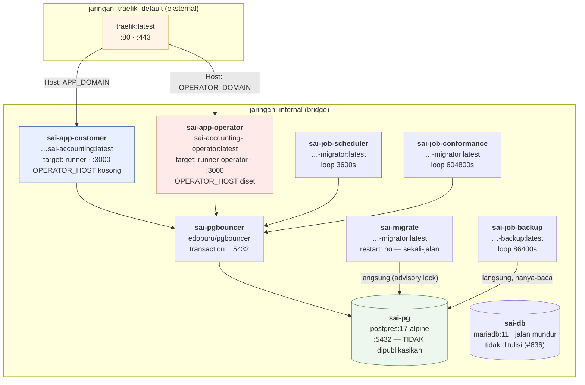

# 03 — Inventaris & Peta Layanan

> Dimutakhirkan 18 Okt 2026 · produksi `main@ca0cd038` · [indeks](./README.md)

> Sejak 15 Okt 2026 produksi berjalan di PostgreSQL 17 (`pg`) di belakang
> PgBouncer (`pgbouncer`). MariaDB (`db`) tetap terdaftar sebagai jalan mundur
> sampai #636.

Katalog setiap hal yang berjalan, tersimpan, atau dipanggil. Satu repositori,
satu mesin, satu berkas compose. "Layanan" di sini berarti container atau unit
penyebaran, bukan mikrolayanan.

- **Repositori:** `tri-evendi/sai-accounting` — monorepo bun workspaces: `src/` (aplikasi pelanggan), `apps/operator` (konsol), `packages/*` (lima paket `@sai/*`)
- **Direktori kerja:** `/opt/applications/sai-accounting`
- **Pemilik:** Tri Evendi. ❓ Tidak ada berkas `CODEOWNERS`; pemilik per komponen belum dipastikan
- **Registry:** `ghcr.io/tri-evendi/sai-accounting`

## 0. Berapa layanan yang dipelihara?

Jawabannya menentukan cara berpikir soal deploy, penskalaan, dan blast
radius. **Tujuh layanan didefinisikan, enam berjalan terus-menerus**, dan
ketujuh permukaan web dibagi ke dua aplikasi Next di antaranya.

| Layanan | Container | Peran | Kadens |
|---|---|---|---|
| `app-customer` | `sai-app-customer` | **Enam grup rute pelanggan** — pemasaran, auth, panel tenant, buku besar, setup, docs | selalu hidup |
| `app-operator` | `sai-app-operator` | Konsol operator — aplikasi `apps/operator`, image `…-operator` | selalu hidup |
| `pg` | `sai-pg` | **PostgreSQL 17**: 17 buku PT + kendali + platform | selalu hidup |
| `pgbouncer` | `sai-pgbouncer` | Kolam koneksi `transaction` di depan `pg` | selalu hidup |
| `db` | `sai-db` | MariaDB 11, **jalan mundur** sejak 15 Okt, tidak ditulisi; dicabut di #636 | selalu hidup (sementara) |
| `job-scheduler` | `sai-job-scheduler` | 7 langkah: tagihan, kabar, pengingat, berulang, `watch:health`, `prune:trails` | tiap jam |
| `job-conformance` | `sai-job-conformance` | Sapuan kesesuaian data (hanya-baca) | mingguan |
| `job-backup` | `sai-job-backup` | dump → tar → sandi → S3 (tanpa bucket: volume `cadangan`) | harian |
| `migrate` | `sai-migrate` | Migration, lalu **keluar** (`restart: "no"`) | sekali per deploy |

Ditambah `traefik`, yang dipakai bersama lima aplikasi lain di mesin ini dan
tidak termasuk `docker-compose.yml` repo ini.

Empat image menopang semuanya: `app-customer` (`runner`), `app-operator`
(`runner-operator`), `migrator`, dan `backup`. `job-scheduler` dan
`job-conformance` sengaja memakai ulang image `migrator`.

### Tujuh permukaan, dua aplikasi

Yang sering disebut "layanan" sebenarnya grup rute. Grup rute itu dibagi ke dua
aplikasi Next terpisah, dipisahkan *hostname* di Traefik dan `OPERATOR_HOST` di
dalam aplikasi:

```
sai-app-customer  (container #1)
├── APP_DOMAIN
│   ├── (marketing)         3 halaman   /  ·  /pricing  ·  /status
│   ├── (auth)             13 halaman   login, daftar, undangan, unlock…
│   ├── (tenant)/(panel)    7 halaman   /platform/*  akun, tagihan, tim
│   ├── (dashboard)       103 halaman   /t/{tenant}/{company}/*  ← buku besar
│   ├── (setup)             2 halaman   wisaya penyiapan
│   └── (docs)              3 halaman   /docs/**  (publik, tanpa sesi)

sai-app-operator  (container #2 — image …-operator, apps/operator)
└── OPERATOR_DOMAIN
    └── (operator)         18 halaman   /  ·  /tenants  ·  /login …  (tanpa prefix)
```

Konsekuensinya:

- Kedua image aplikasi dibangun dari commit dan `SAI_TAG` yang sama. Keduanya
  menulis basis data yang sama, jadi versi skemanya harus satu.
- Satu deploy tetap memindahkan keenam permukaan pelanggan. Halaman
  pendaratan tidak bisa dirilis tanpa ikut merilis buku besar.
- Restart hanya mengosongkan cache container itu (pengaturan surel TTL 60s,
  kolam klien LRU per PT). Me-restart konsol operator tidak mengosongkan cache
  pelanggan.
- `app-customer` tetap titik gagal tunggal bagi keenam permukaan pelanggan,
  diredam `restart: unless-stopped` dan healthcheck. Ia tidak lagi menjatuhkan
  konsol operator bersamanya.
- Pemisahan bidang ditegakkan oleh hostname, lalu oleh kode. Image pelanggan
  tidak memuat rute konsol. `OPERATOR_HOST: ""` pada `app-customer` adalah lapis
  tambahan: Host operator yang dikirim langsung ke container itu (melewati
  Traefik) tetap dijawab 404.

Alasan lengkapnya, termasuk apa yang tidak diberikan pemisahan ini, ada di
[dok 10 §3](./10-PORTABILITAS-DAN-PEMISAHAN.md). Pemasaran tidak dipisah karena
batasnya memotong funnel pendaftaran ([dok 10 §4](./10-PORTABILITAS-DAN-PEMISAHAN.md)).

## 1. Peta container



`app-customer` dan `app-operator` adalah satu-satunya container yang berada di
dua jaringan. Sisanya hanya di `internal`, sehingga tidak terjangkau dari luar
mesin.

## 2. Katalog layanan

### 2.1 `app-customer` — bidang pelanggan (`sai-app-customer`)

| | |
|---|---|
| **Image** | `ghcr.io/tri-evendi/sai-accounting:latest` (tahap `runner`) |
| **Dasar** | `node:22-bookworm-slim` + openssl/ca-certificates |
| **Perintah** | `node server.js` (keluaran `output: "standalone"`) |
| **Pengguna** | `node` (bukan root) |
| **Port** | `3000` — `expose`, bukan `ports`. Tidak terbit ke host |
| **Jaringan** | `traefik_default` + `internal` |
| **Domain** | `APP_DOMAIN` + `www.` (di-redirect ke apex). Tidak melayani `OPERATOR_DOMAIN` |
| **Bergantung pada** | `pg` (healthy), `pgbouncer` (berjalan), `migrate` (selesai sukses) |
| **Healthcheck** | `fetch('http://127.0.0.1:3000/api/health')` tiap 30s, 3 kali coba, start 20s |
| **Volume** | `documents:/app/data/documents` (RW) · `audit:/app/data/audit` (RW) |

**Tanggung jawab:** enam grup rute pelanggan (pemasaran, autentikasi, panel
tenant, buku besar, wisaya penyiapan, dokumentasi), 127 rute API, pembuatan
PDF/Excel, dan pengiriman surel transaksional.

Image ini tidak memuat rute konsol. Sebagai lapis tambahan, `OPERATOR_HOST`
dikosongkan di container ini lewat `environment:` (yang menimpa `env_file:`).

**Masukan:** permintaan HTTP dari Traefik · webhook Midtrans · kueri
PostgreSQL (lewat PgBouncer) · berkas di dua volume.
**Keluaran:** HTML/JSON/PDF/XLSX · tulisan ke ketiga lapis basis data ·
SMTP keluar · HTTP keluar ke Midtrans Core API.

Satu container, tanpa replika. Restart mengosongkan setiap cache dalam memori
(pengaturan surel TTL 60s, kolam klien LRU, konteks per permintaan). Itu murah
hari ini, tetapi juga alasan `app-customer` tidak bisa diskalakan horizontal
tanpa pekerjaan tambahan; lihat [dok 08](./08-PENILAIAN-ARSITEKTUR.md).

### 2.2 `app-operator` — bidang operator (`sai-app-operator`)

| | |
|---|---|
| **Image** | `ghcr.io/tri-evendi/sai-accounting-operator:latest` (tahap `runner-operator`, aplikasi `apps/operator`); tag `sha-` harus sama dengan `app-customer` |
| **Perintah** | `node apps/operator/server.js` — rute tanpa prefix `/operator` (`/`, `/tenants`, `/login`, …); tautan `/operator/*` lama di-redirect 308 |
| **Port** | `3000` — `expose` |
| **Jaringan** | `traefik_default` + `internal` |
| **Domain** | Hanya `OPERATOR_DOMAIN`; tidak punya router `APP_DOMAIN` |
| **Bergantung pada** | `pg` (healthy), `pgbouncer` (berjalan), `migrate` (selesai sukses) |
| **Healthcheck** | `fetch('http://127.0.0.1:3000/api/health')` — probe konsol sendiri: hanya basis data kendali yang memutuskan 503, platform dilaporkan; dilayani di host mana pun |
| **Volume** | `audit:/app/data/audit` (RW); tanpa `documents` |

**Tanggung jawab:** 17 halaman konsol penyedia + `/login` (+ 1 rute unduhan):
tenant, audit (operator + jejak tenant), cadangan & versi skema, akun operator,
permintaan hapus, katalog paket, e-Faktur platform, pengumuman status, surel,
penjadwal, kesesuaian data, isi situs, pengaturan, rekonsiliasi.

Volume `audit` adalah sisa yang aman dicabut. Jejak operator tinggal di tabel
`sai_platform.operator_audit_logs` sejak 17 Okt 2026, dan berkas JSONL lamanya
sudah dipindahkan di produksi. Container ini tidak pernah memasang `documents`,
sehingga berkas dokumen pelanggan berada di luar jangkauan proses konsol
operator.

Konsol adalah aplikasi Next tersendiri, jadi pemisahannya mencakup kode, tidak
hanya proses. Image operator tidak memuat halaman buku (keluaran standalone
69 MB vs 299 MB), dan image pelanggan tidak memuat rute konsol. Kode bersama
ada di `packages/*` ([dok 02 §7](./02-ARSITEKTUR.md)).

Jangan beri container ini router `APP_DOMAIN`. Pemisahan tidak batal karenanya,
sebab aplikasinya tidak punya rute pelanggan dan `apps/operator/src/proxy.ts`
menjawab 404 untuk setiap host selain `OPERATOR_HOST`. Akibatnya justru
pelanggan yang diarahkan ke sana menerima 404 untuk seluruh aplikasi.

Rinciannya: [dok 10 §3](./10-PORTABILITAS-DAN-PEMISAHAN.md).

### 2.3 `pg` — PostgreSQL 17 (`sai-pg`)

| | |
|---|---|
| **Image** | `postgres:17-alpine` (17.11). Versi mayor dipatok sejajar dengan `postgresql-client-17` di tahap `backup`, dijaga `tests/pg-client-version.test.ts` |
| **Port** | `5432`, hanya di jaringan `internal`, tidak dipublikasikan ke host |
| **Volume** | `pg_data:/var/lib/postgresql/data` |
| **Inisialisasi** | `--data-checksums --encoding=UTF8 --lc-collate=C --lc-ctype=C`. Checksum tidak bisa dinyalakan sesudahnya |
| **Healthcheck** | `pg_isready` tiap 10s, 12 kali, start 20s |
| **Batas** | `max_connections = 100`; tanpa batas memori container |
| **Zona waktu** | `TZ` (bawaan `Asia/Jakarta`) |

**Isi (16 Okt 2026):** 19 basis data: `sai_control`, `sai_platform`, dan 17
buku perusahaan (termasuk `sai_production`). Total 227 MB.

**Jalur koneksi:** `app-*`, `job-scheduler`, dan `job-conformance` lewat
`pgbouncer`. `migrate` dan `job-backup` langsung ke `pg`, karena Prisma Migrate
memakai `pg_advisory_lock` yang terikat sesi dan pooler `transaction`
memulangkan dump sebagian.

Dua hal yang berbeda dari MariaDB: collation `C` (perbandingan teks peka huruf
besar-kecil, sortir per byte, berbeda dari `utf8mb4_unicode_ci`), dan role
aplikasi `sai` adalah **SUPERUSER**. Keduanya dibahas di
[11 §10.2](./11-RENCANA-POSTGRESQL.md#102-validasi-pasca-penukaran-16-okt-2026).

Satu instans, tanpa replika. Ini titik gagal tunggal paling berat di sistem;
lihat [dok 04 §5](./04-DEPENDENSI-INTEGRASI.md).

### 2.3a `pgbouncer` — kolam koneksi (`sai-pgbouncer`)

| | |
|---|---|
| **Image** | `edoburu/pgbouncer:latest`. Mendengarkan di 5432, bukan 6432; salah port ini sebab pertama penukaran 15 Okt gagal |
| **Mode** | `POOL_MODE=transaction`, `MAX_CLIENT_CONN=200`, `DEFAULT_POOL_SIZE=20`, `AUTH_TYPE=scram-sha-256` |
| **Bergantung pada** | `pg` (healthy) |

**Kenapa wajib:** PostgreSQL memakai satu proses per koneksi. Puncak terukur 62
koneksi di mesin 3,6 GB, dan jumlahnya tumbuh mengikuti buku yang aktif
bersamaan. Mode `session` akan menghapus manfaatnya.

### 2.3b `db` — MariaDB 11 (`sai-db`), jalan mundur

Masih hidup sejak penukaran 15 Okt 2026, tetapi tidak ditulisi siapa pun. Image
yang berjalan dibangun dari skema `provider = "postgresql"` dan tidak bisa
memakai `mysql://`, jadi kembali ke MariaDB berarti men-deploy image `sha-` lama
sekaligus menukar URL. Pencabutan: issue #636, paling cepat 22 Okt 2026.

### 2.4 `migrate` — migrator sekali-jalan

| | |
|---|---|
| **Image** | `…-migrator:latest` (tahap `migrator`) |
| **Perintah** | `bun run db:migrate:all` |
| **restart** | `"no"`, sengaja: ia harus selesai, tidak berputar |
| **Bergantung pada** | `pg` (healthy), `pgbouncer` (berjalan); menyambung langsung ke `pg` (advisory lock Prisma Migrate terikat sesi) |

**Tanggung jawab:** menerapkan migration ke kendali, lalu platform, lalu setiap
perusahaan terdaftar. Satu perusahaan yang gagal tidak menghentikan yang lain.

**Kenapa tidak `db:migrate` / `prisma migrate deploy` saja:** perintah itu hanya
menerapkan ke satu basis data (yang ditunjuk `DATABASE_URL`), sehingga kendali,
platform, dan buku PT lain tertinggal tanpa galat. Selalu pakai
`db:migrate:all`.

**Kenapa `FROM bunbase`, tidak `FROM builder`:** migrator tidak memakai keluaran
`next build`. Mewarisi `builder` berarti ikut menanggung build itu (~10 menit),
sehingga image yang paling butuh berkas migration menjadi yang paling mahal
dibuat.

### 2.5 `job-scheduler` — penjadwal langganan (`sai-job-scheduler`)

| | |
|---|---|
| **Image** | `…-migrator:latest` (dipakai ulang — env & `node_modules` sama) |
| **Kadens** | `sleep 3600` — tiap jam |
| **Batas per langkah** | `timeout -k 30 480` (7 langkah × 480s = 56 menit < 1 jam) |
| **Bergantung pada** | `pg` (healthy), `pgbouncer` (berjalan), `migrate` (selesai sukses) |

Tujuh langkah berurutan dalam satu putaran: lima produser, lalu penjaga dan
pemangkas.

| Urut | Perintah | Tugas | Idempotensi |
|---|---|---|---|
| 1 | `scheduler:subscriptions` | Trial habis, tagihan terbit, dunning, suspensi, pengingat H-7/H-3/H-1, sinkronisasi pemakaian, rekonsiliasi | Idempoten |
| 2 | `notify:setup` | Kabar dalam aplikasi untuk penyiapan yang mandek (H+1/+3/+7/+14) | `dedupe_key` — maks 4 kabar seumur hidup |
| 3 | `notify:invoice-due` | Kabar jatuh tempo (≤3 hari) + ringkasan mingguan tertunggak | `dedupe_key` |
| 4 | `remind:customers` | **Surel ke pelanggan** (H-3/H+1/H+7, satu per faktur) | Kunci unik (invoice, kind, due_key) |
| 5 | `recurring:run` | Terbitkan dokumen berulang yang jatuh hari ini | Kunci unik (template, occurrence_date) |
| 6 | `watch:health` | Baca denyut cadangan, penjadwal, kesesuaian; kirim surel peringatan | Peredam satu surel per status per 24 jam |
| 7 | `prune:trails` | Pangkas jejak putaran > 90 hari — satu-satunya yang menghapus, karena itu paling akhir | Putaran kosong = satu `SELECT` per tabel |

Tiga keputusan desain yang perlu dibaca sebelum menyentuhnya:

1. **`remind:customers` diletakkan di belakang produser lain (#467).** Ia
   satu-satunya langkah yang mengirim surel ke luar. Putaran yang mati di
   tengah jadi berhenti pada pekerjaan yang masih bisa diulang tanpa akibat
   bagi orang lain.
2. **`|| true` per langkah.** Satu produser yang gagal tidak boleh
   menghentikan langkah berikutnya; putaran harus tetap sampai `sleep`.
3. **`timeout` wajib, karena `|| true` tidak cukup.** `|| true` hanya menangani
   langkah yang gagal, tidak yang menggantung. Pada 30 Agustus 2026
   `scheduler:subscriptions` menggantung dua jam dengan CPU 0,09%, putaran itu
   tidak pernah sampai `sleep`, dan semua putaran berikutnya tertahan.
   Container tetap "Up", log terakhir "✓ selesai tanpa masalah", nol galat.
   Masalahnya hanya terlihat dari `/api/health` → `scheduler: late` dan
   `docker top`.

**Kenapa layanan, tidak baris crontab (#373):** tidak ada yang memeriksa bahwa
baris crontab itu ada. Kalau terlewat saat rilis, uji coba tidak pernah
berakhir, tagihan pertama tidak terbit, dan penunggak tidak ditangguhkan, semua
tanpa galat, sampai seseorang melihat laporan pendapatan bernilai nol. Sebagai
layanan, ia ikut naik bersama deploy dan terlihat di `docker compose ps`.

**Dapat diamati lewat:** `scheduler_runs` (platform) · `/api/health` →
`scheduler` · konsol `/scheduler` · `bun run prove-scheduler-alive`.

### 2.6 `job-conformance` — pemeriksa kesesuaian data (`sai-job-conformance`)

| | |
|---|---|
| **Image** | `…-migrator:latest` |
| **Perintah** | `bun run check-data-conformance` |
| **Kadens** | `sleep 604800` (mingguan); putaran pertama saat layanan naik |
| **Batas** | `timeout -k 30 1800` |
| **Sifat** | Hanya membaca; dijaga `tests/check-data-conformance.test.ts` |

**Yang diperiksa:** status di luar enum · mata uang tak dikenal · valas tanpa
kurs · mata uang pembayaran ≠ dokumennya · faktur kelebihan bayar · jurnal
timpang/kosong · tipe akun asing · dan sejak #444 akun penampung beban berskala
material ("Beban Lain-lain" dkk; ambang 5% dari total beban).

**Kenapa ada:** penjaga zod hanya berlaku di jalur tulis. Impor sekali jalan,
perbaikan SQL manual, dan penyemai tidak melewati penjaga itu. Audit 20–21
Agustus 2026 menemukan enam kelas cacat yang masuk lewat jalur tersebut di buku
produksi: status kontrak di luar enum, mata uang `LC`, 609 kontrak valas tanpa
kurs, 720 pembayaran salah label mata uang, faktur kelebihan bayar, dan
kuantitas faktur termigrasi salah senilai Rp 774 juta. Semuanya ditemukan lewat
penggalian manual selama dua hari; layanan ini menggantikan penggalian itu.

**Kenapa mingguan dan layanan sendiri:** cacat seperti ini lahir dari peristiwa
jarang, tidak dari lalu lintas harian. Kegagalan penagihan dan temuan
kesesuaian data juga dua kabar berbeda yang tidak boleh bercampur di satu
aliran log.

`|| true` di sini punya alasan khusus: skrip sengaja keluar dengan kode
bukan-nol saat menemukan sesuatu (supaya berguna di CI). Tanpa `|| true`, setiap
temuan menjadi *crash-loop*.

**Membacanya:** temuan tiap putaran tercatat di `conformance_runs` (platform),
dilaporkan `/api/health` → `conformance`, dan diperingatkan lewat surel oleh
`watch:health`. Rinciannya: `docker compose logs job-conformance --tail 60`.

### 2.7 `job-backup` — cadangan (`sai-job-backup`)

| | |
|---|---|
| **Image** | `…-backup:latest` (tahap `backup` = `migrator` + `postgresql-client-17` + `awscli`; `mariadb-client` masih terpasang sampai #636) |
| **Perintah** | `sh scripts/backup.sh` |
| **Kadens** | `sleep 86400` — harian (RPO 1 hari, disengaja) |
| **Batas** | `timeout -k 60 7200` — 2 jam, longgar |
| **Volume** | `documents:…:ro` · `audit:…:ro` (hanya-baca) · `cadangan:/app/data/cadangan` (RW, hanya untuk hasilnya sendiri) |

**Urutan:** `pg_dumpall` langsung ke `pg` (mesin dan tujuan diturunkan dari `DATABASE_URL`; MariaDB: `mariadb-dump --all-databases`) → `tar -czf` → `openssl enc
-aes-256-cbc -pbkdf2 -iter 200000 -salt` → SHA-256 atas ciphertext →
`aws s3 cp` (arsip + `.sha256`) → pangkas yang kedaluwarsa (hanya bila
unggahan sukses). Tanpa `BACKUP_S3_BUCKET`, arsip terenkripsi + `.sha256`
disalin ke volume `cadangan` saja, dan `/api/health` melaporkan `local_only`.

Empat keputusan desain:

1. **`--all-databases`, tidak daftar yang diketik tangan.** Daftar tangan akan
   tertinggal saat pelanggan baru mendaftar, dan cadangan menjadi tidak lengkap
   tanpa ada yang tahu.
2. **Enkripsi dilakukan sebelum berkas meninggalkan mesin.**
3. **SHA-256 atas ciphertext ikut dikirim.** AES-256-CBC tidak membawa
   pemeriksaan keutuhan sendiri. Tanpa berkas `.sha256`, arsip yang rusak di
   perjalanan baru ketahuan saat pemulihan.
4. **Memakai `awscli`, tidak SigV4 buatan sendiri.** Penanda tangan S3 sendiri
   hanya ~60 baris, tetapi mudah lulus uji lalu gagal pada penyedia yang
   menormalkan header sedikit berbeda, dan kegagalan itu baru muncul saat
   memulihkan.

Volume sumber dipasang `:ro` dengan sengaja. Layanan penyalin tidak perlu
menulis ke yang disalinnya, dan bendera itu mencegah skrip cadangan merusak
data yang dicadangkan.

**⚠ Status 18 Okt 2026: `local_only`, belum ada salinan di luar mesin.**
`/api/health` → `backup: local_only`, `lastSuccessAt: null`. `AWS_ACCESS_KEY_ID`,
`AWS_SECRET_ACCESS_KEY`, dan `BACKUP_S3_BUCKET` di `.env` kosong, jadi cadangan
harian hanya mendarat di volume `cadangan` di mesin yang sama. Kehilangan mesin
berarti kehilangan buku beserta cadangannya. Tetap P0 di
[dok 08](./08-PENILAIAN-ARSITEKTUR.md) sampai kredensial S3 disetel.

**Pembuktian:** `docker compose run --rm job-backup bun run prove-backup-restore`
memeriksa bahwa sidik jari cocok, sandi benar, dan setiap basis data terdaftar
ada di dalam arsip. Skrip ini tidak memuat dump ke basis data mana pun, karena
satu `psql <` yang salah sasaran akan menimpa produksi dengan data lama.
Pemuatan sungguhan ke server bayangan adalah latihan kuartalan yang dijalankan
manusia. ❓ Belum dipastikan apakah latihan itu pernah dijalankan.

### 2.8 `traefik` — proxy (di luar compose ini)

Dipakai bersama 5 aplikasi lain di mesin yang sama (`movin-pwa`,
`movin-landing`, `movin-budget-web`, `movin-wedding`, `movin-partner`). Diatur
lewat label Docker, tidak lewat berkas konfigurasi di repo ini. Hanya Traefik
yang mengikat `:80`/`:443` di host.

Rinciannya: [dok 07 §2](./07-INFRASTRUKTUR-DEPLOY.md).

## 3. Modul aplikasi (di dalam kedua container `app-*`)

`src/lib` punya 231 berkas (18 Okt 2026); modul bersama pindah ke
`packages/*` dan ditulis di bawah dengan jalur paketnya. Tanpa prefix = di
`src/lib/`. Daftar di bawah hanya memuat modul yang memegang keputusan.

### 3.1 Lapisan data & konteks

| Modul | Tanggung jawab |
|---|---|
| `prisma.ts` | Proxy klien PT aktif; menyelesaikan klien saat kueri dipanggil |
| `company-clients.ts` | Kolam LRU klien PT (`POOL_MAX`=4, 2 koneksi/klien, *grace* 15s) |
| `company-context.ts` | `AsyncLocalStorage` + `runWithCompany()` + `MissingCompanyContextError` |
| `current-company.ts` | "PT mana ini?" — 2 sumber, `WeakMap` dikunci pada `headers()` |
| `packages/core/src/control-db.ts` | Singleton kendali (batas 2 koneksi) |
| `packages/platform/src/platform-db.ts` | Singleton platform (batas 1 koneksi); dilarang dari jalur panas |
| `company-registry.ts` · `company-route.ts` · `company-request.ts` | Resolusi PT dari jalur/permintaan |
| `company-provisioning.ts` | Pembuatan basis data PT baru + penyemaian |
| `users-directory.ts` | Pengganti FK ke `users` lintas basis data |
| `packages/core/src/tenant-cache.ts` | `TenantKeyedCache`: cache wajib berkunci penyewa |

### 3.2 Otorisasi & sesi

| Modul | Tanggung jawab |
|---|---|
| `packages/core/src/authz.ts` | Matriks bawaan, 66 izin × 4 peran. Murni |
| `authz-effective.ts` | Matriks efektif = bawaan + override peran + override pengguna + modul |
| `tenant-authz.ts` | Matriks tenant — 6 izin × 3 peran |
| `page-auth.ts` | `requirePagePermission`, `requireUnlockedCompany`, `requireSetupDone` |
| `auth-guard.ts` | `requireApiPermission` |
| `api-token-guard.ts` | `requireApiToken` — Bearer `sai_…` |
| `auth.ts` | NextAuth v5 — Credentials, JWT 24 jam |
| `business-modules.ts` | 11 modul; dilarang diimpor modul laporan/posting |
| `company-unlock.ts` | Kunci buku — otentikasi ulang |
| `packages/core/src/rate-limit.ts` · `rate-limit-persistent.ts` | Pembatasan laju (memori + tabel kendali) |
| `packages/core/src/operator-plane.ts` | Keputusan bidang operator (host saja); murni, aman-edge |
| `apps/operator/src/lib/operator/{guard,session,credentials,totp}.ts` | Sesi operator + IP + TOTP |

### 3.3 Mesin akuntansi

| Modul | Tanggung jawab |
|---|---|
| `posting/index.ts` (1.867 baris) | `postForSource` / `repostForSource` / `unpostForSource` |
| `posting/rules.ts` | Penyusun baris jurnal per jenis dokumen; murni |
| `posting/mapping.ts` | `MAPPING_KEYS` → `account_mappings` |
| `posting/rates.ts` | Kurs penyelesaian; selisih → `fx_gain_loss` |
| `posting/cogs.ts` | HPP rata-rata bergerak tertimbang |
| `ledger.ts` | `postJournal` / `reverseJournal` — kunci periode |
| `accounting.ts` | Primitif akuntansi |
| `period-close.ts` · `year-close.ts` · `year-close-service.ts` | Tutup periode & tahun |
| `fx-revaluation-service.ts` | Revaluasi valas akhir periode |
| `approvals.ts` · `approval-queue.ts` · `approval-requests.ts` | Alur persetujuan |
| `document-chain.ts` · `document-writes.ts` | Rantai dokumen & tulisan |
| `opening-balance.ts` | Saldo awal + plug ekuitas |

### 3.4 Pelaporan

| Modul | Tanggung jawab |
|---|---|
| `statement-layout.ts` (79 KB — terbesar) | Tata letak laporan keuangan |
| `reports.ts` · `report-catalog.ts` · `report-payload.ts` · `report-summary.ts` | Mesin & katalog laporan |
| `report-export.ts` | Ekspor Excel (`exceljs`) & PDF (`jspdf`) |
| `budget-report.ts` · `project-profit-report.ts` · `stock-value-report.ts` | Laporan khusus |
| `receivables.ts` (39 KB) | Piutang & penuaan |

### 3.5 Platform & penagihan

| Modul | Tanggung jawab |
|---|---|
| `packages/billing/src/subscription-lifecycle.ts` · `subscription-store.ts` | Daur hidup langganan |
| `packages/billing/src/payment-gateway.ts` | Abstraksi gerbang — `midtrans` \| `manual`, dengan transport MOCK |
| `packages/platform/src/payment-webhook.ts` | Pemrosesan webhook |
| `company-payment-settings.ts` | Gerbang milik pelanggan (bukan milik platform) |
| `packages/core/src/registration.ts` · `packages/platform/src/invitation-store.ts` | Pendaftaran mandiri & undangan |
| `tenant-{export,directory}.ts` · `packages/core/src/tenant-deletion.ts` · `packages/platform/src/tenant-{state,audit}.ts` | Siklus hidup tenant |
| `packages/platform/src/{mailer-core,mail-settings}.ts` · `tenant-mail-settings.ts` | Surel tiga lapis |
| `health-report.ts` · `packages/core/src/public-status.ts` | Kesehatan untuk mesin & untuk orang |
| `packages/core/src/site-content.ts` | Isi pendaratan yang bisa ditimpa dari DB |

### 3.6 Penyajian & isi

| Modul | Tanggung jawab |
|---|---|
| `nav.ts` (24 KB) | Struktur navigasi |
| `docs-content.ts` (68 KB) · `docs.ts` | Dokumentasi dalam-aplikasi |
| `wizard.ts` (44 KB) | Wisaya penjualan/pembelian |
| `packages/core/src/labels.ts` · `packages/core/src/i18n/*` | Label & kamus id/en/zh (~2.500 kunci bertipe) |
| `packages/ui/src/theme/antd-tokens.ts` | Satu-satunya tempat nilai warna mentah boleh ditulis |
| `packages/ui/src/layout-scale.ts` | Skala jarak — sumber tunggal 60 angka |
| `packages/ui/src/brand/mark.ts` | Lambang — sumber tunggal; raster via `bun run brand:icons` |
| `changelog.ts` | Sumber `CHANGELOG.md` (dibangkitkan, jangan disunting) |
| `accurate/*` | Rekonsiliasi terhadap ekspor Accurate Online |

## 4. Skrip operasional (53 berkas)

Dijalankan manual atau oleh layanan `job-scheduler`. Semua lewat `bun run <nama>`.

### 4.1 Migration & adopsi

| Skrip | Tugas | Kapan |
|---|---|---|
| `db:migrate:all` | kendali → platform → setiap PT | Setiap rilis yang membawa migration |
| `migrate-all-companies.ts` | Terapkan ke setiap PT; tidak berhenti di PT gagal | dipanggil di atas |
| `migrate-platform.ts` | Platform; dilewati dengan peringatan bila `PLATFORM_DATABASE_URL` kosong | dipanggil di atas |
| `migrate-audit.ts` | `data/audit/<slug>/audit.jsonl` → tabel `audit_logs` per PT | Langkah rilis #370, sekali |
| `migrate-tenant-audit.ts` | `data/audit/tenants/<slug>/…` → `tenant_audit_logs` (kendali) | Langkah rilis #484, sekali |
| `adopt-existing-company.ts` | Daftarkan basis data lama sebagai PT pertama | Migrasi #104, sekali |
| `adopt-tenant.ts` | Adopsi tenant | Migrasi #133, sekali |

Kedua skrip audit mengganti nama berkasnya menjadi `.dipindahkan` dan tidak
menghapusnya, karena jejak audit tidak boleh dihapus otomatis.

### 4.2 Pembuktian (gerbang rilis)

Skrip-skrip ini memeriksa keadaan nyata, tidak sekadar melaporkan hasil skrip lain.

| Skrip | Membuktikan |
|---|---|
| `prove-scheduler-alive.ts` | Penjadwal benar-benar berdenyut |
| `prove-backup-restore.ts` | Cadangan terbaru bisa dibuka & memuat setiap basis data |
| `prove-tenant-adoption.ts` | Adopsi tenant benar-benar terjadi |
| `prove-company-slug-immutable.ts` | Slug PT tidak bisa berubah |
| `prove-company-slug-scope.ts` | Lingkup slug benar |
| `check-data-conformance.ts` | Data patuh aturan yang ditegakkan kode |
| `classify-books.ts` | Buku mana produksi, mana uji, dari isinya, bukan namanya ([dok 12](./12-KLASIFIKASI-BUKU.md)) |
| `verify-local-setup.ts` | Pemasangan lokal lengkap |
| `rehearse-billing-webhook.ts` | Webhook penagihan bisa dilatih tanpa Midtrans |

### 4.3 Dipanggil `job-scheduler` tiap jam

`subscription-scheduler.ts` · `notify-pending-setup.ts` ·
`notify-invoice-due.ts` · `remind-customers.ts` · `run-recurring.ts` ·
`watch-health.ts` (langkah ke-6, menerima `--dry-run`) · `prune-run-trails.ts`
(langkah ke-7, satu-satunya yang menghapus, karena itu paling akhir).
Produser menerima `-- --dry`.

### 4.4 Penyemaian & penyiapan

`seed-plans.ts` (katalog paket) · `seed-coa.ts` · `seed-asset-categories.ts`
(langkah rilis #416) · `seed-demo.ts` (tiga bulan transaksi yang diposting
lewat mesin posting yang sama, ditandai `[CONTOH]`) · `prisma/seed.ts` (fixture
pengembangan yang menulis baris tanpa jurnal) · `bootstrap.ts` ·
`create-admin.ts` · `create-company.ts`.

`seed-demo.ts` menghasilkan buku yang neracanya seimbang; `prisma/seed.ts`
tidak, sehingga hasilnya tidak bisa dipakai sebagai buku.

### 4.5 Operasi & pemeliharaan

`backup.sh` · `record-backup-run.ts` · `reconcile-platform.ts` ·
`pause-platform-billing.ts` (Fase A; kering secara bawaan, `--apply` menuntut
`--reason`) · `change-tenant-plan.ts` · `operator-code.ts` ·
`operator-credential.ts` · `execute-tenant-deletion.ts` ·
`rename-tenant-slug.ts` · `link-contract-customers.ts` ·
`audit-invoice-currency.ts` · `efaktur-platform.ts` · `build-changelog.ts` ·
`build-brand-icons.ts` · `check-env.mjs`.

Skrip tidak bisa mengimpor `server-only` karena `tsx` gagal memuatnya. Logika
produser harus tinggal di pustaka murni.

## 5. Penyimpanan & volume

| Volume | Dipasang di | Isi | Dicadangkan? |
|---|---|---|---|
| `pg_data` | `pg:/var/lib/postgresql/data` | 19 basis data: 17 buku PT + kendali + platform | Ya, lewat `pg_dumpall` |
| `db_data` | `db:/var/lib/mysql` | MariaDB jalan mundur, beku sejak 15 Okt 2026 | Tidak lagi; arsipkan dump terakhir sebelum dihapus (#636) |
| `documents` | `app-customer` (RW), `job-backup` (RO); tidak `app-operator` | `data/documents/<companyId>/<uuid>.<ext>` | Ya — di `tar` |
| `audit` | `app-customer` (RW), `app-operator` (RW), `job-backup` (RO) | Kini hanya berkas JSONL lama (sudah dipindahkan ke tabel, berganti nama `.dipindahkan`) | Ya — di `tar` |
| `cadangan` | `job-backup` (RW) | Arsip cadangan terenkripsi + `.sha256` saat `BACKUP_S3_BUCKET` belum disetel | — (ia *adalah* cadangannya; mesin yang sama) |

Jejak audit ada di tiga tabel: `audit_logs` di tiap buku PT,
`tenant_audit_logs` di kendali, dan `operator_audit_logs` di platform.
`tenant_audit_logs` sengaja tanpa FK ke `tenants`: jejak ini mencatat
penghapusan tenant, jadi harus tetap ada sesudah tenant dihapus.

`data/mail-outbox/` berisi `.eml` dari transport surel `file` (dipakai saat
pengembangan). Produksi memakai SMTP dari baris `mail_settings` di platform.

## 6. Peringatan

Dua jalur surel peringatan, penerimanya `PLATFORM_ALERT_EMAIL` (cadangan
`PLATFORM_CONTACT_EMAIL`):

- `watch:health` (langkah 6 `job-scheduler`, tiap jam) membaca tiga denyut
  (cadangan, penjadwal, kesesuaian) dan mengirim surel bila salah satunya tidak
  sehat. Peredamnya satu surel per status per 24 jam.
- `src/lib/alert.ts` (issue #374) untuk peristiwa dalam aplikasi, dengan peredam
  satu surel per sidik jari per jam lewat `rate-limit-persistent.ts`.

Titik buta: kalau penjadwal mati total, `watch:health` ikut mati dan tidak
melaporkan apa pun. Celah ini hanya bisa ditutup pembaca `/api/health` dari
luar mesin, dan pembaca itu belum ada (§7).

## 7. Yang belum dipastikan

| Hal | Kenapa penting |
|---|---|
| ❓ `CODEOWNERS` / pemilik per-komponen | Tidak ada di repo. Semua komponen tampak dimiliki satu orang |
| ❓ Lingkungan *staging* | Tidak ada definisi compose/CI untuk non-produksi. 🔶 Tersimpulkan: pengembangan terjadi di lokal + produksi langsung |
| ❓ Pemantauan luar | Tidak ada konfigurasi Uptime/Prometheus/Sentry di repo. `/api/health` ada, pembacanya tak diketahui |
| ❓ Agregasi log | Hanya `docker compose logs`. Tidak ada pengiriman ke luar |
| ❓ Latihan pemulihan kuartalan | Diwajibkan `package.json`; tidak ada bukti pernah dijalankan |
| 🔶 Asal `sai_production` | Satu-satunya buku yang tidak berpola `sai_t<N>_…`, dan ia terdaftar di `sai_control`. 🔶 Tersimpulkan: buku pra-#104 yang diadopsi |
| ❓ Basis data uji di produksi | `sai_t11_data_dummy`, `sai_t1_uji_wisaya_416`, `sai_t1_uji_pindahan_425`, `sai_t2_demo` tampak uji/demo tapi hidup di instans produksi |

Lanjut: [04 Dependensi & Integrasi](./04-DEPENDENSI-INTEGRASI.md)
