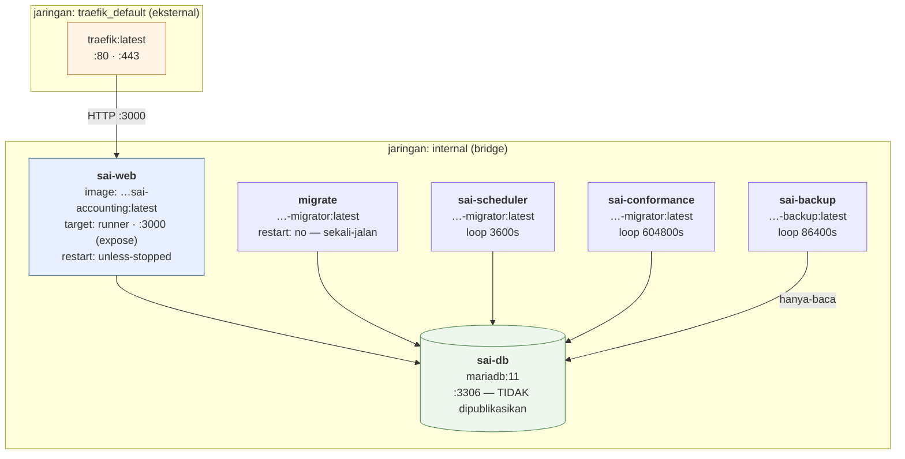

# 03 — Inventaris & Peta Layanan

> Potret 11 Oktober 2026 · v0.9.0 · [indeks](./README.md)

Katalog setiap hal yang berjalan, tersimpan, atau dipanggil. Satu repositori,
satu mesin, satu berkas compose — "layanan" di sini berarti **container atau
unit penyebaran**, bukan mikrolayanan.

- **Repositori:** `tri-evendi/sai-accounting` (satu repo, bukan monorepo)
- **Direktori kerja:** `/opt/applications/sai-accounting`
- **Pemilik:** Tri Evendi — ❓ tidak ada berkas `CODEOWNERS`; pemilik per-komponen **belum dipastikan**
- **Registry:** `ghcr.io/tri-evendi/sai-accounting`

## 1. Peta container



`web` adalah **satu-satunya** container di dua jaringan sekaligus. Sisanya
hanya di `internal` dan karena itu tidak terjangkau dari luar mesin sama sekali.

## 2. Katalog layanan

### 2.1 `web` — aplikasi (`sai-web`)

| | |
|---|---|
| **Image** | `ghcr.io/tri-evendi/sai-accounting:latest` (tahap `runner`) |
| **Dasar** | `node:22-bookworm-slim` + openssl/ca-certificates |
| **Perintah** | `node server.js` (keluaran `output: "standalone"`) |
| **Pengguna** | `node` (**bukan root**) |
| **Port** | `3000` — `expose`, bukan `ports`. Tidak terbit ke host |
| **Jaringan** | `traefik_default` + `internal` |
| **Domain** | `APP_DOMAIN` + `www.` (dialihkan ke apex) + `OPERATOR_DOMAIN` |
| **Bergantung pada** | `db` (healthy), `migrate` (selesai sukses) |
| **Healthcheck** | `fetch('http://127.0.0.1:3000/api/health')` tiap 30s, 3 kali coba, start 20s |
| **Volume** | `documents:/app/data/documents` (RW) · `audit:/app/data/audit` (RW) |

**Tanggung jawab:** seluruh permukaan HTTP — halaman pemasaran, aplikasi
pelanggan, panel tenant, dokumentasi, konsol operator, 126 rute API,
pembuatan PDF/Excel, pengiriman surel transaksional.

**Masukan:** permintaan HTTP dari Traefik · webhook Midtrans · kueri
MariaDB · berkas di dua volume.
**Keluaran:** HTML/JSON/PDF/XLSX · tulisan ke ketiga lapis basis data ·
SMTP keluar · HTTP keluar ke Midtrans Core API.

**Yang perlu diketahui:** satu container, **tanpa replika**. Pemulaian ulang
mengosongkan setiap cache dalam-memori (pengaturan surel TTL 60s, kolam klien
LRU, konteks per-permintaan). Itu benar dan murah hari ini, tapi ia juga alasan
`web` tidak bisa diskalakan horizontal tanpa pekerjaan tambahan —
lihat [dok 08](./08-PENILAIAN-ARSITEKTUR.md).

### 2.2 `db` — MariaDB (`sai-db`)

| | |
|---|---|
| **Image** | `mariadb:11` |
| **Port** | `3306` — hanya di jaringan `internal`, **tidak** dipublikasikan ke host |
| **Volume** | `db_data:/var/lib/mysql` |
| **Healthcheck** | `healthcheck.sh --connect --innodb_initialized` tiap 10s, 12 kali, start 20s |
| **Zona waktu** | `TZ` (bawaan `Asia/Jakarta`) |

**Isi (11 Okt 2026):** 23 skema — `sai_control`, `sai_platform`, **17** basis
data perusahaan (termasuk `sai_production`), dan 4 skema sistem MySQL.

**Satu instans tunggal, tanpa replika.** Ini titik gagal tunggal yang paling
berat di sistem; lihat [dok 04 §5](./04-DEPENDENSI-INTEGRASI.md).

### 2.3 `migrate` — migrator sekali-jalan

| | |
|---|---|
| **Image** | `…-migrator:latest` (tahap `migrator`) |
| **Perintah** | `bun run db:migrate:all` |
| **restart** | `"no"` — sengaja. Ia harus **selesai**, bukan berputar |
| **Bergantung pada** | `db` (healthy) |

**Tanggung jawab:** menerapkan migration ke **kendali → platform → setiap
perusahaan terdaftar**, dalam urutan itu, dan **tidak berhenti hanya karena
satu perusahaan gagal**.

**Kenapa bukan `prisma migrate deploy` telanjang** — ini penting dan
didokumentasikan panjang di `Dockerfile`: perintah itu menerapkan ke **satu**
basis data (yang ditunjuk `DATABASE_URL`), dan **migration 0042 MENGHAPUS tabel
`users` dari basis data perusahaan**. Bila `docker compose up` berjalan
sebelum langkah adopsi, perintah lama itu akan menghapus seluruh akun beserta
hash sandinya, dan satu-satunya jalan pulang adalah cadangan. `db:migrate:all`
aman terhadap urutan: pemasangan yang belum diadopsi tidak punya perusahaan
terdaftar, jadi tidak ada yang disentuh.

**Kenapa `FROM bunbase`, bukan `FROM builder`:** migrator tidak pernah
menyentuh keluaran `next build`, tapi mewarisi `builder` berarti ikut
menanggung build itu (~10 menit, *thrashing* sampai setengah jam di mesin
1,9 GB). Image yang paling butuh berkas migration jadi image yang paling mahal
dibuat — persis terbalik.

### 2.4 `scheduler` — penjadwal langganan (`sai-scheduler`)

| | |
|---|---|
| **Image** | `…-migrator:latest` (dipakai ulang — env & `node_modules` sama) |
| **Kadens** | `sleep 3600` — tiap jam |
| **Batas per langkah** | `timeout -k 30 600` (600s; 5 × 10 menit < 1 jam) |
| **Bergantung pada** | `db` (healthy), `migrate` (selesai sukses) |

**Lima produser, berurutan dalam satu putaran:**

| Urut | Perintah | Tugas | Idempotensi |
|---|---|---|---|
| 1 | `scheduler:subscriptions` | Trial habis, tagihan terbit, dunning, suspensi, pengingat H-7/H-3/H-1, sinkronisasi pemakaian, rekonsiliasi | Idempoten |
| 2 | `notify:setup` | Kabar dalam-aplikasi untuk penyiapan MANDEK (H+1/+3/+7/+14) | `dedupe_key` — maks 4 kabar seumur hidup |
| 3 | `notify:invoice-due` | Kabar jatuh tempo (≤3 hari) + ringkasan mingguan tertunggak | `dedupe_key` |
| 4 | `remind:customers` | **SUREL KE PELANGGAN** (H-3/H+1/H+7, satu per faktur) | Kunci unik (invoice, kind, due_key) |
| 5 | `recurring:run` | Terbitkan dokumen berulang yang jatuh hari ini | Kunci unik (template, occurrence_date) |

**Tiga keputusan desain yang layak dibaca sebelum menyentuhnya:**

1. **`remind:customers` TERAKHIR, sengaja (#467).** Ia satu-satunya mata rantai
   yang mengirim surel **ke luar**; menempatkannya di belakang berarti putaran
   yang mati di tengah gagal pada pekerjaan yang masih bisa diulang **tanpa
   konsekuensi ke orang lain**.
2. **`|| true` per langkah** — satu produser yang gagal tidak boleh menelan
   yang berikutnya; putarannya harus tetap sampai `sleep`.
3. **`timeout` WAJIB, karena `|| true` TIDAK cukup** — dan ini terbukti di
   produksi 30 Agustus 2026. `|| true` melindungi dari langkah yang **gagal**,
   bukan dari yang **menggantung**: `scheduler:subscriptions` menggantung dua
   jam dengan CPU 0,09%, putaran itu tak pernah sampai `sleep`, dan **seluruh
   putaran berikutnya tertahan selamanya**. Gejalanya menyesatkan — container
   "Up", log terakhir "✓ selesai tanpa masalah", nol galat. Yang
   menyingkapkannya hanya `/api/health` → `scheduler: late` dan `docker top`.

**Kenapa layanan, bukan baris crontab (#373):** tidak ada apa pun yang
memeriksa baris crontab itu ada. Kalau ia terlewat saat rilis, yang terjadi
adalah: uji coba tidak pernah berakhir, tagihan pertama tidak pernah terbit,
penunggak tidak pernah ditangguhkan — **semuanya tanpa satu pun galat**.
Terlihat persis seperti sistem sehat, sampai seseorang membuka laporan
pendapatan dan bertanya kenapa nol. Sebagai layanan ia lahir bersama deploy
dan terlihat di `docker compose ps`.

**Dapat diamati lewat:** `scheduler_runs` (platform) · `/api/health` →
`scheduler` · `/operator/scheduler` · `bun run prove-scheduler-alive`.

**Status 11 Okt 2026:** 1.246 putaran, terakhir 7 menit sebelum potret,
`status: ok`.

### 2.5 `conformance` — pemeriksa kesesuaian data (`sai-conformance`)

| | |
|---|---|
| **Image** | `…-migrator:latest` |
| **Perintah** | `bun run check-data-conformance` |
| **Kadens** | `sleep 604800` — **mingguan**; putaran pertama saat layanan naik |
| **Batas** | `timeout -k 30 1800` |
| **Sifat** | **HANYA MEMBACA** — dijaga `tests/check-data-conformance.test.ts` |

**Yang diperiksa:** status di luar enum · mata uang tak dikenal · valas tanpa
kurs · mata uang pembayaran ≠ dokumennya · faktur kelebihan bayar · jurnal
timpang/kosong · tipe akun asing · dan sejak #444 **akun PENAMPUNG beban
berskala material** ("Beban Lain-lain" dkk; ambang 5% dari total beban).

**Kenapa ada:** penjaga zod hanya berlaku di jalur **tulis**. Impor
sekali-jalan, perbaikan SQL manual, dan penyemai **tidak melewati satu penjaga
pun** — dan audit 20–21 Agustus 2026 menemukan **enam kelas cacat** yang masuk
lewat pintu itu di buku produksi: status kontrak di luar enum, mata uang `LC`,
609 kontrak valas tanpa kurs, 720 pembayaran salah label mata uang, faktur
kelebihan bayar, dan kuantitas faktur termigrasi salah senilai Rp 774 juta.
Semuanya ditemukan dengan menggali manual dua hari. Layanan ini ada supaya
penggalian itu tidak perlu terulang.

**Kenapa mingguan, dan kenapa layanan sendiri:** yang dicarinya bergeser
lambat — cacat seperti ini lahir dari peristiwa jarang, bukan lalu lintas
harian. Dan kegagalan penagihan vs temuan kesesuaian data adalah **dua kabar
berbeda yang tidak boleh bercampur** di satu aliran log.

`|| true` di sini punya alasan khusus: skrip ini **sengaja keluar bukan-nol**
saat menemukan sesuatu (supaya berguna di CI), jadi tanpa penjaga itu setiap
temuan jadi *crash-loop*.

**Membacanya:** `docker compose logs conformance --tail 60`.
❓ Tidak ada kanal keluar — temuan hanya ada di log. Dinilai di [dok 08](./08-PENILAIAN-ARSITEKTUR.md).

### 2.6 `backup` — cadangan (`sai-backup`)

| | |
|---|---|
| **Image** | `…-backup:latest` (tahap `backup` = `migrator` + `mariadb-client` + `awscli`) |
| **Perintah** | `sh scripts/backup.sh` |
| **Kadens** | `sleep 86400` — harian (RPO 1 hari, disengaja) |
| **Batas** | `timeout -k 60 7200` — 2 jam, longgar |
| **Volume** | `documents:…:ro` · `audit:…:ro` — **hanya-baca** |

**Urutan:** `mariadb-dump --all-databases` → `tar -czf` → `openssl enc
-aes-256-cbc -pbkdf2 -iter 200000 -salt` → SHA-256 atas **ciphertext** →
`aws s3 cp` (arsip + `.sha256`) → pangkas yang kedaluwarsa (**hanya** bila
unggahan sukses).

**Empat keputusan yang layak diketahui:**

1. **`--all-databases`, bukan daftar yang diketik tangan.** Daftar tangan pasti
   tertinggal saat pelanggan baru mendaftar, dan cadangan "hampir semua" adalah
   janji yang diingkari diam-diam.
2. **Enkripsi SEBELUM berkas meninggalkan mesin**, tidak pernah sesudah.
3. **SHA-256 atas ciphertext ikut dikirim.** AES-256-CBC tidak membawa
   pemeriksaan keutuhan sendiri; tanpa berkas `.sha256` di sebelahnya, cadangan
   yang rusak di tengah jalan baru ketahuan pada hari kita paling tidak ingin
   menemukannya.
4. **`awscli` dipakai, bukan SigV4 buatan sendiri.** Menandatangani permintaan
   S3 sendiri hanya ~60 baris, dan itulah jebakannya: ia akan terlihat benar di
   uji dan gagal pada penyedia pertama yang menormalkan header sedikit berbeda
   — **pada hari kita mencoba MEMULIHKAN**.

Volume dipasang `:ro` dengan sengaja: layanan yang tugasnya menyalin tidak
punya satu alasan pun untuk bisa menulis, dan bendera itu menghapus seluruh
kelas kecelakaan di mana skrip cadangan justru merusak yang dicadangkannya.

**⚠ STATUS 11 OKT 2026: BELUM PERNAH BERHASIL SEKALI PUN.**
`/api/health` → `backup.status: "failing"`, `lastSuccessAt: null`, setelah
**54 percobaan** tercatat di `backup_runs`. Akar terbukti dari `.env`:
`AWS_ACCESS_KEY_ID`, `AWS_SECRET_ACCESS_KEY`, dan `BACKUP_S3_BUCKET`
**tidak ada** (`BACKUP_ENCRYPTION_KEY`, `BACKUP_RETENTION_DAYS`,
`BACKUP_S3_PREFIX` ada). Dump manual adalah satu-satunya jaring yang tersisa.
Prioritas **P0** di [dok 08](./08-PENILAIAN-ARSITEKTUR.md).

**Pembuktian:** `docker compose run --rm backup bun run prove-backup-restore` —
memeriksa sidik jari cocok, sandi benar, dan **setiap** basis data terdaftar ada
di dalamnya. Ia **tidak** memuat dump ke basis data mana pun: satu `mariadb <`
yang salah sasaran menimpa produksi dengan data lama, dan tidak ada nilai
pembuktian yang sepadan dengan risiko itu. Pemuatan sungguhan ke server
**bayangan** adalah latihan **kuartalan yang dijalankan manusia** —
❓ belum dipastikan apakah latihan itu pernah dijalankan.

### 2.7 `traefik` — proxy (di luar compose ini)

Bersama dengan **5 aplikasi lain** di mesin yang sama (`movin-pwa`,
`movin-landing`, `movin-budget-web`, `movin-wedding`, `movin-partner`).
Diatur lewat **label Docker**, bukan berkas konfigurasi di repo ini.
Satu-satunya yang mengikat `:80`/`:443` di host.

Rinciannya: [dok 07 §2](./07-INFRASTRUKTUR-DEPLOY.md).

## 3. Modul aplikasi (di dalam `web`)

`src/lib` punya 299 berkas. Yang di bawah ini adalah **modul yang memegang
keputusan** — bukan daftar lengkap.

### 3.1 Lapisan data & konteks

| Modul | Tanggung jawab |
|---|---|
| `prisma.ts` | **Proxy** klien PT aktif; menyelesaikan klien **saat kueri dipanggil** |
| `company-clients.ts` | Kolam LRU klien PT (`POOL_MAX`=4, 2 koneksi/klien, *grace* 15s) |
| `company-context.ts` | `AsyncLocalStorage` + `runWithCompany()` + `MissingCompanyContextError` |
| `current-company.ts` | "PT mana ini?" — 2 sumber, `WeakMap` dikunci pada `headers()` |
| `control-db.ts` | Singleton kendali (batas 2 koneksi) |
| `platform-db.ts` | Singleton platform (batas 1 koneksi) — **dilarang dari jalur panas** |
| `company-registry.ts` · `company-route.ts` · `company-request.ts` | Resolusi PT dari jalur/permintaan |
| `company-provisioning.ts` | Pembuatan basis data PT baru + penyemaian |
| `users-directory.ts` | Pengganti FK ke `users` lintas basis data |
| `tenant-cache.ts` | `TenantKeyedCache` — cache wajib berkunci penyewa |

### 3.2 Otorisasi & sesi

| Modul | Tanggung jawab |
|---|---|
| `authz.ts` | Matriks BAWAAN — 66 izin × 4 peran. **Murni** |
| `authz-effective.ts` | Matriks EFEKTIF = bawaan + override peran + override pengguna + modul |
| `tenant-authz.ts` | Matriks tenant — 6 izin × 3 peran |
| `page-auth.ts` | `requirePagePermission`, `requireUnlockedCompany`, `requireSetupDone` |
| `auth-guard.ts` | `requireApiPermission` |
| `api-token-guard.ts` | `requireApiToken` — Bearer `sai_…` |
| `auth.ts` | NextAuth v5 — Credentials, JWT 24 jam |
| `business-modules.ts` | 11 modul; **dilarang** diimpor modul laporan/posting |
| `company-unlock.ts` | Kunci buku — otentikasi ulang |
| `rate-limit.ts` · `rate-limit-persistent.ts` | Pembatasan laju (memori + tabel kendali) |
| `operator/plane.ts` | Keputusan bidang operator — **murni, aman-edge** |
| `operator/{guard,session,credentials,totp}.ts` | Sesi operator + IP + TOTP |

### 3.3 Mesin akuntansi

| Modul | Tanggung jawab |
|---|---|
| `posting/index.ts` (1.867 baris) | `postForSource` / `repostForSource` / `unpostForSource` |
| `posting/rules.ts` | Penyusun baris jurnal per jenis dokumen — **murni** |
| `posting/mapping.ts` | `MAPPING_KEYS` → `account_mappings` |
| `posting/rates.ts` | Kurs penyelesaian; selisih → `fx_gain_loss` |
| `posting/cogs.ts` | HPP rata-rata bergerak tertimbang |
| `ledger.ts` | `postJournal` / `reverseJournal` — kunci periode |
| `accounting.ts` | Primitif akuntansi |
| `period-close.ts` · `year-close.ts` · `year-close-service.ts` | Tutup periode & tahun |
| `fx-revaluation-service.ts` | Revaluasi valas akhir periode |
| `approvals.ts` · `approval-queue.ts` · `approval-requests.ts` | Alur persetujuan |
| `document-chain.ts` · `document-writes.ts` | Rantai dokumen & tulisan |
| `opening-balance.ts` | Saldo awal + plug ekuitas |

### 3.4 Pelaporan

| Modul | Tanggung jawab |
|---|---|
| `statement-layout.ts` (79 KB — terbesar) | Tata letak laporan keuangan |
| `reports.ts` · `report-catalog.ts` · `report-payload.ts` · `report-summary.ts` | Mesin & katalog laporan |
| `report-export.ts` | Ekspor Excel (`exceljs`) & PDF (`jspdf`) |
| `budget-report.ts` · `project-profit-report.ts` · `stock-value-report.ts` | Laporan khusus |
| `receivables.ts` (39 KB) | Piutang & penuaan |

### 3.5 Platform & penagihan

| Modul | Tanggung jawab |
|---|---|
| `subscription-lifecycle.ts` · `subscription-store.ts` | Daur hidup langganan |
| `payment-gateway.ts` | Abstraksi gerbang — `midtrans` \| `manual`, dengan transport MOCK |
| `payment-webhook.ts` | Pemrosesan webhook |
| `company-payment-settings.ts` | Gerbang **milik pelanggan** (bukan milik platform) |
| `registration.ts` · `invitation-store.ts` | Pendaftaran mandiri & undangan |
| `tenant-{export,deletion,state,directory,audit}.ts` | Siklus hidup tenant |
| `mailer-core.ts` · `mail-settings.ts` · `tenant-mail-settings.ts` | Surel tiga lapis |
| `health-report.ts` · `public-status.ts` | Kesehatan untuk mesin & untuk orang |
| `site-content.ts` | Isi pendaratan yang bisa ditimpa dari DB |

### 3.6 Penyajian & isi

| Modul | Tanggung jawab |
|---|---|
| `nav.ts` (24 KB) | Struktur navigasi |
| `docs-content.ts` (68 KB) · `docs.ts` | Dokumentasi dalam-aplikasi |
| `wizard.ts` (44 KB) | Wisaya penjualan/pembelian |
| `labels.ts` · `i18n/*` | Label & kamus id/en/zh (~2.500 kunci **bertipe**) |
| `theme/antd-tokens.ts` | **Satu-satunya** tempat nilai warna mentah boleh ditulis |
| `layout-scale.ts` | Skala jarak — sumber tunggal 60 angka |
| `brand/mark.ts` | Lambang — sumber tunggal; raster via `bun run brand:icons` |
| `changelog.ts` | Sumber `CHANGELOG.md` (**dibangkitkan**, jangan disunting) |
| `accurate/*` | Rekonsiliasi terhadap ekspor Accurate Online |

## 4. Skrip operasional (51 berkas)

Dijalankan **manual** atau oleh layanan `scheduler`. Semua lewat `bun run <nama>`.

### 4.1 Migration & adopsi

| Skrip | Tugas | Kapan |
|---|---|---|
| `db:migrate:all` | kendali → platform → setiap PT | **Setiap rilis bermigrasi** |
| `migrate-all-companies.ts` | Terapkan ke setiap PT; tidak berhenti di PT gagal | dipanggil di atas |
| `migrate-platform.ts` | Platform; dilewati **berisik** bila `PLATFORM_DATABASE_URL` kosong | dipanggil di atas |
| `migrate-audit.ts` | `data/audit/<slug>/audit.jsonl` → tabel `audit_logs` per PT | Langkah rilis #370 — **sekali** |
| `migrate-tenant-audit.ts` | `data/audit/tenants/<slug>/…` → `tenant_audit_logs` (kendali) | Langkah rilis #484 — **sekali** |
| `adopt-existing-company.ts` | Daftarkan basis data lama sebagai PT pertama | Migrasi #104 — **sekali** |
| `adopt-tenant.ts` | Adopsi tenant | Migrasi #133 — **sekali** |

Kedua skrip audit **mengganti nama** berkasnya jadi `.dipindahkan`, tidak
menghapus — menghapus jejak audit secara otomatis adalah kebalikan dari alasan
jejak itu ada.

### 4.2 Pembuktian (gerbang rilis)

Kelas skrip yang khas repo ini: ia **membuktikan**, bukan melaporkan.

| Skrip | Membuktikan |
|---|---|
| `prove-scheduler-alive.ts` | Penjadwal benar-benar berdenyut |
| `prove-backup-restore.ts` | Cadangan terbaru bisa dibuka & memuat **setiap** basis data |
| `prove-tenant-adoption.ts` | Adopsi tenant benar-benar terjadi |
| `prove-company-slug-immutable.ts` | Slug PT tidak bisa berubah |
| `prove-company-slug-scope.ts` | Lingkup slug benar |
| `check-data-conformance.ts` | Data patuh aturan yang ditegakkan kode |
| `verify-local-setup.ts` | Pemasangan lokal lengkap |
| `rehearse-billing-webhook.ts` | Webhook penagihan bisa dilatih tanpa Midtrans |

### 4.3 Dipanggil `scheduler` tiap jam

`subscription-scheduler.ts` · `notify-pending-setup.ts` ·
`notify-invoice-due.ts` · `remind-customers.ts` · `run-recurring.ts`
— semuanya menerima `-- --dry`.

### 4.4 Penyemaian & penyiapan

`seed-plans.ts` (katalog paket) · `seed-coa.ts` · `seed-asset-categories.ts`
(langkah rilis #416) · `seed-demo.ts` (tiga bulan transaksi **diposting lewat
mesin yang sama**, ditandai `[CONTOH]`) · `prisma/seed.ts` (fixture
pengembangan — menulis baris **tanpa** jurnal) · `bootstrap.ts` ·
`create-admin.ts` · `create-company.ts`.

Pembedaan `seed-demo.ts` vs `prisma/seed.ts` penting: yang pertama menghasilkan
buku yang **neracanya seimbang**; yang kedua tidak dan karena itu bukan buku.

### 4.5 Operasi & pemeliharaan

`backup.sh` · `record-backup-run.ts` · `reconcile-platform.ts` ·
`pause-platform-billing.ts` (Fase A — **kering secara bawaan**, `--apply`
menuntut `--reason`) · `change-tenant-plan.ts` · `operator-code.ts` ·
`operator-credential.ts` · `execute-tenant-deletion.ts` ·
`rename-tenant-slug.ts` · `link-contract-customers.ts` ·
`audit-invoice-currency.ts` · `efaktur-platform.ts` · `build-changelog.ts` ·
`build-brand-icons.ts` · `check-env.mjs`.

**Jebakan yang terdokumentasi:** skrip **tidak bisa** mengimpor `server-only` —
`tsx` mati di atasnya. Logika produser harus tinggal di pustaka murni.

## 5. Penyimpanan & volume

| Volume | Dipasang di | Isi | Dicadangkan? |
|---|---|---|---|
| `db_data` | `db:/var/lib/mysql` | 23 skema: 17 buku PT + kendali + platform + 4 skema sistem | Ya — lewat `mariadb-dump --all-databases` |
| `documents` | `web` (RW), `backup` (RO) | `data/documents/<companyId>/<uuid>.<ext>` | Ya — di `tar` |
| `audit` | `web` (RW), `backup` (RO) | Jejak tenant & operator | Ya — di `tar` |

Volume `uploads` (`public/`) **dicabut** 16 Agustus 2026 setelah pemindahan
melaporkan 0 dipindahkan / 0 yatim atas tabel `documents` yang berisi 0 baris
di keempat PT. Tidak ada dokumen lama yang kehilangan tempat — memang tidak
pernah ada.

Jejak audit **sudah pindah dari berkas ke tabel**: `audit_logs` di tiap buku PT
(migration 0044 + `migrate:audit`) dan `tenant_audit_logs` di kendali
(migration 0017 kendali + `migrate:tenant-audit`). Tabel `tenant_audit_logs`
**sengaja tanpa FK** ke `tenants`: jejak ini mencatat **penghapusan** tenant,
jadi ia harus selamat dari penghapusan itu.

`data/mail-outbox/` berisi `.eml` dari transport surel **berkas** (dipakai saat
pengembangan). Produksi memakai SMTP dari baris `mail_settings` di platform.

## 6. Satu temuan operasional, terbukti

**Mekanisme peringatan ada, tetapi nyaris tidak tersambung.**

`lib/alert.ts` (issue #374) dirancang benar: peringatan surel dengan peredam
**satu surel per sidik jari per jam**, memakai `rate-limit-persistent.ts` yang
sudah atomik lewat UPSERT dan selamat dari *restart*. Sidik jarinya nama
peristiwa + nama galat, bukan pesannya — pesan sering memuat id berbeda tiap
kejadian, dan sidik jari yang ikut berubah berarti tidak ada peredaman sama
sekali. Berkasnya bahkan menjelaskan kenapa peredam itu seluruh bagian yang
sulit: "peringatan yang membanjir sama tidak bergunanya dengan tidak ada
peringatan, dan lebih berbahaya karena terasa seperti punya."

Masalahnya bukan modulnya, melainkan **pemanggilnya**. Seluruh repo memanggil
`lib/alert.ts` dari **tepat dua tempat**:

```
src/app/api/auth/register/route.ts
src/app/api/auth/verify-email/route.ts
```

Artinya hal-hal berikut **tidak berbunyi ke siapa pun** — hanya ke log yang
harus ditemukan seseorang lebih dulu:

- cadangan yang gagal (54 kali, berturut-turut)
- putaran penjadwal yang `error` atau dibunuh `timeout`
- temuan `conformance` mingguan
- basis data perusahaan yang tak terjangkau

Penerimanya `PLATFORM_ALERT_EMAIL`, dengan cadangan `PLATFORM_CONTACT_EMAIL`
(yang **ada** di `.env`). Jadi kanalnya siap; yang kurang adalah tiga-empat
pemanggilan. Diprioritaskan **P1** di [dok 08](./08-PENILAIAN-ARSITEKTUR.md).

## 7. Yang BELUM dipastikan

| Hal | Kenapa penting |
|---|---|
| ❓ `CODEOWNERS` / pemilik per-komponen | Tidak ada di repo. Semua komponen tampak dimiliki satu orang |
| ❓ Lingkungan *staging* | Tidak ada definisi compose/CI untuk non-produksi. 🔶 Tersimpulkan: pengembangan terjadi di lokal + produksi langsung |
| ❓ Pemantauan luar | Tidak ada konfigurasi Uptime/Prometheus/Sentry di repo. `/api/health` ada, **pembacanya tak diketahui** |
| ❓ Agregasi log | Hanya `docker compose logs`. Tidak ada pengiriman ke luar |
| ❓ Latihan pemulihan kuartalan | Diwajibkan `package.json`; tidak ada bukti pernah dijalankan |
| 🔶 Asal `sai_production` | Satu-satunya buku yang tidak berpola `sai_t<N>_…`, dan ia **terdaftar** di `sai_control`. 🔶 Tersimpulkan: buku pra-#104 yang diadopsi |
| ❓ Basis data uji di produksi | `sai_t11_data_dummy`, `sai_t1_uji_wisaya_416`, `sai_t1_uji_pindahan_425`, `sai_t2_demo` tampak uji/demo tapi hidup di instans produksi |

Lanjut: [04 Dependensi & Integrasi](./04-DEPENDENSI-INTEGRASI.md)
