# 04 — Aliran Data & Model Data

> 22 Okt 2026 (kode `develop`) · terakhir diukur terhadap produksi `main@ca0cd038` · [indeks](./README.md)

Model datanya, alur dari masukan sampai keluaran, lalu daur hidup status tiap
dokumen.

## 1. ERD — model data

95 model di tiga skema (`packages/db/prisma/<db>/schema.prisma`), dipecah per
lapis dan per domain. Nama di diagram = nama model Prisma; tabelnya
`snake_case` jamak lewat `@@map`. `||--o{` = satu-ke-banyak wajib, `|o--o{` =
induk opsional.

### 1.1 Tiga lapis, dan jembatan yang sengaja BUKAN FK

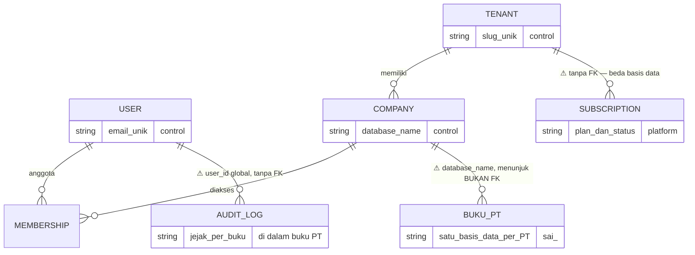

Tiga garis bertanda ⚠ adalah jembatan antar basis data, dan ketiganya sengaja
tanpa FK karena FK tidak bisa menyeberangi basis data. Keutuhannya dijaga kode,
bukan mesin basis data:

| Jembatan | Caranya dijaga |
|---|---|
| `Company.databaseName` → buku PT | Disaring `/^[A-Za-z0-9_]{1,64}$/`, dan kredensialnya **selalu** dari environment |
| Tenant (control) ↔ Subscription (platform) | Snapshot status & kuota, urutan tulis platform→control, plus `reconcile:platform` |
| `*.userId` di buku PT → `User` (control) | Id global + `lib/users-directory.ts`; nama **ikut disalin** supaya jejak tetap terbaca walau penggunanya dihapus |

### 1.2 Control — identitas & keanggotaan

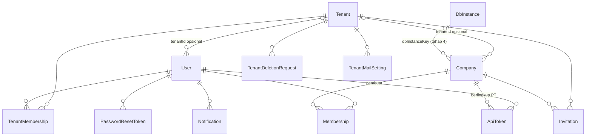

Dua matriks keanggotaan, dan itu bukan duplikasi: `TenantMembership`
(owner/admin/member — urusan langganan) berbeda dari `Membership` (peran di satu
PT — urusan pembukuan).

**Tanpa relasi keluar, dan sengaja:** `Registration` (pendaftar belum punya
`User`) · `TenantSlugHistory` (slug lama harus tetap bisa di-redirect) ·
`RateLimitCounter` · `OperatorAccount` (akun SAI, bukan pengguna customer) ·
**`TenantAuditLog`** — jejak ini mencatat penghapusan tenant, jadi ia **harus
selamat** sesudah tenant-nya hilang · **`Job`**, antrean pekerjaan latar: ia
memuat `tenant_id`/`company_id` sebagai angka tanpa FK, karena pekerjaan harus
tetap bisa dibaca sesudah perusahaannya nonaktif — sebuah pekerjaan yang hilang
bersama barisnya adalah kegagalan yang tidak meninggalkan jejak · `SchedulerRun`
· `BackupRun` · `ConformanceRun` (jejak putaran) · `RuntimeSample` (sampel
runtime, migration kendali 0008).

**`Tenant` membawa dua kolom pindah on-premise** (migration kendali
`0010_tenant_pindah_onprem`): `frozen_at` — tidak `NULL` = seluruh buku tenant
**hanya-baca**, apa pun status langganannya — dan `migrated_out_at`. Pembekuan
sengaja kolom sendiri, bukan nilai `status`, sebab `status` ditulis ulang
penjadwal, webhook, dan konsol ([§8.7](#87-tenant--langganan--dua-tangga-yang-berjalan-bersamaan)).

**`jobs` di `control`, bukan di `platform` maupun di basis data sendiri.**
Aplikasi sudah punya koneksi ke `control` (2 dianggarkan) dan `tenant_id`/
`company_id` yang dirujuknya juga hidup di sana; basis data ke-20 berarti satu
pasangan pool, satu entri migration, dan satu objek dump lagi demi nol manfaat.
`platform` gugur karena doktrin #137 melarangnya dari jalur panas — dan membaca
kemajuan pekerjaan **adalah** jalur panas.

⚠ **Harganya nyata:** `control` juga melayani **autentikasi**, dan antrean
ber-`SKIP LOCKED` membuat baris mati lebih cepat daripada tabel lain di sana.
Itu sebabnya `autovacuum` disetel lebih agresif **pada tabel itu saja**
(migration kendali `0006_jobs`). **Pemicu memindahkan `jobs` ke basis datanya
sendiri:** latensi p95 kueri autentikasi naik terukur seiring throughput
antrean — bukan sebelum itu terukur.

### 1.3 Platform — langganan & penagihan

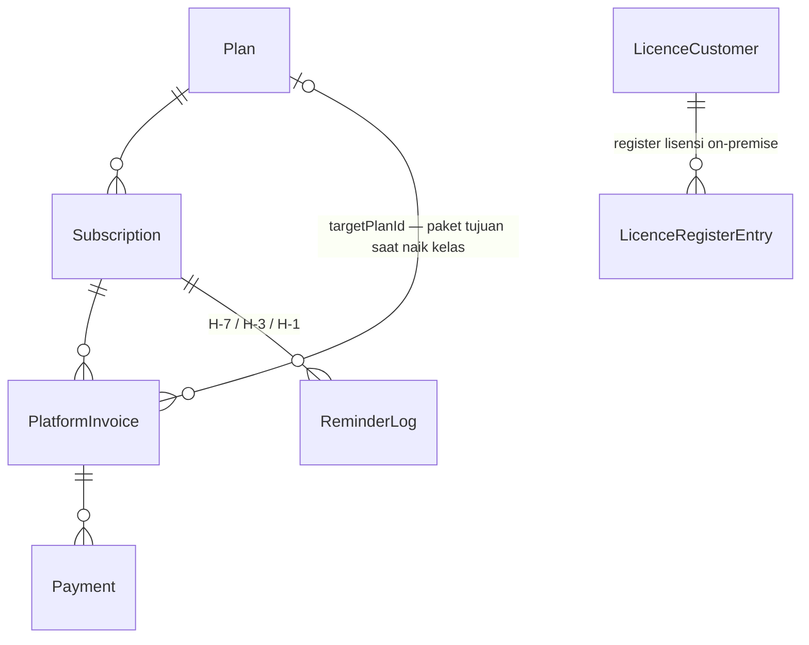

Hanya tujuh model yang berelasi. `LicenceCustomer` · `LicenceRegisterEntry`
(migration platform `0006_licence_register`) adalah **arsip** lisensi
on-premise — ditandatangani di konsol atau luring — dibaca dan ditulis konsol
operator saja; `source_tenant_id` menunjuk tenant SaaS asal tanpa FK. Tidak ada
yang membacanya untuk memutuskan status lisensi. `LicenceSigningKey`
(`0007_licence_signing_keys`, berdiri sendiri) memegang kunci penanda konsol
yang **tersegel** dengan frasa sandi ([06 §3.7](./06-KEAMANAN.md)). Sisanya **sengaja berdiri sendiri**, karena
masing-masing adalah catatan peristiwa, bukan entitas: `SchedulerRun` ·
`BackupRun` · `ConformanceRun` (tiga heartbeat yang dibaca `/api/health`) ·
`SubscriptionEvent` · `OperatorAuditLog` ·
`UsageCounter` · `TenantBillingProfile` · `MailSetting` · `SiteContent` ·
`SiteSetting` · `StatusNotice` · `BrandAsset`.

> **Tidak ada satu pun angka akuntansi di lapis ini.** Tabel transaksi di
> platform akan membatalkan isolasi #104.

### 1.4 Buku PT — inti buku besar

Enam model yang memegang kebenaran akuntansi. Semua yang lain akhirnya bermuara
ke sini lewat mesin posting.

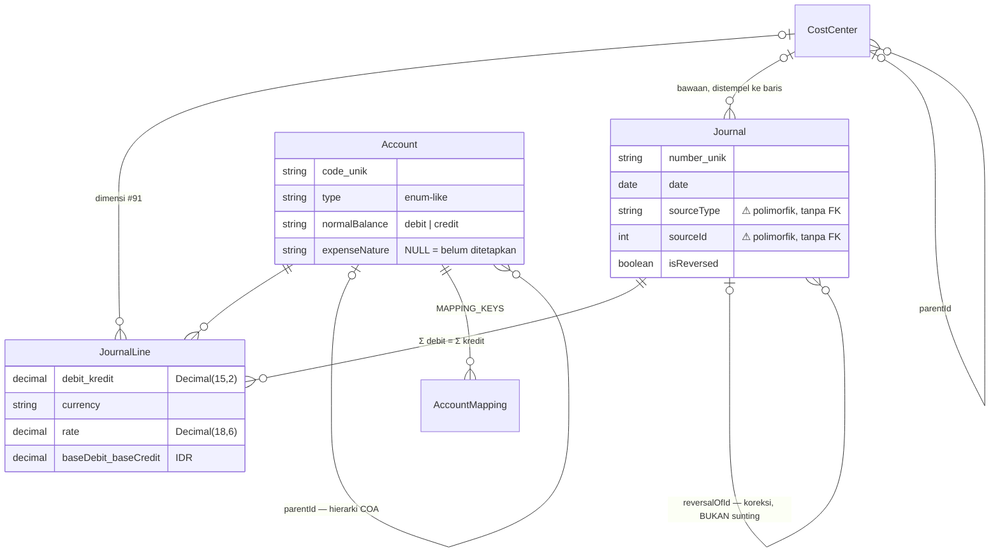

| Yang harus dibaca | Kenapa |
|---|---|
| `Journal.sourceType` + `sourceId` polimorfik, tanpa FK | Satu kolom tidak bisa menunjuk sembilan tabel dokumen; dijaga mesin posting, dicari lewat `@@index([sourceType, sourceId])` |
| Koreksi lewat `reversalOfId`, bukan `UPDATE` | Jurnal imutabel |
| Tiap baris membawa `currency` + `rate` + `base*` | Nilai IDR disimpan, tidak dihitung ulang saat laporan — laporan lama tetap cocok walau kurs berubah |
| `CostCenter` nullable di kedua tempat | `NULL` = "belum ditetapkan / seluruh perusahaan", bukan data hilang; karena itu tidak ada backfill |

`Period` dan `YearClose` **tidak punya relasi sama sekali** — keduanya dikunci
`@@unique([year, month])` dan dibaca sebagai gate oleh mesin posting.

### 1.5 Buku PT — penjualan

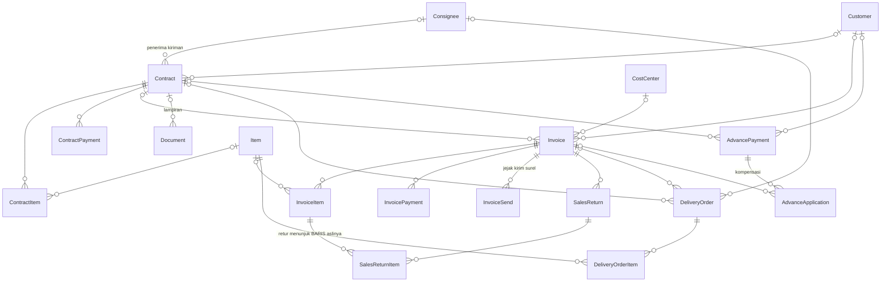

`SalesReturnItem` menunjuk `InvoiceItem`, bukan `Item` — retur harus menunjuk
**baris faktur** yang dikembalikan, supaya harga dan kuantitas yang dibalik
sama persis dengan yang pernah ditagih.

### 1.6 Buku PT — pembelian, persediaan & manufaktur

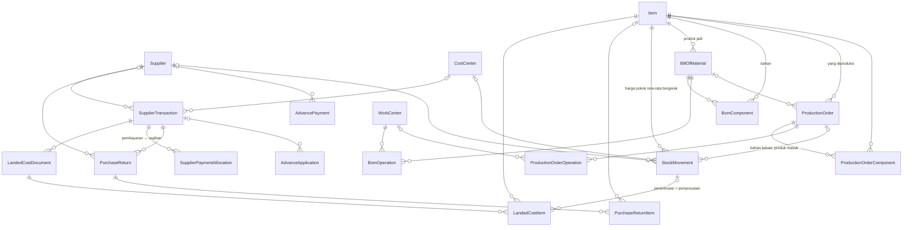

**`StockMovement` adalah simpul yang dipakai bersama** empat domain: pembelian,
penjualan (lewat surat jalan), biaya pendaratan, dan produksi. Harga pokok
rata-rata bergerak dihitung dari tabel ini (`posting/cogs.ts`), jadi setiap
jalur baru yang memindahkan barang **wajib** lewat sini — kalau tidak, HPP-nya
diam-diam salah.

`SupplierPaymentAllocation` menunjuk `SupplierTransaction` **dua kali** (baris
pembayaran dan baris tagihan yang dilunasinya); `LandedCostItem` menunjuk
`StockMovement` dua kali (penerimaan dan penyesuaiannya).

### 1.7 Buku PT — kas, bank, aset tetap & tata kelola

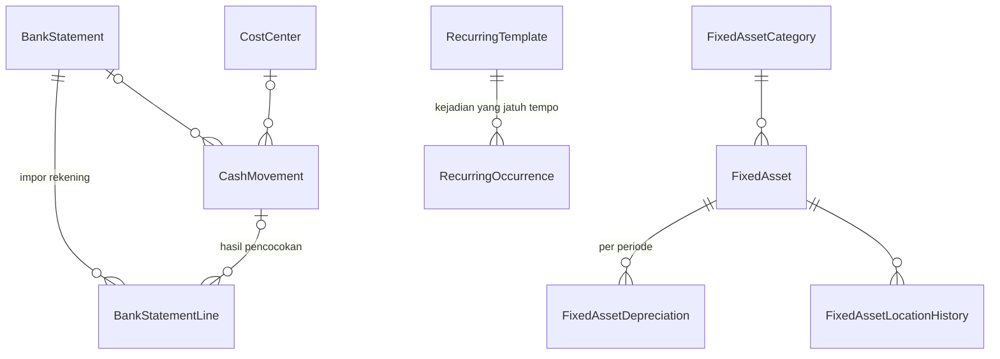

Rekonsiliasi bank adalah satu-satunya tempat pencocokan **dua arah**:
`BankStatementLine.cashMovementId` nullable (baris rekening yang belum
dicocokkan) dan `CashMovement.bankStatementId` juga nullable (transaksi yang
dicatat sebelum rekeningnya diimpor).

Berdiri sendiri tanpa relasi: `Role` · `RolePermissionOverride` ·
`UserPermissionOverride` · `ApprovalRule` · `ApprovalRequest` · `AuditLog` ·
`TaxRate` · `Budget` · `SalesTarget` · `ExchangeRate` · `CurrencyConversion` ·
`FxRevaluation` · `CompanySetting` · `CompanyLogo` · `Period` · `YearClose`.

### 1.8 Kolom `*_id` tanpa FK — daftar lengkap dan alasannya

Tidak satu pun dari kolom ini boleh "diperbaiki" dengan menambah FK.

| Kolom | Kenapa tanpa FK |
|---|---|
| `journals.source_type` + `source_id` | **Polimorfik** — satu kolom tidak bisa menunjuk sembilan tabel dokumen |
| `approval_requests.document_id` | Polimorfik: `contract` \| `invoice` \| `contract_payment` \| `invoice_payment` \| `supplier_transaction` |
| `recurring_templates.source_id` | Polimorfik (beberapa jenis dokumen) |
| `recurring_occurrences.document_id` | Polimorfik — dokumen yang diterbitkan bisa berjenis apa saja |
| `audit_logs.user_id` | **Id global**; `users` hidup di basis data lain |
| `invoice_sends.sent_by_user_id` | sama |
| `periods.closed_by_id` | sama |
| `year_closes.closed_by_id`, `.reversed_by_id` | sama |
| `approval_requests.decided_by_id` | sama |
| `tenant_audit_logs.user_id` (control) | sama, **dan** jejaknya harus selamat dari penghapusan |
| `invitations.invited_by_user_id` (control) | sama |
| `tenant_deletion_requests.requested_by_user_id` (control) | sama |
| `companies.database_name` (control) | **Menunjuk basis data**, bukan baris. Menyimpan URL lengkap di sini berarti satu `SELECT` bisa membawa kredensial setiap customer |
| `company_settings.opening_journal_id` | 🔶 Satu baris per buku, jadi FK/indeks tidak memberi manfaat |
| `budgets.account_id`, `fixed_assets.*_account_id` | FK ada di basis data, relasi Prisma sengaja tidak dideklarasikan supaya tidak menggantung back-relation di model yang ramai |

> ⚠ **PostgreSQL tidak membuat indeks untuk kolom FK** (MySQL membuatnya
> sendiri). Setiap relasi baru wajib membawa `@@index` yang dideklarasikan di
> skema, dijaga `tests/index-fk-parity.test.ts`. Gejala kalau terlewat hanyalah
> kueri yang perlahan melambat.

### 1.9 Aturan skema yang berlaku untuk setiap tabel baru

Selengkapnya di [`docs/DATABASE.md`](../DATABASE.md).

| Aturan | Nilai |
|---|---|
| Nama | Inggris · `snake_case` di DB (`@map`) · tabel **jamak** (`@@map`) · Prisma camelCase |
| Kolom wajib | `id` (Int autoincrement) + `created_at` + `updated_at`; master data + `is_active` |
| **Uang** | `Decimal(15,2)` — **jangan pernah** `Float`/`Int` |
| Kuantitas · kurs | `Decimal(15,3)` · `Decimal(18,6)` |
| Valas | Simpan `currency` + `rate` + `base_amount` (IDR) bersama-sama |
| Enum-like | `String @db.VarChar` + `z.enum` (nilai `snake_case`) — **bukan** enum native |
| Indeks | `@unique` untuk code/number; `@@index` untuk setiap FK, kolom tanggal, dan status |
| `onDelete` | **Selalu eksplisit**; `Restrict` untuk apa pun yang sudah diposting |

## 2. Daur hidup permintaan halaman

Alur yang paling sering terjadi, dan setiap batas keamanan dilewati di sini.

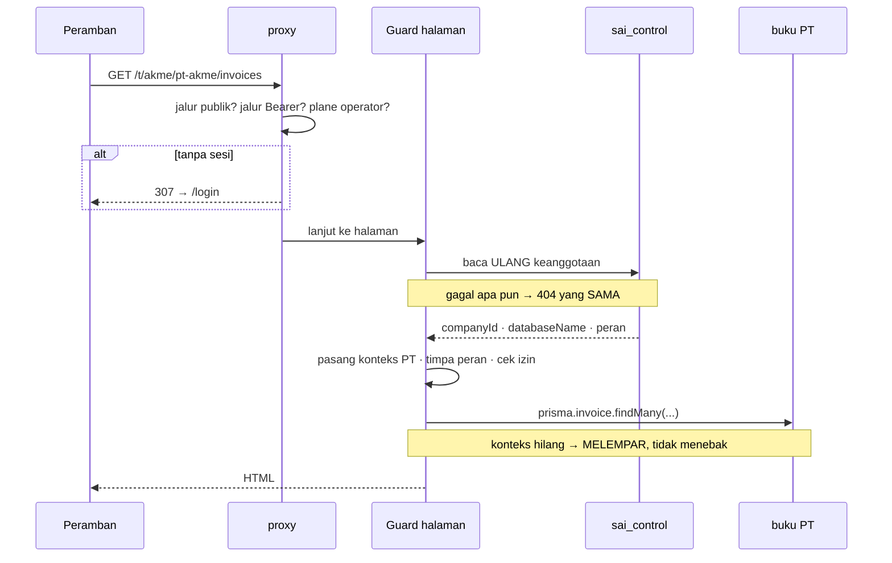

Empat kegagalan berbeda — slug tak ada, PT nonaktif, bukan anggota, tenant lain
— menghasilkan **404 yang identik**; membedakannya akan membocorkan keberadaan
perusahaan orang lain. Konteks yang hilang selalu melempar, tidak ada jalur
bawaan.

## 3. Posting dokumen → jurnal

Alur yang memegang kebenaran akuntansi. Contoh: faktur penjualan.

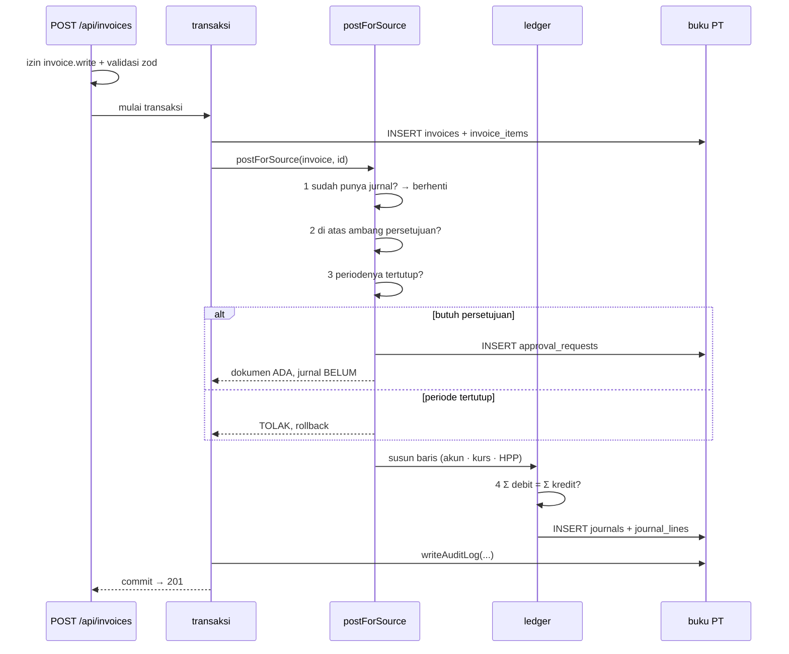

### Jalur persetujuan

```
Dibuat ──(di bawah ambang)──▶ Terposting ──reverseJournal()──▶ Dibalik
   └──(ambang terlampaui)──▶ Menunggu ──disetujui──▶ Terposting
                                 └──ditolak──▶ Ditolak ──resubmit──▶ Menunggu
```

Saat **Menunggu**, dokumen ADA tetapi jurnal BELUM. Buku besar diam sampai
seseorang memutuskan di `/approvals`. Saat **Terposting**, jurnal **imutabel** —
koreksi lewat pembalikan, bukan sunting.

**Dokumen berulang** (`recurring:run`) selalu menerbitkan pengajuan persetujuan
dengan `force`, berapa pun nilainya. Kejadian yang jatuh di periode tertutup,
atau yang dokumen sumbernya hilang, ditahan dan dilaporkan.

## 4. Penyediaan PT baru

Satu-satunya alur yang **membuat basis data**.

```
POST /api/companies
├─ izin "company.create" (owner/admin, matriks tenant)
├─ kuota paket terlampaui? → tolak + ajakan naik paket
├─ provisionCompany():
│   ├─ susun slug + nama basis data, saring /^[A-Za-z0-9_]{1,64}$/
│   ├─ CREATE DATABASE "sai_t<N>_<slug>" (collation C)
│   ├─ prisma migrate deploy (prisma/postgresql/company)
│   ├─ INSERT companies (database_name = NAMA saja) + memberships
│   └─ semai: COA per modul · pemetaan akun bawaan · kategori aset · data [CONTOH]
└─ alihkan ke wisaya /setup → identitas, periode, saldo awal, modul
```

Dua catatan:

- `companies.database_name` hanya menyimpan **nama**. Bila URL lengkap
  disimpan, satu `SELECT` bisa membawa kredensial setiap customer.
- Data `[CONTOH]` pada perusahaan baru wajib `is_demo = FALSE`. Data itu
  prasyarat penyiapan, dan tidak boleh ikut tersapu bersama data demo.

## 5. Penagihan langganan

Alur ini menyeberangi dua basis data, sehingga **urutan tulisnya diatur**.

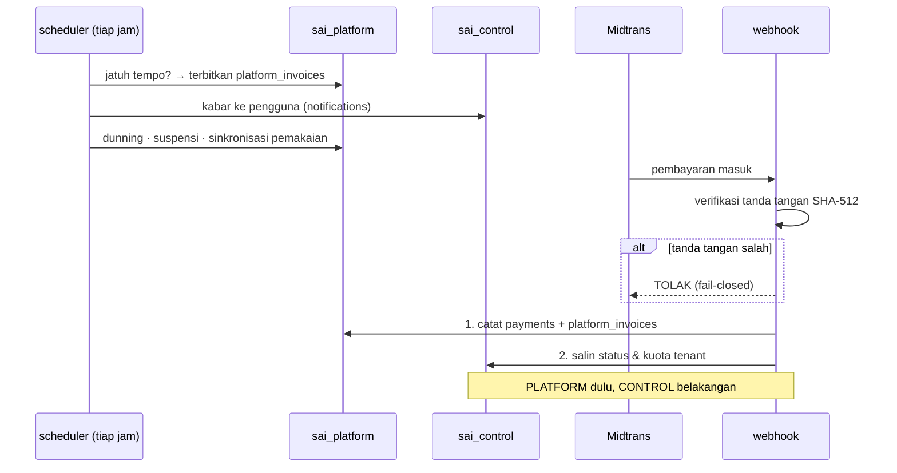

### Kenapa urutannya tidak boleh dibalik

FK dan transaksi tidak menyeberangi basis data, jadi kegagalan di tengah selalu
mungkin. Urutan platform→control memastikan kegagalan itu bisa diperbaiki:

| Urutan | Kegagalan di tengah meninggalkan | Bisa diperbaiki? |
|---|---|---|
| **Platform dulu** ✅ | Pembayaran tercatat, tenant **belum** naik kelas | **Ya** — `bun run reconcile:platform` |
| Control dulu ❌ | Tenant naik kelas, **tanpa** pembayaran | **Tidak akan pernah ketahuan** |

### Keadaan hari ini

Penagihan otomatis sengaja dihentikan (Fase A). Data platform 11 Okt 2026:
`billing_mode = none` di **11 dari 11** langganan · `payments` **0 baris** ·
`platform_invoices` 11 baris · tanpa `MIDTRANS_*` → transport MOCK.

Mekanismenya aktif dan diuji, tetapi gate-nya ditutup **di tingkat data**.
Penghentiannya dilakukan `scripts/pause-platform-billing.ts` (kering secara
bawaan, `--apply` menuntut `--reason`, idempoten). Alasan dan syarat
pembukaannya: [`docs/KOMERSIALISASI.md`](../KOMERSIALISASI.md).

## 6. Surel keluar

Pemicu yang membawa **token akses** (undangan, atur-ulang sandi, verifikasi)
wajib memakai pengaturan platform dan tidak pernah SMTP tenant. Sisanya
(faktur, pengingat) memakai SMTP tenant bila ada.

### Pengingat ke pelanggan — empat gate

Satu-satunya alur yang menghubungi orang di luar organisasi customer, sehingga
gate-nya paling ketat:

| # | Gate | Kalau tidak lulus |
|---|---|---|
| 1 | `reminder_enabled` — bawaan **MATI** | berhenti |
| 2 | `reminder_tested_at` — seseorang harus pernah **menerima sendiri** kalimatnya | **TOLAK** |
| 3 | Dalam jendela toleransi 2 hari | lewati |
| 4 | Kunci unik `(invoice, kind, due_key)` | constraint menolak **sebelum** `sendMail` |

Jendela toleransi 2 hari mencegah pengaktifan fitur ini mengirim ratusan surel
ke tunggakan lama sekaligus. Surel dikirim **satu per faktur**, karena seorang
pelanggan hanya menanggung fakturnya sendiri.

`notify:invoice-due` (kabar dalam-aplikasi) berbeda: ia berupa **ringkasan**,
karena 80 kabar terpisah tidak akan terbaca. Kabar itu hanya dikirim ke anggota
yang boleh membaca Piutang (`receivable.read`, matriks efektif), karena isinya
menyebut jumlah tunggakan dan nama pelanggan.

## 7. Penyimpanan berkas

```
Pengguna unggah → POST /api/upload (requireApiPermission)
                  ├─ validasi tipe & ukuran
                  ├─ data/documents/<companyId>/<uuid>.<ext>     ← di luar public/
                  ├─ tabel documents (di buku PT)
                  └─ audit_logs

Dibaca     → GET /api/t/{t}/{c}/documents/[id]/file
             └─ document.read + baris ADA di buku PT aktif → byte
```

Berkas hanya terjangkau lewat **route bertenant** (#489). Sebelum #367, berkas
ada di direktori statis `public/uploads/` yang tidak melewati guard apa pun.

`companyId` diambil dari konteks yang sudah dimasuki guard, **tidak dari klien**
— polanya sama dengan `lib/audit.ts`.

## 8. Daur hidup & status dokumen

Enam daur hidup yang statusnya disimpan di basis data, ditambah satu yang
dihitung. Nilai status di bawah dibaca dari konstanta di kode; berkas sumbernya
disebut di tiap bagian.

### 8.1 Pengajuan persetujuan — `APPROVAL_STATUSES`

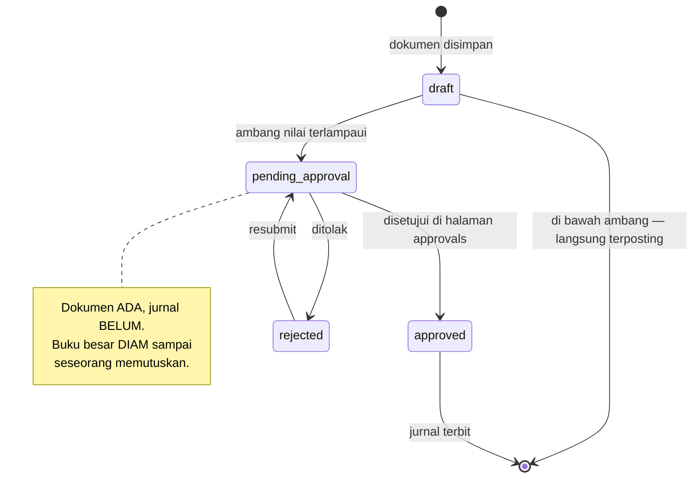

`src/lib/approvals.ts` · empat nilai: `draft` · `pending_approval` ·
`approved` · `rejected`. Ambang, peran pemutus, dan nilai IDR **disalin
sebagai snapshot** saat pengajuan dibuat, supaya keputusan lama tetap terbaca
meski aturannya diubah kemudian.

**Dokumen berulang selalu masuk `pending_approval` dengan `force`**, berapa pun
nilainya.

### 8.2 Jurnal — dua keadaan, dan tidak ada "sunting"

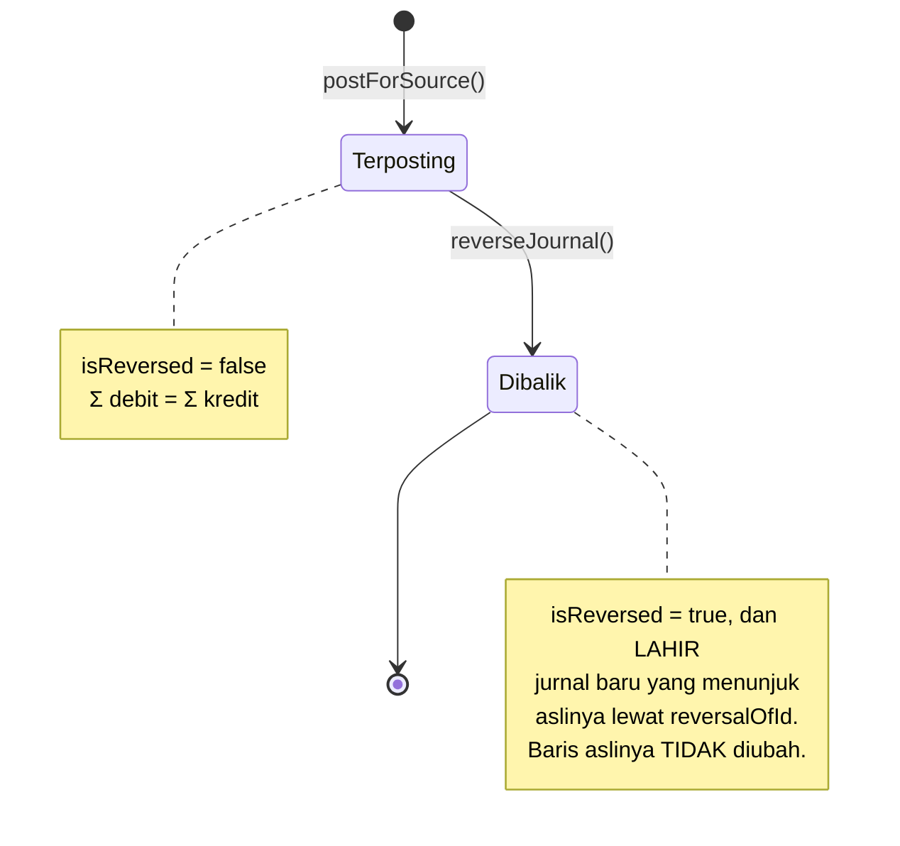

Tidak ada transisi "sunting" maupun "hapus".

### 8.3 Periode & tutup tahun — `PERIOD_STATUSES`

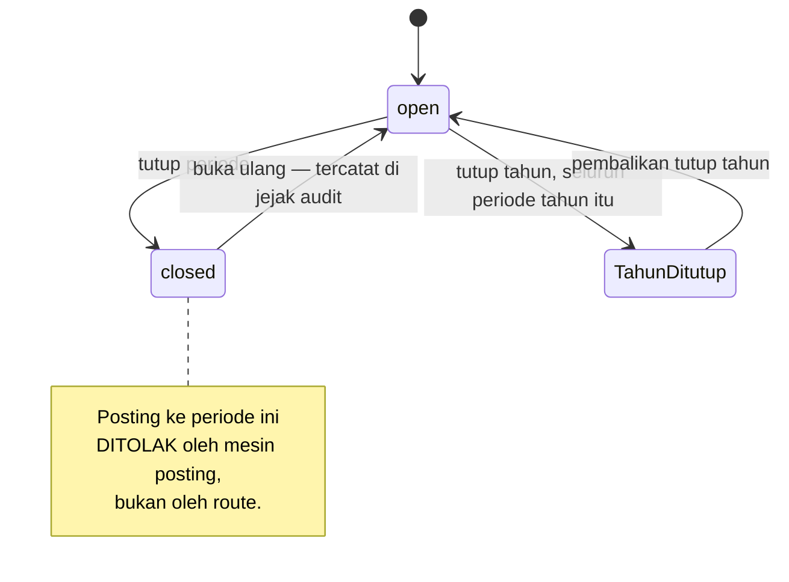

`src/lib/period.ts` · dua nilai: `open` · `closed`. Siapa menutup disimpan di
`closed_by_id` sebagai **id pengguna global tanpa FK** (`users` hidup di basis
data lain); nama dicari saat ditampilkan, dan pengguna yang sudah dihapus
tampil sebagai "—". Riwayat tutup/buka selengkapnya ada di jejak audit.

### 8.4 Kontrak — `CONTRACT_STATUSES`

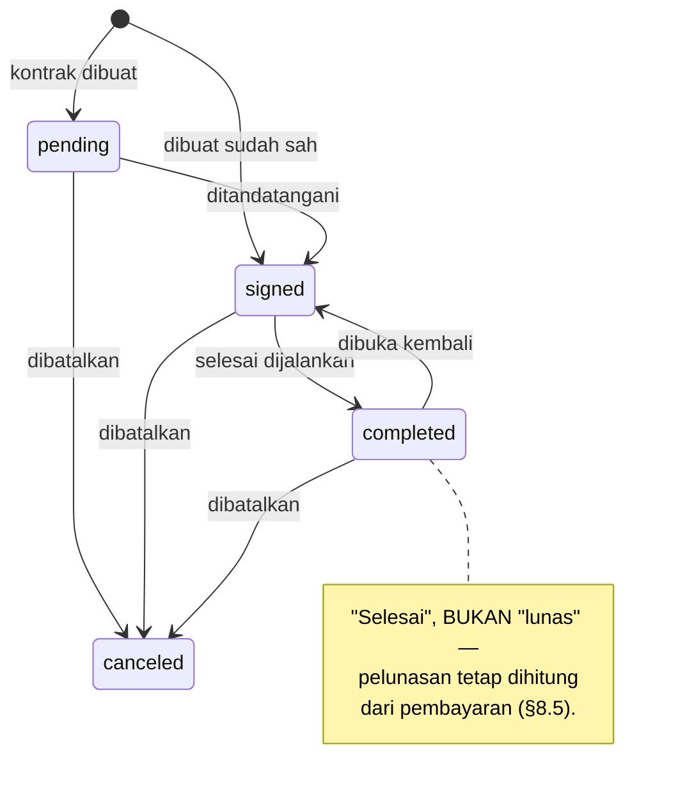

`contract/accounting.yaml` (`contract_statuses`, dibangkitkan untuk TS & Go,
di-re-ekspor `@sai/core/constants`) · empat nilai: `signed` · `pending` ·
`canceled` · `completed`. `completed` disahkan pemilik 23 Okt 2026 (temuan S3,
sebelumnya nilai liar dari impor warisan). Perpindahannya —
`CONTRACT_STATUS_TRANSITIONS` — hanya membatasi `completed`: ia dicapai dari
`signed` saja, dan kontrak baru tidak lahir `completed`; perpindahan di antara
tiga status lama tetap bebas seperti sebelumnya (tidak semuanya digambar di
atas). Ditegakkan route POST/PUT kontrak; di basis data dijaga CHECK
`contracts_status_check` (migration perusahaan 0003). Faktur tetap tiga status
(`invoice_statuses`). Latar lengkapnya, termasuk kenapa grafik donat di halaman
kontrak pernah kehilangan 16,6% datanya tanpa terlihat salah, ada di
[07 Riwayat](./07-RIWAYAT.md).

### 8.5 Pembayaran dokumen — DIHITUNG, bukan disimpan

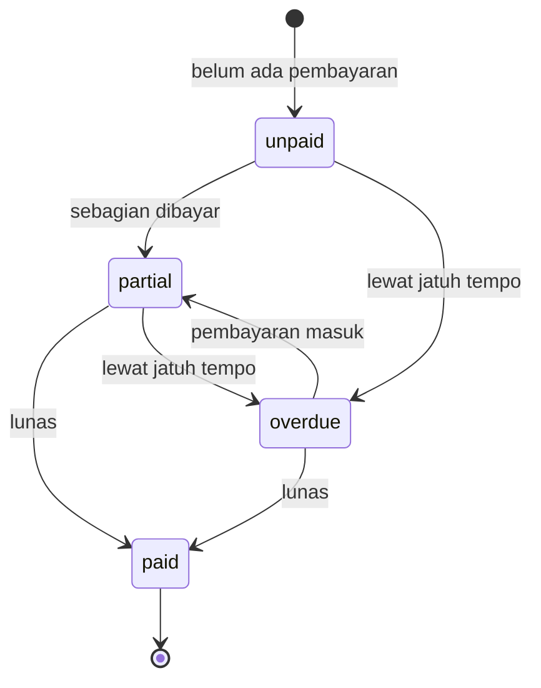

`src/lib/receivables.ts` · empat nilai: `paid` · `partial` · `unpaid` ·
`overdue`. **Tidak ada kolom `payment_status`** — keempatnya diturunkan dari
jumlah `InvoicePayment` dibanding nilai faktur dan tanggal jatuh temponya.

Status yang disimpan akan menyimpang dari pembayarannya begitu satu pembayaran
disunting atau dibalik, dan penyimpangan itu tidak berbunyi.

### 8.6 Perintah produksi & aset tetap

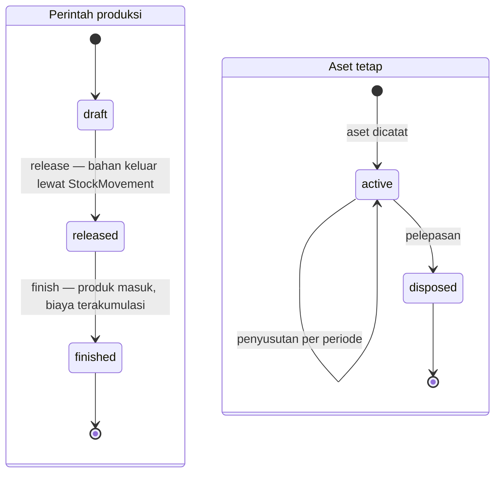

`src/lib/manufacturing/production-writes.ts` (`draft` → `released` →
`finished`; `finish` menolak perintah yang belum `released`) dan
`src/lib/fixed-assets.ts` (`FIXED_ASSET_STATUSES` = `active` · `disposed`).
Pemindahan lokasi **tidak** mengubah status — ia menambah baris
`FixedAssetLocationHistory`.

### 8.7 Tenant & langganan — dua tangga yang berjalan bersamaan

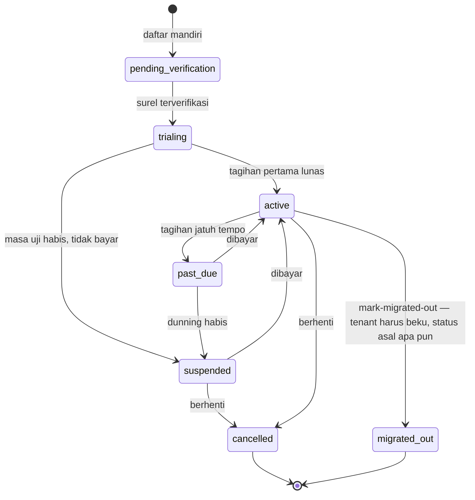

`TENANT_STATUSES` (control, 7 nilai: + `pending_verification`, + `migrated_out`
sejak migration kendali 0010) dan
`SUBSCRIPTION_STATUSES` (platform, 5 nilai) berjalan **berpasangan**: status
tenant adalah snapshot dari status langganan, disalin platform → control dengan
urutan tulis yang tidak boleh dibalik.

Empat hal yang mudah salah di sini:

| Hal | Kenyataannya |
|---|---|
| `suspended` dan `cancelled` | **Hanya-baca, bukan hilang.** `READ_ONLY_TENANT_STATUSES` — customer yang berhenti tetap **wajib** bisa membaca dan mengekspor pembukuannya |
| Pindah status otomatis | Semuanya digerakkan `scheduler:subscriptions` tiap jam, dan **tiap langkahnya idempoten** |
| `migrated_out` | Tenant yang pindah ke on-premise ([`ONPREM-PINDAH-DARI-SAAS.md`](../ONPREM-PINDAH-DARI-SAAS.md)). Ditulis `tenant:mark-migrated-out` bersamaan dengan langganan → `cancelled`, PT dinonaktifkan, sesi dicabut; buku SaaS **tidak dihapus**. Pembekuan sebelumnya (`frozen_at`) adalah sumbu terpisah dari tangga ini |
| Keadaan hari ini | Seluruh 11 langganan ber-`billing_mode = none`, jadi tangga ini tidak digerakkan — gate-nya ditutup di tingkat data, bukan di kode |

### 8.8 Permintaan penghapusan tenant

Alur yang sengaja lambat: permintaan dicatat di
`control.tenant_deletion_requests`, bertenggang **30 hari**, dan **bisa
dibatalkan** selama tenggang itu. Eksekusinya dijalankan manusia
(`bun run execute-tenant-deletion`), bukan scheduler.

Jejaknya tinggal di `tenant_audit_logs`, yang **sengaja tanpa FK** ke `tenants`
— jejak ini mencatat penghapusan tenant, jadi ia harus tetap ada sesudah
tenant-nya hilang. Kewajiban retensi 10 tahun atas pembukuan dibahas di
[`docs/COMPLIANCE.md`](../COMPLIANCE.md).

### 8.9 Pekerjaan latar — `JOB_STATUSES`

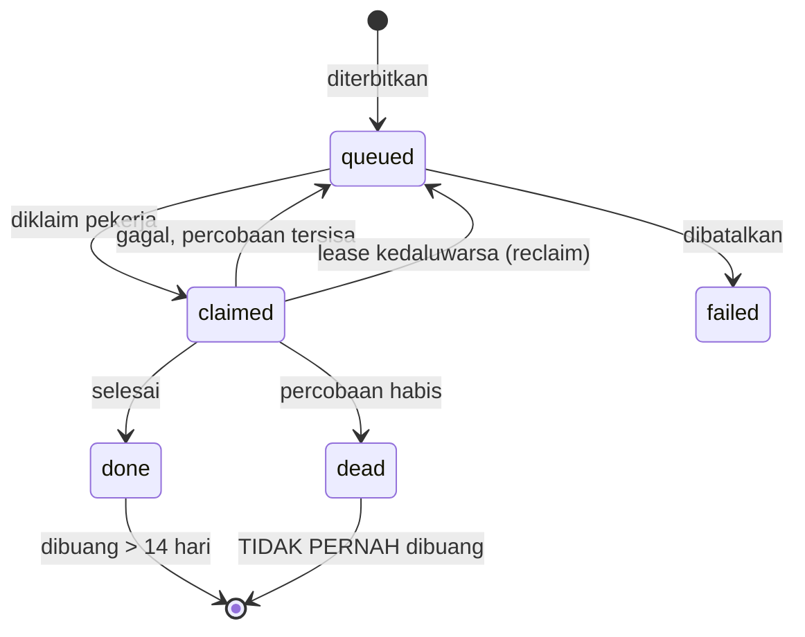

`contract/kinds.yaml` → `packages/core/src/generated/job-kinds.ts` · lima nilai:
`queued` · `claimed` · `done` · `failed` · `dead`. Kosakatanya **dibangkitkan**,
tidak ditulis dua kali: tahap 1b menambahkan pekerja Go yang membaca kontrak
yang sama, dan dua daftar tulis tangan menyimpang tanpa galat — `kind` yang
hanya dikenal satu sisi menjadi baris yang menumpuk selamanya.

Empat sifat yang menentukan, dan masing-masing menjawab satu kegagalan:

| Sifat | Bentuknya | Kalau tidak |
|---|---|---|
| **Klaim satu pernyataan** | CTE `FOR UPDATE SKIP LOCKED` yang memilih dan `UPDATE` sekaligus | dua pekerja memilih baris yang sama di celah antar-pernyataan |
| **`dedupe_key` UNIK** | penerbitan dua kali menabrak constraint | penjadwal yang berjalan dua kali menghasilkan dua pekerjaan — dan ini yang menggantikan *leader election* |
| **Lease diperpanjang** | pekerja memperbarui `claimed_at` tiap 30 detik; ambang reclaim kelipatannya | ambang tetap selalu salah untuk ekspor 30 menit: pekerja kedua mengklaimnya **sementara yang pertama masih berjalan** |
| ***Partial index*** | `WHERE status = 'queued'`, urut `priority DESC, run_after` | pengambilan melambat seiring antrean tumbuh |

⚠ **Baris `dead` tidak pernah dipangkas**, sementara baris `done` dibuang setelah
14 hari. Kegagalan adalah isi paling berharga di tabel ini — ia justru yang
dicari orang berbulan-bulan kemudian.

⚠ ***Vacuum horizon*:** satu transaksi panjang **di mana pun** di basis data yang
sama menahannya, jadi laporan berdurasi panjang tidak boleh berjalan dalam
transaksi terbuka di `control`.

## 9. Ke mana data berhenti

| Data | Tempat berhenti | Retensi |
|---|---|---|
| Jurnal & buku besar | `journals`, `journal_lines` (buku PT) | **Imutabel**; 10 tahun (UU KUP) |
| Dokumen transaksi | Tabel per jenis (buku PT) | Mengikuti buku |
| Berkas lampiran | `data/documents/<companyId>/` | Mengikuti buku |
| Jejak audit PT | `audit_logs` (per buku) | Mengikuti buku |
| Jejak audit tenant | `tenant_audit_logs` (control) | **Selamat dari penghapusan tenant** — sengaja tanpa FK |
| Identitas & keanggotaan | `sai_control` | Sampai penghapusan akun |
| Langganan & tagihan | `sai_platform` | ❓ belum dipastikan |
| Jejak scheduler/backup/kesesuaian | `*_runs` | Dipangkas `prune:trails` > 90 hari |
| Pekerjaan latar | `jobs` (control) | `done` dibuang > 14 hari oleh pelari jalur; **`dead` tidak pernah** |
| Arsip backup | Volume `backup` (lokal; S3 belum disetel) | `BACKUP_RETENTION_DAYS` |
| Surel pengembangan | `data/mail-outbox/*.eml` | ❓ tanpa pemangkasan |

**Berhenti berlangganan tidak menghapus buku.** Keputusan ini tercatat di
[`docs/COMPLIANCE.md`](../COMPLIANCE.md): kewajiban retensi 10 tahun melekat pada
pembukuan, tidak pada status langganan.
