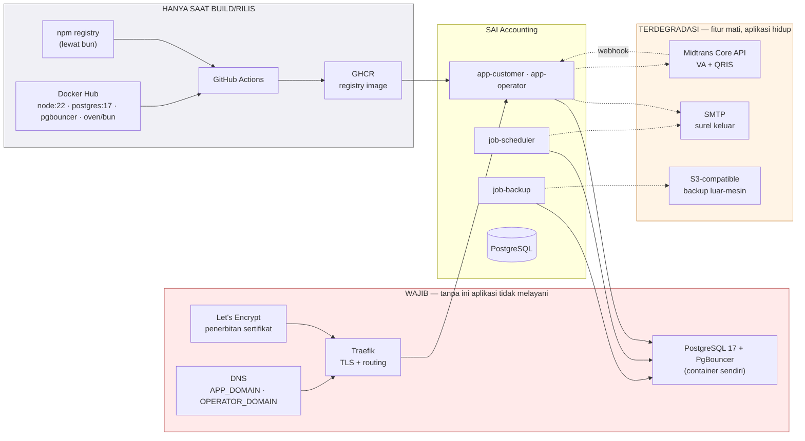
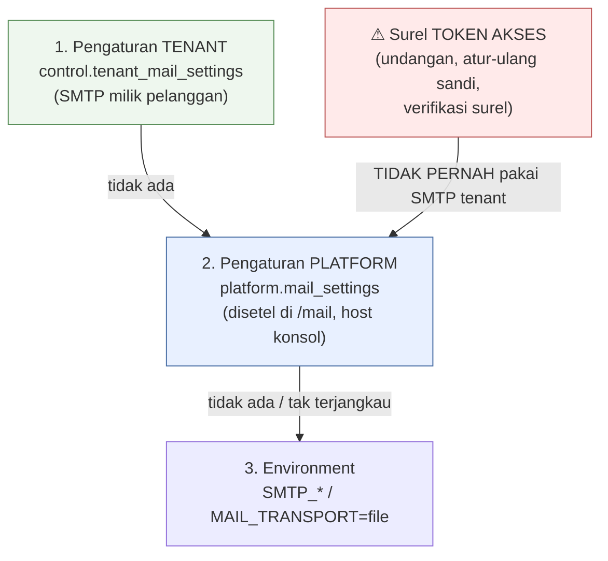
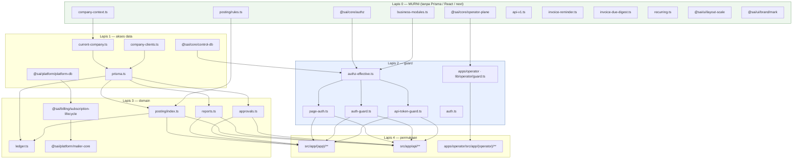
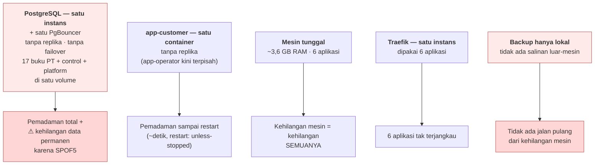

# 04 — Peta Dependensi & Integrasi

> Dimutakhirkan 18 Okt 2026 · produksi `main@ca0cd038` · [indeks](./README.md)

## 1. Dependensi eksternal — gambaran

## 2. Dependensi eksternal — rinci

### 2.1 WAJIB

| Dependensi | Dipakai oleh | Bila mati | Konfigurasi |
|---|---|---|---|
| **PostgreSQL 17** (+ PgBouncer) | semua | Pemadaman total. Bagi `app-*` dan job, PgBouncer mati sama dengan basis data mati; hanya `migrate`/`job-backup` yang langsung ke `pg`. `/api/health` → 503 `database: unreachable`, Traefik berhenti mengirim lalu lintas | `DATABASE_URL`, `CONTROL_DATABASE_URL`, `PLATFORM_DATABASE_URL` |
| **Traefik** | web | Tidak ada akses dari luar. Container tetap sehat | Label Docker di `docker-compose.yml` |
| **Let's Encrypt** (resolver `le`) | Traefik | Sertifikat kedaluwarsa → peramban menolak. 🔶 Pembaruan ditangani Traefik; tidak ada pemantauan di repo ini | `certresolver=le` |
| **DNS** | semua | `APP_DOMAIN` tak terselesaikan = tak terjangkau. `OPERATOR_DOMAIN` salah = konsol 404 (fail-closed, disengaja) | `APP_DOMAIN`, `OPERATOR_DOMAIN`, `OPERATOR_HOST` |

Probe kesehatan: hanya basis data **control** yang boleh memutuskan 503.
Platform, PT contoh, scheduler, backup, dan surel hanya dilaporkan. Kalau
probe 503 karena scheduler telat, satu masalah penagihan akan berubah menjadi
pemadaman total.

### 2.2 TERDEGRADASI (fitur mati, aplikasi hidup)

#### SMTP — surel keluar

Konfigurasinya tiga lapis, dan urutannya menentukan:

| | |
|---|---|
| Pustaka | `nodemailer` 7, satu berkas: `packages/platform/src/mailer-core.ts` |
| Lapis 1 | `lib/tenant-mail-settings.ts` — SMTP milik pelanggan |
| Lapis 2 | `packages/platform/src/mail-settings.ts` — milik penyedia, di `sai_platform` |
| Lapis 3 | *environment* / transport `file` → `data/mail-outbox/*.eml` |
| Sandi | Disimpan hanya sebagai segel AES-256-GCM (`packages/core/src/settings-crypto.ts`, kunci `SETTINGS_ENCRYPTION_KEY`) |
| Cache | TTL 60s; sengaja tidak berkunci tenant, karena pengaturan platform milik penyedia dan hanya satu untuk seluruh pemasangan |
| Status 11 Okt 2026 | 1 baris `mail_settings`, `transport = smtp`, host terisi. `tenant_mail_settings` = 0 baris |

**Aturan:** surel yang membawa token akses (undangan staf, atur-ulang sandi,
verifikasi surel) tidak pernah lewat SMTP tenant. SMTP tenant dikendalikan
pelanggan, dan token akses adalah kredensial yang tidak boleh melewati
infrastruktur yang bisa ia baca.

Bila SMTP mati, undangan, atur-ulang sandi, pengiriman faktur, dan pengingat
pelanggan gagal; login dan buku besar tidak terpengaruh. `mail-settings.ts`
sengaja tanpa `server-only` karena dipakai skrip `tsx` di luar Next. Menarik
`server-only` ke sana akan mematikan scheduler.

#### S3-compatible — backup

| | |
|---|---|
| Perkakas | `awscli` di image `backup` (`aws s3 cp`, `ls`, `rm`) |
| Penyedia | Mana pun yang S3-compatible, lewat `--endpoint-url` |
| Env | `AWS_ACCESS_KEY_ID`, `AWS_SECRET_ACCESS_KEY`, `AWS_DEFAULT_REGION`, `BACKUP_S3_BUCKET`, `BACKUP_S3_PREFIX`, `BACKUP_ENCRYPTION_KEY`, `BACKUP_RETENTION_DAYS` |
| Status 18 Okt 2026 | Tiga env kosong: `AWS_ACCESS_KEY_ID`, `AWS_SECRET_ACCESS_KEY`, `BACKUP_S3_BUCKET` |
| Akibat | Backup harian terenkripsi hanya mendarat di volume `backup` (mesin yang sama). `/api/health` → `backup: local_only`, `lastSuccessAt: null` |

#### Midtrans — gate pembayaran

| | |
|---|---|
| Modul | `packages/billing/src/payment-gateway.ts`, `packages/platform/src/payment-webhook.ts`, `lib/company-payment-settings.ts` |
| Keluar | `POST {base}/v2/charge` — Core API. `base` = `api.midtrans.com` (produksi) / `api.sandbox.midtrans.com` |
| Masuk | `POST /api/billing/webhook` — tanda tangan SHA-512 |
| Env | `PAYMENT_GATEWAY`, `MIDTRANS_SERVER_KEY`, `MIDTRANS_IS_PRODUCTION` |
| Status 11 Okt 2026 | Tidak ada `MIDTRANS_*` di `.env` → transport MOCK |

Ada dua pemakaian, dan `lib/company-payment-settings.ts` ada untuk menjaga
keduanya tetap terpisah:

1. **Penagihan platform** (kami menagih tenant) memakai `MIDTRANS_SERVER_KEY`
   milik platform dari *environment*.
2. **Penagihan pelanggan** (tenant menagih pelanggannya) memakai kredensial
   milik tenant yang disimpan terenkripsi per perusahaan. Karena itu
   `company-payment-settings.ts` tidak pernah membaca `process.env.MIDTRANS_*`.

Gate efektif menuntut `NODE_ENV=production` dan `MIDTRANS_SERVER_KEY`. Di
luar itu ia jatuh ke MOCK dengan peringatan, sehingga salah setel tidak
menagih sungguhan. Verifikasi webhook fail-closed: produksi tanpa
`MIDTRANS_SERVER_KEY` menolak semua webhook.

Bila Midtrans mati, pembayaran langganan baru tidak bisa diproses. Karena
11 dari 11 langganan ber-`billing_mode=none` dan 0 pembayaran tercatat,
dampaknya hari ini nol.

### 2.3 Hanya saat build/rilis

| Dependensi | Peran | Bila mati |
|---|---|---|
| **GitHub Actions** | Membangun 4 image (`runner`, `runner-operator`, `migrator`, `backup`) | Tidak bisa rilis. Produksi tetap jalan. Jangan membangun di server (lihat dok 07) |
| **GHCR** | Menyimpan image + tag `sha-<pendek>` | Tidak bisa `pull`, jadi rollback juga tidak bisa |
| **npm registry** (lewat bun) | `bun install --frozen-lockfile` | Build gagal |
| **Docker Hub** | `node:22-bookworm-slim`, `postgres:17-alpine`, `edoburu/pgbouncer`, `oven/bun:1.3` (+ `mariadb:11` sampai #636) | Build gagal; container berjalan tak terpengaruh |

### 2.4 Integrasi yang TIDAK dipanggil runtime

**Accurate Online** (`src/lib/accurate/`) berbasis ekspor laporan yang
diunggah manusia, tanpa API. Yang diekspor Accurate berupa halaman cetak,
bukan tabel (lihat
[`docs/accurate-reference.md` Lampiran B](../accurate-reference.md)). Tidak ada
panggilan jaringan maupun kredensial Accurate.

**e-Faktur / Coretax** (`packages/core/src/efaktur.ts`, `scripts/efaktur-platform.ts`)
membuat berkas untuk diunggah ke sistem pajak. Tidak ada panggilan API ke DJP.

## 3. Dependensi internal — graf modul

Tanpa prefix = `src/lib/`; `@sai/*` = `packages/*/src/`.

### Larangan impor yang DITEGAKKAN TES

Tes merah kalau dilanggar:

| Larangan | Guard | Kenapa |
|---|---|---|
| `lib/reports.ts`, `lib/ledger.ts`, `lib/posting/*` **tidak boleh** mengimpor `business-modules.ts` | `tests/business-modules-ledger.test.ts` | Modul tidak pernah menggerbangi buku besar; laporan harus tetap rekonsiliasi |
| `packages/core/src/operator-plane.ts` **tidak boleh** mengimpor `platform-db.ts` | doktrin #137 | Guard & proxy bukan kode penagihan |
| Halaman `(docs)/**` **tidak boleh** memuat guard apa pun | `tests/authz-coverage.test.ts`, `tests/docs.test.ts` | `/docs` publik; pembaca anonim tidak boleh memicu satu kueri pun |
| `@ant-design/icons` **tidak boleh** diimpor sebagai default/namespace | `tests/icon-rsc-boundary.test.ts` | Barrel-nya meruntuhkan lapisan RSC |
| `<Link><Button/></Link>` | `tests/anchor-button-nesting.test.ts` | Dua elemen interaktif bersarang |
| `asChild` pada `Button` | `tests/button-no-aschild.test.ts` | Tidak aman dari server component (dicabut #250) |
| Nilai warna mentah di luar `packages/ui/src/theme/antd-tokens.ts` | ESLint `sai/warna-token-antd` (#204) | Satu sumber warna |
| Halaman/route tanpa deklarasi izin | `tests/authz-coverage.test.ts` | Rute tak ber-guard = lubang |
| Skrip **tidak boleh** mengimpor `server-only` | — (`tsx` mati di atasnya) | Logika produser harus di pustaka murni |

## 4. Hulu & hilir

### Hulu (yang memberi masukan)

| Sumber | Masuk lewat | Dipercaya? |
|---|---|---|
| Peramban pengguna | HTTPS → Traefik → proxy → guard | **Tidak** — zod di setiap jalur tulis |
| Webhook Midtrans | `POST /api/billing/webhook` | **Tidak** — tanda tangan SHA-512, fail-closed |
| Integrator API | `Authorization: Bearer sai_…` | **Tidak** — `requireApiToken` + izin |
| Unggahan berkas | `POST /api/upload`, impor master/COA | **Tidak** — validasi tipe & bentuk |
| Dump sistem lama | `subt5236_sai_prod_18july.sql` (manual) | **Tidak** — **tidak melewati guard zod**; alasan `conformance` ada |
| Ekspor Accurate | Unggahan manusia | **Tidak** — pengurai sendiri |

### Hilir (yang menerima keluaran)

| Tujuan | Keluar lewat | Isi |
|---|---|---|
| Peramban | HTML/JSON/PDF/XLSX | Data perusahaan |
| **Pelanggan tenant** | SMTP | Faktur + **pengingat jatuh tempo** |
| Anggota tim | SMTP | Undangan, atur-ulang sandi, verifikasi |
| Midtrans | `POST /v2/charge` | Jumlah, id pesanan |
| S3 | `aws s3 cp` | **Seluruh** basis data + dokumen + audit (terenkripsi) |
| Pemantauan luar | `GET /api/health` | ❓ pembacanya belum dipastikan |
| Perayap | `/robots.txt`, `/sitemap.xml`, `/opengraph-image` | Metadata publik |

`remind:customers` adalah satu-satunya jalur yang menghubungi orang di luar
organisasi pelanggan. Ada tiga guard sebelum surel keluar:

1. `reminder_enabled` — bawaannya mati.
2. `reminder_tested_at` — seseorang harus pernah menerima sendiri kalimatnya
   lebih dulu; tanpa itu scheduler menolak.
3. Kunci unik `(invoice_id, reminder_kind, reminder_due_key)` — putaran kedua
   menabrak constraint sebelum `sendMail` dipanggil.

Ditambah jendela toleransi 2 hari, sehingga menyalakan pengingat tidak
langsung mengirim ratusan surel untuk tunggakan lama.

## 5. Titik gagal tunggal

| # | Titik | Dampak | Mitigasi hari ini | Penilaian |
|---|---|---|---|---|
| 1 | **PostgreSQL tunggal** (+ PgBouncer tunggal) | Pemadaman total + kehilangan data | `restart: unless-stopped`, healthcheck, volume bernama | **Kritis** — diperburuk SPOF 5 |
| 2 | **Backup tanpa salinan luar-mesin** | Kehilangan mesin = kehilangan buku beserta backup-nya | Salinan terenkripsi harian di volume `backup` (mesin yang sama) + peringatan `watch:health` | **Kritis — P0** |
| 3 | **Mesin tunggal** | Kehilangan semuanya | Tidak ada | Diterima sadar pada skala ini |
| 4 | **`app-customer` tunggal** | Pemadaman enam permukaan pelanggan sampai restart; konsol operator tidak ikut jatuh | `restart: unless-stopped` + healthcheck | Dapat diterima |
| 5 | **Traefik tunggal** | 6 aplikasi | Di luar repo ini | Di luar lingkup |
| 6 | **`AUTH_SECRET` tunggal** | Rotasi = seluruh sesi batal | Masa sesi 24 jam | Dapat diterima |
| 7 | **`BACKUP_ENCRYPTION_KEY`** | Kunci hilang = backup tidak bisa dibuka | ❓ Penyimpanan kunci di luar mesin belum dipastikan | **Perlu dipastikan** |
| 8 | **`SETTINGS_ENCRYPTION_KEY`** | Kunci hilang = sandi SMTP tersimpan tak terbaca | Dapat disetel ulang lewat konsol | Rendah |

Titik 7 perlu diperiksa segera: backup yang berhasil pun tidak bisa dipakai
kalau kuncinya hanya ada di `.env` mesin yang hilang bersama datanya.

## 6. Kopling

| Kopling | Ketat? | Catatan |
|---|---|---|
| `app-customer` ↔ PostgreSQL | **Ketat** | Benar — ini aplikasi basis data |
| `app-customer` ↔ pool klien PT | **Ketat** | `prisma` Proxy menyembunyikan ini dari 120 berkas |
| `job-scheduler`/`job-conformance` ↔ image `migrator` | **Ketat, sengaja** | Image sama = env & `node_modules` sama. Harganya: membangun image aplikasi tidak membangun `migrator`, sehingga 2 layanan bisa menjalankan kode basi tanpa tanda. Terjadi beberapa kali; kini CI membangun keempat image tiap kali |
| Control ↔ platform | **Longgar, sengaja** | Tanpa FK. Harganya: butuh rekonsiliasi (`reconcile:platform`) |
| Control ↔ buku PT | **Longgar, sengaja** | `database_name` menunjuk, bukan FK |
| Aplikasi ↔ Midtrans | **Longgar** | `PaymentGateway` punya transport MOCK & `manual` |
| Aplikasi ↔ SMTP | **Longgar** | Tiga lapis + transport `file` |
| Aplikasi ↔ S3 | **Longgar** | Hanya `job-backup` yang bicara S3 |
| UI ↔ Ant Design v6 | **Ketat** | Diperketat sengaja #203 (Tailwind dicabut) |

## 7. Tanggung jawab yang terduplikasi

| Duplikasi | Bukti | Risiko |
|---|---|---|
| **Dua jalur penyemaian** | `prisma/seed.ts` (baris tanpa jurnal) vs `scripts/seed-demo.ts` (diposting lewat mesin sungguhan) | Rendah — pembedaannya didokumentasikan di `package.json` |
| **Dua pembatas laju** | `rate-limit.ts` (memori) + `rate-limit-persistent.ts` (tabel control) | Rendah — yang persisten sengaja dipakai ulang `lib/alert.ts` alih-alih menulis peredam kedua |
| **Tiga sumber pengaturan surel** | tenant → platform → env | Rendah — urutannya eksplisit dan diuji |
| **Dua definisi migration-apply** | `db:migrate` (satu DB) vs `db:migrate:all` (semua) | Rendah — `db:migrate` sengaja dipertahankan dan bahayanya ditulis di `package.json` |

Lanjut: [05 API & Komunikasi](./05-API-KOMUNIKASI.md)
