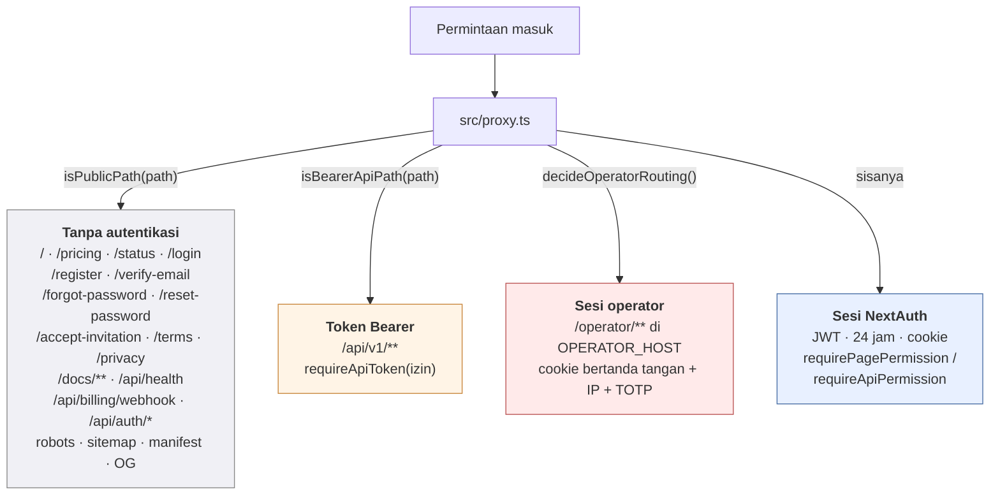
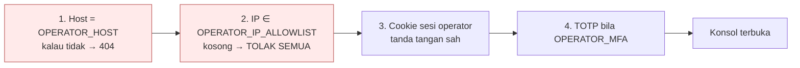
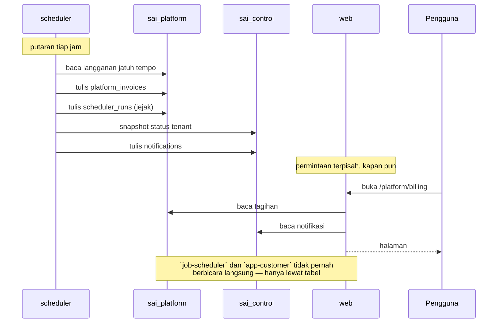

# 05 — Permukaan API & Pola Komunikasi

> Potret 11 Oktober 2026 · v0.9.0 · [indeks](./README.md)

## 1. Protokol yang dipakai

Daftarnya pendek, dan itu disengaja:

| Protokol | Di mana | Catatan |
|---|---|---|
| **HTTPS** | Semua lalu lintas masuk | Traefik terminasi TLS; HTTP → 301 |
| **HTTP** | Traefik → `web:3000` | Di dalam jaringan Docker `traefik_default` |
| **PostgreSQL** | `app-customer`/`app-operator`/`job-scheduler`/`job-conformance` → `pgbouncer:5432`; `migrate`/`job-backup` → `pg:5432` langsung | Lewat `@prisma/adapter-pg` (MySQL/`adapter-mariadb` sampai 15 Okt 2026) |
| **SMTP** | `app-customer`/`job-scheduler` → penyedia surel | `nodemailer` |
| **HTTPS keluar** | `app-customer` → Midtrans Core API | **Satu-satunya** panggilan HTTP keluar di seluruh aplikasi |
| **S3 (HTTPS)** | `job-backup` → penyimpanan objek | `awscli` |

**Tidak ada** gRPC, GraphQL, WebSocket, Server-Sent Events, atau antrean pesan.
Komunikasi antar-"layanan" terjadi **lewat basis data bersama**, bukan lewat
jaringan — lihat §6.

## 2. Tiga rezim autentikasi

Ini bagian yang paling mudah salah dipahami, karena ketiganya berjalan di
**satu proses** dan dipisahkan oleh jalur serta host.



### 2.1 Sesi NextAuth (mayoritas)

| | |
|---|---|
| Pustaka | `next-auth` v5 beta |
| Penyedia | **Credentials** saja (nama pengguna + sandi, `bcrypt`) |
| Strategi | **JWT**, masa 24 jam |
| Cookie | Berlingkup host — inilah yang memisahkan bidang operator |
| Env | `AUTH_SECRET`, `AUTH_URL`, `AUTH_TRUST_HOST` |

**Yang JWT TIDAK lagi bawa:** `companyId`. Dicabut di #158 — alasannya di
[dok 02 §4](./02-ARSITEKTUR.md). Perusahaan **selalu** datang dari **jalur
URL** dan keanggotaannya dibaca **ulang** dari basis data kendali pada setiap
permintaan.

Peran pun **ditimpa per permintaan**: JWT membawa peran di perusahaan yang
*terakhir* dibuka, jadi penjaga menggantinya dengan peran di PT **ini**.
Tanpa itu, `finance_manager` di PT A yang membuka buku PT B — tempat ia hanya
`staff` — akan memegang hak PT A.

### 2.2 Token Bearer (`/api/v1`)

| | |
|---|---|
| Bentuk | `Authorization: Bearer sai_…` |
| Penjaga | `lib/api-token-guard.ts` → `requireApiToken("izin")` |
| Penyimpanan | `control.api_tokens` |
| Pengelolaan | Halaman `/t/{tenant}/{company}/api-tokens` |
| Spesifikasi | `GET /api/v1/openapi.json` — **publik dengan sengaja**, nol data perusahaan |
| **Status 11 Okt** | **0 token aktif** |

**Kenapa `/api/v1/*` dilepas proxy** — dan ini regresi produksi yang layak
diingat: `src/proxy.ts` membaca sesi NextAuth untuk setiap `/api/*` yang tidak
disebut `isPublicPath`, lalu menjawab 401 bila tak ada cookie. Permintaan
ber-`Authorization: Bearer` **tidak menghasilkan cookie**, jadi **seluruh**
`/api/v1` dijawab 401 **sebelum** `requireApiToken` sempat berjalan — setiap
endpoint, setiap token sah, termasuk `openapi.json`.

Yang membuat cacat itu lolos kedua gerbang pantas dicatat: **seluruh tes token
memanggil `requireApiToken` LANGSUNG.** Tak satu pun menembus proxy, jadi tak
satu pun bisa melihat penolakan satu lapis di atasnya. Hijau di `verify`, hijau
di `build`, mati di produksi sampai 16 Agustus 2026.

"Publik bagi proxy" **bukan** "tanpa penjaga":
`tests/api-v1-spec.test.ts` menuntut **setiap** route `/api/v1/*` memanggil
`requireApiToken` dengan izin yang **sama persis** dengan yang didokumentasikan.

#### Endpoint v1

| Endpoint | Metode | Izin |
|---|---|---|
| `/api/v1/accounts` | GET | `account.read` |
| `/api/v1/customers` | GET | `customer.read` |
| `/api/v1/invoices` | GET | `invoice.read` |
| `/api/v1/items` | GET | `inventory.read` |
| `/api/v1/suppliers` | GET | `supplier.read` |
| `/api/v1/openapi.json` | GET | — (publik) |

**Hanya-baca, lima sumber daya.** Bentuknya (penguraian kueri + penyusunan
`meta`) ditetapkan di `lib/api-v1.ts` saat baru ada satu endpoint — sengaja,
karena "bentuk yang ditetapkan pada endpoint kelima adalah bentuk yang tidak
pernah berlaku untuk empat yang pertama."

### 2.3 Sesi operator

Rezim paling ketat, dengan **empat** syarat yang semuanya harus lulus:



| | |
|---|---|
| Modul murni | `lib/operator/plane.ts` (**aman-edge** — tanpa Prisma, `node:crypto`, `next/*`) |
| Penjaga | `lib/operator/guard.ts` |
| Sesi | `lib/operator/session.ts` — `OPERATOR_SESSION_SECRET` |
| Kredensial | `OPERATOR_USERS` (akun **darurat**, selalu owner) + `sai_control.operator_accounts` (sejak 17 Okt 2026, migration kendali 0004; TOTP tersegel `SETTINGS_ENCRYPTION_KEY`) — `lib/operator/credentials.ts`, `operator-accounts.ts` |
| Peran | `lib/operator/roles.ts` — owner / billing / support / viewer; membagi **tindakan**, bukan bacaan. Setiap server action memanggil `requireOperatorActionSession(izin)` (dijaga `tests/operator-roles.test.ts`) |
| Pencabutan sesi | akun basis data: `session_version` dibawa token dan dibandingkan **tiap permintaan** (`identity.ts`); akun env: hapus entrinya atau putar `OPERATOR_SESSION_SECRET` |
| TOTP | `lib/operator/totp.ts` — `OPERATOR_MFA` |
| Env di `.env` 11 Okt | `OPERATOR_DOMAIN`, `OPERATOR_HOST`, `OPERATOR_IP_ALLOWLIST`, `OPERATOR_MFA`, `OPERATOR_SESSION_SECRET`, `OPERATOR_USERS` — **semuanya terisi** |

**Gagal-tertutup di tiga arah sekaligus:**
`OPERATOR_HOST` kosong → `/operator` **404 di host mana pun** (bukan
terbuka-diam-diam). Di host pelanggan → `/operator` 404. Di host operator →
**rute pelanggan** 404. Daftar IP kosong → **semua ditolak**; `*` hanya untuk
pengembangan lokal.

#### ⚠ Daftar IP & hitungan hop proxy

Ini jebakan operasional yang terdokumentasi di `docker-compose.yml` dan layak
diulang. Daftar IP membandingkan alamat klien dari `x-forwarded-for`, mengambil
entri ke-**N dari KANAN**, dengan N = `OPERATOR_TRUSTED_PROXY_HOPS`
(bawaan **1** = Traefik saja, susunan sekarang). Entri paling kanan adalah
satu-satunya yang ditulis Traefik sendiri; yang di kirinya **bisa diketik
klien**.

- Menambah Cloudflare/CDN/LB kedua **di depan** Traefik → setel
  `OPERATOR_TRUSTED_PROXY_HOPS=2` **pada perubahan yang sama**. Kalau lupa,
  yang terbaca adalah alamat CDN — dan **seluruh dunia yang lewat CDN itu
  tampak sebagai satu IP**.
- Jangan **menurunkan** angkanya di bawah jumlah proxy sebenarnya: setiap hop
  yang tidak dihitung adalah satu entri kiriman klien yang ikut dipercaya.
- Rantai yang lebih pendek dari angka ini **ditolak** (gagal-tertutup), bukan
  ditebak.

### 2.4 Jalur publik — kenapa daftarnya PERSIS

`isPublicPath` di `src/proxy.ts` menyebut jalur **persis**, bukan awalan,
dengan satu pengecualian yang dibenarkan. Alasannya: halaman publik baru
**harus disebut namanya** di sana (dan di `tests/authz-coverage`), sehingga
tidak ada yang bisa menjadi publik secara tidak sengaja.

| Jalur | Kenapa publik |
|---|---|
| `/` | Pembacanya justru yang **belum** punya akun |
| `/pricing` | Tujuan kueri "harga software akuntansi" (`/harga` → 301) |
| `/status` | Pembacanya justru yang sedang **tidak bisa** memakai aplikasinya |
| `/login`, `/register`, `/verify-email` | Pra-akun |
| `/forgot-password`, `/reset-password` | Yang lupa sandi jelas belum bersesi |
| `/accept-invitation` | Penerimanya belum punya akun |
| `/terms`, `/privacy` | Harus terbaca **sebelum** disetujui |
| `/api/health` | Docker & Traefik tidak punya kredensial — dan tidak boleh punya |
| `/api/billing/webhook` | Pengirimnya server Midtrans; kredensialnya tanda tangan |
| `/api/auth/*` | NextAuth — **kecuali** `change-password` |
| `/robots.txt`, `/sitemap.xml`, `/opengraph-image*` | Perayap & pratinjau tautan tidak punya cookie |
| `/manifest.webmanifest` | Peramban mengambil manifest **tanpa kredensial**; tanpa ini PWA #471 batal **tanpa satu pun galat** |
| `/docs/**` | **Satu-satunya pelepasan SUBPOHON** — pohon dokumen tidak bisa dienumerasi; dijawab `isDocsPath` (fungsi murni teruji) + dua tes |

Dua di antaranya punya pelajaran yang mudah terlewat:
`/opengraph-image` dicocokkan sebagai **awalan** karena Next menambahkan sufiks
versi — pencocokan persis akan lolos hari ini lalu **diam-diam berhenti cocok**
setelah pemutakhiran. Dan manifest PWA tidak pernah terambil **bahkan oleh
pengguna yang sudah masuk**, karena peramban mengambilnya `no-cors` tanpa
kredensial; yang diterima peramban adalah HTML halaman masuk dengan status 307.

## 3. Permukaan HTTP — ringkasan

| Permukaan | Jumlah | Autentikasi |
|---|---|---|
| Halaman | **142** | Campuran — lihat §4 |
| Rute API | **126** | Campuran — lihat §5 |
| Berkas metadata | 4 (`robots`, `sitemap`, `manifest`, `opengraph-image`) | Publik |

## 4. Halaman menurut bidang

| Grup rute | Jumlah | Pola jalur | Penjaga |
|---|---|---|---|
| `(marketing)` | 3 | `/`, `/pricing`, `/status` | **Tanpa** |
| `(app)/(auth)` | 13 | `/login`, `/register`, … | Sebagian publik |
| `(app)/(dashboard)` | 103 | `/t/{tenantSlug}/{companySlug}/…` (102) + `/dashboard` (pengalih) | `requirePagePermission` |
| `(app)/(setup)` | 2 | `/t/{t}/{c}/setup`, `/setup/done` | `setup.manage` |
| `(app)/(tenant)/(panel)` | 7 | `/platform/…`, `/companies/new` | Matriks **tenant** |
| `(app)/(docs)` | 3 | `/docs`, `/docs/cari`, `/docs/[...slug]` | **Tanpa** — dijaga tes |
| `(app)/(operator)` | 11 | `/operator/…` | Bidang operator |

### Pola jalur bertenant

```
/t/{tenantSlug}/{companySlug}/{halaman}
   └── tenant       └── PT        └── 102 halaman
```

Dua perilaku yang penting:

- **Slug tenant berganti (#458)** → `permanentRedirect` (301), bukan 307,
  supaya bookmark peramban ikut memperbarui dirinya dan mesin pencari
  memindahkan alamat lama. Jalur dalamnya dibaca dari header `x-sai-path` yang
  dititipkan proxy. **Hanya anggota tenant itu** yang dipantulkan; bukan
  anggota tetap 404.
- **Slug PT tidak boleh berubah** — dijaga
  `scripts/prove-company-slug-immutable.ts` + `tests/company-slug-immutable.test.ts`.

**Satu bentuk jawaban untuk banyak kegagalan berbeda.** Slug tak ada, PT
nonaktif, bukan anggota, tenant lain — semuanya **404 yang sama persis**
(`lib/company-route.ts`, dijaga `tests/cross-tenant-404.test.ts`). Membedakan
jawabannya akan membocorkan **keberadaan** perusahaan orang lain.

## 5. Rute API menurut kelompok

### 5.1 Akuntansi inti (sesi + izin)

| Kelompok | Rute |
|---|---|
| Akun & COA | `accounts`, `accounts/[id]`, `setup/coa`, `t/…/accounts/import` |
| Jurnal | `journals`, `journals/[id]`, `journals/[id]/reverse` |
| Buku besar | `ledger` |
| Periode | `periods`, `periods/summary`, `periods/reopen`, `periods/year-close`, `periods/fx-revaluation` |
| Pusat biaya | `cost-centers`, `cost-centers/[id]` |

### 5.2 Penjualan

`contracts`, `contracts/[id]`, `contracts/[id]/payments`,
`contracts/[id]/outstanding` · `invoices`, `invoices/[id]`,
`invoices/[id]/payments`, `invoices/[id]/send` · `delivery-orders` ·
`returns/sales` · `customers`, `customers/[id]` · `consignees`,
`consignees/[id]` · `wizard/sales`

### 5.3 Pembelian & persediaan

`suppliers`, `suppliers/[id]`, `suppliers/[id]/transactions` ·
`returns/purchase` · `advances`, `advances/[id]`, `advances/applications` ·
`landed-costs`, `landed-costs/[id]` · `inventory`, `inventory/opname` ·
`wizard/purchase`

### 5.4 Manufaktur

`boms` · `work-centers` · `production-orders`,
`production-orders/[id]/release`, `production-orders/[id]/finish`

### 5.5 Aset tetap

`fixed-assets`, `fixed-assets/[id]`, `fixed-assets/categories`,
`fixed-assets/depreciation`, `fixed-assets/[id]/dispose`,
`fixed-assets/[id]/transfer`

### 5.6 Kas, bank, rekonsiliasi

`finance` · `reconciliation`, `reconciliation/[id]/import`,
`reconciliation/[id]/lines`, `reconciliation/[id]/match`,
`reconciliation/[id]/lock`

### 5.7 Laporan & ekspor

`reports/payload` · `reports/export` · `budget`, `budget/[id]`,
`budget/targets`, `budget/targets/[id]`

### 5.8 Tata kelola

| Kelompok | Rute |
|---|---|
| Persetujuan | `approvals`, `approvals/[id]`, `approvals/[id]/resubmit`, `approvals/summary`, `approvals/rules`, `approvals/rules/[id]` |
| Otorisasi | `roles`, `roles/[key]`, `authz/overrides`, `users/[id]/permissions`, `user/permissions` |
| Pengguna | `users`, `users/[id]`, `company-unlock` |
| Audit | `audit` |
| Pengaturan | `company-settings`, `company-settings/modules`, `company-settings/tax`, `company-settings/reminders`, `company/identity` |
| Dokumen | `upload`, `t/…/documents/[id]/file` |
| Berulang | `recurring`, `recurring/[id]` |
| Pajak | `t/…/tax/efaktur` |
| Impor | `t/…/master/import`, `t/…/master/opening`, `t/…/accurate/ledger` |

### 5.9 Tenant & platform

`companies` · `setup` · `sample-data` · `user/companies`,
`user/notifications`, `user/accountant-mode` · `tenant/profile`,
`tenant/slug`, `tenant/mail`, `tenant/invitations`,
`tenant/invitations/[id]`, `tenant/export`, `tenant/deletion-request` ·
`tenant/billing/pay`, `tenant/billing/plan-change`, `tenant/billing/profile`

### 5.10 Autentikasi & infrastruktur

| Rute | Autentikasi |
|---|---|
| `auth/[...nextauth]` | NextAuth |
| `auth/register`, `auth/verify-email` | Publik |
| `auth/forgot-password`, `auth/reset-password` | Publik + token |
| `auth/accept-invitation` | Publik + token |
| `auth/change-password` | **Sesi WAJIB** — satu-satunya `/api/auth/*` yang tidak publik |
| `health` | Publik |
| `billing/webhook` | Tanda tangan SHA-512 |

## 6. Komunikasi antar-layanan

**Tidak ada panggilan jaringan antar-layanan.** Seluruh koordinasi lewat
**basis data bersama** — pola yang layak dipahami karena ia menjelaskan kenapa
tidak ada antrean:



| Jalur | Mekanisme | Jejaknya di |
|---|---|---|
| `job-scheduler` → `app-customer` | Tabel (`notifications`, `platform_invoices`, `scheduler_runs`) | `/operator/scheduler`, `/api/health` |
| `job-conformance` → `app-customer` | Tabel `conformance_runs` | `/api/health` → `conformance`, plus `docker compose logs job-conformance` |
| `job-backup` → `app-customer` | Tabel `backup_runs` (lewat `record-backup-run.ts`) | `/api/health` → `backup` |
| `migrate` → semua | `depends_on: service_completed_successfully` | Keluaran container |
| Midtrans → `app-customer` | Webhook HTTP | `payments`, `platform_invoices` |

Konsekuensi yang harus diterima: **tidak ada *retry* per-pekerjaan, tidak ada
*dead-letter*, tidak ada *backpressure*.** Yang menggantikannya adalah
**idempotensi** — setiap produser bisa dijalankan berulang dengan aman, jadi
putaran berikutnya menyembuhkan yang tertinggal. Dinilai di
[dok 08](./08-PENILAIAN-ARSITEKTUR.md).

Asimetri yang dulu ada di sini — `job-conformance` satu-satunya layanan yang
temuannya tidak meninggalkan jejak — **ditutup 11 Okt 2026** (migration platform
0018, tabel `conformance_runs`). Ketiga layanan latar sekarang punya jejak yang
bisa ditanyai lewat `/api/health`.

## 7. Header keamanan

Dipasang `next.config.ts` untuk **setiap** jalur (`/:path*`):

| Header | Nilai |
|---|---|
| `X-Frame-Options` | `DENY` |
| `X-Content-Type-Options` | `nosniff` |
| `Referrer-Policy` | `strict-origin-when-cross-origin` |
| `X-DNS-Prefetch-Control` | `off` |
| `Permissions-Policy` | `camera=(), microphone=(), geolocation=()` |
| `Strict-Transport-Security` | `max-age=63072000; includeSubDomains; preload` — **produksi saja** |
| `Content-Security-Policy` | lihat di bawah |

```
default-src 'self'
script-src  'self' 'unsafe-inline'                 ← 'unsafe-eval' hanya di DEV
style-src   'self' 'unsafe-inline'
img-src     'self' data: blob:
connect-src 'self'
font-src    'self'
frame-src   'self' blob:
object-src  'self' blob:
frame-ancestors 'none'
base-uri    'self'
form-action 'self'
```

`blob:` pada `frame-src`/`object-src` ada untuk pratinjau PDF
(faktur/kontrak) yang dirender sebagai blob di dalam `<iframe>`/`<embed>` —
**tanpa** membuka sumber luar apa pun.

**Ditinjau 11 Okt 2026**, dan hasilnya terbagi tiga — catatan 🔶 di versi
sebelumnya (*"tersimpulkan sebagai tuntutan Next.js + AntD; tidak ada komentar
yang menjelaskan apakah nonce pernah dicoba"*) kini terjawab:

| Arahan | Keadaan |
|---|---|
| `'unsafe-eval'` | ✅ **dicabut di produksi** — dokumentasi Next menyatakannya tidak dibutuhkan, dan diperiksa: nol `eval(` di `src/`, satu-satunya di `.next/static` adalah shim `vm` tanpa tempat pemanggilan |
| `style-src 'unsafe-inline'` | **struktural** — 2.618 `style={{` di 305 berkas (#203), dan nonce **tidak** mencakup atribut `style` |
| `script-src 'unsafe-inline'` | jalur nonce + `strict-dynamic` **didokumentasikan** di `next.config.ts`; proyek tersendiri |

Dijaga `tests/security-headers.test.ts` (11 tes) — sebelumnya **tidak ada satu
pun** tes yang menyentuh header keamanan. Rinciannya
[dok 08 P2-4](./08-PENILAIAN-ARSITEKTUR.md).

## 8. Format jawaban

| Permukaan | Format |
|---|---|
| Halaman | HTML (RSC) |
| API internal | JSON |
| `/api/v1` | JSON + `meta` (bentuk dari `lib/api-v1.ts`) |
| `/api/health` | JSON; **503** hanya bila kendali tak terjangkau |
| Ekspor laporan | XLSX (`exceljs`), PDF (`jspdf` + `jspdf-autotable`), ZIP (`jszip`) |
| `/api/v1/openapi.json` | OpenAPI (dari `lib/api-v1-spec.ts`) |
| Berkas dokumen | Byte lewat route bertenant, **bukan** statis |

Lanjut: [06 Aliran Data](./06-ALIRAN-DATA.md)
