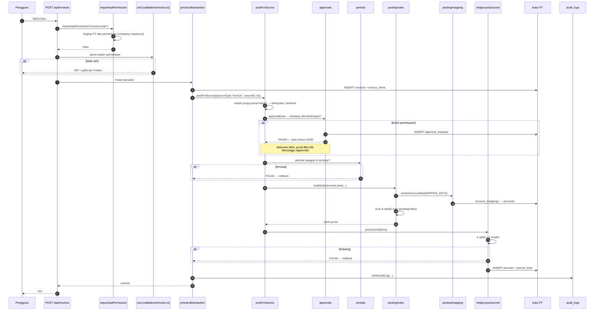
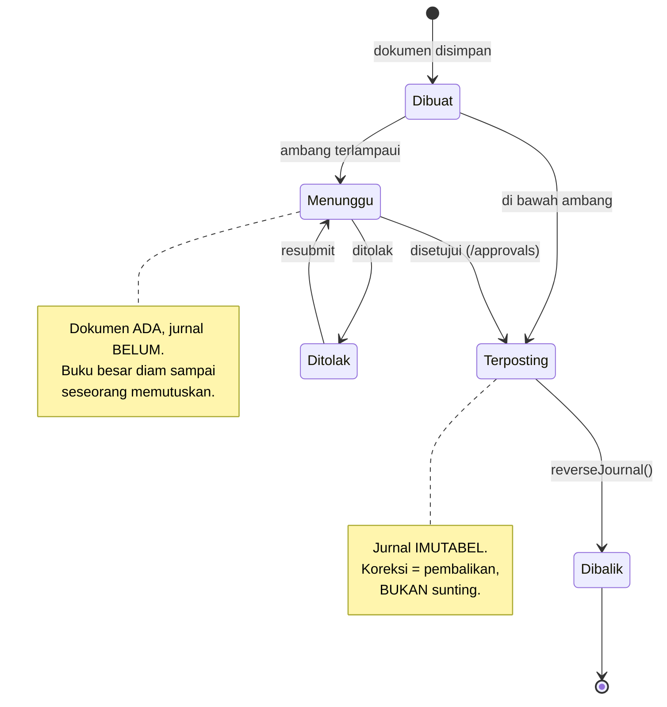
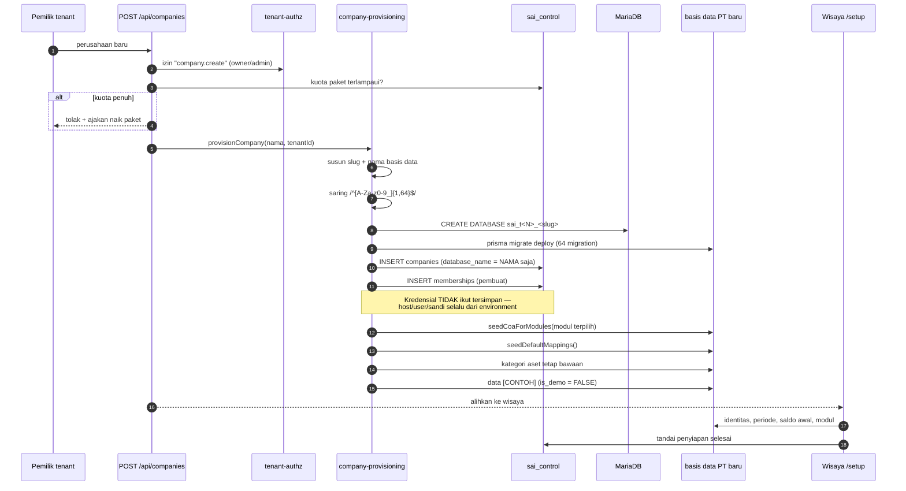
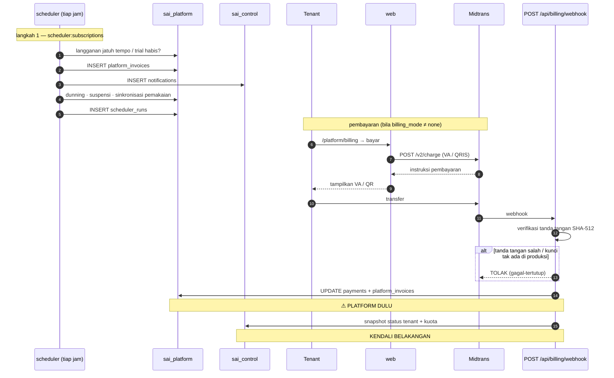
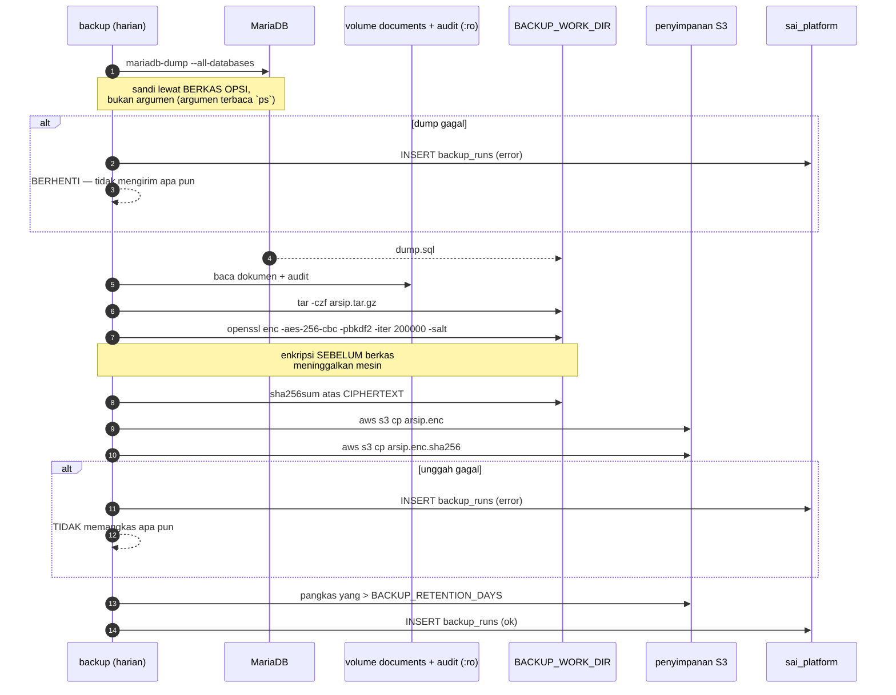
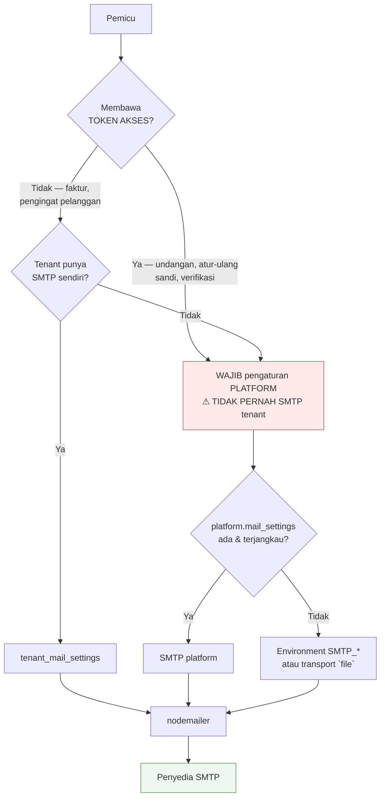
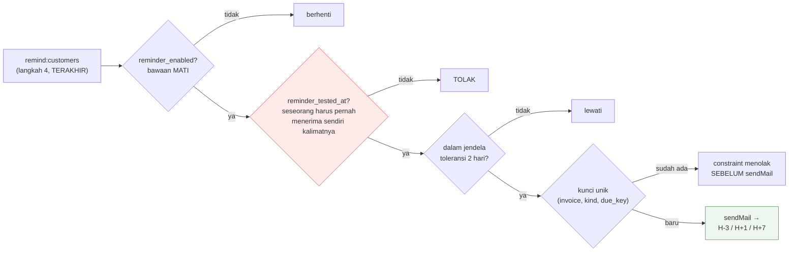
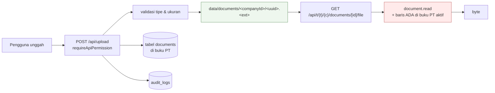

# 06 — Aliran Data

> Potret 11 Oktober 2026 · v0.9.0 · [indeks](./README.md)

Enam alur yang membawa hampir seluruh nilai sistem ini. Masing-masing dilacak
dari masukan sampai tempat data berhenti.

## 1. Daur hidup permintaan halaman

Alur paling sering terjadi, dan tempat setiap batas keamanan dilewati.

```mermaid
sequenceDiagram
    autonumber
    participant B as Peramban
    participant T as Traefik
    participant P as src/proxy.ts
    participant G as requirePagePermission
    participant CDB as sai_control
    participant H as current-company.ts
    participant PX as prisma (Proxy)
    participant POOL as company-clients (LRU)
    participant BDB as buku PT

    B->>T: GET /t/akme/pt-akme/invoices
    T->>P: HTTP (TLS sudah diterminasi)

    P->>P: normalizeHost → bidang operator?
    P->>P: isPublicPath? isBearerApiPath?
    P->>P: getToken() — JWT NextAuth
    alt tanpa sesi
        P-->>B: 307 → /login
    end
    P->>P: titipkan header x-sai-path
    P->>G: lanjut ke halaman

    G->>G: auth() — muat sesi
    G->>CDB: enterCompanyFromRoute(akme, pt-akme, userId)
    Note over G,CDB: baca ULANG keanggotaan pada permintaan INI.<br/>Slug tak ada / PT nonaktif / bukan anggota /<br/>tenant lain → 404 YANG SAMA PERSIS
    CDB-->>G: {companyId, databaseName, role, accountantMode}

    alt slug tenant berpindah (#458)
        G-->>B: 301 → jalur baru (dari x-sai-path)
    end

    G->>H: setRouteCompany(ctx)
    Note over H: WeakMap dikunci pada objek<br/>hasil `await headers()`
    G->>G: timpa session.user.role dengan peran di PT INI
    G->>G: canEffective(izin) — bawaan+override peran+pengguna+modul
    G->>G: requireUnlockedCompany (kunci buku)
    G->>G: requireSetupDone

    G->>PX: prisma.invoice.findMany(...)
    PX->>H: currentCompany()
    alt konteks hilang
        PX-->>G: MissingCompanyContextError ⚠ MELEMPAR
    end
    H-->>PX: {databaseName}
    PX->>POOL: getCompanyClient(databaseName)
    POOL-->>PX: PrismaClient (maks 4; LRU, grace 15s)
    PX->>BDB: SELECT …
    BDB-->>PX: baris
    PX-->>G: data
    G-->>B: HTML (RSC)
```

**Lima hal yang sering disalahpahami pada alur ini:**

1. **Proxy bukan penjaga otorisasi.** Ia memutuskan "perlu sesi atau tidak" dan
   "bidang mana". Izin diputuskan penjaga, satu lapis di bawah.
2. **Keanggotaan dibaca ulang dari basis data setiap permintaan**, tidak dibaca
   dari JWT. Lebih mahal, dan itu harga yang dibayar sengaja.
3. **Peran ditimpa per permintaan.** JWT membawa peran di PT yang *terakhir*
   dibuka.
4. **Empat kegagalan berbeda menghasilkan 404 yang identik.** Membedakannya
   membocorkan keberadaan perusahaan orang lain.
5. **Konteks hilang → melempar**, selalu, tanpa jalur bawaan.

## 2. Posting dokumen → jurnal

Alur yang memegang kebenaran akuntansi. Contoh: faktur penjualan.



### Jalur persetujuan



**Dokumen berulang** (`recurring:run`) selalu menerbitkan pengajuan persetujuan
dengan `force` — **apa pun nilainya**. Jadi buku besar diam sampai seseorang
menyetujuinya di `/approvals`. Kejadian yang jatuh di periode **tertutup** atau
yang dokumen sumbernya **hilang** **ditahan dan dilaporkan** — tidak
diselundupkan, tidak dibuang.

## 3. Alur penyediaan PT baru

Satu-satunya alur yang **membuat basis data**.



Dua catatan yang mencegah kesalahan:

- **`companies.database_name` menyimpan NAMA, bukan URL.** Menyimpan URL
  lengkap berarti satu `SELECT` bisa membawa pergi kredensial setiap pelanggan.
- Data `[CONTOH]` pada perusahaan baru **wajib `is_demo = FALSE`** — ia prasyarat
  penyiapan, bukan data demo yang akan disapu.

## 4. Alur penagihan langganan

Alur yang menyeberangi **dua** basis data, dan karena itu punya aturan urutan.



### Kenapa urutannya tidak boleh dibalik

FK dan transaksi **tidak menyeberangi** basis data, jadi kegagalan di tengah
selalu mungkin. Urutan platform→kendali memilih **kegagalan yang bisa
diperbaiki**:

| Urutan | Kegagalan di tengah meninggalkan | Bisa diperbaiki? |
|---|---|---|
| **Platform dulu** ✅ | Pembayaran tercatat, tenant **belum** naik kelas | **Ya** — `bun run reconcile:platform` |
| Kendali dulu ❌ | Tenant naik kelas, **tanpa** pembayaran | **Tidak akan pernah ketahuan** |

### Keadaan hari ini

**Penagihan otomatis sengaja DIHENTIKAN** (Fase A). Terbukti dari basis data
platform 11 Okt 2026:

| | |
|---|---|
| `billing_mode = none` | **11 dari 11** langganan |
| `payments` | **0 baris** |
| `platform_invoices` | 11 baris |
| `MIDTRANS_*` di `.env` | **tidak ada** → transport MOCK |

Alur di atas karena itu **berjalan tanpa menagih siapa pun**. Mekanismenya
hidup dan diuji; gerbangnya tertutup di tingkat data. Alasan & gerbang
pembukaannya: [`docs/KOMERSIALISASI.md`](../KOMERSIALISASI.md).
Penghentiannya dilakukan `scripts/pause-platform-billing.ts` —
**kering secara bawaan**, `--apply` menuntut `--reason`, dan idempoten.

## 5. Alur cadangan



### ⚠ Status terbukti: alur ini belum pernah selesai

| Bukti | Nilai |
|---|---|
| `/api/health` → `backup.status` | `"failing"` |
| `lastSuccessAt` | **`null`** |
| `lastAttemptAt` | `2026-10-11T06:31:14Z` (berjalan) |
| `backup_runs` | **54 baris** |
| `staleAfterHours` | 48 |

**Akar terbukti dari `.env`:** `AWS_ACCESS_KEY_ID`, `AWS_SECRET_ACCESS_KEY`,
dan `BACKUP_S3_BUCKET` **tidak ada**. Yang ada: `BACKUP_ENCRYPTION_KEY`,
`BACKUP_RETENTION_DAYS`, `BACKUP_S3_PREFIX`.

Jadi langkah dump/tar/enkripsi 🔶 **kemungkinan** berjalan sampai `aws s3 cp`,
lalu gagal di sana — dan karena pemangkasan dikerjakan **paling akhir dan hanya
bila unggahan sukses**, tidak ada yang dihapus. Itu perilaku yang benar;
masalahnya tidak ada salinan yang **keluar dari mesin**.

**Konsekuensinya bukan teknis.** Pembukuan wajib disimpan sepuluh tahun
(UU KUP). Menjual langganan atas data itu tanpa cadangan luar-mesin adalah
risiko **hukum**. Prioritas **P0** di [dok 08](./08-PENILAIAN-ARSITEKTUR.md).

### Satu risiko yang menyertainya

`BACKUP_ENCRYPTION_KEY` ada di `.env` **pada mesin yang sama dengan datanya**.
❓ Belum dipastikan apakah ia disimpan di luar mesin. Cadangan yang berhasil pun
**tidak bisa dibuka** kalau kuncinya hilang bersama mesinnya.

## 6. Alur surel keluar



### Alur pengingat ke pelanggan — empat gerbang

Satu-satunya alur yang menghubungi orang **di luar** organisasi pelanggan,
dan karena itu digerbangi paling ketat:



Gerbang kedua layak diperhatikan: **seseorang harus pernah menerima sendiri
kalimatnya lebih dulu**, atau penjadwal menolak. Dan jendela toleransi 2 hari
membuat "aktifkan" tidak pernah menjadi tombol yang mengirim ratusan surel ke
tunggakan lama sekaligus.

Satu pengingat **per FAKTUR**, bukan ringkasan — seorang pelanggan hanya
memikul fakturnya sendiri. Berbeda dari `notify:invoice-due` (kabar
**dalam-aplikasi**), yang justru **ringkasan**: kotak masuk berisi 80 baris
sama tak terbacanya dengan kotak masuk kosong. Dan kabar itu hanya kepada
anggota yang boleh membaca Piutang (`receivable.read`, matriks **EFEKTIF**),
karena badannya menyebut jumlah tunggakan dan nama pelanggan.

## 7. Aliran penyimpanan berkas



Perubahan di #367 layak dicatat karena ia menutup lubang nyata. Sampai issue
itu berkas mendarat di `public/uploads/` — **satu direktori bersama seluruh PT
seluruh tenant** — dengan nama yang mempertahankan nama asli pengguna, lalu
disajikan sebagai **berkas statis yang tidak melewati satu pun penjaga**.
Sekarang: di luar `public/`, nama `uuid`, dan hanya terjangkau lewat route
bertenant (#489) yang menuntut `document.read` **dan** menemukan barisnya di
basis data PT aktif.

`companyId` datang dari **konteks yang sudah dimasuki penjaga**, bukan dari
klien — pola yang sama dengan `lib/audit.ts`.

## 8. Ke mana data berhenti

| Data | Tempat berhenti | Retensi |
|---|---|---|
| Jurnal & buku besar | `journals`, `journal_lines` di buku PT | **Imutabel**; 10 tahun (UU KUP) |
| Dokumen transaksi | Tabel per jenis di buku PT | Mengikuti buku |
| Berkas lampiran | `data/documents/<companyId>/` | Mengikuti buku |
| Jejak audit PT | `audit_logs` (per buku) | Mengikuti buku |
| Jejak audit tenant | `tenant_audit_logs` (kendali) | **Selamat dari penghapusan tenant** — sengaja tanpa FK |
| Identitas & keanggotaan | `sai_control` | Sampai penghapusan akun |
| Langganan & tagihan | `sai_platform` | ❓ belum dipastikan |
| Jejak penjadwal | `scheduler_runs` (1.246 baris) | ❓ tanpa kebijakan pemangkasan yang terlihat |
| Jejak cadangan | `backup_runs` (54 baris) | ❓ sama |
| Arsip cadangan | S3 | `BACKUP_RETENTION_DAYS` — **tetapi belum ada arsip** |
| Surel pengembangan | `data/mail-outbox/*.eml` | ❓ tanpa pemangkasan |

**Berhenti berlangganan TIDAK menghapus buku** — itu keputusan sadar di
[`docs/COMPLIANCE.md §1`](../COMPLIANCE.md), karena kewajiban retensi 10 tahun
melekat pada pembukuan, bukan pada status langganan.

Lanjut: [07 Infrastruktur & Deploy](./07-INFRASTRUKTUR-DEPLOY.md)
