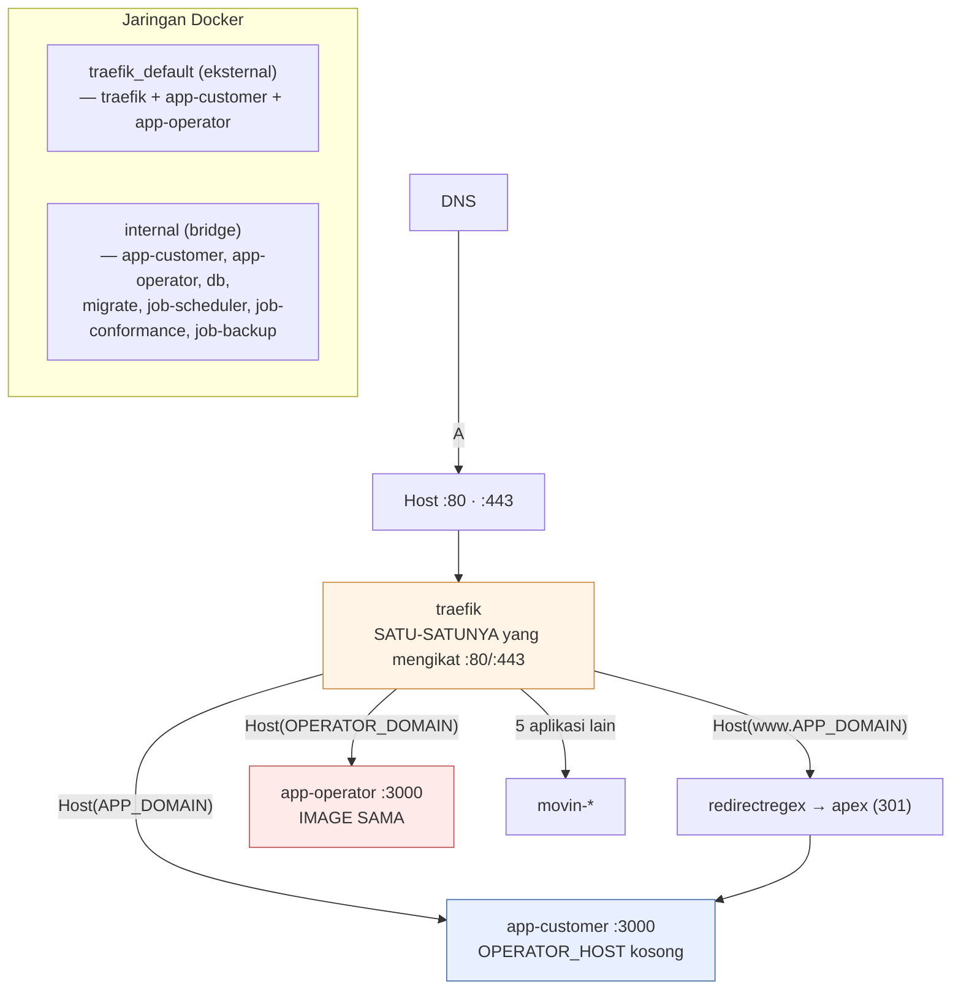
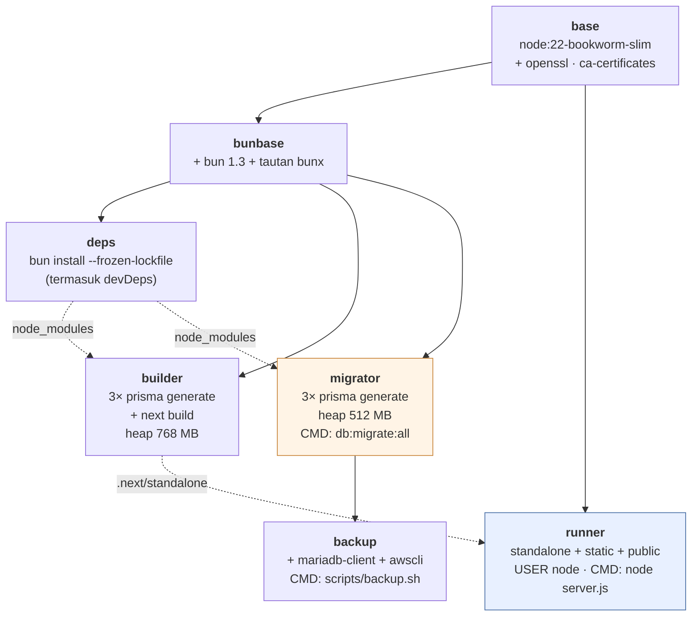
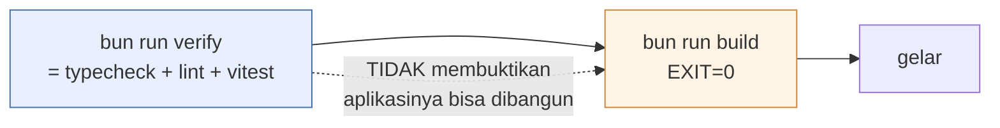
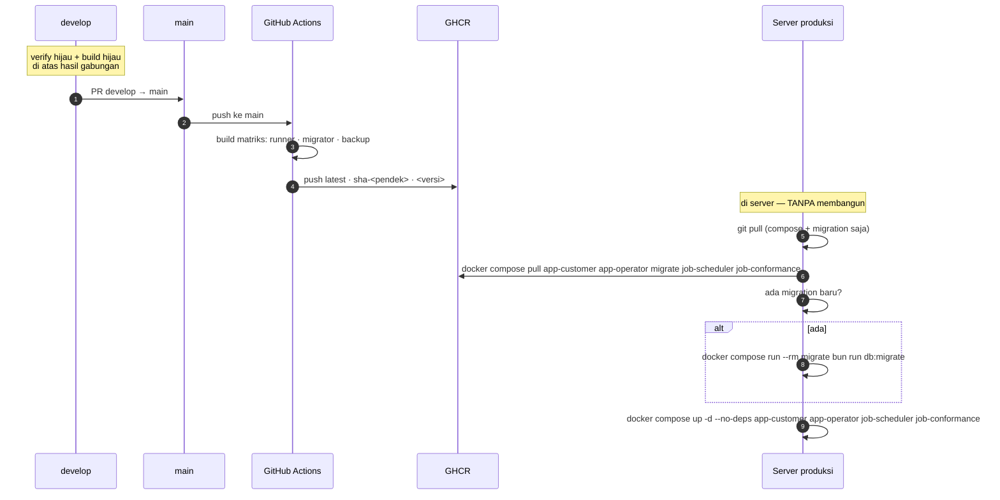
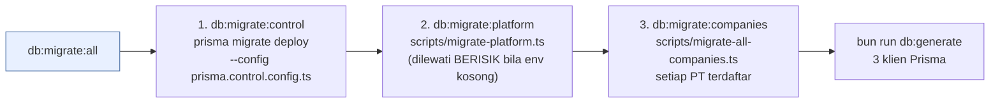

# 07 — Infrastruktur & Penggelaran

> Potret 11 Oktober 2026 · v0.9.0 · [indeks](./README.md)

## 1. Mesin

| | |
|---|---|
| Platform | Linux 6.8.0-117-generic |
| RAM | **~3,6 GB** — dan **6 aplikasi** berbagi di atasnya |
| Direktori | `/opt/applications/sai-accounting` |
| Zona waktu | `Asia/Jakarta` |

**Aplikasi lain di mesin yang sama** (`docker ps`, 11 Okt 2026):
`movin-pwa`, `movin-landing`, `movin-budget-web`, `movin-wedding`,
`movin-partner`, `traefik`.

Keterbatasan RAM ini **bukan catatan pinggir** — ia alasan langsung di balik
empat keputusan arsitektural:

1. Pemeriksaan tipe dikeluarkan dari `next build`.
2. Image dibangun di runner GitHub, **bukan di server**.
3. Tahap `migrator` tidak mewarisi `builder`.
4. Batas heap eksplisit di setiap perintah Node.

## 2. Jaringan & domain



### Router Traefik (dari label `docker-compose.yml`)

| Router | Container | Entrypoint | Aturan | Middleware |
|---|---|---|---|---|
| `sai-app` | `app-customer` | `web` (80) | `Host(APP_DOMAIN)` | `sai-https` → redirect ke HTTPS |
| `sai-app-secure` | `app-customer` | `websecure` (443) | `Host(APP_DOMAIN)` | — · TLS `le` |
| `sai-www` | `app-customer` | `web` | `Host(www.APP_DOMAIN)` | `sai-www-apex` → 301 ke apex |
| `sai-www-secure` | `app-customer` | `websecure` | `Host(www.APP_DOMAIN)` | `sai-www-apex` · TLS `le` |
| `sai-ops` | **`app-operator`** | `web` | `Host(OPERATOR_DOMAIN)` | `sai-https` |
| `sai-ops-secure` | **`app-operator`** | `websecure` | `Host(OPERATOR_DOMAIN)` | — · TLS `le` |

Dua **service** Traefik, bukan satu: `sai-app.loadbalancer.server.port=3000`
dan `sai-ops.loadbalancer.server.port=3000`, masing-masing dengan probe
`/api/health` tiap 30s (timeout 5s).

> ⚠ **Nama service-nya WAJIB berbeda.** Kalau kedua container memakai nama
> service Traefik yang sama, Traefik menganggapnya SATU service dengan dua
> backend lalu menyeimbangkan beban di antaranya — dan permintaan operator bisa
> mendarat di container pelanggan. Itu membatalkan seluruh alasan pemisahan
> bidang, tanpa satu pun galat.

`entrypoints=web` / `websecure` adalah nama **entrypoint Traefik**, bukan nama
service compose — keduanya tidak ikut berubah saat service di-rename.

### Port

| Port | Terbit ke | Catatan |
|---|---|---|
| `80`, `443` | **Host** | Hanya Traefik |
| `3000` | **Tidak** (`expose`) | `app-customer` & `app-operator`, hanya di jaringan Docker |
| `3306` | **Tidak** | `db`, hanya di `internal` |

**Tidak ada satu pun port basis data yang terbit ke host.** Itu juga alasan
`job-scheduler`, `job-conformance`, dan `job-backup` memakai ulang image
`migrator`: itulah satu-satunya cara menjangkau `db` yang tidak memublikasikan
port.

### Domain

| Variabel | Bawaan di compose | Peran |
|---|---|---|
| `APP_DOMAIN` | `saiaccounting.id` | Pemasaran + aplikasi pelanggan |
| `OPERATOR_DOMAIN` | `ops.saiaccounting.id` | Routing Traefik konsol operator |
| `OPERATOR_HOST` | — (**wajib**) | Pemeriksaan host **di dalam aplikasi** |

⚠ `OPERATOR_DOMAIN` dan `OPERATOR_HOST` adalah **dua hal berbeda** yang harus
cocok: yang pertama membuat Traefik meneruskan, yang kedua membuat aplikasi
menerima. Keduanya ada di `.env` produksi.

🔶 Nilai domain sebenarnya **tidak dicantumkan di dokumen ini** — ia ada di
`.env` dan bukan rahasia, tetapi mencantumkannya di sini berarti satu salinan
lagi yang bisa menyimpang.

## 3. Image & tahap build



### Tiga image yang didorong ke GHCR

| Image | Tahap | Dipakai layanan |
|---|---|---|
| `ghcr.io/tri-evendi/sai-accounting` | `runner` | **`app-customer`** + **`app-operator`** |
| `…-migrator` | `migrator` | `migrate`, **`job-scheduler`**, **`job-conformance`** |
| `…-backup` | `backup` (tahap) | `job-backup` |

Tag per jalan CI: `latest` · `sha-<pendek>` · `<versi>` (dari `package.json`).

> ⚠ **`docker compose build web` TIDAK membangun image `migrate`.**
> Ini pelajaran yang **terulang beberapa rilis**: `job-scheduler` dan `job-conformance`
> berjalan di atas image migrator, yang ikut memuat kode aplikasi — jadi
> melewatkannya berarti **dua layanan menjalankan kode basi tanpa satu pun
> tanda**. Matriks CI sekarang membangun **ketiganya setiap kali**, sehingga
> mereka tidak bisa lagi menyimpang.

### Kenapa `bun` tidak menggantikan `node`

Pembagiannya **disengaja** dan ditulis di `package.json`:
**Bun = pemasang paket + peluncur skrip. Node = runtime.**

`bun run` menghormati shebang `#!/usr/bin/env node` pada binary di
`node_modules/.bin`, jadi `next`, `tsc`, `prisma`, dan `tsx` tetap dieksekusi
Node — **dan karena itu `NODE_OPTIONS=--max-old-space-size=…` TETAP BERLAKU**
(terukur: batas 333 MB menghasilkan heap limit 525 MB, sama persis seperti di
bawah npm).

Bun memakai JavaScriptCore, yang **mengabaikan** `--max-old-space-size`. Kalau
ada yang mengubah perintah menjadi `bun --bun …` atau `bun scripts/x.ts`,
**pagar memori itu lenyap diam-diam** dan kegagalan berubah dari galat V8 yang
terbaca menjadi OOM-killer kernel (exit 137).

| Perintah | Batas heap | Alasan tercatat |
|---|---|---|
| `bun run typecheck` | **1536 MB** | Naik dari 768: kamus i18n (~2.500 kunci dot-path bertipe) + dimensi pusat biaya menembus 768 dan mati `FatalProcessOutOfMemory` (exit 134, **bukan** dibunuh kernel). Terukur: 768 gagal walau 607 MB bebas; 1400 lolos |
| `builder` di Docker | **768 MB** | Terukur di mesin ini |
| `migrator` di Docker | **512 MB** | Hanya `prisma generate` |

**Jangan pernah melepaskan `--max-old-space-size`** — tanpa batas, Node tumbuh
sampai kernel membunuhnya, dan itu jauh lebih sulit dibaca.

### `trustedDependencies` bukan hiasan

Bun **memblokir** skrip lifecycle dependensi kecuali disebut di
`package.json` → `trustedDependencies` (berbeda dari npm, yang menjalankan
semuanya):

| Paket | Tanpa ini |
|---|---|
| `bcrypt` | Modul native tidak dibangun → **galat saat login** |
| `@prisma/engines` | Mesin query tidak diunduh → `prisma generate` gagal |
| `esbuild` | Binary tidak terpasang → **vitest mati** |
| `prisma`, `sharp`, `unrs-resolver` | — |

## 4. Dua gerbang rilis — dan siapa menjalankan yang mana

Aturannya di [`AGENTS.md`](../../AGENTS.md), dan pembagiannya penting:



| Gerbang | Siapa | Di mana |
|---|---|---|
| `bun run verify` | **Semua** — termasuk agent latar & sesi cabang | Cabang masing-masing |
| `bun run build` | **Hanya sesi utama, SEKALI**, di atas `develop` hasil gabungan | Bukan di cabang mana pun |

**Kenapa agent latar dilarang `bun run build`:** kotak ~3,6 GB dengan produksi
hidup di atasnya, `next build` ~10 menit, dan **dua agent yang membangun
bersamaan sudah menghasilkan OOM (exit 137)** — kegagalan yang terbaca seperti
kode rusak padahal bukan. Tiga pengukuran lain di sesi yang sama juga terbuang
jadi timeout karena beban. Ketiadaan build **ditulis apa adanya di badan PR**,
bukan didiamkan.

**Kenapa sesi utama tetap WAJIB menjalankannya di atas hasil gabungan:**
satu-satunya build yang pernah gagal di repo ini **gagal di hasil gabungan**,
sementara setiap cabangnya hijau sendiri-sendiri. Menghapus langkah ini berarti
mempromosikan sesuatu yang **belum pernah dibangun**.

### Jebakan gerbang yang terdokumentasi

| Jebakan | Akibat |
|---|---|
| `bun test` ≠ `bun run test` | `bun test` memanggil runner bawaan Bun — mengabaikan `vitest.config.ts`, tidak kenal alias `@/`, melaporkan "no tests found" **seolah-olah suite rusak** |
| `\| tail` pada perintah verify | **Menutupi kode keluar** — gerbang tampak hijau |
| `.next/types` basi | Typecheck gagal pada rute yang dipindahkan |
| `npm install` | Repo hanya punya `bun.lock` → **lockfile kedua** |

Dan yang paling penting: **`next build` TIDAK memeriksa tipe**
(`typescript.ignoreBuildErrors: true`). Jadi `bun run typecheck` adalah
**satu-satunya** gerbang tipe, dan ia **harus bisa dijalankan**.

## 5. Alur rilis



### Perintahnya

```bash
git pull
docker compose pull app-customer app-operator migrate job-scheduler job-conformance
# HANYA bila ada migration baru:
docker compose run --rm migrate bun run db:migrate
docker compose up -d --no-deps app-customer app-operator job-scheduler job-conformance
```

**Urutan menentukan bila rilis membawa migration: pull → migrate → swap.**
Satu `docker compose up --build -d` **salah** — ia menukar container
**sebelum** migration berjalan, jadi kode baru sejenak bertemu skema lama.

Memeriksa apakah sebuah rilis membawa migration:

```bash
git diff --name-only <sha-main-sebelumnya>..HEAD -- prisma/
```

### Rollback

Setiap push menandai `sha-<pendek>` dan nomor versi di samping `latest`, jadi
setiap rilis punya jangkarnya sendiri **secara otomatis**:

```bash
SAI_TAG=sha-573d9cf docker compose up -d --no-deps app-customer app-operator
```

Ritual lama — `docker tag … :rollback-<sha>` **sebelum** membangun, karena
build menimpa `:latest` dan image lamanya langsung tak terjangkau di containerd
— **sudah tidak perlu**. Lupa satu kali dulu berarti rollback berubah dari 30
detik menjadi build 10 menit **di tengah insiden**.

`SAI_IMAGE` menimpa awalan registry, yang juga membuat image lokal warisan
terjangkau.

### Satu langkah sekali-jalan

Paket GHCR dibuat **private** bahkan untuk repo publik. Entah jadikan ketiga
paket publik sekali, atau autentikasi servernya. Sampai itu dilakukan,
`docker compose pull` menjawab `denied`.

### Langkah rilis yang mudah terlewat

| Kondisi | Langkah |
|---|---|
| Migration baru | `db:migrate:all` (**bukan** `db:migrate` — lihat §6) |
| Setelah `db:migrate:all` | `bun run db:generate` |
| Rilis #370 | `bun run migrate:audit` — tanpa ini halaman Audit tampak **KOSONG** |
| Rilis #484 | `bun run migrate:tenant-audit` |
| Rilis #416 | `bun run seed-asset-categories` |
| Buku pra-#104 | `bun run adopt-company` **sebelum** `up` |
| Katalog paket berubah | `bun run db:seed:plans` |

**Pelajaran yang terbukti dua kali:** buktikan migrasi lewat **angka pra/pasca**
yang dibaca sendiri, **bukan** lewat laporan skrip. Dan **sapu `.next/server`**
untuk membuktikan sebuah fitur benar-benar **terjangkau** — begitu #555
ketahuan tanpa pemanggil.

## 6. Migration



| Basis data | Dir migration | Diterapkan 11 Okt |
|---|---|---|
| Kendali | `prisma/control/migrations/` | **17/17** |
| Platform | `prisma/platform/migrations/` | **17/17** |
| Perusahaan | `prisma/migrations/` | **64/64** (`sai_production`) |

**Tidak ada drift** pada potret ini.

> ⚠ **`db:migrate` (tunggal) berbahaya pada pemasangan multi-PT.** Ia
> menerapkan ke **satu** basis data — yang ditunjuk `DATABASE_URL`. Dan
> **migration 0042 MENGHAPUS tabel `users` dari basis data perusahaan.** Bila
> `docker compose up` berjalan **sebelum** langkah adopsi (yang menyalin
> pengguna ke kendali), perintah itu akan menghapus **seluruh akun beserta hash
> sandinya**, dan satu-satunya jalan pulang adalah cadangan.
>
> `db:migrate:all` aman terhadap urutan: pemasangan yang belum diadopsi tidak
> punya perusahaan terdaftar, jadi tidak ada yang disentuh — skripnya berhenti
> dan menyebutkan perintah adopsi yang harus dijalankan lebih dulu.

**Migration ditulis TANGAN** di `prisma/migrations/NNNN_<nama>/migration.sql`
(lihat [`docs/DATABASE.md §7`](../DATABASE.md)) — bukan dibangkitkan
`migrate dev`. Menyunting **komentar** di migration yang sudah diterapkan
**tidak** merusak `migrate deploy` (sudah diverifikasi).

## 7. Variabel lingkungan

Nama saja — **nilai tidak dicantumkan di dokumen ini**.

### Terisi di `.env` produksi (11 Okt 2026)

| Kelompok | Variabel |
|---|---|
| Domain & auth | `APP_DOMAIN`, `AUTH_SECRET`, `AUTH_URL`, `AUTH_TRUST_HOST` |
| Basis data | `DATABASE_URL`, `CONTROL_DATABASE_URL`, `PLATFORM_DATABASE_URL`, `DB_NAME`, `DB_USER`, `DB_PASSWORD`, `DB_ROOT_PASSWORD`, `DB_CONNECTION_LIMIT` |
| Operator | `OPERATOR_DOMAIN`, `OPERATOR_HOST`, `OPERATOR_IP_ALLOWLIST`, `OPERATOR_MFA`, `OPERATOR_SESSION_SECRET`, `OPERATOR_USERS` |
| Enkripsi | `SETTINGS_ENCRYPTION_KEY`, `BACKUP_ENCRYPTION_KEY` |
| Cadangan | `BACKUP_RETENTION_DAYS`, `BACKUP_S3_PREFIX` |
| Kontak | `PLATFORM_CONTACT_EMAIL`, `PLATFORM_CONTACT_WHATSAPP` |
| Lain | `NODE_ENV`, `TZ`, `NEXT_PUBLIC_APP_NAME` |

### ⚠ Ada di contoh / dipakai kode, TIDAK ADA di `.env`

| Variabel | Akibat ketiadaannya |
|---|---|
| `AWS_ACCESS_KEY_ID` | **Cadangan gagal** |
| `AWS_SECRET_ACCESS_KEY` | **Cadangan gagal** |
| `BACKUP_S3_BUCKET` | **Cadangan gagal** |
| `AWS_DEFAULT_REGION` | Cadangan |
| `MIDTRANS_SERVER_KEY` | Gerbang bayar → **MOCK** |
| `MIDTRANS_IS_PRODUCTION` | Gerbang bayar |
| `PAYMENT_GATEWAY` | Jatuh ke `manual` |
| `PLATFORM_ALERT_EMAIL` | Peringatan jatuh ke `PLATFORM_CONTACT_EMAIL` |
| `OPERATOR_TRUSTED_PROXY_HOPS` | Bawaan **1** = benar untuk susunan sekarang (Traefik saja) |
| `COMPANY_CLIENT_POOL_MAX` | Bawaan **4** |
| `CONTROL_DB_CONNECTION_LIMIT` | Bawaan **2** |
| `PLATFORM_DB_CONNECTION_LIMIT` | Bawaan **1** |
| `POOL_DISCONNECT_GRACE_MS` | Bawaan **15.000** |
| `COMPANY_DATABASE_URL_TEMPLATE` | Jatuh ke `DATABASE_URL` |
| `SMTP_*` | Tidak perlu — SMTP dari `platform.mail_settings` |
| `ALLOW_SEED` | **Jangan pernah** `true` di produksi |

Pemeriksa: `bun run check:env` (`scripts/check-env.mjs`).

### Anggaran koneksi

| Klien | Koneksi | Dikali | Total |
|---|---|---|---|
| Buku PT (LRU) | 2 | maks 4 klien | **8** |
| Kendali | 2 | 1 | **2** |
| Platform | 1 | 1 | **1** |
| | | | **11 dari `app-customer`** |

Plus `app-operator`, `job-scheduler`, `job-conformance`, dan `job-backup` saat
berjalan — pemisahan bidang menambah satu klien lagi ke anggaran ini.
Angka-angka ini
**sengaja kecil**: setiap koneksi yang dipesan kendali adalah koneksi yang tidak
bisa dipakai buku PT, dan `max_connections` MariaDB di mesin ini adalah
anggaran yang benar-benar terbatas.

## 8. Lingkungan

| Lingkungan | Keadaan |
|---|---|
| **Pengembangan** | `bun run dev` — lokal. Transport surel `file` → `data/mail-outbox/` |
| **Produksi** | `docker compose` di mesin ini |
| **Staging** | ❓ **Tidak ada definisi di repo.** 🔶 Tersimpulkan: lokal → produksi langsung |

🔶 **Catatan:** basis data bernama `sai_t11_data_dummy`,
`sai_t1_uji_wisaya_416`, `sai_t1_uji_pindahan_425`, dan `sai_t2_demo` hidup di
**instans produksi**. Pola namanya menunjukkan pengujian/demo, dan ketiadaan
staging membuat itu masuk akal. Dinilai di
[dok 08](./08-PENILAIAN-ARSITEKTUR.md).

`DOCKER.md` menyebut host `inventory.suburanugerahindonesia.com` sebagai
contoh — host **uji**, bukan `ops.*`. ❓ Belum dipastikan apakah host itu masih
aktif.

## 9. Pemantauan & dapat-diamati

### Yang ADA

| Mekanisme | Isi |
|---|---|
| `GET /api/health` | `control`, `platform`, `company`, `scheduler` (+umur), `backup` (+umur), `mail`. **503 hanya bila kendali tak terjangkau** |
| `GET /status` | Versi untuk manusia — komponen dengan **empat keadaan** (`operational` · `degraded` · `down` · `unknown`), tanpa nama basis data, angka, atau kalimat galat (`lib/public-status.ts`) |
| Healthcheck Docker | `app-customer` & `app-operator` tiap 30s · `db` tiap 10s |
| Healthcheck Traefik | `/api/health` tiap 30s |
| `scheduler_runs` | 1.246 baris — status per putaran |
| `backup_runs` | 54 baris — status per percobaan |
| `/operator/scheduler` | Denyut penjadwal di layar |
| `audit_logs` / `tenant_audit_logs` | Jejak tindakan |
| `bun run prove-scheduler-alive` | Pembuktian denyut |
| `bun run prove-backup-restore` | Pembuktian cadangan bisa dibuka |
| `lib/alert.ts` | Peringatan surel berperedam — **hanya 2 pemanggil** |
| `docker compose logs <layanan>` | Log mentah |

🔶 **Satu ketidakcocokan kecil komentar-vs-kode.** `src/proxy.ts` baris 60
menyebut `/status` "dipersempit menjadi **tiga** keadaan", sementara
`lib/public-status.ts` mendefinisikan `ComponentState` dengan **empat** nilai
(`operational` · `degraded` · `down` · `unknown`) dan memakainya juga untuk
`overall`. Yang berjumlah tiga adalah `MaintenanceState`
(`none` · `upcoming` · `active`). Komentarnya kemungkinan tertinggal dari versi
lebih awal — tidak berdampak pada perilaku, tetapi layak dirapikan di repo yang
komentarnya biasa dipercaya seakurat kodenya.

### Yang TIDAK ADA

| Hilang | Akibat |
|---|---|
| Agregasi log | Satu-satunya cara membaca masa lalu adalah `docker logs` pada container yang **masih hidup** |
| Metrik / dasbor | Tidak ada tren. "Apakah ini melambat?" tidak terjawab |
| Pelacakan galat (Sentry dsb.) | Galat runtime hanya di log |
| Pemantauan luar | ❓ `/api/health` ada; **pembacanya belum dipastikan** |
| Peringatan tersambung | `lib/alert.ts` tidak dipanggil dari cadangan/penjadwal/kesesuaian |
| Temuan `job-conformance` yang bisa ditanyai | **Hanya stdout** |

Membaca log, dari `PRODUCTION.md §Reading the logs`:

```bash
docker compose logs app-customer --tail 200
docker compose logs job-scheduler --tail 60
docker compose logs job-conformance --tail 60
docker compose logs job-backup --tail 60
```

## 10. ⚠ Kebusukan dokumentasi penggelaran

**Temuan, bukan catatan pinggir.** Repo punya **lima** berkas yang menjelaskan
cara menggelar, dan mereka tidak sepakat:

| Berkas | Keadaan |
|---|---|
| `PRODUCTION.md` §Updates, §Rollback | **MUTAKHIR** — registry pull + compose up |
| `PRODUCTION.md` §2, §4 | ✅ **DITANDAI WARISAN** di tempatnya (11 Okt 2026) |
| `PRODUCTION.md` §5 (nginx) | ✅ **DITANDAI WARISAN** di tempatnya |
| `PRODUCTION.md` §Legacy: PM2 | Ditandai warisan — **benar** |
| `HOSTING.md`, `HOSTING-LOW-MEMORY.md`, `HOSTING-NO-NODE.md` | ✅ **DITANDAI WARISAN** — dipertahankan karena `package-standalone.sh` + `ecosystem.config*.cjs` masih merujuknya |
| `DOCKER.md` | ✅ Diberi penunjuk ke `PRODUCTION.md` §Updates sebagai jalur yang hidup |
| `ecosystem.config.cjs`, `ecosystem.config.low-memory.cjs` | PM2 tidak dipakai, **tetapi `package-standalone.sh` menyalinnya** — jadi dipertahankan, dijelaskan di `HOSTING*.md` |
| `.github/workflows/build-standalone.yml` | 🔶 Alur bundel zip; tampak warisan di samping `publish-image.yml` |

Bahayanya **konkret**: `PRODUCTION.md` §2 masih menyarankan
`bun run setup:prod`, yang menjalankan `next build` **di server** — persis yang
dilarang §Updates dan `AGENTS.md`, dan yang sudah terukur menghabiskan ~19
menit dengan iowait 58–92%. Seseorang yang membaca dari atas akan menemukan
nasihat yang salah **sebelum** menemukan yang benar.

Ditangani di [dok 09](./09-PETA-JALAN.md).

## 11. Pemulihan bencana

| Pertanyaan | Jawaban hari ini |
|---|---|
| RPO (kehilangan data maksimum) | **Dirancang** 24 jam · **Nyata: tak terbatas** — belum ada cadangan |
| RTO (waktu pulih) | ❓ Belum pernah diukur |
| Cadangan luar-mesin | **TIDAK ADA** (54 percobaan, 0 berhasil) |
| Dump manual | **Ada dan dipakai** — `backups/` di akar repo berisi dump pra-promosi, yang terbaru `pra-promosi-0017-2026-10-11-0022.sql` (hari potret). ⚠ Tetapi semuanya **di mesin yang sama dengan datanya** |
| Latihan pemulihan | Diwajibkan **kuartalan oleh manusia**; ❓ tidak ada bukti pernah dijalankan |
| Kunci enkripsi cadangan di luar mesin | ❓ Belum dipastikan — **risiko besar** |
| Rollback kode | **Baik** — tag `sha-<pendek>` di GHCR |
| Rollback skema | ❓ Tidak ada migration `down` |

> ⚠ **Sebuah jebakan yang terdokumentasi:** `.dockerignore` **menjangkar**
> polanya, `.gitignore` **tidak**. Asimetri `backups/` pernah memanggang
> **seluruh basis data produksi ke dalam image yang digelar**. Periksa
> **image**, bukan pohon berkas.

Lanjut: [08 Penilaian Arsitektur](./08-PENILAIAN-ARSITEKTUR.md)
