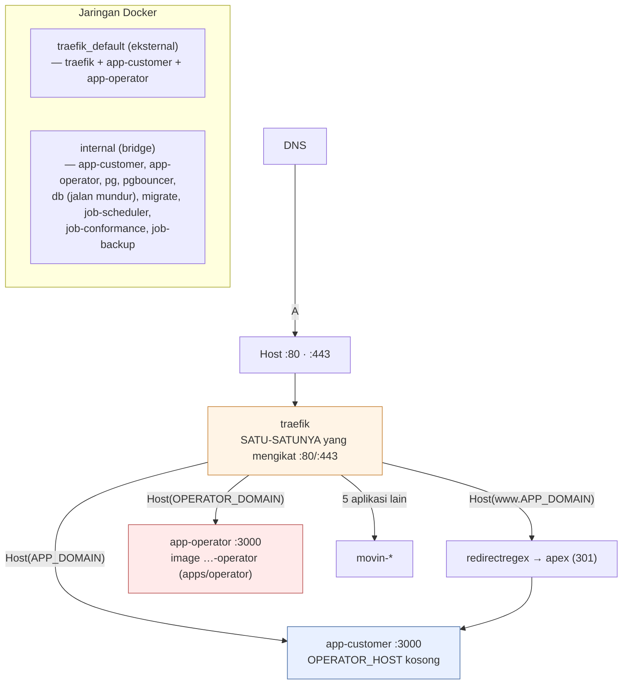
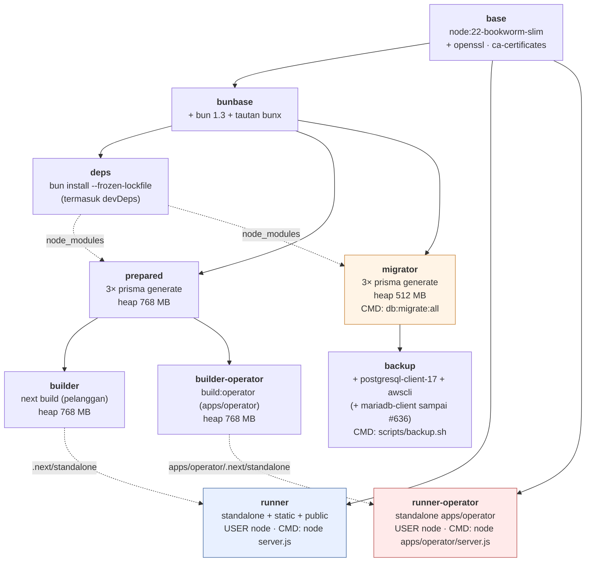
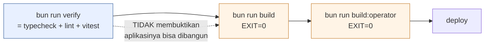
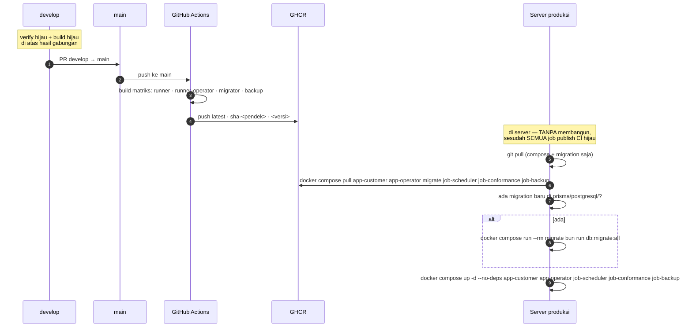
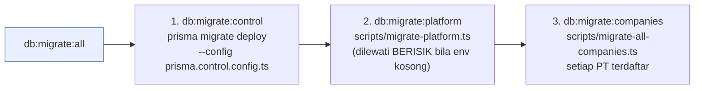

# 07 — Infrastruktur & Deploy

> Dimutakhirkan 18 Okt 2026 · produksi `main@ca0cd038` · [indeks](./README.md)

## 1. Mesin

| | |
|---|---|
| Platform | Linux 6.8.0-117-generic |
| RAM | **~3,6 GB**, dipakai bersama 6 aplikasi |
| Direktori | `/opt/applications/sai-accounting` |
| Zona waktu | `Asia/Jakarta` |

Aplikasi lain di mesin yang sama (`docker ps`, 11 Okt 2026):
`movin-pwa`, `movin-landing`, `movin-budget-web`, `movin-wedding`,
`movin-partner`, `traefik`.

Keterbatasan RAM ini menjadi alasan langsung empat keputusan arsitektural:

1. Pemeriksaan tipe dikeluarkan dari `next build`.
2. Image dibangun di runner GitHub, tidak di server.
3. Tahap `migrator` tidak mewarisi `builder`.
4. Batas heap eksplisit di setiap perintah Node.

## 2. Jaringan & domain



### Router Traefik (dari label `docker-compose.yml`)

| Router | Container | Entrypoint | Aturan | Middleware |
|---|---|---|---|---|
| `sai-app` | `app-customer` | `web` (80) | `Host(APP_DOMAIN)` | `sai-https` → redirect ke HTTPS |
| `sai-app-secure` | `app-customer` | `websecure` (443) | `Host(APP_DOMAIN)` | — · TLS `le` |
| `sai-www` | `app-customer` | `web` | `Host(www.APP_DOMAIN)` | `sai-www-apex` → 301 ke apex |
| `sai-www-secure` | `app-customer` | `websecure` | `Host(www.APP_DOMAIN)` | `sai-www-apex` · TLS `le` |
| `sai-ops` | `app-operator` | `web` | `Host(OPERATOR_DOMAIN)` | `sai-https` |
| `sai-ops-secure` | `app-operator` | `websecure` | `Host(OPERATOR_DOMAIN)` | — · TLS `le` |

Ada dua service Traefik: `sai-app.loadbalancer.server.port=3000` dan
`sai-ops.loadbalancer.server.port=3000`. Masing-masing punya probe
`/api/health` tiap 30s (timeout 5s).

> ⚠ **Nama service Traefik kedua container harus berbeda.** Dengan nama yang
> sama, Traefik menganggapnya satu service dengan dua backend dan membagi beban
> di antaranya. Permintaan operator lalu bisa mendarat di container pelanggan,
> tanpa galat apa pun.

`entrypoints=web` / `websecure` adalah nama entrypoint Traefik, bukan nama
service compose. Keduanya tidak ikut berubah saat service di-rename.

### Port

| Port | Terbit ke | Catatan |
|---|---|---|
| `80`, `443` | Host | Hanya Traefik |
| `3000` | Tidak (`expose`) | `app-customer` & `app-operator`, hanya di jaringan Docker |
| `5432` | Tidak | `pg` dan `pgbouncer`, hanya di `internal` |
| `3306` | Tidak | `db` (MariaDB jalan mundur, sampai #636), hanya di `internal` |

Tidak ada port basis data yang terbit ke host. Karena itu `job-scheduler`,
`job-conformance`, dan `job-backup` memakai ulang image `migrator`: hanya dari
dalam jaringan compose `pg`/`pgbouncer` bisa dijangkau.

### Domain

| Variabel | Bawaan di compose | Peran |
|---|---|---|
| `APP_DOMAIN` | `saiaccounting.id` | Pemasaran + aplikasi pelanggan |
| `OPERATOR_DOMAIN` | `ops.saiaccounting.id` | Routing Traefik konsol operator |
| `OPERATOR_HOST` | — (wajib) | Pemeriksaan host di dalam aplikasi |

`OPERATOR_DOMAIN` dan `OPERATOR_HOST` adalah dua variabel berbeda yang nilainya
harus cocok. Yang pertama membuat Traefik meneruskan permintaan, yang kedua
membuat aplikasi menerimanya. Keduanya ada di `.env` produksi.

Nilai domain sebenarnya tidak dicantumkan di sini. Nilainya ada di `.env` dan
bukan rahasia, tetapi salinan kedua di dokumen bisa menyimpang.

## 3. Image & tahap build



### Empat image yang didorong ke GHCR

| Image | Tahap | Dipakai layanan |
|---|---|---|
| `ghcr.io/tri-evendi/sai-accounting` | `runner` | `app-customer` |
| `…-operator` | `runner-operator` (aplikasi `apps/operator`) | `app-operator` |
| `…-migrator` | `migrator` | `migrate`, `job-scheduler`, `job-conformance` |
| `…-backup` | `backup` (tahap) | `job-backup` |

Kedua image aplikasi dibangun dari commit yang sama di setiap dorongan, dan
compose menarik keduanya dengan `SAI_TAG` yang sama. Sesudah deploy, periksa
bahwa `app-customer` dan `app-operator` menjalankan image `sha-` dan
tanggal-bangun yang sama. Keduanya menulis basis data yang sama, jadi versi
skemanya harus satu.

Tag per jalan CI: `latest` · `sha-<pendek>` · `<versi>` (dari `package.json`).

Membangun image aplikasi tidak ikut membangun image `migrator`. Image itu juga
memuat kode aplikasi dan dipakai `job-scheduler` serta `job-conformance`, jadi
bila terlewat, kedua layanan itu menjalankan kode lama tanpa tanda apa pun. Ini
sudah terjadi di beberapa rilis. Karena itu matriks CI membangun keempat image
setiap kali, dan `pull` di §5 selalu menyebut semuanya.

### Kenapa `bun` tidak menggantikan `node`

Pembagiannya disengaja dan ditulis di `package.json`: Bun adalah pemasang
paket dan peluncur skrip, Node adalah runtime.

`bun run` menghormati shebang `#!/usr/bin/env node` pada binary di
`node_modules/.bin`, jadi `next`, `tsc`, `prisma`, dan `tsx` tetap dijalankan
Node. Karena itu `NODE_OPTIONS=--max-old-space-size=…` tetap berlaku. Terukur:
batas 333 MB menghasilkan heap limit 525 MB, sama dengan di bawah npm.

Bun memakai JavaScriptCore, yang mengabaikan `--max-old-space-size`. Bila
perintah diubah menjadi `bun --bun …` atau `bun scripts/x.ts`, batas memori itu
hilang. Kegagalannya lalu berubah dari galat V8 yang terbaca menjadi
OOM-killer kernel (exit 137).

| Perintah | Batas heap | Alasan tercatat |
|---|---|---|
| `bun run typecheck` | **2048 MB** | Kamus i18n bertipe terus tumbuh; pada batas lebih rendah `tsc` mati `FatalProcessOutOfMemory` (exit 134, bukan dibunuh kernel). Riwayat pengukurannya di `_typecheck_note` `package.json` |
| `prepared` / `builder` / `builder-operator` di Docker | **768 MB** | Terukur di mesin ini |
| `migrator` di Docker | **512 MB** | Hanya `prisma generate` |

Jangan melepaskan `--max-old-space-size`. Tanpa batas, Node tumbuh sampai
kernel membunuhnya, dan kegagalan itu jauh lebih sulit dibaca.

### `trustedDependencies` bukan hiasan

Bun memblokir skrip lifecycle dependensi kecuali paketnya disebut di
`package.json` → `trustedDependencies`. npm menjalankan semuanya.

| Paket | Tanpa ini |
|---|---|
| `bcrypt` | Modul native tidak dibangun → galat saat login |
| `@prisma/engines` | Mesin query tidak diunduh → `prisma generate` gagal |
| `esbuild` | Binary tidak terpasang → vitest mati |
| `prisma`, `sharp`, `unrs-resolver` | — |

## 4. Gerbang rilis — dan siapa menjalankan yang mana

Aturannya di [`AGENTS.md`](../../AGENTS.md):



| Gerbang | Siapa | Di mana |
|---|---|---|
| `bun run verify` | Semua, termasuk agent latar & sesi cabang | Cabang masing-masing |
| `bun run build` | Hanya sesi utama, sekali, di atas `develop` hasil gabungan | Bukan di cabang mana pun |
| `bun run build:operator` | Sama dengan `build`; wajib bila perubahan menyentuh konsol (`apps/operator`) atau `packages/*` | Bukan di cabang mana pun |

**Agent latar tidak menjalankan `bun run build`.** Mesinnya ~3,6 GB dengan
produksi berjalan di atasnya, dan `next build` makan ~10 menit. Dua agent yang
membangun bersamaan pernah berakhir OOM (exit 137), yang terbaca seperti kode
rusak. Tiga pengukuran lain di sesi yang sama juga habis jadi timeout karena
beban. Build yang tidak dijalankan ditulis di badan PR.

**Sesi utama tetap menjalankannya di atas hasil gabungan.** Satu-satunya build
yang pernah gagal di repo ini gagal di hasil gabungan, padahal setiap cabangnya
hijau sendiri-sendiri. Tanpa langkah ini, yang dipromosikan adalah kode yang
belum pernah dibangun.

### Jebakan gerbang yang terdokumentasi

| Jebakan | Akibat |
|---|---|
| `bun test` ≠ `bun run test` | `bun test` memanggil runner bawaan Bun: mengabaikan `vitest.config.ts`, tidak kenal alias `@/`, dan melaporkan "no tests found" seolah suite rusak |
| `\| tail` pada perintah verify | Menutupi kode keluar; gerbang tampak hijau |
| `.next/types` basi | Typecheck gagal pada rute yang dipindahkan |
| `npm install` | Repo hanya punya `bun.lock` → lockfile kedua |

**`next build` tidak memeriksa tipe** (`typescript.ignoreBuildErrors: true`).
`bun run typecheck` adalah satu-satunya gerbang tipe, jadi perintah itu harus
selalu bisa dijalankan.

## 5. Alur rilis



### Perintahnya

Tunggu sampai semua job matriks `publish-image.yml` (keempat target) hijau.
Bila satu target belum terdorong saat `pull`, layanan berjalan di versi yang
berbeda-beda.

```bash
git pull
docker compose pull app-customer app-operator migrate job-scheduler job-conformance job-backup
# HANYA bila ada migration baru di prisma/postgresql/:
docker compose run --rm migrate bun run db:migrate:all
docker compose up -d --no-deps app-customer app-operator job-scheduler job-conformance job-backup
```

**Bila rilis membawa migration, urutannya pull → migrate → swap.**
`docker compose up --build -d` dalam satu langkah salah: container ditukar
sebelum migration berjalan, sehingga kode baru sempat bertemu skema lama.

Memeriksa apakah sebuah rilis membawa migration:

```bash
git diff --name-only <sha-main-sebelumnya>..HEAD -- prisma/postgresql/
```

### Rollback

Setiap push menandai `sha-<pendek>` dan nomor versi di samping `latest`, jadi
setiap rilis otomatis punya tag untuk kembali:

```bash
SAI_TAG=sha-573d9cf docker compose up -d --no-deps app-customer app-operator
```

⚠ **Rollback ke sebelum Fase 4 (18 Okt 2026).** Tag `sha-` yang lebih tua dari
pemisahan tidak punya image `…-operator`, jadi perintah di atas gagal menarik
`app-operator`. Kembalikan juga `docker-compose.yml` versi itu, yang
menjalankan `app-operator` dari image `runner`:
`git checkout <sha-lama> -- docker-compose.yml`, lalu
`SAI_TAG=sha-<lama> docker compose up -d --no-deps app-customer app-operator`.

`SAI_IMAGE` menimpa prefix registry, yang juga membuat image lokal warisan
terjangkau.

### Satu langkah sekali-jalan

Paket GHCR dibuat private, juga untuk repo publik. Setiap paket baru
(keempatnya: aplikasi, `…-operator`, `…-migrator`, `…-backup`) harus dijadikan
publik sekali, atau servernya diautentikasi. Sampai itu dilakukan,
`docker compose pull` menjawab `denied` untuk paket itu.

### Langkah rilis yang mudah terlewat

| Kondisi | Langkah |
|---|---|
| Migration baru | `db:migrate:all` (bukan `db:migrate`; lihat §6) |
| Katalog paket berubah | `bun run db:seed:plans` |

Dua kebiasaan yang sudah dua kali terbukti perlu: buktikan migration lewat
angka pra/pasca yang dibaca sendiri, jangan lewat laporan skrip. Untuk
memastikan sebuah fitur terjangkau, periksa `.next/server`; dengan cara itu
#555 ketahuan tidak punya pemanggil.

## 6. Migration



Klien Prisma sudah dibangkitkan di dalam image (`migrator`, `prepared`), jadi
`db:generate` tidak perlu dijalankan di server.

| Basis data | Dir migration | Diterapkan 18 Okt 2026 |
|---|---|---|
| Kendali | `prisma/postgresql/control/` | **4/4** |
| Platform | `prisma/postgresql/platform/` | **4/4** |
| Perusahaan | `prisma/postgresql/company/` | **1/1** (setiap buku PT) |

`prisma/migrations/` dan `prisma/{control,platform}/migrations/` adalah arsip
MariaDB hanya-baca (99 migration). Yang ditulis di sana tidak akan diterapkan.

> ⚠ **`db:migrate` (tunggal) hanya menyentuh satu basis data**, yaitu yang
> ditunjuk `DATABASE_URL`. Kendali, platform, dan buku PT lain tertinggal tanpa
> galat. Selalu pakai `db:migrate:all`.

Migration ditulis tangan di `prisma/postgresql/<company|control|platform>/NNNN_<nama>/migration.sql`
(lihat [`docs/DATABASE.md §7`](../DATABASE.md)), tidak dibangkitkan
`migrate dev`. Menyunting komentar di migration yang sudah diterapkan tidak
merusak `migrate deploy` (sudah diverifikasi).

## 7. Variabel lingkungan

Hanya nama; nilainya tidak dicantumkan di dokumen ini.

### Terisi di `.env` produksi (11 Okt 2026; baris basis data 18 Okt)

| Kelompok | Variabel |
|---|---|
| Domain & auth | `APP_DOMAIN`, `AUTH_SECRET`, `AUTH_URL`, `AUTH_TRUST_HOST` |
| Basis data | `DATABASE_URL`, `CONTROL_DATABASE_URL`, `PLATFORM_DATABASE_URL`, `PG_USER`, `PG_PASSWORD` (dipakai `pg`, `pgbouncer`, dan URL langsung `migrate`/`job-backup`) · `DB_NAME` · `DB_USER`, `DB_PASSWORD`, `DB_ROOT_PASSWORD`, `DB_CONNECTION_LIMIT` = MariaDB jalan mundur (#636) |
| Operator | `OPERATOR_DOMAIN`, `OPERATOR_HOST`, `OPERATOR_IP_ALLOWLIST`, `OPERATOR_MFA`, `OPERATOR_SESSION_SECRET`, `OPERATOR_USERS` |
| Enkripsi | `SETTINGS_ENCRYPTION_KEY`, `BACKUP_ENCRYPTION_KEY` |
| Cadangan | `BACKUP_RETENTION_DAYS`, `BACKUP_S3_PREFIX` |
| Kontak | `PLATFORM_CONTACT_EMAIL`, `PLATFORM_CONTACT_WHATSAPP` |
| Lain | `NODE_ENV`, `TZ`, `NEXT_PUBLIC_APP_NAME` |

### ⚠ Ada di contoh / dipakai kode, TIDAK ADA di `.env`

| Variabel | Akibat ketiadaannya |
|---|---|
| `AWS_ACCESS_KEY_ID` | Cadangan hanya lokal (`local_only`) |
| `AWS_SECRET_ACCESS_KEY` | Cadangan hanya lokal |
| `BACKUP_S3_BUCKET` | Cadangan hanya lokal; arsip ke volume `cadangan` |
| `AWS_DEFAULT_REGION` | Cadangan |
| `MIDTRANS_SERVER_KEY` | Gerbang bayar → MOCK |
| `MIDTRANS_IS_PRODUCTION` | Gerbang bayar |
| `PAYMENT_GATEWAY` | Jatuh ke `manual` |
| `PLATFORM_ALERT_EMAIL` | Peringatan jatuh ke `PLATFORM_CONTACT_EMAIL` |
| `OPERATOR_TRUSTED_PROXY_HOPS` | Bawaan 1, benar untuk susunan sekarang (Traefik saja) |
| `COMPANY_CLIENT_POOL_MAX` | Bawaan 4 |
| `CONTROL_DB_CONNECTION_LIMIT` | Bawaan 2 |
| `PLATFORM_DB_CONNECTION_LIMIT` | Bawaan 1 |
| `POOL_DISCONNECT_GRACE_MS` | Bawaan 15.000 |
| `COMPANY_DATABASE_URL_TEMPLATE` | Jatuh ke `DATABASE_URL` |
| `SMTP_*` | Tidak perlu; SMTP dari `platform.mail_settings` |
| `ALLOW_SEED` | **Jangan pernah** `true` di produksi |

Pemeriksa: `bun run check:env` (`scripts/check-env.mjs`).

### Anggaran koneksi

| Klien | Koneksi | Dikali | Total |
|---|---|---|---|
| Buku PT (LRU) | 2 | maks 4 klien | **8** |
| Kendali | 2 | 1 | **2** |
| Platform | 1 | 1 | **1** |
| | | | **11 dari `app-customer`** |

Ditambah `app-operator`, `job-scheduler`, `job-conformance`, dan `job-backup`
saat berjalan. Angkanya sengaja kecil: setiap koneksi yang dipesan kendali tidak
bisa dipakai buku PT, dan `max_connections` di mesin ini terbatas. Sejak
PostgreSQL (15 Okt 2026) anggarannya dua lapis: `max_client_conn = 200` di
PgBouncer dan `max_connections = 100` di `pg`, dengan `default_pool_size = 20`
per pasangan basis data/pengguna.

## 8. Lingkungan

| Lingkungan | Keadaan |
|---|---|
| **Pengembangan** | `bun run dev` — lokal. Transport surel `file` → `data/mail-outbox/` |
| **Produksi** | `docker compose` di mesin ini |
| **Staging** | ❓ Tidak ada definisi di repo. 🔶 Tersimpulkan: lokal → produksi langsung |

🔶 Basis data `sai_t11_data_dummy`, `sai_t1_uji_wisaya_416`,
`sai_t1_uji_pindahan_425`, dan `sai_t2_demo` hidup di instans produksi. Dari
namanya, keempatnya untuk pengujian/demo, yang masuk akal tanpa staging.
Dinilai di [dok 08](./08-PENILAIAN-ARSITEKTUR.md).

## 9. Pemantauan & dapat-diamati

### Yang ada

| Mekanisme | Isi |
|---|---|
| `GET /api/health` | `control`, `platform`, `company`, `scheduler` (+umur), `backup` (+umur), `conformance` (+umur, jumlah temuan), `mail`. 503 hanya bila kendali tak terjangkau |
| `GET /status` | Versi untuk manusia: komponen dengan empat keadaan (`operational` · `degraded` · `down` · `unknown`), tanpa nama basis data, angka, atau kalimat galat (`packages/core/src/public-status.ts`) |
| Healthcheck Docker | `app-customer` & `app-operator` tiap 30s · `pg` tiap 10s |
| Healthcheck Traefik | `/api/health` tiap 30s |
| `scheduler_runs` | Status per putaran; dipangkas `prune:trails` > 90 hari (baris `error`, terakhir, & `ok` terakhir ditahan selamanya) |
| `conformance_runs` | Status + jumlah temuan per sapuan mingguan |
| `backup_runs` | Status per percobaan (`ok` · `lokal` · `error`) |
| `/scheduler` (host konsol) | Denyut penjadwal di layar |
| `audit_logs` / `tenant_audit_logs` | Jejak tindakan |
| `bun run prove-scheduler-alive` | Pembuktian denyut |
| `bun run prove-backup-restore` | Pembuktian cadangan bisa dibuka |
| `watch:health` | Langkah 6 `job-scheduler`, tiap jam: surel peringatan bila cadangan, penjadwal, atau kesesuaian tidak sehat; peredam satu surel per status per 24 jam |
| `src/lib/alert.ts` | Peringatan surel berperedam untuk peristiwa dalam-aplikasi |
| `docker compose logs <layanan>` | Log mentah |
| CI `Verify` | `typecheck + lint + test` pada setiap PR & push `develop`/`main`; required status check pada `main` sejak 11 Okt 2026 |

🔶 Komentar di `src/proxy.ts` (sekitar baris 62) tidak cocok dengan kode. Ia
menyebut `/status` "dipersempit `lib/public-status.ts` menjadi tiga keadaan",
padahal `packages/core/src/public-status.ts` mendefinisikan `ComponentState`
dengan empat nilai (`operational` · `degraded` · `down` · `unknown`) dan
memakainya juga untuk `overall`. Yang berjumlah tiga adalah `MaintenanceState`
(`none` · `upcoming` · `active`). Komentarnya kemungkinan tertinggal dari versi
lama. Perilakunya tidak terpengaruh, tetapi komentarnya perlu dirapikan.

### Yang tidak ada

| Hilang | Akibat |
|---|---|
| Agregasi log | Log lama hanya bisa dibaca lewat `docker logs` pada container yang masih hidup |
| Metrik / dasbor | Tidak ada tren. "Apakah ini melambat?" tidak terjawab |
| Pelacakan galat (Sentry dsb.) | Galat runtime hanya di log |
| Pemantauan luar | ❓ `/api/health` ada; pembacanya belum dipastikan |
| Peringatan saat penjadwal mati total | `watch:health` berjalan di dalam `job-scheduler` dan ikut mati bersamanya. Hanya pembaca `/api/health` dari luar mesin yang bisa menutup celah ini |

Membaca log, dari `PRODUCTION.md §Reading the logs`:

```bash
docker compose logs app-customer --tail 200
docker compose logs job-scheduler --tail 60
docker compose logs job-conformance --tail 60
docker compose logs job-backup --tail 60
```

## 10. Satu runbook deploy

Deploy dijelaskan di dua tempat: `PRODUCTION.md` §Updates (dan §Rollback)
serta §5 dokumen ini. Perkakas build-di-server (`setup:prod`, `start:prod`,
`bun run deploy`, PM2/`ecosystem.config*.cjs`, `build-standalone.yml`,
`DOCKER.md`, `HOSTING*.md`) dicabut 12 Okt 2026 karena menjalankan `next build`
di server. `scripts/deploy.sh` tersisa sebagai jalan darurat warisan bila GHCR
tak terjangkau; kepala berkasnya menyatakan ia tidak dipakai untuk rilis biasa.

## 11. Pemulihan bencana

| Pertanyaan | Jawaban hari ini |
|---|---|
| RPO (kehilangan data maksimum) | **24 jam** untuk kerusakan data (cadangan harian di volume `cadangan`) · **tak terbatas** untuk kehilangan mesin, karena belum ada salinan luar-mesin |
| RTO (waktu pulih) | ❓ Belum pernah diukur |
| Cadangan luar-mesin | **Tidak ada**: `BACKUP_S3_BUCKET` kosong, `/api/health` → `backup: local_only` (18 Okt 2026) |
| Dump manual | Ada dan dipakai: `backups/` di akar repo; yang terbaru `pra-cutover2-postgres-2026-10-15-0437.sql`. Semuanya di mesin yang sama dengan datanya |
| Latihan pemulihan | Diwajibkan kuartalan, dijalankan manusia; ❓ tidak ada bukti pernah dijalankan |
| Kunci enkripsi cadangan di luar mesin | ❓ Belum dipastikan; risiko besar |
| Rollback kode | Baik: tag `sha-<pendek>` di GHCR |
| Rollback skema | ❓ Tidak ada migration `down` |

> ⚠ `.dockerignore` menjangkar polanya, `.gitignore` tidak. Karena perbedaan itu,
> pola `backups/` pernah membuat seluruh basis data produksi ikut masuk ke image
> yang di-deploy. Periksa isi image, tidak cukup pohon berkas.

Lanjut: [08 Penilaian Arsitektur](./08-PENILAIAN-ARSITEKTUR.md)
