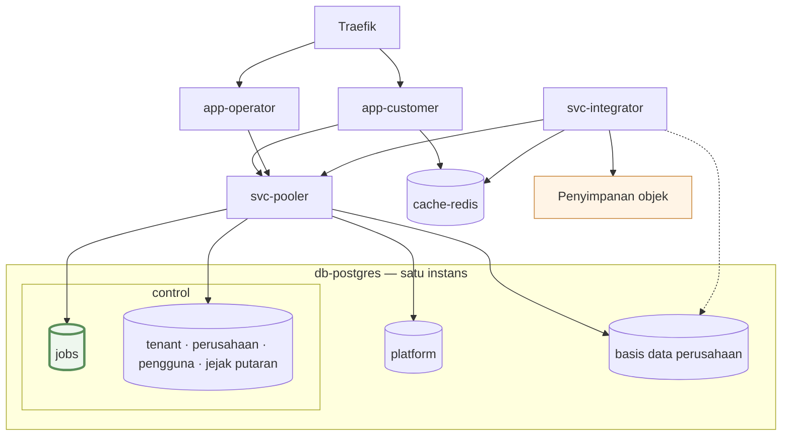
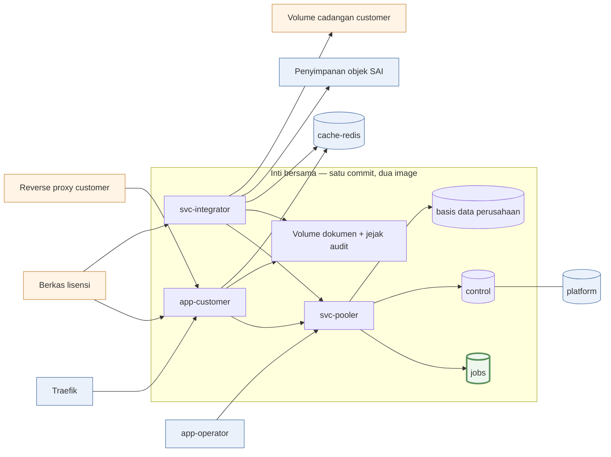

# Rancangan Layanan — Skala Pasar, On-Premise, dan Komersial

> 🔶 **Seluruh dokumen ini RANCANGAN, bukan keadaan.** Delapan dokumen lain
> menggambarkan yang sedang berjalan; yang ini menggambarkan yang hendak dituju.
> Tidak ada bagian di sini yang sudah dibangun, kecuali yang ditandai ✅.
> Disusun 19 Oktober 2026.

## 1. Yang patah lebih dulu saat tenant bertambah

Satu basis data per PT (#104) membuat **setiap operasi pemeliharaan dikalikan
jumlah tenant.** Keempatnya hari ini berurutan dan terikat *wall-clock*:

| Operasi | Sekarang | Pada ratusan tenant |
|---|---|---|
| Migration | `for` loop per perusahaan | ratusan `migrate deploy` berurutan **di setiap rilis** |
| Cadangan | satu `pg_dumpall --all-databases` | satu dump raksasa — **dan tak ada restore per tenant** |
| Kesesuaian data | per basis data, mingguan | jendela mingguan menjadi pembatas |
| Penjadwal | tujuh langkah berurutan, tiap jam | satu putaran tidak muat dalam satu jam |

Yang hilang bukan hanya waktu, tapi satu kemampuan: **`pg_dumpall` berarti satu
tenant tidak bisa dipulihkan tanpa menyentuh tenant lain** — padahal "pulihkan
data kami saja ke keadaan Selasa" (kata customer) adalah permintaan biasa di SaaS berbayar.

## 2. Tiga invarian

Ukuran benar-salah setiap penambahan layanan.

> **I-1 · Jumlah tenant tidak boleh menambah pekerjaan *wall-clock*.** Setiap
> fan-out per basis data wajib *bounded concurrency*, berjejak per basis data,
> dan dapat dilanjutkan dari tengah.

> **I-2 · Yang tunggal tetap tunggal: pintu posting dan penulis primary.**
> Penskalaan menambah pembaca dan pekerja — tidak pernah menambah penulis.

> **I-3 · Layanan tidak saling memanggil.** Koordinasi hanya lewat basis data
> bersama. Tabel `jobs` adalah satu-satunya pertemuan `app-customer` dan
> `svc-integrator`.

Akibat I-3, tiga hal didapat sekaligus: integrator mati tidak membuat aplikasi
gagal (permintaan menumpuk sebagai baris), bahasa integrator bisa ditukar per
`kind`, dan tidak ada *dual-write* karena tidak ada pihak kedua yang harus ikut
berhasil.

Setiap dimensi beban punya satu tempat untuk tumbuh:

| Beban yang tumbuh | Yang ditambah |
|---|---|
| Pengguna serentak | replika `app-customer` |
| Pekerjaan per jam | replika `svc-integrator` |
| **Jumlah tenant** | paralelisme jalur `schema` & `tenant`, lalu pecah instans `db-postgres` |
| Volume data per tenant | replika baca, dump per tenant |

## 3. Bentuk layanan target



| | Arti |
|---|---|
| `db-postgres` | **satu** instans PostgreSQL. `control`, `platform`, dan 17 basis data perusahaan adalah **basis data di dalamnya** — bukan layanan tersendiri |
| `basis data perusahaan` | satu basis data per PT (`sai_<slug>`, #104): buku besar dan seluruh dokumen operasionalnya |
| **`jobs`** | tabel di dalam `control`, dan **satu-satunya tempat `app-customer` dan `svc-integrator` bertemu**: aplikasi menerbitkan baris, integrator mengklaimnya, kemajuan dibaca dari `progress`. Keduanya tidak pernah saling memanggil (I-3) — itu sebabnya ia satu-satunya kotak bergaris tebal |
| Garis putus-putus | **langsung**, melewati pooler — hanya jalur `tenant` dan `schema`, karena dump dan DDL lewat pooler mode `transaction` adalah hal yang salah |
| `cache-redis` | tanpa garis ke `db-postgres`: ia tak pernah menjadi sumber apa pun |

**Lima komponen yang diurus sehari-hari**, dan dua hal di luar kelimanya:

| Komponen | Tanggung jawab | Status |
|---|---|---|
| `app-customer` | HTTP, render, validasi, tulis lewat pintu posting | ✅ ada |
| `app-operator` | konsol internal | ✅ ada |
| `svc-integrator` | **seluruh pekerjaan asinkron** — impor, ekspor, dokumen, email borongan, penjadwalan, kesesuaian, migration, cadangan, integrasi luar | baru |
| `cache-redis` | cache bersama antar-replika — **bukan antrean** | baru |
| `db-postgres` | sumber kebenaran; primary (+ standby) | ✅ primary ada |
| `svc-pooler` | **sidecar** PgBouncer, bukan entitas sendiri | ✅ ada, dinamai ulang |
| Penyimpanan objek | luar: dokumen jadi, dump, arsip WAL | baru |

**Image: tiga milik SAI, sisanya hulu.** Lima layanan tidak berarti lima image:

| Komponen | Image | Asal |
|---|---|---|
| `app-customer` | tahap `runner` — keluaran `standalone` Next.js | **SAI** |
| `svc-integrator` | **Go** — binary statis + `postgresql-client-17`; menggantikan `migrator` dan `backup` | **SAI** |
| jalur Node (`ledger` + dokumen) | Node, dari pohon sumber yang sama dengan `app-customer` | **SAI** |
| `app-operator` | tahap `runner-operator` | SAI, **hanya SaaS** |
| `db-postgres` · `svc-pooler` · `cache-redis` | `postgres:17-alpine` · `edoburu/pgbouncer` · `redis:<versi>-alpine` | hulu, **versi dipatok** |

⚠ **Ketiganya image terpisah, dan bahasanya pun berbeda.** Yang wajib sama bukan
image-nya melainkan **commit dan tag**-nya: itulah yang membuat gerbang skema
saat boot (§3.2) dan kontrak bangkitan di `contract/` (§3.5) bisa dipercaya.

### `db-postgres` satu server, 19 basis data

`control` dan `platform` **bukan** layanan tersendiri — ketiga URL menunjuk host
dan port yang sama (`pg:5432`), yang berbeda hanya nama basis datanya.

| Basis data | Isinya | Jumlah |
|---|---|---|
| `control` | pengguna, tenant, perusahaan, keanggotaan, token, jejak audit tenant — **dan tabel `jobs`** | 1 |
| `platform` | komersial, jejak putaran, situs publik, operasional — §7 | 1 |
| basis data perusahaan | satu per PT | 17 |

Pemisahan `platform` **doktrinal, bukan fisik**: ia ada supaya penagihan yang
mati tidak menjatuhkan aplikasi, dan itu ditegakkan di tingkat **impor**
(`platform-db` dilarang dari jalur panas akuntansi, dijaga tes). Instans
terpisah tidak menambah apa pun pada jaminan itu. Pemicu memecahnya: tahap 4.

### 3.1 Unit isolasinya JALUR, bukan layanan

> Sesuatu pantas dipisah bila **salah satu** dari empat ini berbeda: **image**,
> **rahasia yang dipegangnya**, **jalur koneksinya**, atau **jumlah instans yang
> benar**. Yang dipisah adalah **container jalur**, bukan layanan — keempatnya
> bisa dinyatakan per container, jadi layanan baru tidak pernah menjadi harganya.

Itu sebabnya migration dan cadangan hidup di `svc-integrator`:

| Pembeda | Cara jalur memenuhinya |
|---|---|
| Rahasia | `BACKUP_ENCRYPTION_KEY` + kredensial S3 hanya disuntikkan ke container jalur `tenant` |
| Jalur koneksi | jalur `tenant` dan `schema` menunjuk `db-postgres` langsung; jalur lain lewat pooler |
| Jumlah instans | `schedule` dan `schema` berjalan satu; `interactive` dan `bulk` berapa pun |
| Image | satu image Go untuk jalur yang sudah pindah; jalur Node (`ledger`, dokumen) image tersendiri — §3.3 |

Yang berbahaya bukan adanya `pg_dump` di dalam image — pekerja mana pun sudah
punya akses basis data — melainkan **kunci enkripsi dan kredensial unggah**.
Keduanya env, dan env dinyatakan per container, jadi properti itu bertahan utuh.
Harganya: image Go membawa `postgresql-client-17` untuk `pg_dump`, dan
`interactive` membawa perkakas yang tak dipakainya — tanpa kunci, jadi ia tidak
bisa mengirim apa pun keluar. `awscli` dan `openssl` **tidak** ikut: SDK S3 dan
kripto native Go menggantikannya.

**`svc-pooler` wajib, bukan penyetelan:** PostgreSQL satu proses per koneksi,
dan pola klien per-perusahaan membuat koneksi tumbuh mengikuti jumlah perusahaan
aktif, bukan jumlah pengguna. Penempatannya di sisi aplikasi karena *failover* —
pooler yang menumpang host basis data ikut mati bersama primary.

⚠ Anggarannya hari ini timpang: `DEFAULT_POOL_SIZE: 20` berlaku per pasangan
(basis data, pengguna) dengan 19 basis data — sampai 380 koneksi dituntut,
sementara `max_connections` tetap **100** dan tidak ada `MAX_DB_CONNECTIONS`
sebagai batas global. Ketiga setelan itu **prasyarat replika kedua**.

### 3.2 Jalur di dalam integrator

Pembedanya **jalur** (*lane*) — kelas `kind` yang diklaim lewat satu klausa
`WHERE kind IN (…)`. **Setiap jalur adalah PROSES tersendiri dari image yang
sama**, bukan anggaran di dalam satu proses: satu ekspor yang kehabisan memori
hanya menjatuhkan proses jalur `bulk`, dan pengguna yang menunggu unduhan di
jalur `interactive` tidak merasakan apa pun. Operasionalnya tetap satu layanan —
satu commit, beberapa `command`.

| Jalur | Bahasa | Isinya | Instans | Rahasia | Koneksi |
|---|---|---|---|---|---|
| `interactive` | Node → Go¹ | ekspor & dokumen yang ditunggu pengguna | berapa pun | — | pooler |
| `bulk` | Node → Go¹ | impor besar, paket laporan, email borongan | berapa pun | — | pooler |
| `schedule` | Go | denyut penerbitan tiap jam | **satu** | — | pooler |
| `tenant` | Go | kesesuaian data **dan cadangan** per perusahaan | **satu** | kunci enkripsi + kredensial unggah | **langsung** |
| `schema` | Go | migration setiap perusahaan | **satu**, sekali jalan | — | **langsung** |
| `ledger` | **Node** | pekerjaan yang **menulis** buku: dokumen berulang, dunning | **satu** | — | pooler |

¹ Dimulai sebagai proses Node terpisah, pindah ke Go per generator bila ada
pemicunya — §3.3 menjelaskan kenapa jalur yang **menghitung angka akuntansi**
tidak ikut gelombang pertama.

Hanya satu jalur menerima rahasia, dan ia jalur yang **tidak memproses masukan
pengguna**.

**Gerbang skemanya sudah terpasang**, dan ia prasyarat pemindahan ini: begitu
pekerjaan latar menjadi layanan yang berjalan terus, tidak ada lagi apa pun yang
"selesai" untuk ditunggu `service_completed_successfully`. Aturan dan arah
vonisnya kini **keadaan**, bukan rancangan — [02 §12](./02-LAYANAN-INFRA.md).
Yang belum: gerbangnya masih per-image, bukan **per perusahaan**, dan
expand/contract (§6) menuntut yang kedua.

Jalur `schema` tetap dijalankan **sekali** saat rilis (`docker compose run --rm`),
bukan diterbitkan ke antrean: migration adalah langkah rilis, dan pelaksananya
harus melihat kode keluarnya. Di on-premise, pelaksananya customer.

### 3.3 Bahasa & runtime: Go

**Keputusan: `svc-integrator` ditulis dalam Go.** Yang dibeli: memori diam
puluhan MB bukan ratusan (mesin 3,6 GB sudah dibagi enam aplikasi), paralelisme
sejati untuk kerja CPU, *static binary* dengan image kecil, SDK S3 dan kripto
native yang menghapus `awscli` + `openssl` dari image, dan hilangnya pagar
`--max-old-space-size` yang pernah berujung OOM-killer di sini.

Satu hal tidak boleh ikut pindah, dan bukan karena mahal:

> **I-2 menuntut pintu posting TUNGGAL.** `app-customer` memposting secara
> sinkron saat pengguna menekan tombol — 44 pemanggil `postForSource` — dan ia
> aplikasi Next.js yang tidak akan pindah. Pintu posting kedua di Go berarti dua
> mesin menulis buku besar, dan penyimpangan di antara keduanya tidak
> memunculkan galat. I-3 menutup jalan keluarnya: layanan tidak saling
> memanggil, jadi Go tidak bisa menitip posting ke Node.

Pembagiannya mengikuti satu garis: **apakah pekerjaan itu MENULIS ke buku
besar.**

| Jalur | Bahasa | Alasan |
|---|---|---|
| `tenant` — cadangan | **Go** | `backup.sh` sudah shell, nol aturan akuntansi |
| `tenant` — kesesuaian data | **Go** | hanya membaca dan melaporkan; konstanta akuntansinya dibangkitkan, lihat §3.5 |
| `schema` — migration | **Go** | migration-nya **SQL tangan**, jadi Go menerapkannya langsung |
| Integrasi luar (e-faktur, feed bank) | **Go** | HTTP+XML, SFTP; tidak menyentuh pembukuan |
| `schedule` — penerbitan | **Go** | hanya menerbitkan baris `jobs` |
| `interactive` · `bulk` — ekspor & dokumen | **Go, bersyarat** | tidak menulis ke buku, tapi **menghitung angka akuntansi**; lihat batas di bawah |
| Pekerjaan yang MENULIS buku besar | **tetap Node** | dokumen berulang lewat `createInvoiceInTx`, dunning. Satu jalur kecil, satu container: jalur `ledger`, dan pintu posting satu-satunya alasan keberadaannya |

⚠ **Batas yang disarankan: Go berhenti sebelum perhitungan akuntansi, sampai ada
pemicu.** Lima baris pertama tabel itu nol aturan akuntansi — pindah tanpa
perdebatan. Baris keenam lain sifatnya, dan ongkosnya baru terukur setelah
rancangan ini ditulis:

| Ongkos | Bentuknya |
|---|---|
| **Ini penulisan ulang aturan, bukan pemindahan proses** | 45 berkas · 14.625 baris TS. `contract/` (§3.5) membangkitkan **konstanta**, bukan **aturan**: dua implementasi "laba ditahan periode ini" bisa sama-sama konsisten di dalam dirinya dan tetap berbeda hasilnya |
| **Dua implementasi hidup berdampingan selama transisi** | `app-customer` memakai tumpukan laporan yang sama untuk tampilan di layar — **174 pengimpor di `src/app`** — dan layar tidak bisa menunggu pekerjaan. Jadi TS untuk layar, Go untuk berkas — kelas kegagalan yang I-2 ada untuk mencegah |
| **Node sudah terbukti bisa di server** | `src/lib/invoice-send.ts` menjalankan jsPDF **di Node** hari ini (impor dinamis, `server-only`). Jadi §5 tidak menuntut Go — ia hanya menuntut generatornya pindah dari peramban ke server |
| **25 penjaga tidak melihat Go** | dari 306 berkas tes, 25 memindai kode untuk menegakkan aturan struktural dan semuanya berhenti di batas `services/`. Permukaan Go wajib punya penjaga Go-nya sendiri |

Maka: **tahap 1d (§9) dibuka oleh pengukuran, bukan oleh rencana.** Pemicunya
satu dari dua — jalur ekspor memblokir event loop sampai p95 permintaan interaktif
terpengaruh, atau memori jalur dokumen memaksa `--max-old-space-size` lagi. Sebelum
pemicu itu terbaca, jalur `interactive` dan `bulk` berjalan sebagai **proses Node
terpisah** di luar `app-customer`: itu sudah membeli paralelisme dan isolasi
memori yang dicari, tanpa menyentuh satu aturan akuntansi pun.

Runtime Node yang tersisa tetap **Node, bukan Bun**: pagar
`--max-old-space-size` diabaikan JavaScriptCore.

### 3.4 Batas `cache-redis`

| Redis **boleh** | Redis **tidak boleh** |
|---|---|
| Cache bersama antar-replika (`cacheHandler`) | **Antrean pekerjaan** |
| Koordinasi sekilas: lease, pembatas laju | Sumber kebenaran apa pun |

> **Apa pun yang hilang bila Redis dikosongkan harus boleh hilang.** Redis mati
> = aplikasi melambat. Redis mati ≠ pekerjaan hilang atau tagihan terlewat.

### 3.5 Struktur monorepo poliglot

```
sai-accounting/
├── package.json             # workspaces: packages/* · apps/*  ← tidak menyentuh services/
├── src/                     # app-customer (Next.js) — pemilik pintu posting
├── apps/operator/
├── packages/{db,core,ui,billing,platform}/
├── workers/                 # jalur `ledger` (Node) — satu-satunya yang menulis buku
│   └── ledger.ts
├── services/integrator/     # integrator GO — jalur tanpa aturan akuntansi
│   ├── go.mod
│   ├── cmd/<jalur>/main.go  # tenant · schema · schedule · integration
│   └── internal/
│       ├── jobs/            # klaim · lease · reclaim — satu-satunya tempat SQL antrean
│       ├── ledgerread/      # pembacaan buku: neraca, laba-rugi, mutasi
│       ├── document/        # penghasil PDF/XLSX/CSV
│       ├── backup/
│       └── contract/        # DIBANGKITKAN — jangan disunting tangan
└── contract/                # satu sumber untuk setiap kontrak lintas bahasa
    ├── jobs.sql             # DDL tabel jobs → sqlc
    ├── kinds.yaml           # kind & status pekerjaan
    └── accounting.yaml      # tipe akun, status, mata uang, ambang materialitas
```

**`services/` sengaja di luar workspace.** Glob-nya `packages/*` dan `apps/*`,
terukur — jadi Go tidak masuk graf paket dan `bun install` tidak menyentuhnya.
Satu `package.json` di dalam pohon Go akan menariknya ke graf yang penjaganya
tidak memahaminya.

**Satu aturan yang memutuskan poliglot ini bertahan atau menyimpang diam-diam:**

> **Setiap konstanta yang dipakai dua bahasa DIBANGKITKAN dari `contract/`,
> tidak pernah ditulis dua kali.** Itu berlaku untuk `kind` dan `status`
> pekerjaan, dan juga untuk konstanta akuntansi:
> `ACCOUNT_TYPE_VALUES`, `CONTRACT_STATUSES`, `CURRENCIES`, ambang materialitas.
> Komentar di `scripts/check-data-conformance.ts:55` sudah melarang menyalinnya
> sejak sebelum Go masuk: konstanta itu **sumber yang sama** yang dipakai zod di
> jalur tulis.

Kalau dua daftar ditulis tangan, penyimpangannya **tidak muncul sebagai galat**:
`kind` yang hanya dikenal satu sisi menjadi baris yang menumpuk selamanya tanpa
pengklaim, dan tipe akun yang hanya dikenal satu sisi menjadi laporan yang
diam-diam melewatkan satu kelompok akun.

| Aturan | Bentuknya |
|---|---|
| **Prisma tetap pemilik skema** | Go membaca lewat `sqlc` dari `contract/jobs.sql` dan dari skema yang di-dump; Go **tidak pernah** menulis berkas migration |
| **Hanya jalur `ledger` menulis buku besar** | Go menyentuh tabel `jobs`, membaca buku, dan menulis berkas — tidak lebih. Dijaga tes yang menolak `INSERT`/`UPDATE` ke tabel buku dari `services/` |
| **Gerbang rilis jadi TIGA** | `bun run verify` · `go test ./...` + `golangci-lint` · build (`bun run build`, `bun run build:operator`, dan build image Go) |
| **`pg_dump` sejajar mayor server** | tes versi klien `pg` ikut menunjuk image Go, karena di situlah dump dijalankan |
| **Nomenklatur Go** | pengenal Inggris seperti lapisan lain; `gofmt` wajib; nama paket pendek tanpa garis bawah. Satu baris tambahan di `AGENTS.md` |

**Dockerfile** bertambah dua tahap: `FROM golang:<versi dipatok> AS go-build`
menghasilkan binary statis, lalu runtime tipis berisi binary itu +
`postgresql-client-17` (untuk `pg_dump`). Image `migrator` dan `backup` yang ada
dicabut setelah jalurnya pindah; `runner` dan `runner-operator` tidak berubah.

## 4. Yang belum terbangun dari antrean

**Tabel `jobs` sudah ada**, dan bersamanya: kontrak `kind`/status yang
dibangkitkan, klaim satu-pernyataan ber-`FOR UPDATE SKIP LOCKED`, *lease* yang
diperpanjang, *reclaim*, *backoff* ber-jitter, indeks berpredikat, pengarsipan
baris `done`, dan jalur `ledger` sebagai layanan. Bentuk tabelnya, daur hidup
statusnya, dan sebabnya ia tinggal di `control` kini **keadaan** —
[04 §1.2 dan §8.9](./04-ALIRAN-DATA.md); layanannya di
[02 §5](./02-LAYANAN-INFRA.md); metriknya di
[02 §14](./02-LAYANAN-INFRA.md).

Yang **belum**, dan keduanya menunggu pemakai pertamanya di tahap 1c:

**Dua jawaban untuk *dual-write*.** Karena `jobs` di `control` sementara tulisan
domain di basis data perusahaan, penerbitan tidak satu transaksi dengan tulisan
domainnya. Rancangan ini memakai keduanya, masing-masing di tempatnya:

| Pola | Bentuknya | Dipakai untuk |
|---|---|---|
| **Transactional outbox** | tabel `outbox` di basis data perusahaan, ditulis dalam **transaksi yang sama** dengan jurnalnya; satu *relay* memindahkannya ke `jobs` | pekerjaan yang lahir dari satu tulisan domain — "faktur diposting → terbitkan dokumen & email" |
| **Rekonsiliasi** | pekerja membaca keadaan domain dan menyimpulkan sendiri apa yang jatuh tempo | produser berjadwal — pengingat, dokumen berulang, dunning |

Outbox memberi atomisitas yang rekonsiliasi tidak bisa: tanpanya "posting
berhasil tapi dokumennya tak pernah terbit" mungkin terjadi, dan tak ada putaran
berikutnya yang akan menyadarinya. Sebaliknya rekonsiliasi lebih kuat untuk yang
berjadwal — ia menyusul sendiri setelah pemadaman, dan **sudah** jadi cara kerja
produser hari ini. Konsekuensi outbox: pengiriman **sekurang-kurangnya sekali**,
jadi setiap pemakai wajib idempoten — dan `dedupe_key` unik itulah yang
menjadikannya demikian. Relay memakai polling berinterval pendek, bukan CDC.

> **Satu aturan yang tetap:** pekerjaan demi kenyamanan pengguna (ekspor, impor)
> tidak butuh keduanya — yang hilang hanya berarti pengguna mengklik lagi.

**Otorisasi hasil, dan ini yang paling mudah terlewat.** `result_ref` memuat
isi buku besar, jadi tiga aturan berlaku dan ketiganya harus ditulis sebagai
kode, bukan diasumsikan:

| Aturan | Kenapa |
|---|---|
| Penyimpanan objek **privat**, tanpa akses anonim | kunci objek yang bisa ditebak atau bocor dari log menjadi kebocoran buku |
| Unduhan lewat **rute aplikasi**, bukan URL penyimpanan yang dibagikan | di situlah izin peran dan konteks perusahaan diperiksa; URL bertanda tangan dibuat di sana dan berumur pendek |
| Izin diperiksa **saat mengunduh**, bukan hanya saat pekerjaan lahir | pekerjaan hidup berjam-jam; orang yang aksesnya dicabut di antaranya tidak boleh tetap menerima hasilnya |

Itu sebabnya `result_ref` disebut kunci, bukan tautan: **memegang kuncinya bukan
izin untuk membacanya.**

## 5. Dokumen dibuat di server

Hari ini sebelas modul `src/lib/pdf/` berjalan di **peramban** (`report-files.ts`
ber-`"use client"`). Itu diubah: generatornya pindah ke server. Yang
mempermudahnya, modul-modul itu fungsi murni (data → byte) dengan kontrak yang
jelas.

| Dokumen | Sesudah |
|---|---|
| Satu faktur, surat jalan, kontrak, retur | server, sinkron, di-stream — milidetik |
| Laporan periode panjang, paket laporan, ekspor tenant | **pekerjaan** `document.*` → penyimpanan objek → pengguna mengunduh tautan |
| Peramban | tidak menghasilkan apa pun; tombolnya menjadi pemicu unduh |

Yang ini membuka, dan mustahil dari peramban: server menyimpan **byte yang
persis sama** dengan yang dikirim ke customer (syarat audit), batch e-faktur dan
paket laporan bulanan terbit sendiri, dan dokumen tidak lagi bergantung pada
perangkat pengguna.

⚠ **Ongkosnya CPU yang hari ini gratis.** Perakitan PDF laporan sekarang
berjalan di mesin pengguna — satu peramban per pengguna, paralel sempurna, nol
beban server. Memindahkannya ke server memindahkan beban itu ke mesin 3,6 GB
yang sudah dibagi enam aplikasi. Itu sebabnya jalur ini **wajib lewat antrean**
(§4), bukan lewat permintaan HTTP: kalau sebelas pengguna menekan "cetak laporan
tahunan" bersamaan, antrean yang menahannya, bukan event loop.

⚠ **Pemindahan ini tidak menuntut Go.** `src/lib/invoice-send.ts` sudah
menjalankan jsPDF **di Node** di server hari ini (impor dinamis, `server-only`),
jadi langkah termurahnya memakai generator yang sama di proses Node terpisah —
dan keluarannya tetap **byte-identik** dengan yang dicetak pengguna hari ini.
Menulis ulang generatornya di Go memutus kesamaan byte itu untuk setiap dokumen
yang pindah, dan menambah jendela dua-implementasi yang dibahas di §3.3. Urutan
yang disarankan: **pindah ke server dulu dengan Node, Go menyusul per generator
bila ada pemicunya.**

## 6. Fan-out per tenant

Menutup §1, dan inilah pekerjaan yang paling menentukan kesiapan pasar.

| Operasi | Jalur | Perubahan |
|---|---|---|
| Migration | `schema` | `for` loop → *bounded concurrency*, hasil per perusahaan dicatat, rilis dapat dilanjutkan dari tengah |
| **Cadangan** | `tenant` | `pg_dumpall` → **`pg_dump` per basis data** + satu `pg_dumpall --globals-only`. Satu tenant bisa dipulihkan tanpa menyentuh yang lain |
| Kesesuaian | `tenant` | *bounded concurrency* + baris jejak per basis data |
| Denyut jam | `schedule` | menerbitkan satu pekerjaan per (tenant, langkah) — §4 |

Bukti kelengkapan cadangan diperluas: **setiap basis data terdaftar wajib punya
objek dumpnya sendiri**, bukan hanya hadir di dalam satu dump besar.

**Memparalelkan migration tidak cukup — skemanya yang harus berubah.** Selama
rilis memblokir sampai setiap basis data termigrasi, waktu padam tetap tumbuh
mengikuti jumlah tenant. Jawaban bakunya **expand/contract** (*parallel change*):

> **Setiap migration wajib menghasilkan skema yang bekerja untuk kode LAMA dan
> kode BARU sekaligus.** Perubahan yang memutus kompatibilitas dipecah jadi tiga
> rilis: **expand** → **migrate** → **contract**.

Tiga hal yang didapat, dan tidak bisa diperoleh dengan cara lain: rilis berhenti
memblokir, rollback tidak menyentuh skema, dan gerbangnya berubah dari "semua
perusahaan siap" menjadi "perusahaan ini siap" — satu yang gagal tidak lagi
menahan 16 lainnya. Harganya: struktur lama dan baru hidup berdampingan beberapa
rilis, jadi fase `contract` **wajib punya nomor issue saat `expand` ditulis**.

⚠ Aturan ini belum berlaku hari ini. Pada 17 perusahaan gerbang pemblokir masih
murah — detik, bukan menit. Ia harus menjadi aturan **sebelum** jumlahnya
membuatnya mahal, karena mengubah kebiasaan migration lebih lambat daripada
menambah tenant.

## 7. Dua profil penyebaran: SaaS dan On-Premise

Satu commit, dua profil. Bedanya konfigurasi, bukan kode.

| | SaaS | On-Premise |
|---|---|---|
| Tenant | banyak | satu |
| Basis data `platform` | ya | **tidak ada** |
| Penagihan | penjadwal langganan | mati; diganti lisensi |
| Entitlement | `plan_key` + modul per perusahaan | **berkas lisensi** → modul per perusahaan |
| Cadangan & kuncinya | SAI | customer, tertulis di serah terima |
| Pembaruan | SAI men-deploy | tag versi; customer menarik |

### SaaS vs On-Premise



| | Arti |
|---|---|
| Kotak dalam `inti` | ada di **kedua** profil, dari commit yang sama |
| 🔵 biru · 🟠 jingga | **hanya SaaS** · **hanya on-premise** |
| Garis **tanpa arah** | "berada di dalam" — `platform` adalah basis data di instans `db-postgres` yang sama. Ketiadaannya di on-premise berarti satu basis data tidak dibuat, bukan satu layanan tidak dipasang |

### Yang dipasang di on-premise

```
docker compose -f docker-compose.yml -f docker-compose.onprem.yml up -d
```

| Dipasang | Wajib? |
|---|---|
| `app-customer` · `svc-integrator` · `db-postgres` | **wajib** |
| `svc-pooler` | dipasang untuk **keseragaman konfigurasi**, bukan untuk beban |
| Reverse proxy **milik customer** | **wajib** — TLS harus berhenti di suatu tempat; Traefik SAI tidak dikirim |
| Volume `pg_data` · `documents` · `audit` · cadangan | **wajib** — dokumen dan jejak audit **tidak** ada di basis data |
| Berkas lisensi | **wajib**, hanya-baca ke `app-customer` dan jalur `schedule` — [06 §3.6](./06-KEAMANAN.md) |
| Jalur `schema` | **wajib setiap pembaruan**, dijalankan customer |
| `cache-redis` · `app-operator` · basis data `platform` | **tidak dipasang** |

Dua komponen sering dikira wajib, dan keduanya gugur di profil ini:

| Komponen | Kenapa gugur |
|---|---|
| `cache-redis` | tugasnya cache bersama **antar-replika**; on-premise satu replika, jadi cache dalam-proses memadai. Pembatas laju endpoint publik **sudah** memakai `control` dan sengaja bukan Redis (#138) |
| `svc-pooler` | aritmetikanya berbeda: satu tenant menuntut belasan koneksi (`COMPANY_CLIENT_POOL_MAX` 4 × `DB_CONNECTION_LIMIT` 2 + `control` 2) terhadap `max_connections` 100 — bukan 380 lawan 100 |

**Fondasinya sudah ada**, dan yang paling menentukan bukan yang baru dibangun:
isolasi data per perusahaan (#104) membuat hal tersulit di profil ini selesai
sebelum dimulai, entitlement modul **sudah** per perusahaan sehingga langsung
bisa digerakkan lisensi, dan doktrin #137 sudah menjaga batas plane penagihan.
Compose on-premise, tag versi wajib, profil penyebaran, jejak putaran di
`control`, dan bundel diagnostik kini **keadaan, bukan rancangan** — semuanya
dijelaskan di [02](./02-LAYANAN-INFRA.md). Begitu pula **artefak lisensi** dan
**penegakan entitlement di satu pintu**: kriptografi dan kustodi kuncinya di
[06 §3.6](./06-KEAMANAN.md), pintunya di [01 §8](./01-ARSITEKTUR.md).

**Yang belum, dan harus dibangun.** Nomor yang hilang sudah selesai dan pindah
ke 02; nomor pensiun, tidak dipakai ulang.

| # | Celah | Catatan |
|---|---|---|
| 5 | Cadangan per tenant | §6 — profil ini yang membutuhkannya paling dulu |

Hanya tiga hal menyeberang batas customer, dan ketiganya **manual**: image rilis
bertag versi (masuk), berkas lisensi (masuk), bundel diagnostik (keluar).

### DC/DRC customer menggantikan HA SAI — bukan cadangannya

Yang benar disimpulkan: **lapisan HA SAI tidak dikirim** — tanpa standby
sinkron, tanpa witness, tanpa Patroni/etcd. Yang **tidak** benar: bahwa jalur
cadangan jadi tidak perlu.

| DC/DRC menjawab | Cadangan menjawab |
|---|---|
| mesin atau situs hilang | **kesalahan manusia**, migration yang merusak, korupsi data |
| keadaan **sekarang** | keadaan **pada suatu titik waktu** |
| seluruh kluster | **satu tenant saja** |
| berkas basis data | berkas basis data **+ dokumen + jejak audit** |

Sebabnya: **replikasi menyalin perintah yang salah dengan patuh.** Satu `UPDATE`
tanpa `WHERE` sampai di DRC dalam hitungan detik. Ditambah dua hal khas
pemasangan ini: arsip wajib bertahan **sepuluh tahun**, dan replika bukan arsip.

**Jalur cadangan boleh dimatikan** hanya bila perkakas customer lolos dua uji —
memulangkan pembukuan **satu** tenant ke titik waktu pilihan tanpa menyentuh
tenant lain, dan membuktikan setiap basis data terdaftar **beserta** dokumen dan
jejak audit ada di dalam artefaknya. Asumsi "sudah punya DRC jadi cadangan tidak
perlu" harus **tertulis dan dibantah** di dokumen serah terima.

> ⚠ **Perpetual berarti aplikasinya tidak boleh berhenti bekerja.** Yang berakhir
> adalah hak atas versi baru dan dukungan — bukan akses ke pembukuan. Lisensi
> yang mematikan buku adalah kesalahan kategori untuk produk akuntansi.

**Kesimpulan: arsitekturnya siap, produknya belum.** Yang kurang pipa komersial,
bukan desain ulang.

> §8 pensiun 20 Okt 2026: entitlement sudah terbangun dan pindah ke
> [01 §8](./01-ARSITEKTUR.md). Nomor bagian **tidak dipakai ulang**, mengikuti
> aturan yang sama dengan nomor celah di §7 — rujukan dari kode, `AGENTS.md`,
> dan riwayat commit menunjuk nomor, dan menggesernya membatalkan semuanya
> sekaligus demi kerapian yang tidak dibaca siapa pun.

## 9. Tahapan & pemicu

✅ **Tahap 1a selesai 20 Okt 2026** dan karena itu tidak lagi di tabel ini: tabel
`jobs`, `contract/` + generator, jalur `ledger` sebagai layanan, gerbang skema
saat boot, batas ekspor & periode laporan, semver + tag tetap. Tempatnya
sekarang [02](./02-LAYANAN-INFRA.md) dan [04](./04-ALIRAN-DATA.md).

| Tahap | Pemicu | Isi | VM |
|---|---|---|---|
| **1b — Go masuk dari tepi** | sesudah 1a | jalur `tenant` (cadangan **per tenant** + kesesuaian) · jalur `schema` · **nol aturan akuntansi tersentuh** | 1 |
| **1c — dokumen pindah ke server** | sesudah 1a | jalur `interactive`, `bulk`, `schedule` sebagai **proses Node terpisah** · generator dokumen pindah dari peramban ke server, **byte tetap identik** | 1 |
| **1d — Go ke perhitungan laporan** | **pengukuran**, bukan jadwal: event loop ekspor memengaruhi p95 interaktif, atau memori memaksa `--max-old-space-size` lagi | generator per laporan pindah ke Go · **paritas dibuktikan per laporan, lalu versi TS dicabut** | 1 |
| **2 — pasar awal** | tenant berbayar, SLA pertama | replika `app-customer` kedua · **`cache-redis` + cache bersama** · `db-postgres` pindah host · **standby** | 3–4 |
| **3 — pasar tumbuh** | putaran fan-out tak muat di jendelanya | witness & *failover* otomatis · replika baca · replika `svc-integrator` | 5–7 |
| **4 — besar** | satu instans tidak cukup | tenant dipecah ke beberapa instans `db-postgres` | — |
| **D — on-premise** | customer on-prem pertama | penanda profil · artefak lisensi · satu pintu entitlement · saluran rilis · bundel diagnostik | di customer |

⚠ **Tahap 1 dipecah empat, dan urutannya mengikuti satu garis: aturan akuntansi
disentuh paling akhir.** 1a membangun fondasi antreannya tanpa satu baris Go.
1b memindahkan ke Go apa yang nol aturan akuntansi
(`tenant`, `schema`) dan bisa dibatalkan tanpa jejak — cadangan dan migration
tidak meninggalkan angka di buku. 1c memindahkan dokumen ke server **tanpa
mengganti bahasanya**, jadi keluarannya tetap byte-identik dan tidak ada
perhitungan yang punya dua implementasi. 1d satu-satunya yang menulis ulang
aturan, dan karena itu ia **dibuka pengukuran, bukan rencana** (§3.3).

Urutan ini juga membuat 1b berfungsi sebagai bukti bahwa toolchain, image, CI,
dan kontrak bangkitan memang bekerja — sebelum dipakai untuk hal yang lebih mahal
untuk salah.

⚠ **`cache-redis` pindah dari tahap 1 ke tahap 2**, karena tahap 1 berjalan satu
replika dan cache bersama tidak membeli apa pun sebelum ada replika kedua —
alasan yang sama yang membuatnya gugur di on-premise (§7). Memasangnya lebih awal
berarti satu layanan berjaga untuk manfaat nol.

⚠ **Standby pindah dari tahap 3 ke tahap 2**, dan ini koreksi urutan: tahap 2
adalah tahap "SLA pertama", jadi rancangan sebelumnya menjanjikan SLA di atas
primary tunggal tanpa salinan panas. Yang boleh menyusul di tahap 3 hanyalah
*failover* **otomatis** (witness, leader election) — bukan keberadaan
standby-nya.

Tahap 1 seluruhnya di **satu VM yang sudah ada**. Sesudahnya, tahap 2 dan 3
menjadi perubahan konfigurasi — bukan penulisan ulang. Itu arti "siap secara
desain". Tahap 4 mungkin karena #104: tenant bisa dipindah ke instans lain tanpa
menyentuh skema atau kode.

⚠ `cacheHandler`-nya **ditulis sendiri**, apa pun penyimpanannya: pustaka yang
beredar menyasar Next 13–15, sementara versi di sini memakai model
`updateTags`/`refreshTags` yang baru.

## 10. Nomenklatur

Aturannya kini mengikat di `AGENTS.md` (penamaan) dan `DATABASE.md` (skema,
kolom tersandi, klasifikasi PII). Yang tinggal di sini rencana memindahkan nama
lama ke aturan itu. Keadaan terukur hari ini:

| Lapis | Keadaan |
|---|---|
| Skrip (55) | **35 pakai pola `<domain>:<aksi>`, 20 tidak** |
| Volume (6) | `pg_data`, `db_data` · `documents`, `audit` · **`cadangan`** (Indonesia) |
| Service | `app-*`/`job-*` konsisten; `db`, `pg`, `pgbouncer`, `migrate` tidak — dan **`db` vs `pg` aktif menyesatkan** |
| Env var | `DATABASE_URL` tanpa prefiks padahal saudaranya berprefiks |

Sebabnya: lapisan basis data punya aturan tertulis dan patuh (95 model, nol
pelanggaran), sementara lapisan aplikasi belum punya — dan karena itu melayang.

**Rencana rename — empat gelombang, yang lebih berisiko selalu sesudah yang
lebih aman:**

| # | Lingkup | Kuncinya |
|---|---|---|
| 1 | Pengenal kode, nama berkas & tes | tanpa menyentuh produksi; dijaga `tsc` |
| 2 | Env var | **satu pembaca env terpusat lebih dulu** — menerima nama baru, jatuh ke nama lama sambil memperingatkan. Sesudah itu rename jadi satu baris |
| 3 | Nama service compose | nama service adalah **nama DNS**, jadi seluruh URL basis data berubah pada rilis yang sama. Prasyarat: pencabutan `db` (MariaDB) lebih dulu |
| 4 | Nama volume | volume Docker tidak bisa diganti nama — isinya disalin, lalu volume lama dibuang setelah terbukti. Perlu jendela pemeliharaan |

> ⚠ Satu catatan terhadap gelombang 4: **`pg_data` memuat seluruh basis data.**
> Menggantinya namanya tidak membeli apa pun selain konsistensi, sementara satu
> langkah salah berarti kehilangan data — dan kekaburan `pg_data` vs `db_data`
> hilang sendiri begitu `db_data` dicabut. Bila tetap dijalankan: hanya sesudah
> P0-1 dan P0-2 selesai.

## 11. Observabilitas — yang belum terukur

**Sinyal utamanya sudah terpasang:** umur pekerjaan tertua yang belum jalan,
per jalur, dengan ambang 7/10 menit yang hanya berlaku bila ada yang menunggu —
berpasangan dengan denyut penerbit yang tidak bergantung pada isi antrean.
Keduanya kini **keadaan**: [02 §14](./02-LAYANAN-INFRA.md).

Yang belum ada, dan ketiganya butuh penyimpan **riwayat** yang belum dipilih —
hari ini setiap angka terbaca *sekarang*, bukan sebagai tren:

| Metrik | Satuan | Perannya | Kenapa belum |
|---|---|---|---|
| *Queue depth* | jumlah | pendamping, berguna hanya bersama laju | terbaca sekarang; tanpa laju ia tidak mengatakan apa pun |
| Laju terbit & laju selesai | per menit | bersama kedalaman memberi perkiraan *drain time* | menuntut dua titik waktu, jadi menuntut riwayat |
| Durasi pekerjaan | histogram p95/p99 | rata-rata menyembunyikan satu jenis yang melambat | menuntut agregasi, bukan satu kueri |

⚠ Histogram durasi bukan kemewahan: ia **prasyarat** ambang per-jalur. Hari ini
tujuh jalur memakai satu pasang ambang dengan sengaja, sebab tujuh angka yang
dikarang tanpa pengukuran akan berteriak untuk hal normal atau diam untuk hal
gawat — dan dua-duanya lebih buruk daripada satu angka yang jujur.

Penamaannya mengikuti konvensi OpenTelemetry (`queue.items.age`,
`queue.items.size`, `job.duration`) dengan dimensi nama jalur.

## 12. Tata kelola

Gerbang rilis dan register keputusan sudah utuh. Yang berlubang:

| Bidang | Hilang |
|---|---|
| **Versi** | **semver + tag tetap + definisi GA** (hari ini `0.9.0`, tag `latest`) |
| Rollback skema | **aturan** expand/contract ditegakkan penjaga, bukan kebiasaan — §6 |
| **Insiden** | severity **insiden** (yang ada baru severity temuan P0–P3), siapa dihubungi |
| **SLO** | satu sasaran per permukaan + ***error budget***-nya; tanpa itu metrik §11 hanya grafik |
| Keamanan | `SECURITY.md` — jalur pengungkapan kerentanan |
| Deprecation | jendela tertulis: ditandai satu rilis minor, dicabut sesudahnya |
| Data | retensi tertulis per jenis data + perjanjian pengolahan data |
| On-premise | jendela dukungan, kebijakan backport, serah terima kunci |
| Kepemilikan kode | `CODEOWNERS` (P3-3) |

Dua di antaranya memblokir komersialisasi, bukan sekadar kerapian: **disiplin
versi** — tanpa artefak bernomor tidak ada yang bisa dijual atau didukung — dan
**severity insiden**, tanpanya tidak ada SLA yang bisa dijanjikan.

## 13. Yang sengaja TIDAK dirancang

| Tidak diusulkan | Alasan |
|---|---|
| Broker pesan sebagai antrean — Kafka, Rabbit, Redis | baris pekerjaan harus hidup di basis data yang sama dengan jejaknya dan ikut cadangan yang sama; broker terpisah mengembalikan *dual-write* — §4 |
| Perender PDF berbasis Chromium | generator yang ada sudah memadai untuk tata letak ini; Chromium menukar satu kenyamanan dengan 100–300 MB RAM per render — §5 |
| Memecah domain akuntansi jadi mikrolayanan | batasnya tidak nyata: setiap pekerja butuh konteks perusahaan dan tiga klien yang sama |
| **Pintu posting kedua di Go** | I-2 menuntut satu pintu, dan `app-customer` memposting sinkron dari Next.js. Itu sebabnya jalur `ledger` tetap Node — §3.3 |
| **Konstanta akuntansi ditulis tangan di dua bahasa** | dibangkitkan dari `contract/accounting.yaml`; dua daftar tulis tangan menyimpang tanpa galat — §3.5 |
| **Aturan laporan ditulis di dua bahasa tanpa pemicu terukur** | `contract/` membangkitkan konstanta, bukan aturan. Perhitungan pindah ke Go per generator, dan hanya setelah pengukuran membukanya — §3.3, tahap 1d |
| Layanan tersendiri per jenis pekerjaan | keempat pembeda bisa dinyatakan **per container jalur** — §3.1 |
| Lapisan HA SAI di on-premise | DC/DRC customer sudah menjawabnya — §7 |
| Instans basis data tersendiri untuk `platform` | doktrin #137 ditegakkan di tingkat **impor**, bukan oleh batas jaringan. Satu-satunya pemicunya tahap 4 — §3 |
| Tenant-baris / schema-per-tenant | membatalkan isolasi fisik, yang justru membuat tahap 4 dan profil on-premise mungkin |
| Lisensi yang mematikan aplikasi | kesalahan kategori untuk produk akuntansi — §7 |
