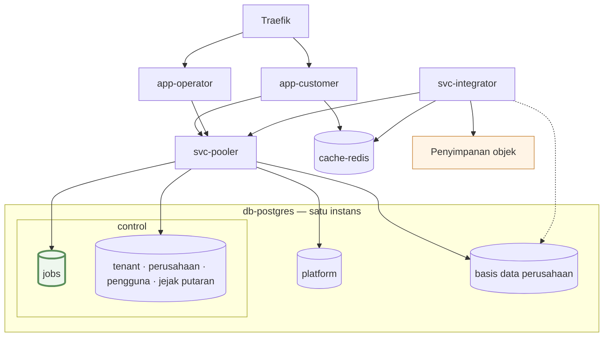
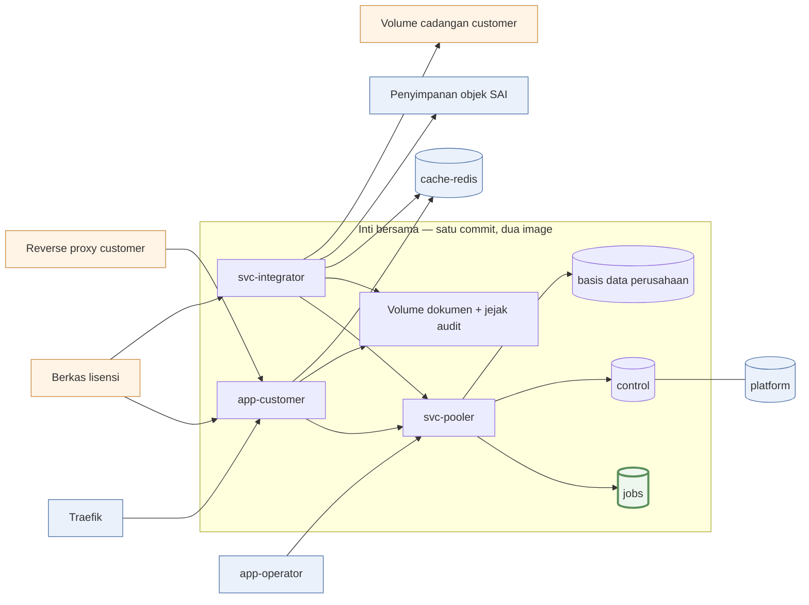

# Rancangan Layanan — Skala Pasar, On-Premise, dan Komersial

> 🔶 **Seluruh dokumen ini RANCANGAN, bukan keadaan.** Delapan dokumen lain
> menggambarkan yang sedang berjalan; yang ini menggambarkan yang hendak dituju.
> Tidak ada bagian di sini yang sudah dibangun, kecuali yang ditandai ✅.
> Disusun 19 Oktober 2026. Tahap 1a–1c **melayani produksi sejak 21 Okt 2026**
> (`main@a8d2749d`, 0.10.0) — jalannya gelar di [07 §5](./07-RIWAYAT.md).

## 1. Yang patah lebih dulu saat tenant bertambah

Satu basis data per PT (#104) membuat **setiap operasi pemeliharaan dikalikan
jumlah tenant.** Keempatnya hari ini berurutan dan terikat *wall-clock*:

| Operasi | Sekarang | Pada ratusan tenant |
|---|---|---|
| Migration | ✅ *bounded concurrency* (tahap 1b) — masih di gerbang pemblokir | gerbangnya yang jadi pembatas, bukan jumlah langkahnya; §6 |
| Cadangan | ✅ satu objek `pg_dump -Fc` **per basis data** (tahap 1b) | satu objek per tenant per hari — ongkos penyimpanan tumbuh linear, dan itu memang ongkos yang benar |
| Kesesuaian data | ✅ *bounded concurrency* + jejak per basis data (§6) — masih langkah di `job-conformance` | jendela mingguan menjadi pembatas bila konkurensinya tak lagi cukup |
| Penjadwal | delapan langkah berurutan, tiap jam | satu putaran tidak muat dalam satu jam |

Yang hilang dulu bukan hanya waktu, tapi satu kemampuan: **`pg_dumpall` berarti
satu tenant tidak bisa dipulihkan tanpa menyentuh tenant lain** — padahal
"pulihkan data kami saja ke keadaan Selasa" (kata customer) adalah permintaan
biasa di SaaS berbayar. ✅ Itu tertutup tahap 1b; prosedurnya di `PRODUCTION.md`.

⚠ Dua baris yang sudah ✅ tetap di tabel ini, dan sengaja: tabel ini menamai
**kelas masalahnya**, dan dua baris yang tersisa punya bentuk yang sama. Baris
yang dihapus akan membuat pembaca berikutnya mengira hanya dua operasi yang
pernah dikalikan jumlah tenant.

## 2. Tiga invarian

Ukuran benar-salah setiap penambahan layanan.

> **I-1 · Jumlah tenant tidak boleh menambah pekerjaan *wall-clock*.** Setiap
> fan-out per basis data wajib *bounded concurrency*, berjejak per basis data,
> dan dapat dilanjutkan dari tengah.

> **I-2 · Yang tunggal tetap tunggal: pintu posting dan penulis primary.**
> Penskalaan menambah pembaca dan pekerja — tidak pernah menambah penulis.

> **I-3 · Layanan tidak saling memanggil.** Koordinasi hanya lewat basis data
> bersama. Tabel `jobs` adalah satu-satunya pertemuan `app-customer` dan
> `svc-integrator`.

Akibat I-3, tiga hal didapat sekaligus: integrator mati tidak membuat aplikasi
gagal (permintaan menumpuk sebagai baris), bahasa integrator bisa ditukar per
`kind`, dan tidak ada *dual-write* karena tidak ada pihak kedua yang harus ikut
berhasil.

Setiap dimensi beban punya satu tempat untuk tumbuh:

| Beban yang tumbuh | Yang ditambah |
|---|---|
| Pengguna serentak | replika `app-customer` |
| Pekerjaan per jam | replika `svc-integrator` |
| **Jumlah tenant** | paralelisme jalur `schema` & `tenant`, lalu pecah instans `db-postgres` |
| Volume data per tenant | replika baca, dump per tenant |

## 3. Bentuk layanan target



| | Arti |
|---|---|
| `db-postgres` | **satu** instans PostgreSQL. `control`, `platform`, dan 17 basis data perusahaan adalah **basis data di dalamnya** — bukan layanan tersendiri |
| `basis data perusahaan` | satu basis data per PT (`sai_<slug>`, #104): buku besar dan seluruh dokumen operasionalnya |
| **`jobs`** | tabel di dalam `control`, dan **satu-satunya tempat `app-customer` dan `svc-integrator` bertemu**: aplikasi menerbitkan baris, integrator mengklaimnya, kemajuan dibaca dari `progress`. Keduanya tidak pernah saling memanggil (I-3) — itu sebabnya ia satu-satunya kotak bergaris tebal |
| Garis putus-putus | **langsung**, melewati pooler — hanya jalur `tenant` dan `schema`, karena dump dan DDL lewat pooler mode `transaction` adalah hal yang salah |
| `cache-redis` | tanpa garis ke `db-postgres`: ia tak pernah menjadi sumber apa pun |

**Lima komponen yang diurus sehari-hari**, dan dua hal di luar kelimanya:

| Komponen | Tanggung jawab | Status |
|---|---|---|
| `app-customer` | HTTP, render, validasi, tulis lewat pintu posting | ✅ ada |
| `app-operator` | konsol internal | ✅ ada |
| `svc-integrator` | **seluruh pekerjaan asinkron** — impor, ekspor, dokumen, email borongan, penjadwalan, kesesuaian, migration, cadangan, integrasi luar | baru |
| `cache-redis` | cache bersama antar-replika — **bukan antrean** | baru |
| `db-postgres` | sumber kebenaran; primary (+ standby) | ✅ primary ada |
| `svc-pooler` | **sidecar** PgBouncer, bukan entitas sendiri | ✅ ada, dinamai ulang |
| Penyimpanan objek | luar: dokumen jadi, dump, arsip WAL | baru |

**Image: tiga milik SAI, sisanya hulu.** Lima layanan tidak berarti lima image:

| Komponen | Image | Asal |
|---|---|---|
| `app-customer` | tahap `runner` — keluaran `standalone` Next.js | **SAI** |
| `svc-integrator` | **Go** — binary statis + `postgresql-client-17`; menggantikan `migrator` dan `backup` | **SAI** |
| jalur Node (`ledger` + dokumen) | Node, dari pohon sumber yang sama dengan `app-customer` | **SAI** |
| `app-operator` | tahap `runner-operator` | SAI, **hanya SaaS** |
| `db-postgres` · `svc-pooler` · `cache-redis` | `postgres:17-alpine` · `edoburu/pgbouncer` · `redis:<versi>-alpine` | hulu, **versi dipatok** |

⚠ **Ketiganya image terpisah, dan bahasanya pun berbeda.** Yang wajib sama bukan
image-nya melainkan **commit dan tag**-nya: itulah yang membuat gerbang skema
saat boot (§3.2) dan kontrak bangkitan di `contract/` (§3.5) bisa dipercaya.

### `db-postgres` satu server, 19 basis data

`control` dan `platform` **bukan** layanan tersendiri — ketiga URL menunjuk host
dan port yang sama (`pg:5432`), yang berbeda hanya nama basis datanya.

| Basis data | Isinya | Jumlah |
|---|---|---|
| `control` | pengguna, tenant, perusahaan, keanggotaan, token, jejak audit tenant — **dan tabel `jobs`** | 1 |
| `platform` | komersial, jejak putaran, situs publik, operasional — §7 | 1 |
| basis data perusahaan | satu per PT | 17 |

Pemisahan `platform` **doktrinal, bukan fisik**: ia ada supaya penagihan yang
mati tidak menjatuhkan aplikasi, dan itu ditegakkan di tingkat **impor**
(`platform-db` dilarang dari jalur panas akuntansi, dijaga tes). Instans
terpisah tidak menambah apa pun pada jaminan itu. Pemicu memecahnya: tahap 4.

### 3.1 Unit isolasinya JALUR, bukan layanan

> Sesuatu pantas dipisah bila **salah satu** dari empat ini berbeda: **image**,
> **rahasia yang dipegangnya**, **jalur koneksinya**, atau **jumlah instans yang
> benar**. Yang dipisah adalah **container jalur**, bukan layanan — keempatnya
> bisa dinyatakan per container, jadi layanan baru tidak pernah menjadi harganya.

Itu sebabnya migration dan cadangan hidup di `svc-integrator`:

| Pembeda | Cara jalur memenuhinya |
|---|---|
| Rahasia | `BACKUP_ENCRYPTION_KEY` + kredensial S3 hanya disuntikkan ke container jalur `tenant` |
| Jalur koneksi | jalur `tenant` dan `schema` menunjuk `db-postgres` langsung; jalur lain lewat pooler |
| Jumlah instans | `schedule` dan `schema` berjalan satu; `interactive` dan `bulk` berapa pun |
| Image | satu image Go untuk jalur yang sudah pindah; jalur Node (`ledger`, dokumen) image tersendiri — §3.3 |

Yang berbahaya bukan adanya `pg_dump` di dalam image — pekerja mana pun sudah
punya akses basis data — melainkan **kunci enkripsi dan kredensial unggah**.
Keduanya env, dan env dinyatakan per container, jadi properti itu bertahan utuh.
Harganya: image Go membawa `postgresql-client-17` untuk `pg_dump`, dan
`interactive` membawa perkakas yang tak dipakainya — tanpa kunci, jadi ia tidak
bisa mengirim apa pun keluar. `awscli` dan `openssl` **tidak** ikut: SDK S3 dan
kripto native Go menggantikannya.

**`svc-pooler` wajib, bukan penyetelan:** PostgreSQL satu proses per koneksi,
dan pola klien per-perusahaan membuat koneksi tumbuh mengikuti jumlah perusahaan
aktif, bukan jumlah pengguna. Penempatannya di sisi aplikasi karena *failover* —
pooler yang menumpang host basis data ikut mati bersama primary.

⚠ Anggarannya hari ini timpang: `DEFAULT_POOL_SIZE: 20` berlaku per pasangan
(basis data, pengguna) dengan 19 basis data — sampai 380 koneksi dituntut,
sementara `max_connections` tetap **100** dan tidak ada `MAX_DB_CONNECTIONS`
sebagai batas global. Ketiga setelan itu **prasyarat replika kedua**.

### 3.2 Jalur di dalam integrator

Pembedanya **jalur** (*lane*) — kelas `kind` yang diklaim lewat satu klausa
`WHERE kind IN (…)`. **Setiap jalur adalah PROSES tersendiri dari image yang
sama**, bukan anggaran di dalam satu proses: satu ekspor yang kehabisan memori
hanya menjatuhkan proses jalur `bulk`, dan pengguna yang menunggu unduhan di
jalur `interactive` tidak merasakan apa pun. Operasionalnya tetap satu layanan —
satu commit, beberapa `command`.

| Jalur | Bahasa | Isinya | Instans | Rahasia | Koneksi | Keadaan |
|---|---|---|---|---|---|---|
| `interactive` | Node → Go¹ | ekspor & dokumen yang ditunggu pengguna | berapa pun | — | pooler | tahap 1c |
| `bulk` | Node → Go¹ | impor besar, paket laporan, email borongan | berapa pun | — | pooler | tahap 1c |
| `schedule` | Go | denyut penerbitan tiap jam | **satu** | — | pooler | tahap 1c — penerbitan hari ini masih langkah di `job-scheduler` |
| `tenant` | **Go** + Node² | cadangan per basis data **(Go)**, kesesuaian data **(Node)** | **satu** per bahasa | kunci enkripsi + kredensial unggah | **langsung** | ✅ `svc-tenant` + `job-conformance` |
| `schema` | TypeScript³ | migration setiap perusahaan | **satu**, sekali jalan | — | **langsung** | ✅ `migrate`, *bounded concurrency* |
| `ledger` | **Node** | pekerjaan yang **menulis** buku: dokumen berulang, dunning | **satu** | — | pooler | ✅ `svc-ledger` |

¹ Dimulai sebagai proses Node terpisah, pindah ke Go per generator bila ada
pemicunya — §3.3 menjelaskan kenapa jalur yang **menghitung angka akuntansi**
tidak ikut gelombang pertama.

² **Satu jalur, DUA bahasa** — satu-satunya di tabel ini, dan hanya selama
transisinya. Pelari karena itu mengklaim `kind` yang punya handler padanya,
bukan seluruh `kind` jalurnya; lubang yang dibuka keputusan itu (`kind` yang
diterbitkan tanpa pengklaim) ditutup `tests/kind-punya-pengklaim.test.ts`.

³ TypeScript, dan itu keputusan — lihat §3.3 dan §6. `schema` memang sudah
dirancang **tidak** diterbitkan ke antrean (paragraf terakhir bagian ini), jadi
yang tersisa hanya pilihan bahasa penerapnya — dan penerap kedua atas pembukuan
`_prisma_migrations` tidak membeli apa pun yang belum ada.

Hanya satu jalur menerima rahasia, dan ia jalur yang **tidak memproses masukan
pengguna** — ✅ `svc-tenant` satu-satunya container yang memegang
`BACKUP_ENCRYPTION_KEY`.

**Gerbang skemanya sudah terpasang**, dan ia prasyarat pemindahan ini: begitu
pekerjaan latar menjadi layanan yang berjalan terus, tidak ada lagi apa pun yang
"selesai" untuk ditunggu `service_completed_successfully`. Aturan dan arah
vonisnya kini **keadaan**, bukan rancangan — [02 §12](./02-LAYANAN-INFRA.md).
Yang belum: gerbangnya masih per-image, bukan **per perusahaan**, dan
expand/contract (§6) menuntut yang kedua.

Jalur `schema` tetap dijalankan **sekali** saat rilis (`docker compose run --rm`),
bukan diterbitkan ke antrean: migration adalah langkah rilis, dan pelaksananya
harus melihat kode keluarnya. Di on-premise, pelaksananya customer.

### 3.3 Bahasa & runtime: Go

✅ **Keputusan dan modulnya kini KEADAAN** — `services/integrator` ada, bersama
pohon poliglotnya, dua aturan yang menahannya, batas Go, dan ketiga gerbang
rilisnya: [01 §10](./01-ARSITEKTUR.md). Yang dibeli memang terukur: image jalur
`tenant` **185 MB** melawan image `backup` yang mewarisi seluruh
`node_modules`, biner statis 12 MB, dan `awscli` + Python keluar dari jalur
cadangan.

Yang tinggal di sini: pembagian jalur yang **belum** pindah, dan batas yang
menahan sebagiannya.

| Jalur | Bahasa | Keadaan |
|---|---|---|
| `tenant` — cadangan | **Go** | ✅ `svc-tenant`, tahap 1b — [02 §5](./02-LAYANAN-INFRA.md) |
| `tenant` — kesesuaian data | TypeScript | **tertahan** — 2 dari 11 pemeriksaannya menghitung materialitas; pemicunya sama dengan 1d (§9) |
| `schema` — migration | TypeScript | **tertahan** — Prisma pemilik pembukuan skema; §6 menahan asinkronisitasnya sampai *expand/contract* berlaku |
| Integrasi luar (e-faktur, feed bank) | **Go** | belum dibangun — HTTP+XML, SFTP; tidak menyentuh pembukuan |
| `schedule` — penerbitan | **Go** | belum dibangun — hanya menerbitkan baris `jobs`. Penerbitan hari ini masih langkah di `job-scheduler` (Node), dan itu memadai |
| `interactive` · `bulk` — ekspor & dokumen | **Go, bersyarat** | tidak menulis ke buku, tapi **menghitung angka akuntansi**; lihat batas di bawah |
| Pekerjaan yang MENULIS buku besar | **tetap Node** | ✅ jalur `ledger`, dan pintu posting satu-satunya alasan keberadaannya |

⚠ **Batas yang berlaku: Go berhenti sebelum perhitungan akuntansi, sampai ada
pemicu.** Aturannya sendiri kini di [01 §10](./01-ARSITEKTUR.md) bersama dua
pemindahan yang sudah ditahannya. Yang tinggal di sini ONGKOSNYA, sebab ia
argumen tentang 1d — dan 1d belum dibangun:

| Ongkos | Bentuknya |
|---|---|
| **Ini penulisan ulang aturan, bukan pemindahan proses** | **39 berkas · 12.623 baris TS** (`bun run report:count`, 22 Okt 2026 — daftar berkasnya tertulis di skripnya). Angka lama "45 berkas · 14.625 baris" tidak punya daftar, jadi tak bisa diulang maupun dibantah. `contract/` (§3.5) membangkitkan **konstanta**, bukan **aturan**: dua implementasi "laba ditahan periode ini" bisa sama-sama konsisten di dalam dirinya dan tetap berbeda hasilnya |
| **Dua implementasi hidup berdampingan selama transisi** | `app-customer` memakai tumpukan laporan yang sama untuk tampilan di layar — **48 berkas di `src/app`** mengimpornya langsung (skrip yang sama; angka lama "174 pengimpor" tanpa definisi yang bisa diulang) — dan layar tidak bisa menunggu pekerjaan. Jadi TS untuk layar, Go untuk berkas — kelas kegagalan yang I-2 ada untuk mencegah |
| **Node sudah terbukti bisa di server** | `src/lib/invoice-send.ts` menjalankan jsPDF **di Node** hari ini (impor dinamis, `server-only`). Jadi §5 tidak menuntut Go — ia hanya menuntut generatornya pindah dari peramban ke server |
| **25 penjaga tidak melihat Go** | dari 306 berkas tes, 25 memindai kode untuk menegakkan aturan struktural dan semuanya berhenti di batas `services/`. Permukaan Go wajib punya penjaga Go-nya sendiri |

Maka: **tahap 1d (§9) dibuka oleh pengukuran, bukan oleh rencana.** Pemicunya
satu dari dua — jalur ekspor memblokir event loop sampai p95 permintaan interaktif
terpengaruh, atau memori jalur dokumen memaksa `--max-old-space-size` lagi. Sejak
22 Okt 2026 keduanya **diukur** dan vonisnya terbaca di konsol `/scheduler` — bentuk
pengukurannya di §11. Sebelum pemicu itu terbaca, jalur `interactive` dan `bulk` berjalan sebagai **proses Node
terpisah** di luar `app-customer`: itu sudah membeli paralelisme dan isolasi
memori yang dicari, tanpa menyentuh satu aturan akuntansi pun.

⚠ **Baris keempat tabel ongkos di atas sudah dibayar sebagian, dan hasilnya
bukan yang diperkirakan.** "25 penjaga tidak melihat Go" dijawab tahap 1b dengan
penjaga Go-nya sendiri — tapi yang ditulis bukan 25 pemindai Go. Yang ditulis
penjaga **TypeScript** yang memindai teks Go (`tests/services-go.test.ts`,
`kind-punya-pengklaim`, `go-image-version`), sebab gerbang yang tidak pernah
dilewati orang adalah `bun run verify` — bukan gerbang yang paling dekat dengan
kodenya. Sisi Go menjaga PERILAKU yang hanya bisa dibuktikan dengan
menjalankannya. Pembagian itu pantas dipakai ulang di 1d.

Runtime Node yang tersisa tetap **Node, bukan Bun**: pagar
`--max-old-space-size` diabaikan JavaScriptCore.

### 3.4 Batas `cache-redis`

| Redis **boleh** | Redis **tidak boleh** |
|---|---|
| Cache bersama antar-replika (`cacheHandler`) | **Antrean pekerjaan** |
| Koordinasi sekilas: lease, pembatas laju | Sumber kebenaran apa pun |

> **Apa pun yang hilang bila Redis dikosongkan harus boleh hilang.** Redis mati
> = aplikasi melambat. Redis mati ≠ pekerjaan hilang atau tagihan terlewat.

### 3.5 Kontrak lintas bahasa — yang belum dibangkitkan

✅ **Struktur pohonnya dan aturan "setiap konstanta dua-bahasa DIBANGKITKAN"
kini KEADAAN** — [01 §10](./01-ARSITEKTUR.md). `contract/kinds.yaml` → TS +
Go, generatornya menolak kombinasi yang tidak konsisten, dan berkas bangkitan
yang basi ditolak gerbang (`contract:gen --cek`).

Yang tinggal di sini: kontrak yang **belum** ada, beserta pemakai pertamanya.

| Kontrak | Dibangkitkan jadi | Pemakai pertamanya |
|---|---|---|
| `contract/jobs.sql` → `sqlc` | kueri Go bertipe atas tabel `jobs` | belum ada. SQL antrean Go hari ini ditulis tangan dengan parameter terikat, dan bentuknya dijaga `tests/services-go.test.ts` — `sqlc` membeli pengetikan, bukan keamanan yang belum ada |
| `contract/accounting.yaml` | `ACCOUNT_TYPE_VALUES`, `CONTRACT_STATUSES`, `CURRENCIES`, ambang materialitas | jalur Go pertama yang MEMBACA angka akuntansi — yaitu kesesuaian data atau 1d, dan keduanya masih tertahan (§3.3) |
| `internal/ledgerread/` · `internal/document/` | — | tahap 1d |

⚠ **`accounting.yaml` sengaja BELUM dibuat, dan itu bukan penundaan.** Kontrak
yang dibangkitkan untuk nol pembaca adalah berkas yang menyimpang tanpa ada yang
menyadarinya: ia tidak punya sisi kedua yang bisa membantahnya. Komentar di
`scripts/check-data-conformance.ts` sudah melarang MENYALIN konstanta itu sejak
sebelum Go masuk, dan larangan itu yang menjaganya hari ini — bukan generator
yang belum punya tujuan.

## 4. Yang belum terbangun dari antrean

**Tabel `jobs` sudah ada**, dan bersamanya: kontrak `kind`/status yang
dibangkitkan, klaim satu-pernyataan ber-`FOR UPDATE SKIP LOCKED`, *lease* yang
diperpanjang, *reclaim*, *backoff* ber-jitter, indeks berpredikat, pengarsipan
baris `done`, dan jalur `ledger` sebagai layanan. Bentuk tabelnya, daur hidup
statusnya, dan sebabnya ia tinggal di `control` kini **keadaan** —
[04 §1.2 dan §8.9](./04-ALIRAN-DATA.md); layanannya di
[02 §5](./02-LAYANAN-INFRA.md); metriknya di
[02 §14](./02-LAYANAN-INFRA.md).

✅ **Otorisasi hasil pekerjaan sudah jadi (tahap 1c).** Ketiga aturannya kini
kode, bukan asumsi — permukaannya di [03 §1](./03-API-INTEGRASI.md), kontrolnya
di [06 §3](./06-KEAMANAN.md). Yang paling mudah terlewat di antara ketiganya
ternyata yang KEEMPAT, dan ia ditemukan dengan menabraknya: izin JENIS tidak
cukup — `report.export` menjawab "boleh mengekspor laporan", bukan "boleh
mengekspor laporan INI" (#355), sehingga pekerjaan yang terbit ketika sebuah
modul masih aktif tetap bisa diunduh sesudah modul itu dimatikan.

Yang **belum**, dan ia satu — bukan dua:

**Dua jawaban untuk *dual-write*.** Karena `jobs` di `control` sementara tulisan
domain di basis data perusahaan, penerbitan tidak satu transaksi dengan tulisan
domainnya. Rancangan ini memakai keduanya, masing-masing di tempatnya:

| Pola | Bentuknya | Dipakai untuk |
|---|---|---|
| **Transactional outbox** | tabel `outbox` di basis data perusahaan, ditulis dalam **transaksi yang sama** dengan jurnalnya; satu *relay* memindahkannya ke `jobs` | pekerjaan yang lahir dari satu tulisan domain — "faktur diposting → terbitkan dokumen & email" |
| **Rekonsiliasi** | pekerja membaca keadaan domain dan menyimpulkan sendiri apa yang jatuh tempo | produser berjadwal — pengingat, dokumen berulang, dunning |

Outbox memberi atomisitas yang rekonsiliasi tidak bisa: tanpanya "posting
berhasil tapi dokumennya tak pernah terbit" mungkin terjadi, dan tak ada putaran
berikutnya yang akan menyadarinya. Sebaliknya rekonsiliasi lebih kuat untuk yang
berjadwal — ia menyusul sendiri setelah pemadaman, dan **sudah** jadi cara kerja
produser hari ini. Konsekuensi outbox: pengiriman **sekurang-kurangnya sekali**,
jadi setiap pemakai wajib idempoten — dan `dedupe_key` unik itulah yang
menjadikannya demikian. Relay memakai polling berinterval pendek, bukan CDC.

> **Satu aturan yang tetap:** pekerjaan demi kenyamanan pengguna (ekspor, impor)
> tidak butuh keduanya — yang hilang hanya berarti pengguna mengklik lagi.

⚠ **Outbox TIDAK dibangun di tahap 1c, dan itu keputusan — bukan sisa.**
Paragraf di atas menyebut sendiri bahwa ia "menunggu pemakai pertamanya", dan
pemakai yang dinamainya adalah **"faktur diposting → terbitkan dokumen &
email"** — yaitu fitur yang `src/lib/invoice-send.ts` sengaja menolak
mengotomatiskan:

> *"TIDAK ADA YANG DIKIRIM OTOMATIS DI SINI. Setiap fungsi di modul ini berawal
> dari seseorang yang menekan tombol. Pengingat otomatis adalah #467, dan
> digabung sekarang berarti satu bug di sini mengirimkan surel ke pelanggan
> sungguhan tanpa ada yang memintanya."*

Membangun mekanisme untuk konsumen yang sengaja absen menghasilkan jalur yang
tidak pernah dijalankan satu kali pun — dan jalur yang tidak pernah dijalankan
tidak bisa dibedakan dari jalur yang rusak. Alasan yang sama menahan
`contract/accounting.yaml` (§3.5).

**Pemicunya karena itu BUKAN tahap, melainkan satu keputusan produk:** hari
pertama ada pengiriman dokumen yang terjadi TANPA seseorang menekan tombol.
Sebelum itu, rekonsiliasi sudah cukup untuk setiap produser yang ada.

## 5. Dokumen dibuat di server

✅ **Sebagian besar sudah jadi (tahap 1c).** Permukaannya di
[03 §1](./03-API-INTEGRASI.md); jalur berantrenya di
[02 §5](./02-LAYANAN-INFRA.md).

| Dokumen | Sesudah | Keadaan |
|---|---|---|
| Satu faktur, surat jalan, kontrak, retur | server, sinkron, di-stream — milidetik | ✅ setiap dokumen satuan, dari ID-nya |
| Laporan pendek yang sudah tampil di layar | server, sinkron | ✅ `/api/reports/pdf` & `/api/reports/export` |
| Ekspor besar | **pekerjaan** → penyimpanan objek → pengguna mengunduh tautan | ✅ jalur `interactive`; di atas ambang penyerahan |
| **Paket laporan** (banyak laporan satu periode jadi satu berkas) | pekerjaan `report.package` | **belum** — ia FITUR BARU, bukan pemindahan |
| Peramban | tidak menghasilkan apa pun | sebagian: tiga generator LAPORAN masih di sana |

**Yang tersisa dua, dan keduanya bukan "pemindahan yang belum selesai":**

| Tersisa | Kenapa ia bukan sekadar sisa |
|---|---|
| Tiga generator laporan di peramban (`finance-report`, `opname-sheet`, `stock-report`) | ketiganya LAPORAN, bukan dokumen satuan — jalur mereka `/api/reports/pdf`, dan memindahkannya menuntut pembangun payload per laporan, bukan satu pemuat per dokumen |
| `report.package` | tidak pernah ada di aplikasi ini. Membangunnya berarti **menambah fitur** di bawah nama "pindah ke server", dan itu dua keputusan yang digabung menjadi satu |

⚠ **Satu klaim di §5 ini DIUKUR dan ternyata punya batas.** "Byte tetap
identik" dipakai untuk menyimpulkan pemindahan ini tidak menuntut Go, dan
kesimpulannya benar — tapi dua instance jsPDF atas muatan yang sama TIDAK
menghasilkan byte yang sama: mereka berbeda pada `/ID` di trailer (pengenal
berkas acak, 60 byte) dan, bila jamnya berjalan, `/CreationDate`. Isinya
identik.

Jadi syarat audit ("server menyimpan byte yang persis sama dengan yang dikirim
ke customer") dipenuhi dengan **membangkitkan sekali** dan memakai buffer itu
untuk kedua tujuan — bukan dengan membangkitkan ulang lalu membandingkan.
Angkanya dan penjaganya di [08 §2](./08-GLOSARIUM.md).

⚠ **Ongkosnya CPU yang hari ini gratis — dan ia sudah dibayar sebagian.**
Perakitan PDF dulu berjalan di mesin pengguna: satu peramban per pengguna,
paralel sempurna, nol beban server. Memindahkannya memindahkan beban itu ke
mesin 3,6 GB yang dibagi enam aplikasi.

Yang dibangun karena itu membelah pembayarannya menurut ONGKOS, bukan menurut
jenis dokumen — dan pembelahnya satu angka: `EXPORT_QUEUE_HANDOFF_ROWS`. Di
bawahnya sinkron (milidetik, satu permintaan); di atasnya diserahkan ke antrean.
§5 dulu menyiratkan seluruh jalur dokumen harus lewat antrean; yang terukur
ternyata lebih tajam — **yang perlu antrean bukan "dokumen" melainkan yang
besar**, dan antrean untuk satu faktur hanya menambah penantian beserta satu
tombol yang harus menunggu.

Angkanya sendiri (5.000 baris) masih **dikarang**, dan sekarang ada alat untuk
memperbaikinya: histogram durasi per jalur sudah terbaca (§11). Yang belum ada
sampelnya — ambang disetel dari pengukuran, bukan dari hari pertama pengukuran
itu menyala.

✅ **Pemindahan ini memang tidak menuntut Go, dan itu terbukti.**
`src/lib/invoice-send.ts` sudah menjalankan jsPDF di Node sejak #465; tahap 1c
memakai generator yang SAMA di rute server dan di jalur `interactive`. Menulis
ulang generatornya di Go akan menambah jendela dua-implementasi §3.3 untuk
setiap dokumen yang pindah. Urutannya tetap: **Node dulu, Go menyusul per
generator bila ada pemicunya** — dan sampai hari ini tidak ada.

## 6. Fan-out per tenant

Menutup §1, dan inilah pekerjaan yang paling menentukan kesiapan pasar.

| Operasi | Jalur | Perubahan | Keadaan |
|---|---|---|---|
| Migration | `schema` | `for` loop → *bounded concurrency*, hasil per perusahaan dicatat, rilis dapat dilanjutkan dari tengah | ✅ ketiganya ada (tahap 1b) — tapi masih di gerbang pemblokir, dan masih TypeScript. Alasannya di bawah |
| **Cadangan** | `tenant` | `pg_dumpall` → **`pg_dump` per basis data** + satu `pg_dumpall --globals-only`. Satu tenant bisa dipulihkan tanpa menyentuh yang lain | ✅ [02 §5](./02-LAYANAN-INFRA.md) · celah on-premise #5 tertutup |
| Kesesuaian | `tenant` | *bounded concurrency* + baris jejak per basis data | ✅ **selesai 20 Okt 2026** — `CONFORMANCE_CONCURRENCY` (bawaan 3, plafon 8) + catatan per buku di jejaknya, terbaca di konsol. Masih langkah di `job-conformance`, bukan jalur tersendiri: belum ada `kind` yang diterbitkan untuknya |
| Denyut jam | `schedule` | menerbitkan satu pekerjaan per (tenant, langkah) — §4 | sebagian: dua langkah sudah MENERBITKAN (`recurring:publish`, `backup:publish`), tapi penerbitnya masih langkah di `job-scheduler`, bukan jalur `schedule` tersendiri |

✅ **Bukti kelengkapan cadangan sudah diperluas**: setiap basis data terdaftar
wajib punya objek dumpnya sendiri, bukan hanya hadir di dalam satu dump besar —
dan basis data terdaftar yang HILANG dari server menggagalkan putaran sebelum
satu objek pun dikirim. Pembuktinya memeriksa setiap objek, bukan satu.

**Memparalelkan migration tidak cukup — skemanya yang harus berubah.** Selama
rilis memblokir sampai setiap basis data termigrasi, waktu padam tetap tumbuh
mengikuti jumlah tenant. Jawaban bakunya **expand/contract** (*parallel change*):

> **Setiap migration wajib menghasilkan skema yang bekerja untuk kode LAMA dan
> kode BARU sekaligus.** Perubahan yang memutus kompatibilitas dipecah jadi tiga
> rilis: **expand** → **migrate** → **contract**.

Tiga hal yang didapat, dan tidak bisa diperoleh dengan cara lain: rilis berhenti
memblokir, rollback tidak menyentuh skema, dan gerbangnya berubah dari "semua
perusahaan siap" menjadi "perusahaan ini siap" — satu yang gagal tidak lagi
menahan 16 lainnya. Harganya: struktur lama dan baru hidup berdampingan beberapa
rilis, jadi fase `contract` **wajib punya nomor issue saat `expand` ditulis**.

✅ Aturannya **berlaku sejak 20 Okt 2026** — ditegakkan `tests/expand-contract.test.ts`,
rinciannya di `docs/DATABASE.md` §7.1. Yang belum adalah **memindahkan
penerapannya** keluar dari gerbang pemblokir, dan pemicunya ongkos: pada 17
perusahaan gerbang itu masih murah — **24 detik** pada gelar 21 Okt 2026
(`COMPANY_MIGRATE_CONCURRENCY=2`), detik, bukan menit. Ia dijadikan aturan **sebelum** jumlahnya
membuatnya mahal, karena mengubah kebiasaan migration lebih lambat daripada
menambah tenant.

⚠ **Dan ia PRASYARAT, bukan pelengkap — itu yang ditemukan tahap 1b.**
Memindahkan migration ke antrean tanpa expand/contract berarti aplikasi melayani
buku yang skemanya lebih tua daripada kodenya, yaitu persis keadaan yang
expand/contract ada untuk membuatnya aman. Jadi urutannya terbalik dari yang
terbaca di tabel §9: **expand/contract lebih dulu, jalur `schema` menyusul.**
Sampai itu, yang dibutuhkan §6 dari jalur ini sudah ada tanpa penerap migration
kedua — dan penerap kedua atas pembukuan `_prisma_migrations` adalah kelas
kerusakan yang tidak menghasilkan galat (§3.5: Prisma tetap pemilik skema).

## 7. Dua profil penyebaran: SaaS dan On-Premise

Satu commit, dua profil. Bedanya konfigurasi, bukan kode.

| | SaaS | On-Premise |
|---|---|---|
| Tenant | banyak | satu |
| Basis data `platform` | ya | **tidak ada** |
| Penagihan | penjadwal langganan | mati; diganti lisensi |
| Entitlement | `plan_key` + modul per perusahaan | **berkas lisensi** → modul per perusahaan |
| Cadangan & kuncinya | SAI | customer, tertulis di serah terima |
| Pembaruan | SAI men-deploy | tag versi; customer menarik |

### SaaS vs On-Premise



| | Arti |
|---|---|
| Kotak dalam `inti` | ada di **kedua** profil, dari commit yang sama |
| 🔵 biru · 🟠 jingga | **hanya SaaS** · **hanya on-premise** |
| Garis **tanpa arah** | "berada di dalam" — `platform` adalah basis data di instans `db-postgres` yang sama. Ketiadaannya di on-premise berarti satu basis data tidak dibuat, bukan satu layanan tidak dipasang |

### Yang dipasang di on-premise

```
docker compose -f docker-compose.yml -f docker-compose.onprem.yml up -d
```

| Dipasang | Wajib? |
|---|---|
| `app-customer` · `svc-integrator` · `db-postgres` | **wajib** |
| `svc-pooler` | dipasang untuk **keseragaman konfigurasi**, bukan untuk beban |
| Reverse proxy **milik customer** | **wajib** — TLS harus berhenti di suatu tempat; Traefik SAI tidak dikirim |
| Volume `pg_data` · `documents` · `audit` · cadangan | **wajib** — dokumen dan jejak audit **tidak** ada di basis data |
| Berkas lisensi | **wajib**, hanya-baca ke `app-customer` dan jalur `schedule` — [06 §3.7](./06-KEAMANAN.md) |
| Jalur `schema` | **wajib setiap pembaruan**, dijalankan customer |
| `cache-redis` · `app-operator` · basis data `platform` | **tidak dipasang** |

Dua komponen sering dikira wajib, dan keduanya gugur di profil ini:

| Komponen | Kenapa gugur |
|---|---|
| `cache-redis` | tugasnya cache bersama **antar-replika**; on-premise satu replika, jadi cache dalam-proses memadai. Pembatas laju endpoint publik **sudah** memakai `control` dan sengaja bukan Redis (#138) |
| `svc-pooler` | aritmetikanya berbeda: satu tenant menuntut belasan koneksi (`COMPANY_CLIENT_POOL_MAX` 4 × `DB_CONNECTION_LIMIT` 2 + `control` 2) terhadap `max_connections` 100 — bukan 380 lawan 100 |

**Fondasinya sudah ada**, dan yang paling menentukan bukan yang baru dibangun:
isolasi data per perusahaan (#104) membuat hal tersulit di profil ini selesai
sebelum dimulai, entitlement modul **sudah** per perusahaan sehingga langsung
bisa digerakkan lisensi, dan doktrin #137 sudah menjaga batas plane penagihan.
Compose on-premise, tag versi wajib, profil penyebaran, jejak putaran di
`control`, dan bundel diagnostik kini **keadaan, bukan rancangan** — semuanya
dijelaskan di [02](./02-LAYANAN-INFRA.md). Begitu pula **artefak lisensi** dan
**penegakan entitlement di satu pintu**: kriptografi dan kustodi kuncinya di
[06 §3.7](./06-KEAMANAN.md), pintunya di [01 §8](./01-ARSITEKTUR.md).

✅ **Kelima celah on-premise tertutup, 20 Okt 2026.** Nomor pensiun dan tidak
dipakai ulang. Yang terakhir, **#5 cadangan per tenant**, ditutup tahap 1b:
`pg_dumpall` diganti satu objek `pg_dump -Fc` **per basis data** + satu
`pg_dumpall --globals-only` + satu manifest, sehingga satu tenant bisa
dipulihkan tanpa menyentuh tenant lain. Keadaannya kini
[02 §5 `svc-tenant`](./02-LAYANAN-INFRA.md); prosedur pemulihan satu PT ada di
`PRODUCTION.md`.

Profil ini yang membutuhkannya paling dulu, dan itu terbukti dua kali: di
on-premise tidak ada bucket milik SAI dan seringkali tidak ada S3 sama sekali,
jadi direktori `cadangan` di mesin customer adalah satu-satunya salinan yang
ada — yang juga membuat aturan "yang terbaru tidak pernah dibuang" berlaku di
kedua tujuan, bukan hanya di jalur lokal.

Hanya tiga hal menyeberang batas customer, dan ketiganya **manual**: image rilis
bertag versi (masuk), berkas lisensi (masuk), bundel diagnostik (keluar).

### DC/DRC customer menggantikan HA SAI — bukan cadangannya

Yang benar disimpulkan: **lapisan HA SAI tidak dikirim** — tanpa standby
sinkron, tanpa witness, tanpa Patroni/etcd. Yang **tidak** benar: bahwa jalur
cadangan jadi tidak perlu.

| DC/DRC menjawab | Cadangan menjawab |
|---|---|
| mesin atau situs hilang | **kesalahan manusia**, migration yang merusak, korupsi data |
| keadaan **sekarang** | keadaan **pada suatu titik waktu** |
| seluruh kluster | **satu tenant saja** |
| berkas basis data | berkas basis data **+ dokumen + jejak audit** |

Sebabnya: **replikasi menyalin perintah yang salah dengan patuh.** Satu `UPDATE`
tanpa `WHERE` sampai di DRC dalam hitungan detik. Ditambah dua hal khas
pemasangan ini: arsip wajib bertahan **sepuluh tahun**, dan replika bukan arsip.

**Jalur cadangan boleh dimatikan** hanya bila perkakas customer lolos dua uji —
memulangkan pembukuan **satu** tenant ke titik waktu pilihan tanpa menyentuh
tenant lain, dan membuktikan setiap basis data terdaftar **beserta** dokumen dan
jejak audit ada di dalam artefaknya. Asumsi "sudah punya DRC jadi cadangan tidak
perlu" harus **tertulis dan dibantah** di dokumen serah terima.

> ⚠ **Perpetual berarti aplikasinya tidak boleh berhenti bekerja.** Yang berakhir
> adalah hak atas versi baru dan dukungan — bukan akses ke pembukuan. Lisensi
> yang mematikan buku adalah kesalahan kategori untuk produk akuntansi.

**Kesimpulan: arsitekturnya siap, produknya belum.** Yang kurang pipa komersial,
bukan desain ulang.

> §8 pensiun 20 Okt 2026: entitlement sudah terbangun dan pindah ke
> [01 §8](./01-ARSITEKTUR.md). Nomor bagian **tidak dipakai ulang**, mengikuti
> aturan yang sama dengan nomor celah di §7 — rujukan dari kode, `AGENTS.md`,
> dan riwayat commit menunjuk nomor, dan menggesernya membatalkan semuanya
> sekaligus demi kerapian yang tidak dibaca siapa pun.

## 9. Tahapan & pemicu

✅ **Tahap 1a selesai 20 Okt 2026** dan karena itu tidak lagi di tabel ini: tabel
`jobs`, `contract/` + generator, jalur `ledger` sebagai layanan, gerbang skema
saat boot, batas ekspor & periode laporan, semver + tag tetap. Tempatnya
sekarang [02](./02-LAYANAN-INFRA.md) dan [04](./04-ALIRAN-DATA.md).

✅ **Tahap 1b selesai 20 Okt 2026.** Yang dibangun: modul Go
`services/integrator` (di luar workspace bun, dependensi dua), kontrak lintas
bahasa diperluas ke **angka** antrean dan dibangkitkan ke keduanya, SQL antrean
+ pelari jalur di Go, jalur `tenant` sebagai `svc-tenant` dengan **cadangan per
basis data** (celah #5), gerbang rilis ketiga (`go:test` + `go:lint`), dan
*bounded concurrency* pada fan-out migration. Tempatnya sekarang
[01 §10](./01-ARSITEKTUR.md) (pohon poliglot, dua aturan yang menahannya, batas
Go) dan [02 §5](./02-LAYANAN-INFRA.md) (layanan & keputusannya).

⚠ **Dua hal yang 1b sengaja TIDAK pindahkan, dan pemicunya bukan jadwal.**
Keduanya ditahan oleh ⚠ yang ditulis rancangan ini sendiri, jadi keduanya tidak
menjadi tahap baru — mereka melipat ke pemicu yang sudah ada:

| Tertahan | Ditahan oleh | Pemicunya |
|---|---|---|
| Kesesuaian data (`tenant.conformance`) ke Go | §3.3 — "Go berhenti sebelum perhitungan akuntansi" | 2 dari 11 pemeriksaannya memanggil pagar materialitas (#444/#445): penilaian, bukan konstanta. Pemicunya SAMA dengan 1d |
| Jalur `schema` lewat antrean | §6 — *expand/contract* "belum berlaku hari ini" | Migration di luar gerbang pemblokir berarti aplikasi melayani buku yang skemanya lebih tua daripada kodenya. §6 juga sudah mengukur harga menunggu: pada 17 perusahaan gerbang pemblokir masih murah |

Yang §6 butuhkan dari jalur `schema` ada tiga, dan ketiganya kini ada **tanpa**
penerap migration kedua: *bounded concurrency*, hasil per perusahaan yang bisa
ditanyai (`vonisVersi` di konsol `/backup`, dibaca dari `_prisma_migrations`
sendiri — bukan dari tabel jejak yang bisa berbohong tentang apa yang sungguh
ada di basis datanya), dan dapat dilanjutkan dari tengah.

✅ **Tahap 1c selesai 20 Okt 2026, untuk dokumen.** Yang dibangun: otorisasi
hasil pekerjaan (pintu unduhan, izin per `kind` + gerbang kedua per laporan),
penyimpanan hasil beserta pembersih yatimnya, jalur `interactive` sebagai proses
Node terpisah, dan **setiap dokumen satuan** dirender di server dari ID-nya —
faktur, kontrak, dua surat jalan, dua arah retur. Tempatnya sekarang
[02 §5](./02-LAYANAN-INFRA.md), [03 §1 & §6](./03-API-INTEGRASI.md), dan
[06 §3](./06-KEAMANAN.md).

⚠ **Tiga hal yang 1c sengaja TIDAK bangun**, dan tidak satu pun karena
kehabisan waktu:

| Tertahan | Kenapa, dan pemicunya |
|---|---|
| **Outbox + relay** | §4 menyebut sendiri ia "menunggu pemakai pertamanya", dan pemakai yang dinamainya adalah fitur yang `invoice-send.ts` SENGAJA menolak mengotomatiskan. Pemicunya keputusan produk, bukan tahap: hari pertama ada pengiriman dokumen tanpa seseorang menekan tombol |
| **`report.package`** | tidak pernah ada di aplikasi ini. Membangunnya berarti menambah FITUR di bawah nama "pindah ke server" — dua keputusan yang digabung menjadi satu |
| Jalur `bulk` & `schedule` sebagai proses sendiri | belum ada `kind` yang diterbitkan untuk keduanya. Penerbitan hari ini masih langkah di `job-scheduler` dan itu memadai; pelari tanpa penerbit adalah kode mati yang terlihat hidup |

Tiga generator LAPORAN masih di peramban (`finance-report`, `opname-sheet`,
`stock-report`) — ketiganya bukan dokumen satuan, dan jalurnya `/api/reports/pdf`
(§5). Jumlahnya DICACAH penjaga, jadi ia tidak bisa diam-diam berubah menjadi
"sudah semuanya".

| Tahap | Pemicu | Isi | VM |
|---|---|---|---|
| **1d — Go ke perhitungan laporan** | **pengukuran**, bukan jadwal: event loop ekspor memengaruhi p95 interaktif, atau memori memaksa `--max-old-space-size` lagi — vonisnya di konsol `/scheduler` (§11) | generator per laporan pindah ke Go · **paritas dibuktikan per laporan, lalu versi TS dicabut** | 1 |
| **2 — pasar awal** | tenant berbayar, SLA pertama | replika `app-customer` kedua · **`cache-redis` + cache bersama** · `db-postgres` pindah host · **standby** | 3–4 |
| **3 — pasar tumbuh** | putaran fan-out tak muat di jendelanya | witness & *failover* otomatis · replika baca · replika `svc-integrator` | 5–7 |
| **4 — besar** | satu instans tidak cukup | tenant dipecah ke beberapa instans `db-postgres` | — |
| **D — on-premise** | customer on-prem pertama | penanda profil · artefak lisensi · satu pintu entitlement · saluran rilis · bundel diagnostik | di customer |

⚠ **Tahap 1 dipecah empat, dan urutannya mengikuti satu garis: aturan akuntansi
disentuh paling akhir.** 1a membangun fondasi antreannya tanpa satu baris Go.
1b memindahkan ke Go apa yang nol aturan akuntansi dan bisa dibatalkan tanpa
jejak — cadangan tidak meninggalkan angka di buku. 1c memindahkan dokumen ke
server **tanpa mengganti bahasanya**, jadi tidak ada perhitungan yang punya dua
implementasi — dan itu terbukti: generator yang dipakai rute server, jalur
antrean, dan lampiran surel adalah satu fungsi yang sama. 1d satu-satunya yang menulis
ulang aturan, dan karena itu ia **dibuka pengukuran, bukan rencana** (§3.3).

Urutan itu terbukti berguna pada 1b, dan bukan di tempat yang diperkirakan:
toolchain, image, CI, dan kontrak bangkitan memang bekerja — tapi yang paling
berharga adalah bahwa garis "nol aturan akuntansi" ternyata **memotong lebih
dalam** daripada yang ditulis tabel di atas. Jalur `tenant` tidak seluruhnya
nol aturan akuntansi (kesesuaian data menghitung materialitas), dan jalur
`schema` punya pemilik pembukuan yang belum boleh punya penulis kedua. Garis
itu ditemukan dengan menabraknya, bukan dengan merencanakannya — dan itu
sebabnya 1b dikerjakan sebelum 1d, bukan sesudahnya.

⚠ **`cache-redis` pindah dari tahap 1 ke tahap 2**, karena tahap 1 berjalan satu
replika dan cache bersama tidak membeli apa pun sebelum ada replika kedua —
alasan yang sama yang membuatnya gugur di on-premise (§7). Memasangnya lebih awal
berarti satu layanan berjaga untuk manfaat nol.

⚠ **Standby pindah dari tahap 3 ke tahap 2**, dan ini koreksi urutan: tahap 2
adalah tahap "SLA pertama", jadi rancangan sebelumnya menjanjikan SLA di atas
primary tunggal tanpa salinan panas. Yang boleh menyusul di tahap 3 hanyalah
*failover* **otomatis** (witness, leader election) — bukan keberadaan
standby-nya.

Tahap 1 seluruhnya di **satu VM yang sudah ada**. Sesudahnya, tahap 2 dan 3
menjadi perubahan konfigurasi — bukan penulisan ulang. Itu arti "siap secara
desain". Tahap 4 mungkin karena #104: tenant bisa dipindah ke instans lain tanpa
menyentuh skema atau kode.

⚠ `cacheHandler`-nya **ditulis sendiri**, apa pun penyimpanannya: pustaka yang
beredar menyasar Next 13–15, sementara versi di sini memakai model
`updateTags`/`refreshTags` yang baru.

## 10. Nomenklatur

Aturannya kini mengikat di `AGENTS.md` (penamaan) dan `DATABASE.md` (skema,
kolom tersandi, klasifikasi PII). Yang tinggal di sini rencana memindahkan nama
lama ke aturan itu. Keadaan terukur hari ini:

| Lapis | Keadaan |
|---|---|
| Skrip (55) | **35 pakai pola `<domain>:<aksi>`, 20 tidak** |
| Volume (6) | `pg_data`, `db_data` · `documents`, `audit` · **`cadangan`** (Indonesia) |
| Service | `app-*`/`job-*` konsisten; `db`, `pg`, `pgbouncer`, `migrate` tidak — dan **`db` vs `pg` aktif menyesatkan** |
| Env var | `DATABASE_URL` tanpa prefiks padahal saudaranya berprefiks |

Sebabnya: lapisan basis data punya aturan tertulis dan patuh (95 model, nol
pelanggaran), sementara lapisan aplikasi belum punya — dan karena itu melayang.

**Rencana rename — empat gelombang, yang lebih berisiko selalu sesudah yang
lebih aman:**

| # | Lingkup | Kuncinya |
|---|---|---|
| 1 | Pengenal kode, nama berkas & tes | tanpa menyentuh produksi; dijaga `tsc` |
| 2 | Env var | **satu pembaca env terpusat lebih dulu** — menerima nama baru, jatuh ke nama lama sambil memperingatkan. Sesudah itu rename jadi satu baris |
| 3 | Nama service compose | nama service adalah **nama DNS**, jadi seluruh URL basis data berubah pada rilis yang sama. Prasyarat: pencabutan `db` (MariaDB) lebih dulu |
| 4 | Nama volume | volume Docker tidak bisa diganti nama — isinya disalin, lalu volume lama dibuang setelah terbukti. Perlu jendela pemeliharaan |

> ⚠ Satu catatan terhadap gelombang 4: **`pg_data` memuat seluruh basis data.**
> Menggantinya namanya tidak membeli apa pun selain konsistensi, sementara satu
> langkah salah berarti kehilangan data — dan kekaburan `pg_data` vs `db_data`
> hilang sendiri begitu `db_data` dicabut. Bila tetap dijalankan: hanya sesudah
> P0-1 dan P0-2 selesai.

## 11. Observabilitas — yang belum terukur

**Sinyal utamanya sudah terpasang:** umur pekerjaan tertua yang belum jalan,
per jalur, dengan ambang 7/10 menit yang hanya berlaku bila ada yang menunggu —
berpasangan dengan denyut penerbit yang tidak bergantung pada isi antrean.
Keduanya kini **keadaan**: [02 §14](./02-LAYANAN-INFRA.md).

✅ **Ketiganya sudah jadi (20 Okt 2026)** — kedalaman, laju terbit & selesai,
dan histogram p50/p95/p99 per jalur, di konsol operator. Tempatnya sekarang
[02 §14](./02-LAYANAN-INFRA.md).

⚠ **Dan premis §11 ini ternyata SALAH — itu temuan terpentingnya.** Paragraf di
atas dulu berbunyi *"ketiganya butuh penyimpan riwayat yang belum dipilih"*,
sebab *"laju menuntut dua titik waktu, jadi menuntut riwayat"*. Itu benar untuk
metrik berbentuk **counter** — angka yang hanya naik, yang lajunya hanya terbaca
dengan mengurangi dua pembacaan, yang karena itu menuntut sesuatu yang menyimpan
pembacaan sebelumnya.

Tapi baris `jobs` **bukan counter**. Ia peristiwa yang membawa cap waktunya
sendiri, dan laju atas peristiwa bercap waktu adalah satu `COUNT(*)` berjendela:

```sql
COUNT(*) FILTER (WHERE created_at > now() - interval '15 min')
```

Riwayat yang §11 cari karena itu **sudah ada di tabelnya**, lengkap dengan
retensinya (`archiveDoneJobs`, 14 hari). Yang sungguh kurang hanya **satu
kolom** — dan bukan kolom yang mudah diduga.

**Yang kurang itu `started_at`, dan sebabnya halus.** Durasi tidak bisa dihitung
dari kolom mana pun yang sudah ada: `claimed_at` DIPERPANJANG berkala selama
pekerjaan berjalan (*lease* yang diperbarui), jadi `finished_at - claimed_at`
adalah jarak dari perpanjangan terakhir. Diukur terhadap PostgreSQL sungguhan,
sepuluh pekerjaan berdurasi 100–1000 ms dengan lease diperpanjang 30 detik
sebelum selesai:

| Dihitung dari | p50 | p95 |
|---|---|---|
| `started_at` (benar) | 550 ms | 955 ms |
| `claimed_at` (salah) | 30.000 ms | **30.000 ms** |

`p50 = p95` pada baris kedua adalah intinya: ia tidak sekadar salah angkanya, ia
kehilangan seluruh **sebaran** — satu-satunya hal yang dicari histogram. Satu
jenis yang melambat tidak akan pernah terlihat, dan tidak ada gejala yang
memberi tahu pembacanya.

**Konsekuensi keputusan ini besar dan disebut apa adanya: tidak ada Prometheus,
tidak ada Grafana, tidak ada layanan kedua belas.** Kotak ini ~3,6 GB RAM dengan
produksi hidup di atasnya; dua proses lagi untuk menyimpan angka yang sudah
tersimpan adalah ongkos yang dibayar tanpa membeli apa pun. Yang hilang satu dan
nyata: **tren di luar 14 hari tidak bisa dijawab.** Itu diterima karena bukan
pertanyaan yang §11 ajukan — ambang disetel dari minggu terakhir, bukan dari
kuartal lalu. **Pemicu** untuk membangun rollup per jam: ada orang yang sungguh
menanyakan tren lebih panjang daripada retensinya.

⚠ **Ambang per-jalur masih BELUM disetel, dan itu bukan kelalaian.** Histogramnya
baru ada hari ini, jadi ia belum punya sampel — dan `samples` ditampilkan di
samping setiap persentil justru karena itu: **p95 atas tiga pekerjaan adalah
angka, bukan fakta.** Tujuh jalur tetap memakai satu pasang ambang sampai
angkanya layak dipercaya. Pemicunya pengukuran, sama seperti 1d.

✅ **Pemicu 1d kini diukur (22 Okt 2026)** — tabel kendali `runtime_samples`
(migration `0008`), panel ketiga di `/scheduler`. Rinciannya keadaan, jadi
tempatnya [02 §14](./02-LAYANAN-INFRA.md). Dua hal yang ternyata tidak seperti
yang ditulis pemicunya:

- **"`--max-old-space-size` lagi" tidak bisa dibaca harfiah di jalur dokumen.**
  Pelari jalur berjalan di **Bun**, yang mengabaikan flag itu — tidak ada batas
  heap yang bisa didekati. Yang dinilai karena itu **puncak RSS** per pekerjaan
  terhadap 768 MiB, pagar yang sudah terbukti wajib di kotak ini (Dockerfile).
- **Node dan Bun mencatat histogram event loop dengan dasar berbeda.** Diukur:
  Node menyertakan resolusinya (p50 10,11 ms saat menganggur), Bun tidak
  (0,09 ms). Tanpa koreksi, dua proses yang sama sehatnya terbaca berbeda 10 ms.

Penamaannya mengikuti konvensi OpenTelemetry (`queue.items.age`,
`queue.items.size`, `job.duration`) dengan dimensi nama jalur.

## 12. Tata kelola

Gerbang rilis dan register keputusan sudah utuh. Yang berlubang:

| Bidang | Hilang |
|---|---|
| **Versi** | **definisi GA**. Semver + tag versi sudah ada (tahap 1a: setiap image juga ber-tag versi `package.json`, kini `0.10.0`) — yang belum adalah janji apa yang membuat sebuah versi "umum" |
| ~~Rollback skema~~ | ✅ **selesai 20 Okt 2026** — expand/contract ditegakkan `tests/expand-contract.test.ts`, aturannya di [`docs/DATABASE.md` §7.1](../DATABASE.md). Prasyarat §6 karena itu terpenuhi; yang tersisa dari §6 adalah memindahkan penerapannya keluar dari gerbang pemblokir |
| **Insiden** | severity **insiden** (yang ada baru severity temuan P0–P3), siapa dihubungi |
| **SLO** | satu sasaran per permukaan + ***error budget***-nya; tanpa itu metrik §11 hanya grafik |
| Keamanan | `SECURITY.md` — jalur pengungkapan kerentanan |
| Deprecation | jendela tertulis: ditandai satu rilis minor, dicabut sesudahnya |
| Data | retensi tertulis per jenis data + perjanjian pengolahan data |
| On-premise | jendela dukungan, kebijakan backport, serah terima kunci |
| Kepemilikan kode | `CODEOWNERS` (P3-3) |

Dua di antaranya memblokir komersialisasi, bukan sekadar kerapian: **disiplin
versi** — tanpa artefak bernomor tidak ada yang bisa dijual atau didukung — dan
**severity insiden**, tanpanya tidak ada SLA yang bisa dijanjikan.

⚠ **Delapan sisanya KEBIJAKAN, bukan kode — dan itu sebabnya ia tidak
dikerjakan di sini.** Jendela dukungan, retensi data, severity insiden, sasaran
SLO, definisi GA: semuanya menyatakan apa yang DIJANJIKAN kepada orang di luar
repo ini, dan janji yang ditulis oleh yang bukan penjanjinya adalah janji yang
tidak mengikat siapa pun. Yang bisa dikerjakan di sini sudah: satu-satunya
baris di tabel itu yang berbentuk **penjaga** kini ada.

Satu kaitan pantas disebut: **kontraksi skema pertama menuntut jendela dukungan
lebih dulu tertulis.** Daftar-izin kontraksi menuntut penyebutan rilis tempat
paruh expand-nya terkirim — dan pada pemasangan on-premise pernyataan "tak ada
lagi instans yang memakai bentuk lama" tidak bisa diperiksa dari repo ini.

## 13. Yang sengaja TIDAK dirancang

| Tidak diusulkan | Alasan |
|---|---|
| Broker pesan sebagai antrean — Kafka, Rabbit, Redis | baris pekerjaan harus hidup di basis data yang sama dengan jejaknya dan ikut cadangan yang sama; broker terpisah mengembalikan *dual-write* — §4 |
| Perender PDF berbasis Chromium | generator yang ada sudah memadai untuk tata letak ini; Chromium menukar satu kenyamanan dengan 100–300 MB RAM per render — §5 |
| Memecah domain akuntansi jadi mikrolayanan | batasnya tidak nyata: setiap pekerja butuh konteks perusahaan dan tiga klien yang sama |
| **Pintu posting kedua di Go** | I-2 menuntut satu pintu, dan `app-customer` memposting sinkron dari Next.js. Itu sebabnya jalur `ledger` tetap Node — §3.3 |
| **Konstanta akuntansi ditulis tangan di dua bahasa** | dibangkitkan dari `contract/accounting.yaml`; dua daftar tulis tangan menyimpang tanpa galat — §3.5 |
| **Aturan laporan ditulis di dua bahasa tanpa pemicu terukur** | `contract/` membangkitkan konstanta, bukan aturan. Perhitungan pindah ke Go per generator, dan hanya setelah pengukuran membukanya — §3.3, tahap 1d |
| Layanan tersendiri per jenis pekerjaan | keempat pembeda bisa dinyatakan **per container jalur** — §3.1 |
| Lapisan HA SAI di on-premise | DC/DRC customer sudah menjawabnya — §7 |
| Instans basis data tersendiri untuk `platform` | doktrin #137 ditegakkan di tingkat **impor**, bukan oleh batas jaringan. Satu-satunya pemicunya tahap 4 — §3 |
| Tenant-baris / schema-per-tenant | membatalkan isolasi fisik, yang justru membuat tahap 4 dan profil on-premise mungkin |
| Lisensi yang mematikan aplikasi | kesalahan kategori untuk produk akuntansi — §7 |
