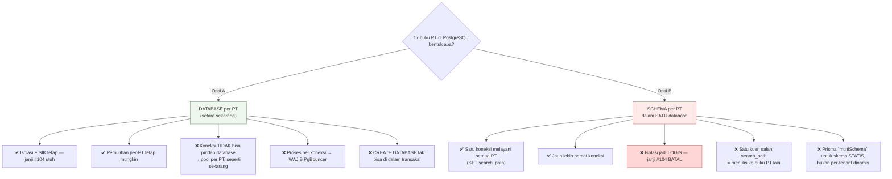
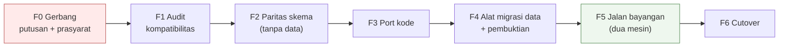

# 11 — Rencana Migrasi MariaDB → PostgreSQL

> Disusun 11 Oktober 2026 atas permintaan pemilik · [indeks](./README.md)

## 0. Status rencana ini

Dokumen ini **rencana pelaksanaan**, bukan rekomendasi untuk mengerjakannya
sekarang.

[Dok 10 §2](./10-PORTABILITAS-DAN-PEMISAHAN.md) menilai **jangan sekarang**, dan
penilaian itu tidak berubah: tidak ada satu pun keluhan terukur di repo ini yang
PostgreSQL selesaikan, sementara P0 cadangan masih terbuka. Rencana ini ada
supaya keputusan itu bisa **ditinjau dengan angka** alih-alih dengan selera —
dan supaya kalau pemicunya datang, pekerjaannya tidak dimulai dari nol.

**Gerbang untuk mulai mengerjakan (§1 harus terjawab "ya"):**

| | | per 12 Okt 2026 |
|---|---|---|
| Ada fitur PG yang MariaDB tidak punya DAN produk membutuhkannya | ❓ | belum dijawab |
| P0-1 & P0-2 (cadangan + kunci) sudah **ditutup** | 🟡 | **berubah** — jaring + alarm terpasang dan satu cadangan sudah **DIBUKTIKAN bisa dipulihkan**; S3 & kunci di luar mesin masih kurang |
| Ada lingkungan non-produksi untuk melatihnya | ❌ | belum ada |
| `verify` sudah menjadi *required status check* | ✅ | **SUDAH** sejak 11 Okt 2026 |

Dua dari empat masih merah, satu kuning. **Mengerjakan migrasi basis data tanpa
cadangan yang terbukti adalah risiko yang paling tidak perlu diambil siapa pun**
— dan baris kedua baru saja bergerak ke arah yang benar: per 12 Okt 2026 ada
artefak harian terenkripsi yang sudah lulus `prove-backup-restore` (19 basis data
di dalam dump). Yang belum ada tetap belum ada: salinan **di luar mesin ini**.

> **Audit kompatibilitas (F1) SUDAH DIJALANKAN** 12 Okt 2026 — hasilnya di
> [§9](#9-audit-kompatibilitas-f1--dijalankan-12-okt-2026). Tiga taksiran di
> dokumen ini berubah karenanya, dan dua di antaranya ke arah yang lebih murah.

## 1. Pertanyaan yang harus dijawab lebih dulu

Rencana teknis di bawah tidak ada artinya kalau pertanyaan ini belum dijawab.

| # | Pertanyaan | Kenapa menentukan |
|---|---|---|
| 1 | **Apa yang PostgreSQL berikan yang MariaDB 11 tidak?** | Kalau jawabannya "lebih modern" atau "lebih disukai", itu bukan pemicu teknis dan migrasinya akan memakan anggaran yang dibutuhkan P0 |
| 2 | Apakah tujuan sebenarnya **DC/DRC atau portabilitas VM**? | Keduanya **sudah bisa** dengan MariaDB (binlog PITR + replikasi). Lihat dok 10 §1 & §5 |
| 3 | Siapa yang akan **mengoperasikan** PG? | PgBouncer, `autovacuum`, WAL archiving, dan `pg_dumpall` adalah kompetensi operasional baru di kotak yang penjadwalnya saja pernah menggantung dua jam tanpa ada yang tahu |
| 4 | Berapa **jendela henti** yang dapat diterima? | Menentukan §6: *cutover* sekali-jalan (sederhana, henti lebih lama) vs replikasi logis (rumit, henti pendek) |

## 2. Keputusan arsitektural terbesar: bentuk multi-tenant di PostgreSQL

Ini **harus** diputuskan sebelum satu baris pun ditulis, karena ia menentukan
semua yang lain.



**Rekomendasi: Opsi A — database per PT, dengan PgBouncer.**

Opsi B lebih idiomatis di PostgreSQL dan jauh lebih hemat koneksi, tetapi ia
**membatalkan janji inti arsitektur ini**: isolasi fisik buku besar. Seluruh dok
02 §3 dan `docs/MULTI-COMPANY.md` berdiri di atas "kueri yang lupa
`WHERE company_id` tidak bisa mengembalikan baris PT lain — tidak ada baris PT
lain **di sana**". Dengan schema-per-tenant, `search_path` yang salah
mengembalikan kelas kegagalan itu, dan ia **senyap** — persis bentuk yang
seluruh repo ini dirancang menghindari.

> ⚠ Konsekuensi Opsi A yang harus dianggarkan: **PgBouncer wajib**, bukan
> opsional. PostgreSQL memakai **proses per koneksi** (~5–10 MB), bukan thread.
> Anggaran sekarang 11 koneksi dari `app-customer` di kotak 3,6 GB; tanpa pooler
> transaksi, angka itu menjadi ~11 proses PG sebelum menghitung `app-operator`
> dan empat job.

## 3. Inventaris perubahan — angka terukur

Diverifikasi langsung di repo pada 11 Oktober 2026.

### 3.1 Skema & migration

| Hal | Jumlah | Catatan |
|---|---|---|
| `provider = "mysql"` | **3** | perusahaan, kendali, platform |
| Berkas `migration.sql` | **99** | semuanya pakai identifier backtick |
| …memuat `INSERT`/`UPDATE` data | **21** | *dikoreksi 12 Okt (sebelumnya 14)* — perlu triage satu-satu; dua berkas memuat 29 dari seluruh pernyataannya |
| `COLLATE utf8mb4_unicode_ci` | **50 berkas** | *dikoreksi 12 Okt (sebelumnya 62)* — lihat §4, dan §9.3: diukur, dampaknya SATU baris |
| `@db.VarChar` | 246 | → `varchar` (langsung) |
| `@db.Decimal` | 116 | → `numeric` (langsung, presisi utuh) |
| `@db.Text` | 42 | → `text` |
| `@db.Date` | 2 | → `date` |

**Strategi migration: BASELINE, bukan tulis-ulang 99 berkas.** Riwayat
migration tidak punya nilai di mesin basis data baru; yang punya nilai adalah
**skema akhir**. Jadi: bangkitkan satu migration awal PG dari skema Prisma,
tandai sebagai applied (`migrate resolve`), lalu simpan 99 migration MySQL
sebagai arsip hanya-baca. **21 migration berisi data** ditriage terpisah:
mana yang backfill historis (tidak perlu diulang — datanya ikut bermigrasi) dan
mana yang penyemaian yang masih dibutuhkan PT baru.

### 3.2 Raw SQL — 25 titik

> ⚠ **Dikoreksi 12 Okt 2026:** **29** titik, bukan 25 — dan angka mana pun yang
> dihitung dengan menyapu seluruh `src/` akan melebihkan dua kali lipat, sebab
> `src/generated/` memuat 36 penyebutan yang bukan pemanggilan kita. Lihat
> [§9.4](#94-yang-benar-benar-harus-ditulis-ulang--dengan-berkasbaris).

Kabar baiknya lebih baik dari dugaan awal:

| Temuan | Status |
|---|---|
| Fungsi khas MySQL (`GROUP_CONCAT`, `DATE_FORMAT`, `IFNULL`, `UNIX_TIMESTAMP`) | ✅ **nol pemakaian** |
| `now()` (33×), `CONCAT` (24×) | ✅ keduanya ada di PostgreSQL |
| 12 pemeriksaan `check-data-conformance` | ✅ **portabel apa adanya** — derived table-nya beralias (`) x`), `UNION ALL` & `NOT IN` standar |
| Kueri `information_schema` | ⚠ **7 tempat** — nama kolom & semantik berbeda |
| `CREATE DATABASE … CHARACTER SET … COLLATE …` | ⚠ sintaks beda total |
| `DROP DATABASE` (penghapusan tenant) | ⚠ tak bisa di dalam transaksi di PG |
| Trigger immutability slug | ⚠ PG butuh `FUNCTION` + `TRIGGER` terpisah |
| Placeholder `?` | ⚠ PG memakai `$1`, `$2` — `$executeRawUnsafe("… WHERE id = ?")` harus diubah |

Titik `information_schema` yang terdampak:

```
src/lib/company-provisioning.ts   SCHEMATA, TABLES
src/lib/tenant-export.ts          tables, columns   (sapuan generik ekspor)
scripts/subscription-scheduler.ts SCHEMATA          (deteksi basis data yatim)
scripts/adopt-existing-company.ts tables, columns
scripts/prove-company-slug-immutable.ts triggers
scripts/pause-platform-billing.ts COLUMNS
```

Di PostgreSQL: `SCHEMATA` → `pg_database` (database ≠ schema!), `triggers` →
`pg_trigger`/`information_schema.triggers` dengan kolom berbeda. **Perhatikan
pergeseran makna**: di MySQL "database" = "schema"; di PG keduanya berbeda
tingkat, jadi kueri yang mencari *database* tidak boleh menanyai `SCHEMATA`.

### 3.3 Perkakas & operasi

| Hal | Sekarang | Jadi |
|---|---|---|
| Adapter Prisma | `@prisma/adapter-mariadb` | `@prisma/adapter-pg` |
| Image basis data | `mariadb:11` | `postgres:17` + **PgBouncer** |
| Dump cadangan | `mariadb-dump --all-databases` | `pg_dumpall` (atau `pg_dump` per database) |
| Pembuktian cadangan | `prove-backup-restore.ts` mencari penanda dump MySQL (`CREATE DATABASE /*!32312 …*/`, `USE \`db\``) | penanda `pg_dumpall` |
| Healthcheck compose | `healthcheck.sh --connect` | `pg_isready` |
| PITR | binlog | **WAL archiving** (lebih matang — satu-satunya keuntungan operasional yang nyata) |

## 4. ⚠ Jebakan: collation case-INSENSITIVE → case-SENSITIVE

> **DIUKUR 12 Okt 2026, dan judul bagian ini salah.** Ia ditulis "jebakan
> TERBESAR" sebelum ada angka. Hasil pengukurannya: **nol** varian huruf besar di
> seluruh data yang ada, **lima** jalur pencarian email semuanya sudah dinormalkan
> di aplikasi, dan sisanya **tepat satu baris** (`src/lib/auth.ts:116`, cabang
> username). Jebakan terbesar yang sesungguhnya adalah **koneksi** —
> [§9.5](#95-koneksi-biaya-operasional-yang-terukur-bukan-dugaan).
>
> Analisis di bawah tetap berlaku sebagai penjelasan **mekanismenya**; yang
> berubah hanya ukurannya. Rinciannya di
> [§9.3](#93--jebakan-collation-4-nyata-tapi-satu-baris--bukan-terbesar).

**Ini bukan masalah sintaksis, ini perubahan PERILAKU — dan ia senyap.**

50 berkas migration memakai `utf8mb4_unicode_ci` (*dihitung ulang 12 Okt:
sebelumnya tertulis 62*). Sufiks `_ci` =
*case-insensitive*. Artinya di MariaDB hari ini:

- `WHERE email = 'Budi@x.com'` **cocok** dengan baris `budi@x.com`
- `UNIQUE(username)` **menolak** `Admin` kalau `admin` sudah ada
- `ORDER BY name` mengurutkan tanpa peduli huruf besar/kecil

PostgreSQL **case-sensitive** secara bawaan. Setelah migrasi, ketiganya berubah
— tanpa satu pun galat.

**Yang sudah meringankan (diverifikasi):** aplikasi **sudah menormalkan huruf
kecil** di jalur-jalur terpenting sebelum menulis maupun menanyai:

```
src/lib/auth.ts:57              identifier.toLowerCase()
src/lib/registration.ts:164,244 toLowerCase()
src/lib/users-directory.ts:199  email.trim().toLowerCase()   (pencarian)
src/lib/users-directory.ts:232  email.trim().toLowerCase()   (penulisan)
src/lib/invitation-store.ts:63  email.trim().toLowerCase()
```

Jadi login, pendaftaran, direktori pengguna, dan undangan **aman**. Tetapi itu
belum seluruh permukaan.

**Yang WAJIB diaudit kolom demi kolom** sebelum cutover — setiap kolom teks
ber-`@unique` atau yang ikut dalam `WHERE`/`ORDER BY`:

| Kolom | Risiko |
|---|---|
| `tenants.slug`, `companies.slug` | dibangkitkan huruf kecil? **buktikan**, jangan asumsikan |
| `companies.database_name` | disaring `/^[A-Za-z0-9_]{1,64}$/` — **mengizinkan huruf besar** |
| `accounts.code`, `invoices.invoice_no`, `contracts.contract_no` | nomor dokumen; duplikat yang berbeda huruf akan **lolos** di PG |
| `site_settings.key`, `company_settings.key` | kunci pengaturan |
| `items.sku` / kode barang | sama |
| Kolom enum-like (`status`, `currency`) | nilainya `snake_case`/huruf besar — konsisten? |

**Cara menutupnya**, pilih satu per kolom:

1. **Normalkan di aplikasi** (pola yang sudah dipakai untuk email) — paling
   bersih, tetapi menuntut *backfill* data lama.
2. **Index fungsional**: `CREATE UNIQUE INDEX … ON t (lower(col))` — menjaga
   keunikan tanpa mengubah data.
3. **Kolom `citext`** (extension `citext`) — paling dekat dengan perilaku lama,
   tetapi menambah extension dan Prisma memetakannya sebagai `String` tanpa
   jaminan.

> **Gerbang yang tidak boleh dilewati:** sebelum cutover, jalankan atas data
> produksi — untuk **setiap** kolom teks ber-`@unique` —
> `SELECT lower(col), COUNT(*) FROM t GROUP BY 1 HAVING COUNT(*) > 1`.
> Baris apa pun yang kembali adalah duplikat yang **MariaDB tolak tapi PG
> terima**: ia akan lolos masuk, dan ketahuan berbulan-bulan kemudian sebagai
> dua pelanggan dengan nomor faktur yang "sama".

## 5. Fase pelaksanaan

Tiap fase berguna sendiri dan **bisa dibatalkan** tanpa membuang fase
sebelumnya.



### F0 — Gerbang (keputusan, bukan kode)
Jawab §1 tertulis. Tutup P0-1 & P0-2. Sediakan lingkungan non-produksi.
**Keluaran:** keputusan tertulis + Opsi A/B dipilih.

### F1 — Audit kompatibilitas (hanya-baca, nol risiko)
1. Skrip yang menjalankan **12 kueri kesesuaian** apa adanya di PG kosong →
   buktikan klaim "portabel" di §3.2.
2. ✅ **DIJALANKAN 12 Okt 2026** — 29 titik (bukan 25) dienumerasi; tujuh butir yang tidak portabel ada di §9.4 beserta berkas:baris.
3. **Audit collation §4** atas data produksi (kueri `HAVING COUNT(*) > 1`).
4. Triage 14 migration berisi data.

**Keluaran:** daftar pekerjaan yang terhitung, bukan ditaksir.
**Bisa dibatalkan:** ya, nol perubahan.

### F2 — Paritas skema (tanpa data)
1. Ubah `provider` → `postgresql` di tiga skema, di **cabang**.
2. `prisma migrate diff` → satu migration awal PG per skema.
3. Naikkan `postgres:17` + PgBouncer di compose **lingkungan uji**.
4. Buktikan bentuknya: jumlah tabel, kolom, index, constraint **sama** dengan
   MariaDB — dibandingkan dengan kueri, bukan dengan mata.

**Keluaran:** PG kosong yang bentuknya identik.

### F3 — Port kode
Adapter, 7 kueri `information_schema`, `CREATE`/`DROP DATABASE`, trigger slug,
placeholder `?`→`$n`, `backup.sh`, `prove-backup-restore.ts`, healthcheck.
Gerbangnya: **`bun run verify` hijau** — dan kini ada CI yang menegakkannya.

### F4 — Alat migrasi data + pembuktian
Alat per basis data (kendali → platform → tiap PT). **Dan di sinilah doktrin
repo ini paling penting**: buktikan lewat **angka pra/pasca yang dibaca
sendiri**, bukan lewat laporan alatnya.

Kewajiban pembuktian untuk sistem akuntansi — **per buku PT**:

| Harus cocok PERSIS | Kenapa |
|---|---|
| Jumlah baris **setiap** tabel | kehilangan senyap |
| **Σ debit = Σ kredit** | invarian buku besar |
| Σ debit & Σ kredit **per periode** | pergeseran agregat |
| Total Neraca & Laba-Rugi **sampai sen** | yang dibaca pengguna |
| Jumlah faktur per status | enum tidak bergeser |
| Σ `base_amount` valas | presisi `numeric` utuh |
| `MAX(id)` tiap tabel + **sequence** di atasnya | ⚠ sequence PG yang tidak di-reset = tabrakan PK pada insert pertama |

Baris terakhir adalah kegagalan khas migrasi MySQL→PG yang paling sering
terlewat: `AUTO_INCREMENT` pindah jadi `IDENTITY`/`serial`, dan kalau
sequence-nya tidak di-`setval` ke `MAX(id)`, insert pertama menabrak PK.

### F5 — Jalan bayangan
Jalankan PG **di samping** MariaDB (MariaDB tetap sumber kebenaran). Replay
lalu lintas baca; bandingkan keluaran laporan. Ini fase yang membeli keyakinan,
dan ia **bisa berlangsung berminggu-minggu tanpa risiko**.

### F6 — Cutover
Bekukan tulisan → dump final → muat → buktikan (§F4) → alihkan
`DATABASE_URL`/`CONTROL_*`/`PLATFORM_*` → naikkan → buktikan lagi.

**Rollback:** MariaDB **tetap hidup dan tidak disentuh** sampai berhari-hari
sesudahnya. Jendela rollback = selama tulisan belum masuk ke PG. Begitu
transaksi pelanggan pertama masuk PG, rollback berarti **kehilangan transaksi
itu** — jadi tulis batas waktunya sebelum mulai.

## 6. Yang tidak akan pernah mudah

Jujur di muka, supaya tidak menjadi kejutan:

| Hal | Kenapa sulit |
|---|---|
| **Collation** (§4) | Perubahan perilaku senyap, bukan galat |
| **Sequence setelah muat** | Terlewat = tabrakan PK pada insert pertama |
| **`CREATE DATABASE` saat provisioning** | Tak bisa di dalam transaksi di PG — alur pembuatan PT harus diurut ulang |
| **Anggaran koneksi** | Proses per koneksi; PgBouncer jadi komponen baru yang bisa mati diam-diam |
| **`tenant-export.ts`** | Sapuan generik `information_schema` adalah yang paling dalam menyentuh dialek |
| **Pembuktian cadangan** | `prove-backup-restore.ts` mencari penanda dump MySQL secara literal |

## 7. Alternatif yang mencapai tujuan yang sama, lebih murah

Kalau tujuan sebenarnya **bukan** fitur PostgreSQL:

| Tujuan | Jalan yang lebih murah |
|---|---|
| Portabilitas VM | Sudah ~80% siap — tutup P0-1/P0-2 ([dok 10 §1](./10-PORTABILITAS-DAN-PEMISAHAN.md)) |
| DC/DRC | Binlog PITR + replikasi MariaDB ([dok 10 §5](./10-PORTABILITAS-DAN-PEMISAHAN.md)) |
| RPO < 24 jam | Binlog shipping — **jauh** lebih murah daripada migrasi mesin |
| Ketahanan | Cadangan yang terbukti + latihan restore |
| "Lebih modern" | Bukan pemicu teknis |

## 8. Ringkasan

| | |
|---|---|
| **Bisa dilakukan?** | Ya. Tidak ada penghalang mendasar |
| **Bentuk yang disarankan** | Opsi A — database per PT + PgBouncer (menjaga janji #104) |
| **Risiko terbesar** | Collation case-insensitive → sensitive (§4), **senyap** |
| **Kejutan paling sering terlewat** | Sequence tidak di-`setval` → tabrakan PK |
| **Kabar baik** | Nol fungsi khas MySQL; 12 kueri kesesuaian portabel; email/username sudah dinormalkan |
| **Sebaiknya dilakukan sekarang?** | **Tidak** — tiga dari empat gerbang §0 masih merah, dan tidak ada pemicu teknis yang teridentifikasi |

Kalimat yang paling penting di dokumen ini: **migrasi basis data tanpa cadangan
yang terbukti bisa dipulihkan adalah risiko yang tidak perlu diambil siapa
pun.** Tutup P0-1 dan P0-2 lebih dulu — dan keduanya berusaha **rendah**.

---

## 9. Audit kompatibilitas (F1) — DIJALANKAN 12 Okt 2026

Fase F1 di §5 adalah "audit kompatibilitas, hanya-baca, nol risiko". Ia
dijalankan. Semua angka di bawah berasal dari basis data produksi dan pohon
kode, bukan dari taksiran — dan **tiga kesimpulan di dokumen ini berubah**.

### 9.1 Volume: soalnya bukan memindahkan data

| | |
|---|---|
| Basis data | **19** (kendali + platform + 17 buku PT) |
| Tabel | **1.084** (62 per buku × 17, + 16 kendali, + 14 platform) |
| Besar data+indeks | **≈78 MB** seluruhnya — buku terbesar `sai_production` 12 MB |
| Artefak cadangan | **1,7 MB** terenkripsi (dump + dokumen + jejak) |

Ini mengubah bentuk soalnya. Rencana ini — dan dok 10 — menimbang migrasi
seolah pemindahan datanya besar. Tidak. `pg_restore` atas 78 MB adalah
pekerjaan **menit**, bukan jam, dan jendela henti bukan lagi variabel yang
menentukan (§1 pertanyaan 4 jadi jauh lebih mudah dijawab).

Yang mahal adalah **kode dan kompetensi operasional**, dan hanya itu. Jangan
pakai argumen "datanya sudah terlalu besar untuk dipindah" ke arah mana pun:
angkanya tidak mendukungnya.

### 9.2 Paritas skema: jauh lebih murah dari yang ditakutkan

Seluruh tiga skema hanya memakai **empat** keluarga tipe native:

| Tipe | Jumlah | Di PostgreSQL |
|---|---|---|
| `@db.VarChar` | 247 | `varchar(n)` — setara |
| `@db.Decimal` | 116 | `numeric(p,s)` — setara, dan **lebih ketat** soal pembulatan |
| `@db.Text` | 43 | `text` — setara |
| `@db.Date` | 2 | `date` — setara |

**Nol** `@db.TinyInt`, **nol** `Json`, **nol** `Bytes`, **nol** enum native.
Disiplin `docs/DATABASE.md` ("enum-like = `String @db.VarChar` + `z.enum`") yang
dulu terasa bertele-tele ternyata membayar tepat di sini: tidak ada satu pun tipe
yang menuntut keputusan desain ulang saat berpindah.

**Dan 5.241 baris SQL di 99 berkas migration tidak perlu diport.** Skema Prisma
adalah sumber kebenarannya; PostgreSQL mendapat **baseline baru** yang
dibangkitkan dari skema itu. Yang perlu diperiksa manual hanya **21 migration
yang memuat pernyataan DATA** (`INSERT`/`UPDATE`/`DELETE`, komentar dibuang
sebelum dihitung) — bukan untuk dijalankan ulang, melainkan untuk memastikan
transformasi yang pernah mereka terapkan memang sudah terbaca di datanya.

Dua di antaranya memuat hampir separuh pernyataannya:
`0032_standard_role_positions` (17) dan `0037_add_missing_timestamps` (12).
Keduanya menanam **data baku**, bukan menambal data pelanggan — jadi di
PostgreSQL ia menjadi bagian dari *seeding* baseline, bukan migrasi.

### 9.3 ⚠ Jebakan collation (§4): nyata, tapi SATU BARIS — bukan "terbesar"

§4 menyebutnya "jebakan terbesar". Diukur, ia jauh lebih kecil — dan ini contoh
kenapa audit dijalankan alih-alih diperkirakan.

**Data yang ada sekarang tidak akan patah sama sekali:**

| Kolom | Baris | Varian huruf besar |
|---|---|---|
| `users.email` | 13 | **0** |
| `companies.slug` | 17 | **0** |
| `tenants.slug` | 11 | **0** |
| `accounts.code` (pt-sai) | 48 | **0** |

**Dan pencariannya sudah dinormalkan di lapisan aplikasi**, diperiksa satu per
satu:

| Jalur | Berkas | Normalisasi |
|---|---|---|
| Login | `src/lib/auth.ts:57` | ✅ `parsed.data.identifier.toLowerCase()` |
| Direktori pengguna | `src/lib/users-directory.ts:199` | ✅ `.trim().toLowerCase()` |
| Pendaftaran | `src/lib/registration-store.ts:51` | ✅ |
| Undangan | `src/lib/invitation-store.ts:66` | ✅ |
| Atur-ulang sandi | `src/lib/password-reset-store.ts:26` | ✅ |

**Sisanya tepat satu titik:** cabang **username** di `src/lib/auth.ts:116`
memakai `parsed.data.identifier` yang **belum** di-`toLowerCase()`, berbeda dari
cabang email di baris 113. Hari ini tak terlihat — collation
`utf8mb4_unicode_ci` memaafkannya, dan dibuktikan: mencari dengan email
huruf-besar masih menemukan barisnya. Di PostgreSQL, pengguna warisan pt-sai yang
masuk dengan `Budi` alih-alih `budi` akan ditolak sebagai **kredensial salah** —
kegagalan yang pesannya menyesatkan.

Yang tersisa sesudah itu bukan kerusakan melainkan **perubahan semantik ke
depan**: `@unique` di PostgreSQL akan mengizinkan `FOO` dan `foo` hidup
bersamaan. Kalau perilaku case-insensitive memang diinginkan, jawabannya
`citext` atau indeks `lower(...)` — keputusan per kolom, bukan satu sakelar.

### 9.4 Yang benar-benar harus ditulis ulang — dengan berkas:baris

Hasil sapuan **tanpa kode bangkitan**: **21 `$queryRaw`** + **8 `$executeRaw`**
= **29 titik** di 12 berkas. Mayoritas SQL biasa yang berpindah tanpa diubah.

> Sapuan pertama saya memulangkan 39 + 26. Selisihnya **18 + 18 dari
> `src/generated/`** — definisi metode di klien yang dibangkitkan Prisma, bukan
> pemanggilan kita. Taksiran permukaan port yang memasukkannya akan melebihkan
> pekerjaan lebih dari dua kali. (Angka "25 titik" di §3.2 ditulis sebelum
> pemisahan ini; **29** yang benar.)

Yang TIDAK berpindah apa adanya:

| # | Apa | Di mana | Kenapa |
|---|---|---|---|
| 1 | `information_schema.SCHEMATA` → `pg_database` | `src/lib/company-provisioning.ts:199`, `scripts/subscription-scheduler.ts:569` | Di PostgreSQL `SCHEMATA` berisi **skema di dalam satu basis data**, bukan daftar basis data. Query-nya *berhasil* dan memulangkan jawaban yang salah — bentuk kegagalan terburuk |
| 2 | `SHOW DATABASES` | `scripts/subscription-scheduler.ts:589` | Tidak ada di PostgreSQL |
| 3 | `CREATE DATABASE … CHARACTER SET utf8mb4 COLLATE utf8mb4_unicode_ci` | `src/lib/company-provisioning.ts:232`, `scripts/create-company.ts:174` | Sintaksis & opsi berbeda (`TEMPLATE`, `ENCODING`, `LC_COLLATE`) |
| 4 | `DROP DATABASE IF EXISTS` | `scripts/execute-tenant-deletion.ts:136` | Ada, tapi PostgreSQL menolak bila masih ada koneksi — butuh `pg_terminate_backend` lebih dulu |
| 5 | `INSERT … ON DUPLICATE KEY UPDATE` | `src/lib/rate-limit-persistent.ts:120` | → `ON CONFLICT (key) DO UPDATE`. Keatomikan jendelanya harus dipertahankan, bukan sekadar sintaksisnya diterjemahkan |
| 6 | **Trigger** `companies_slug_immutable` | `prisma/control/migrations/0010_companies_slug_immutable/migration.sql:48` + `scripts/prove-company-slug-immutable.ts:62` | PostgreSQL menuntut `CREATE FUNCTION … RETURNS trigger` lalu `CREATE TRIGGER` — bukan terjemahan, penulisan ulang. **Satu-satunya trigger** di seluruh pemasangan (dihitung di produksi: 1) |
| 7 | `information_schema.tables/columns` di ekspor & adopsi | `src/lib/tenant-export.ts:90,99`, `scripts/adopt-existing-company.ts:139,190` | Ada di PostgreSQL dengan nama sama, tapi `table_schema` berarti **skema**, bukan basis data — semantiknya bergeser mengikuti keputusan §2 |

**Yang BUKAN masalah, dan sudah diperiksa:** `CREATE DATABASE` tidak pernah
berada di dalam `$transaction` (`company-provisioning.ts` memuat **nol**
`$transaction`). PostgreSQL melarang `CREATE DATABASE` di dalam transaksi, jadi
ini akan menjadi jebakan diam — ternyata tidak ada.

### 9.5 Koneksi: biaya operasional yang terukur, bukan dugaan

Ini angka yang paling menentukan, dan baru ada sekarang:

| | |
|---|---|
| Koneksi aktif saat diukur | **13** |
| **Puncak sejak server hidup** | **62** |
| `max_connections` MariaDB | 151 |

MariaDB memakai **thread** per koneksi; PostgreSQL memakai **proses**. 62 proses
backend pada kotak **3,6 GB yang dibagi dengan lima aplikasi lain** bukan hal
sepele — dan itulah yang membuat **PgBouncer menjadi wajib, bukan opsional**.

Artinya satu komponen baru yang harus dioperasikan, dipantau, dan dipahami, di
kotak yang **penjadwalnya saja pernah menggantung dua jam tanpa ada yang tahu**.
Itu jawaban terukur untuk §1 pertanyaan 3, dan jawabannya tidak nyaman.

Perbesarnya ikut terbawa bentuk multi-tenant: pola klien per-perusahaan
(`POOL_MAX=4`, `connectionLimit` per klien) berarti jumlah koneksi tumbuh
mengikuti **jumlah buku yang aktif bersamaan**, bukan jumlah pengguna.

### 9.6 Putusan yang berubah, dan yang tidak

**Lebih murah dari yang ditulis sebelumnya:**

1. Volume data tidak relevan (78 MB) — jendela henti bukan lagi kendala.
2. Paritas skema mekanis — empat tipe, semuanya setara; 5.241 baris SQL
   migration tidak perlu diport.
3. Jebakan collation **satu baris** di kode, nol kerusakan data.

**Tidak berubah, dan ini yang menentukan:** PgBouncer + `autovacuum` + WAL
archiving adalah kompetensi operasional baru yang nyata, dan **§1 pertanyaan 1
masih belum terjawab** — tidak ada satu pun keluhan terukur yang PostgreSQL
selesaikan.

**Putusannya tetap: jangan sekarang.** Yang berubah adalah alasannya. Ia bukan
"terlalu mahal dan berisiko" lagi — pekerjaan kodenya ternyata sedang dan
terbatas. Ia **belum punya alasan**: migrasi yang berhasil sempurna pun tidak
akan membuat satu pun pengguna mendapat apa pun, sementara dua P0 cadangan masih
terbuka dan belum ada satu lingkungan pun untuk melatihnya.

Kalau pemicunya datang, §9.4 adalah daftar kerjanya — tujuh butir, berkas:baris,
sudah diverifikasi ada.

---

## 10. Rencana implementasi — dan apa yang SUDAH dikerjakan (12 Okt 2026)

§5 adalah fase konseptual. Bagian ini adalah **runbook**, dan sebagian besarnya
sudah dijalankan: seluruh data platform sudah pernah berpindah ke PostgreSQL
sungguhan dan dibuktikan identik. Yang belum adalah port kode aplikasi dan
penukaran.

> **Status ringkas.** Fase A–D **SELESAI & TERBUKTI**. Fase E (penukaran)
> **BELUM**, dan sengaja: ia menuntut keputusan pemilik pada saatnya.
>
> Artinya seluruh pekerjaan TEKNIS migrasi sudah selesai dan terbukti. Yang
> tersisa bukan kode, melainkan tiga prasyarat operasional dan satu keputusan.

### Fase A — paritas skema ✅ SELESAI

**Masalah yang ditutup lebih dulu:** 18 kolom FK yang indeksnya dibuat MySQL
secara implisit, yang di PostgreSQL **tidak akan ada** (242 indeks di 17 buku).
Lihat [dok 13 §S1](./13-AUDIT-SKEMA.md). Dikerjakan **sebelum** pindah mesin
supaya teruji produksi lebih dulu — migration `0065` / `0018` / `0019`.

```bash
bun run pg:baseline      # turunkan skema PG + baseline SQL dari skema kanonik
```

Skema PostgreSQL **bukan berkas tulisan tangan**: ia diturunkan dari
`prisma/*.prisma` dengan **satu** perubahan — baris `provider`.
`tests/pg-baseline-parity.test.ts` membangkitkannya ulang di memori dan menolak
kalau yang ter-commit berbeda, jadi dua skema tidak bisa menyimpang diam-diam.

**Terbukti:** himpunan indeks PostgreSQL **identik** dengan MariaDB —
perusahaan 257, kendali 59, platform 44; nol hilang, nol tambahan. Dibandingkan
sebagai *himpunan kolom*, bukan sebagai jumlah.

### Fase B — pemindahan data ✅ SELESAI & TERBUKTI

```bash
bun run pg:data  --source mysql://…/<db> --target postgres://…/<db>
bun run pg:prove --source mysql://…/<db> --target postgres://…/<db>
```

Migratornya **generik**: daftar tabel dan kolom dibaca dari `information_schema`,
bukan diketik. 1.084 tabel membuat kode per-tabel pasti tertinggal pada tabel
berikutnya — aturan yang sama dengan `--all-databases` di `backup.sh`.

Tiga keputusan yang menentukan benarnya:

1. **FK ditunda, bukan dilewati.** `SET session_replication_role = replica`
   selama pemuatan — sebab `journals.reversal_of_id` menunjuk `journals` sendiri,
   jadi urutan topologis tidak ada. Sesudahnya dikembalikan ke `origin` dan
   **setiap FK dihitung baris yatimnya**; satu saja menggagalkan skripnya.
2. **Uang tidak pernah melewati `Number`.** `Decimal` dibaca sebagai string dan
   dikirim sebagai string. Pembulatan diam di atas 2^53 adalah kerusakan yang
   jumlah barisnya tetap cocok.
3. **Boolean disesuaikan eksplisit.** MySQL memulangkan `0`/`1`; `"0"` bernilai
   **benar** di JavaScript. Tanpa langkah ini setiap master data nonaktif hidup
   kembali — tanpa galat, dengan jumlah baris sempurna.

**Dijalankan terhadap seluruh produksi, ke PostgreSQL 17 bayangan:**

| | |
|---|---|
| Basis data dipindahkan | **19 / 19** (kendali + platform + 17 buku) |
| Baris | 27.452 di `sai_production` saja |
| FK diperiksa | semuanya, **nol baris yatim** |
| Sequence digeser | 15 + 13 + 61 per buku |
| **`pg:prove`** | **6.310 pembandingan · 19 identik · 0 beda** |

`pg:prove` membandingkan empat hal yang kerusakannya **tidak mengubah jumlah
baris**: jumlah baris per tabel, **jumlah setiap kolom uang sebagai teks**,
benar/salah/null setiap boolean, dan rentang min–maks setiap kolom waktu.

Contoh yang paling meyakinkan: `cash_movements` 18.689 baris —
debit `81.360.154.872,21` dan kredit `1.548.932.904.858,88` **sama sampai sen**
di kedua mesin; `supplier_transactions.is_opening` **0/4.893** di keduanya
(kalau jebakan boolean menyala, PostgreSQL akan menjawab 4.893/0).

### Fase C — PostgreSQL bayangan ✅ SELESAI

```bash
docker run -d --name sai-pg-bayangan --network sai-accounting_internal \
  -e POSTGRES_USER=sai -e POSTGRES_PASSWORD=… --memory 512m postgres:17-alpine
```

PostgreSQL 17.11, 512 MB, di jaringan internal yang sama. Migrator dijalankan
**di dalam** jaringan itu (host tidak bisa meresolusi `db`).

### Fase D — port kode aplikasi ✅ SELESAI (12 Okt 2026)

Permukaannya **29 titik** raw SQL (bukan 65 — lihat §9.4), dan hanya **tujuh**
yang tidak portabel. Yang sudah: adapter `@prisma/adapter-pg@7.5.0` + `pg`
terpasang sebagai dependensi produksi, dipatok sama persis dengan
`@prisma/client`.

| # | Titik | Perubahan | Status |
|---|---|---|---|
| 1 | `src/lib/control-db.ts`, `platform-db.ts`, `company-clients.ts` | pilih adapter dari skema URL | ✅ **SELESAI** — `db-engine.ts` + `db-adapter.ts`; ketiganya kini memanggil `buatAdapter(url, …)` |
| 2 | `src/lib/rate-limit-persistent.ts` | `ON DUPLICATE KEY UPDATE` → `ON CONFLICT` | ✅ **SELESAI** — dua pernyataan berdampingan, bukan satu abstraksi |
| 3 | `prisma/control/migrations/0010_…` | trigger → `CREATE FUNCTION … RETURNS trigger` | ✅ **SELESAI & TERBUKTI** — `prisma/postgresql/control/0002_slug_permanen` |
| 4 | `src/lib/company-provisioning.ts` | **`db-server.ts`** — antarmuka SEMANTIK (`adakah`/`buat`/`jumlahTabel`/`hapus`), bukan penerus SQL | ✅ **SELESAI & TERBUKTI** |
| 5 | `src/lib/tenant-export.ts` | `DATABASE()` → `current_schema()`, penanda `?` → `$1` | ✅ SELESAI |
| 6 | `scripts/subscription-scheduler.ts` | `information_schema.SCHEMATA` → `pg_database` | ✅ SELESAI |
| 7 | `scripts/execute-tenant-deletion.ts` | lepaskan klien → `pg_terminate_backend` → `DROP DATABASE` | ✅ SELESAI & TERBUKTI |
| 8 | `scripts/backup.sh` + `Dockerfile` | `pg_dumpall` bila URL `postgres://`; **`postgresql-client-17` dari PGDG** | ✅ SELESAI — lihat koreksi di bawah |
| 9 | `docker-compose.yml` | `pg` + `pgbouncer`, **`profiles: ["postgres"]`** — lahir TIDAK aktif | ✅ SELESAI & TERBUKTI |

**Butir 4 — kenapa ia menuntut abstraksi, bukan tambalan.** Perbedaannya bukan
sintaksis kecil, melainkan KONSEP: `information_schema.SCHEMATA` di PostgreSQL
berisi **skema di dalam satu basis data**, bukan daftar basis data — jadi query
gaya MySQL **berhasil dan memulangkan jawaban yang salah**. Katalog tabel pun
bersifat per-basis-data, tanpa tampilan lintas-basis-data. Maka `db-server.ts`
mengabstraksi MAKSUDNYA, dan penyediaan berhenti menulis satu baris SQL pun —
tidak ada SQL MySQL yang bisa tertinggal di sana.

Ikut diputuskan di situ: **PostgreSQL tidak menjalankan 65 migration MariaDB.**
Perusahaan baru mendapat baseline yang diturunkan dari skema yang sama, jadi
hasilnya identik dengan buku yang bermigrasi lewat 65 langkah — dibuktikan:
**62 tabel**, sama persis dengan MariaDB.

**Dibuktikan ujung-ke-ujung terhadap PostgreSQL 17 lewat compose:**

| | |
|---|---|
| `pg` lewat `--profile postgres` | `healthy`, dan `data_checksums = on` — satu-satunya kesempatan memasangnya adalah saat inisialisasi |
| `adakah` | `false` → `buat` → `true` → `hapus` → `false` |
| `jumlahTabel` | `0` kosong → **`62`** sesudah baseline |
| `hapus` dengan koneksi aktif | koneksi lain diputus, penghapusan berhasil |
| Bawaan `docker compose up -d` | **7 service** — `pg`/`pgbouncer` TIDAK ikut hidup |

**Satu cacat ditemukan HANYA karena dijalankan.** Percobaan pertama mati dengan
*"Connection terminated unexpectedly"* tepat setelah penghapusan berhasil:
koneksi yang diputus dari sisi server membuat klien `pg` memancarkan event
`error` yang, tanpa pendengar, **menjatuhkan prosesnya**. Di penghapusan tenant
bermultiple buku itu berarti buku pertama terhapus lalu skripnya mati —
meninggalkan tenant separuh terhapus.

Perbaikannya `company-clients.ts#releaseCompanyClient`: lepaskan klien **sebelum**
menghapus. Di MariaDB langkah itu tidak dibutuhkan tetapi tidak merugikan, dan
satu urutan untuk kedua mesin lebih mudah dipercaya daripada dua.

> `tsc` tidak akan pernah menemukan ini. Hanya menjalankannya yang bisa.

#### Koreksi butir 8 — klien PostgreSQL yang terlalu tua

Butir 8 mula-mula memasang `postgresql-client` apa adanya. Di Debian bookworm itu
versi **15**, sementara service `pg` adalah **17** — dan `pg_dump` **menolak**
server yang lebih baru daripada dirinya. Diukur di image yang baru dibangun:

```
pg_dumpall: error: aborting because of server version mismatch
detail: server version: 17.11; pg_dumpall version: 15.19
```

Yang membuatnya berbahaya bukan kesalahannya, melainkan **waktunya**: nol gagal
saat membangun image, nol gagal di `verify`, dan nol gagal selama produksi masih
MariaDB. Ia akan gagal pada cadangan **PERTAMA sesudah penukaran** — hari ketika
cadangan paling dibutuhkan dan paling sedikit diperiksa.

Diperbaiki: klien diambil dari repositori resmi PostgreSQL (PGDG) dan **dipatok
`postgresql-client-17`**. Dibuktikan di container bersih —
`pg_dumpall (PostgreSQL) 17.11`, sejajar dengan servernya.

Arahnya penting: klien yang lebih **baru** bisa mendump server yang lebih tua,
jadi aturannya bukan "harus sama" melainkan **klien ≥ server**.
`tests/pg-client-version.test.ts` menegakkannya dengan membaca kedua berkas dan
membandingkan versi mayornya — dan sudah dilihat merah lebih dulu.

**Temuan saat mengerjakan butir 3, dan ia menggeneralisasi:** baseline PostgreSQL
**dibangkitkan Prisma**, dan Prisma tidak tahu apa pun tentang trigger — baseline
yang dihasilkan memuat **nol** trigger. Tanpa padanan tulis-tangan, pindah mesin
akan MENGHAPUS penjaga keabadian slug tanpa satu pun galat. Padanannya sudah
ditulis dan **dibuktikan di PostgreSQL bayangan**: mengubah slug ditolak dengan
pesan yang sama persis, menulis ulang slug dengan nilai yang sama tetap lolos.
`tests/pg-trigger-parity.test.ts` menolak trigger berikutnya yang tak punya
padanan.

Aturan umumnya: **apa pun yang tidak hidup di skema Prisma tidak akan ikut
terbangkitkan** — trigger, fungsi, view, grant. Daftar itu harus diperiksa manual
setiap kali, dan trigger adalah satu-satunya yang ada hari ini.

### Fase E — penukaran ❌ BELUM, dan menuntut keputusan

```
1. Umumkan jendela henti (menit, bukan jam — 78 MB, lihat §9.1)
2. Hentikan app-customer & app-operator        (bukan db — ia masih dibaca)
3. bun run pg:data  untuk 19 basis data
4. bun run pg:prove untuk 19 basis data        ← GERBANG: harus 0 beda
5. Tukar DATABASE_URL / CONTROL_ / PLATFORM_ ke postgres://
6. Naikkan app-*; periksa /api/health
7. MariaDB DIBIARKAN HIDUP minimal 7 hari      ← jalan mundur
```

Langkah 7 yang membuat ini bisa dibatalkan: selama MariaDB masih utuh dan tidak
ditulisi, kembali berarti menukar `DATABASE_URL` balik — **detik, bukan
pemulihan**.

**Prasyarat yang BELUM terpenuhi:**

| | |
|---|---|
| Cadangan **di luar mesin** | ❌ `BACKUP_S3_BUCKET` masih kosong (jaring lokal + alarm sudah ada sejak 12 Okt) |
| Kunci enkripsi di luar server | ❌ `BACKUP_ENCRYPTION_KEY` masih hanya di `.env` |
| Lingkungan non-produksi | ❌ belum ada |
| Fase D | ✅ **selesai** 12 Okt 2026 — sembilan butir, semuanya terbukti |

### 10.1 Yang berubah dari §0 sesudah ini dijalankan

§0 menilai migrasinya "mahal dan berisiko". Sesudah A–C dijalankan, penilaian itu
tidak lagi akurat dalam dua hal, dan **tetap akurat** dalam satu:

- **Pemindahan datanya tidak berisiko lagi** — ia sudah dilakukan, 19/19,
  6.310 pembandingan, nol beda. Dan ia **dapat diulang**: dua perintah.
- **Paritas skema tidak perlu dipercaya** — ia dibangkitkan dan diuji.
- **Tetap akurat:** PgBouncer, `autovacuum`, dan WAL archiving adalah kompetensi
  operasional baru. **Dan §1 pertanyaan 1 masih belum terjawab.**

Jadi putusan §0 tidak berubah sebagai *rekomendasi*. Yang berubah: kalau pemilik
memutuskan pindah, pekerjaannya kini **diketahui, terbukti, dan dapat diulang** —
bukan diperkirakan.
