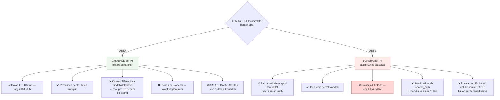
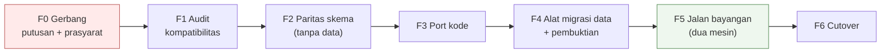

# 11 — Rencana Migrasi MariaDB → PostgreSQL

> Disusun 11 Oktober 2026 atas permintaan pemilik · [indeks](./README.md)

## 0. Status rencana ini

Dokumen ini **rencana pelaksanaan**, bukan rekomendasi untuk mengerjakannya
sekarang.

[Dok 10 §2](./10-PORTABILITAS-DAN-PEMISAHAN.md) menilai **jangan sekarang**, dan
penilaian itu tidak berubah: tidak ada satu pun keluhan terukur di repo ini yang
PostgreSQL selesaikan, sementara P0 cadangan masih terbuka. Rencana ini ada
supaya keputusan itu bisa **ditinjau dengan angka** alih-alih dengan selera —
dan supaya kalau pemicunya datang, pekerjaannya tidak dimulai dari nol.

**Gerbang untuk mulai mengerjakan (§1 harus terjawab "ya"):**

| | |
|---|---|
| Ada fitur PG yang MariaDB tidak punya DAN produk membutuhkannya | ❓ |
| P0-1 & P0-2 (cadangan + kunci) sudah **ditutup** | ❌ belum |
| Ada lingkungan non-produksi untuk melatihnya | ❌ belum ada |
| `verify` sudah menjadi *required status check* | ❌ belum |

Tiga dari empat masih merah. **Mengerjakan migrasi basis data tanpa cadangan
yang terbukti adalah bentuk risiko yang paling tidak perlu diambil siapa pun.**

## 1. Pertanyaan yang harus dijawab lebih dulu

Rencana teknis di bawah tidak ada artinya kalau pertanyaan ini belum dijawab.

| # | Pertanyaan | Kenapa menentukan |
|---|---|---|
| 1 | **Apa yang PostgreSQL berikan yang MariaDB 11 tidak?** | Kalau jawabannya "lebih modern" atau "lebih disukai", itu bukan pemicu teknis dan migrasinya akan memakan anggaran yang dibutuhkan P0 |
| 2 | Apakah tujuan sebenarnya **DC/DRC atau portabilitas VM**? | Keduanya **sudah bisa** dengan MariaDB (binlog PITR + replikasi). Lihat dok 10 §1 & §5 |
| 3 | Siapa yang akan **mengoperasikan** PG? | PgBouncer, `autovacuum`, WAL archiving, dan `pg_dumpall` adalah kompetensi operasional baru di kotak yang penjadwalnya saja pernah menggantung dua jam tanpa ada yang tahu |
| 4 | Berapa **jendela henti** yang dapat diterima? | Menentukan §6: *cutover* sekali-jalan (sederhana, henti lebih lama) vs replikasi logis (rumit, henti pendek) |

## 2. Keputusan arsitektural terbesar: bentuk multi-tenant di PostgreSQL

Ini **harus** diputuskan sebelum satu baris pun ditulis, karena ia menentukan
semua yang lain.



**Rekomendasi: Opsi A — database per PT, dengan PgBouncer.**

Opsi B lebih idiomatis di PostgreSQL dan jauh lebih hemat koneksi, tetapi ia
**membatalkan janji inti arsitektur ini**: isolasi fisik buku besar. Seluruh dok
02 §3 dan `docs/MULTI-COMPANY.md` berdiri di atas "kueri yang lupa
`WHERE company_id` tidak bisa mengembalikan baris PT lain — tidak ada baris PT
lain **di sana**". Dengan schema-per-tenant, `search_path` yang salah
mengembalikan kelas kegagalan itu, dan ia **senyap** — persis bentuk yang
seluruh repo ini dirancang menghindari.

> ⚠ Konsekuensi Opsi A yang harus dianggarkan: **PgBouncer wajib**, bukan
> opsional. PostgreSQL memakai **proses per koneksi** (~5–10 MB), bukan thread.
> Anggaran sekarang 11 koneksi dari `app-customer` di kotak 3,6 GB; tanpa pooler
> transaksi, angka itu menjadi ~11 proses PG sebelum menghitung `app-operator`
> dan empat job.

## 3. Inventaris perubahan — angka terukur

Diverifikasi langsung di repo pada 11 Oktober 2026.

### 3.1 Skema & migration

| Hal | Jumlah | Catatan |
|---|---|---|
| `provider = "mysql"` | **3** | perusahaan, kendali, platform |
| Berkas `migration.sql` | **98** | semuanya pakai identifier backtick |
| …memuat `INSERT`/`UPDATE` data | **14** | perlu triage satu-satu |
| `COLLATE utf8mb4_unicode_ci` | **62 berkas** | ⚠ lihat §4 — ini jebakan terbesar |
| `@db.VarChar` | 246 | → `varchar` (langsung) |
| `@db.Decimal` | 116 | → `numeric` (langsung, presisi utuh) |
| `@db.Text` | 42 | → `text` |
| `@db.Date` | 2 | → `date` |

**Strategi migration: BASELINE, bukan tulis-ulang 98 berkas.** Riwayat 98
migration tidak punya nilai di mesin basis data baru; yang punya nilai adalah
**skema akhir**. Jadi: bangkitkan satu migration awal PG dari skema Prisma,
tandai sebagai applied (`migrate resolve`), lalu simpan 98 migration MySQL
sebagai arsip hanya-baca. **14 migration berisi data** ditriage terpisah:
mana yang backfill historis (tidak perlu diulang — datanya ikut bermigrasi) dan
mana yang penyemaian yang masih dibutuhkan PT baru.

### 3.2 Raw SQL — 25 titik

Kabar baiknya lebih baik dari dugaan awal:

| Temuan | Status |
|---|---|
| Fungsi khas MySQL (`GROUP_CONCAT`, `DATE_FORMAT`, `IFNULL`, `UNIX_TIMESTAMP`) | ✅ **nol pemakaian** |
| `now()` (33×), `CONCAT` (24×) | ✅ keduanya ada di PostgreSQL |
| 12 pemeriksaan `check-data-conformance` | ✅ **portabel apa adanya** — derived table-nya beralias (`) x`), `UNION ALL` & `NOT IN` standar |
| Kueri `information_schema` | ⚠ **7 tempat** — nama kolom & semantik berbeda |
| `CREATE DATABASE … CHARACTER SET … COLLATE …` | ⚠ sintaks beda total |
| `DROP DATABASE` (penghapusan tenant) | ⚠ tak bisa di dalam transaksi di PG |
| Trigger immutability slug | ⚠ PG butuh `FUNCTION` + `TRIGGER` terpisah |
| Placeholder `?` | ⚠ PG memakai `$1`, `$2` — `$executeRawUnsafe("… WHERE id = ?")` harus diubah |

Titik `information_schema` yang terdampak:

```
src/lib/company-provisioning.ts   SCHEMATA, TABLES
src/lib/tenant-export.ts          tables, columns   (sapuan generik ekspor)
scripts/subscription-scheduler.ts SCHEMATA          (deteksi basis data yatim)
scripts/adopt-existing-company.ts tables, columns
scripts/prove-company-slug-immutable.ts triggers
scripts/pause-platform-billing.ts COLUMNS
```

Di PostgreSQL: `SCHEMATA` → `pg_database` (database ≠ schema!), `triggers` →
`pg_trigger`/`information_schema.triggers` dengan kolom berbeda. **Perhatikan
pergeseran makna**: di MySQL "database" = "schema"; di PG keduanya berbeda
tingkat, jadi kueri yang mencari *database* tidak boleh menanyai `SCHEMATA`.

### 3.3 Perkakas & operasi

| Hal | Sekarang | Jadi |
|---|---|---|
| Adapter Prisma | `@prisma/adapter-mariadb` | `@prisma/adapter-pg` |
| Image basis data | `mariadb:11` | `postgres:17` + **PgBouncer** |
| Dump cadangan | `mariadb-dump --all-databases` | `pg_dumpall` (atau `pg_dump` per database) |
| Pembuktian cadangan | `prove-backup-restore.ts` mencari penanda dump MySQL (`CREATE DATABASE /*!32312 …*/`, `USE \`db\``) | penanda `pg_dumpall` |
| Healthcheck compose | `healthcheck.sh --connect` | `pg_isready` |
| PITR | binlog | **WAL archiving** (lebih matang — satu-satunya keuntungan operasional yang nyata) |

## 4. ⚠ Jebakan terbesar: collation case-INSENSITIVE → case-SENSITIVE

**Ini bukan masalah sintaksis, ini perubahan PERILAKU — dan ia senyap.**

62 berkas migration memakai `utf8mb4_unicode_ci`. Sufiks `_ci` =
*case-insensitive*. Artinya di MariaDB hari ini:

- `WHERE email = 'Budi@x.com'` **cocok** dengan baris `budi@x.com`
- `UNIQUE(username)` **menolak** `Admin` kalau `admin` sudah ada
- `ORDER BY name` mengurutkan tanpa peduli huruf besar/kecil

PostgreSQL **case-sensitive** secara bawaan. Setelah migrasi, ketiganya berubah
— tanpa satu pun galat.

**Yang sudah meringankan (diverifikasi):** aplikasi **sudah menormalkan huruf
kecil** di jalur-jalur terpenting sebelum menulis maupun menanyai:

```
src/lib/auth.ts:57              identifier.toLowerCase()
src/lib/registration.ts:164,244 toLowerCase()
src/lib/users-directory.ts:199  email.trim().toLowerCase()   (pencarian)
src/lib/users-directory.ts:232  email.trim().toLowerCase()   (penulisan)
src/lib/invitation-store.ts:63  email.trim().toLowerCase()
```

Jadi login, pendaftaran, direktori pengguna, dan undangan **aman**. Tetapi itu
belum seluruh permukaan.

**Yang WAJIB diaudit kolom demi kolom** sebelum cutover — setiap kolom teks
ber-`@unique` atau yang ikut dalam `WHERE`/`ORDER BY`:

| Kolom | Risiko |
|---|---|
| `tenants.slug`, `companies.slug` | dibangkitkan huruf kecil? **buktikan**, jangan asumsikan |
| `companies.database_name` | disaring `/^[A-Za-z0-9_]{1,64}$/` — **mengizinkan huruf besar** |
| `accounts.code`, `invoices.invoice_no`, `contracts.contract_no` | nomor dokumen; duplikat yang berbeda huruf akan **lolos** di PG |
| `site_settings.key`, `company_settings.key` | kunci pengaturan |
| `items.sku` / kode barang | sama |
| Kolom enum-like (`status`, `currency`) | nilainya `snake_case`/huruf besar — konsisten? |

**Cara menutupnya**, pilih satu per kolom:

1. **Normalkan di aplikasi** (pola yang sudah dipakai untuk email) — paling
   bersih, tetapi menuntut *backfill* data lama.
2. **Index fungsional**: `CREATE UNIQUE INDEX … ON t (lower(col))` — menjaga
   keunikan tanpa mengubah data.
3. **Kolom `citext`** (extension `citext`) — paling dekat dengan perilaku lama,
   tetapi menambah extension dan Prisma memetakannya sebagai `String` tanpa
   jaminan.

> **Gerbang yang tidak boleh dilewati:** sebelum cutover, jalankan atas data
> produksi — untuk **setiap** kolom teks ber-`@unique` —
> `SELECT lower(col), COUNT(*) FROM t GROUP BY 1 HAVING COUNT(*) > 1`.
> Baris apa pun yang kembali adalah duplikat yang **MariaDB tolak tapi PG
> terima**: ia akan lolos masuk, dan ketahuan berbulan-bulan kemudian sebagai
> dua pelanggan dengan nomor faktur yang "sama".

## 5. Fase pelaksanaan

Tiap fase berguna sendiri dan **bisa dibatalkan** tanpa membuang fase
sebelumnya.



### F0 — Gerbang (keputusan, bukan kode)
Jawab §1 tertulis. Tutup P0-1 & P0-2. Sediakan lingkungan non-produksi.
**Keluaran:** keputusan tertulis + Opsi A/B dipilih.

### F1 — Audit kompatibilitas (hanya-baca, nol risiko)
1. Skrip yang menjalankan **12 kueri kesesuaian** apa adanya di PG kosong →
   buktikan klaim "portabel" di §3.2.
2. Enumerasi 25 titik raw SQL; tandai portabel / perlu ubah.
3. **Audit collation §4** atas data produksi (kueri `HAVING COUNT(*) > 1`).
4. Triage 14 migration berisi data.

**Keluaran:** daftar pekerjaan yang terhitung, bukan ditaksir.
**Bisa dibatalkan:** ya, nol perubahan.

### F2 — Paritas skema (tanpa data)
1. Ubah `provider` → `postgresql` di tiga skema, di **cabang**.
2. `prisma migrate diff` → satu migration awal PG per skema.
3. Naikkan `postgres:17` + PgBouncer di compose **lingkungan uji**.
4. Buktikan bentuknya: jumlah tabel, kolom, index, constraint **sama** dengan
   MariaDB — dibandingkan dengan kueri, bukan dengan mata.

**Keluaran:** PG kosong yang bentuknya identik.

### F3 — Port kode
Adapter, 7 kueri `information_schema`, `CREATE`/`DROP DATABASE`, trigger slug,
placeholder `?`→`$n`, `backup.sh`, `prove-backup-restore.ts`, healthcheck.
Gerbangnya: **`bun run verify` hijau** — dan kini ada CI yang menegakkannya.

### F4 — Alat migrasi data + pembuktian
Alat per basis data (kendali → platform → tiap PT). **Dan di sinilah doktrin
repo ini paling penting**: buktikan lewat **angka pra/pasca yang dibaca
sendiri**, bukan lewat laporan alatnya.

Kewajiban pembuktian untuk sistem akuntansi — **per buku PT**:

| Harus cocok PERSIS | Kenapa |
|---|---|
| Jumlah baris **setiap** tabel | kehilangan senyap |
| **Σ debit = Σ kredit** | invarian buku besar |
| Σ debit & Σ kredit **per periode** | pergeseran agregat |
| Total Neraca & Laba-Rugi **sampai sen** | yang dibaca pengguna |
| Jumlah faktur per status | enum tidak bergeser |
| Σ `base_amount` valas | presisi `numeric` utuh |
| `MAX(id)` tiap tabel + **sequence** di atasnya | ⚠ sequence PG yang tidak di-reset = tabrakan PK pada insert pertama |

Baris terakhir adalah kegagalan khas migrasi MySQL→PG yang paling sering
terlewat: `AUTO_INCREMENT` pindah jadi `IDENTITY`/`serial`, dan kalau
sequence-nya tidak di-`setval` ke `MAX(id)`, insert pertama menabrak PK.

### F5 — Jalan bayangan
Jalankan PG **di samping** MariaDB (MariaDB tetap sumber kebenaran). Replay
lalu lintas baca; bandingkan keluaran laporan. Ini fase yang membeli keyakinan,
dan ia **bisa berlangsung berminggu-minggu tanpa risiko**.

### F6 — Cutover
Bekukan tulisan → dump final → muat → buktikan (§F4) → alihkan
`DATABASE_URL`/`CONTROL_*`/`PLATFORM_*` → naikkan → buktikan lagi.

**Rollback:** MariaDB **tetap hidup dan tidak disentuh** sampai berhari-hari
sesudahnya. Jendela rollback = selama tulisan belum masuk ke PG. Begitu
transaksi pelanggan pertama masuk PG, rollback berarti **kehilangan transaksi
itu** — jadi tulis batas waktunya sebelum mulai.

## 6. Yang tidak akan pernah mudah

Jujur di muka, supaya tidak menjadi kejutan:

| Hal | Kenapa sulit |
|---|---|
| **Collation** (§4) | Perubahan perilaku senyap, bukan galat |
| **Sequence setelah muat** | Terlewat = tabrakan PK pada insert pertama |
| **`CREATE DATABASE` saat provisioning** | Tak bisa di dalam transaksi di PG — alur pembuatan PT harus diurut ulang |
| **Anggaran koneksi** | Proses per koneksi; PgBouncer jadi komponen baru yang bisa mati diam-diam |
| **`tenant-export.ts`** | Sapuan generik `information_schema` adalah yang paling dalam menyentuh dialek |
| **Pembuktian cadangan** | `prove-backup-restore.ts` mencari penanda dump MySQL secara literal |

## 7. Alternatif yang mencapai tujuan yang sama, lebih murah

Kalau tujuan sebenarnya **bukan** fitur PostgreSQL:

| Tujuan | Jalan yang lebih murah |
|---|---|
| Portabilitas VM | Sudah ~80% siap — tutup P0-1/P0-2 ([dok 10 §1](./10-PORTABILITAS-DAN-PEMISAHAN.md)) |
| DC/DRC | Binlog PITR + replikasi MariaDB ([dok 10 §5](./10-PORTABILITAS-DAN-PEMISAHAN.md)) |
| RPO < 24 jam | Binlog shipping — **jauh** lebih murah daripada migrasi mesin |
| Ketahanan | Cadangan yang terbukti + latihan restore |
| "Lebih modern" | Bukan pemicu teknis |

## 8. Ringkasan

| | |
|---|---|
| **Bisa dilakukan?** | Ya. Tidak ada penghalang mendasar |
| **Bentuk yang disarankan** | Opsi A — database per PT + PgBouncer (menjaga janji #104) |
| **Risiko terbesar** | Collation case-insensitive → sensitive (§4), **senyap** |
| **Kejutan paling sering terlewat** | Sequence tidak di-`setval` → tabrakan PK |
| **Kabar baik** | Nol fungsi khas MySQL; 12 kueri kesesuaian portabel; email/username sudah dinormalkan |
| **Sebaiknya dilakukan sekarang?** | **Tidak** — tiga dari empat gerbang §0 masih merah, dan tidak ada pemicu teknis yang teridentifikasi |

Kalimat yang paling penting di dokumen ini: **migrasi basis data tanpa cadangan
yang terbukti bisa dipulihkan adalah risiko yang tidak perlu diambil siapa
pun.** Tutup P0-1 dan P0-2 lebih dulu — dan keduanya berusaha **rendah**.
